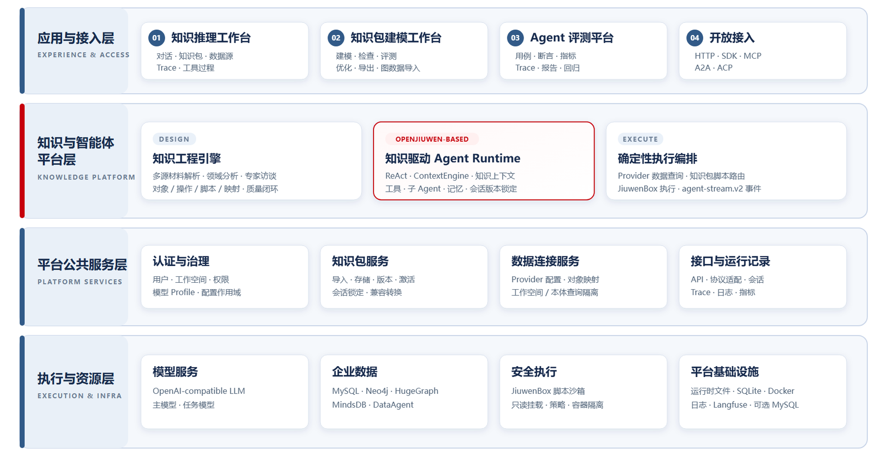

# knowledge-scaffold

`knowledge-scaffold` 是一个面向企业知识工程的 Agentic AI 平台。它把领域对象、业务规则、确定性脚本、数据映射和评测用例组织成可版本化的**知识包**，让智能体在明确的知识语义、数据边界和执行规则内完成问答、查询与计算。

平台解决的核心问题不是“让大模型记住更多内容”，而是减少企业场景中的术语误解、字段猜测、规则编造和数值错算：

- 领域概念、关系和操作由知识包定义；
- 业务对象通过映射连接真实企业数据；
- 复杂数值计算可由知识包中的 Python 脚本确定性执行；
- 推理过程保留知识读取、数据查询、工具调用和脚本执行记录；
- 知识包支持多版本共存，会话可以锁定创建时使用的知识版本。

> 当前仓库包含运行期应用、知识包建模工作台、统一鉴权和 Agent 评测。完整运行需要配置模型服务、认证参数和业务数据源，推荐在 Linux 或 WSL2 中使用 Docker Compose 部署。

## 为什么使用 knowledge-scaffold

通用大模型擅长语言理解和任务规划，但企业推理还需要可控的知识、数据与计算。knowledge-scaffold 将不同职责放到最适合的执行层：

| 企业场景中的问题 | knowledge-scaffold 的处理方式 |
| --- | --- |
| 模型不了解内部术语和对象关系 | 使用知识包中的对象、关系、别名和操作定义建立领域语义 |
| 模型猜测数据库表名或字段名 | 使用对象数据映射和独立 Provider 查询真实数据 |
| 多步数值计算容易漏算、错算 | 将计算交给知识包脚本，在 JiuwenBox 沙箱中执行 |
| 知识包升级影响已有推理 | 同一知识包多版本共存，会话锁定所使用的版本 |
| 推理过程难以定位问题 | 通过 SSE Trace、工具调用、脚本记录和评测结果追踪执行链路 |

## 核心组成

| 模块 | 目录 | 作用 |
| --- | --- | --- |
| 知识消费与推理 | [`consumer/`](consumer/) | React 控制台、Flask API、openJiuwen Agent Runtime、MCP、SDK 和部署脚本 |
| 知识包建模 | [`modeling/`](modeling/) | 从业务资料生成、检查、评测、优化和导出知识包，并支持 Neo4j 图数据导入 |
| 统一鉴权 | [`auth-server/`](auth-server/) | 独立 OAuth2/OIDC 子集服务，供 consumer 与 modeling 共用账号体系 |

## 核心能力

### 知识包建模与版本管理

- 资料上传与解析、领域分析、专家访谈、知识包生成、完善检查、评测、优化和导出；
- 支持 Excel、Markdown、TXT、DOCX 和 PDF 资料；
- 支持规则检查、语义检查、人工修订和对话式修缮；
- 支持同一知识包多个版本共存、激活版本切换和按版本查看内容；
- 已被会话引用的版本不能直接删除，避免历史会话失去执行语义；
- 支持旧知识包导入、对象别名和字段别名转换。

### 知识驱动的 Agent 推理

- Agent 主循环基于 `openjiuwen==0.1.14`，使用 ReAct 模式组织规划、工具调用和结果回写；
- openJiuwen ContextEngine 管理模型上下文窗口；
- 支持知识读取、业务数据查询、脚本执行、联网搜索、长期记忆和子 Agent 编排；
- 通过 `agent-stream.v2` SSE 协议输出回答、思考摘要、工具进度、子任务进度和最终状态；
- 明确选择知识包创建的会话会锁定当时的知识包版本，切换激活版本只影响新会话。

### 企业数据连接

业务数据源按 `workspace_id + ontology_id` 隔离配置。同一知识包的多个版本共享知识包级数据连接；版本锁定的是知识语义，不会复制业务数据。

| Provider | 用途 |
| --- | --- |
| `nl2sql_http` | 调用标准 NL2SQL HTTP 服务 |
| `nl2sql_template` | 优先使用知识包 SQL 模板，未命中时回退 NL2SQL 服务 |
| `mindsdb` | 调用 MindsDB Agent 或查询能力 |
| `dataagent` | 调用 DataAgent REST 服务 |
| `neo4j` | 查询 Neo4j 实体、关系和路径 |
| `hugegraph` | 查询 HugeGraph 图数据 |

### 安全执行、协议与可观测性

- 知识包脚本通过 `execute_script` 执行；默认 `legacy` 保持本地兼容，显式启用 `prefer` 后优先提交给独立 JiuwenBox 容器，并在不支持时审计后回落本地；
- JiuwenBox 使用只读运行时挂载、策略文件、Unix Domain Socket 和容器隔离约束脚本权限；
- MCP 服务作为独立进程运行，支持 Streamable HTTP 和 SSE；
- 后端提供 A2A 与 ACP 适配接口，复用同一套编排器和工作空间权限；
- 支持会话 Trace、工具调用明细、Speedscope 性能诊断和按工作空间配置的 Langfuse 观测。

## 典型场景

### 生产流程规划

生产流程场景可以覆盖批次计划、设备负荷、缓冲容量、产品产出、能耗、成本和经营指标评估。推理链路将模型擅长的理解与规划和确定性计算分开：

```text
批次计划结构化输入
  → 知识包操作路由
  → 业务数据源查询
  → JiuwenBox 确定性脚本计算
  → 负荷、容量和经营指标结论
```

### 工程变更影响分析

工程变更场景可以覆盖设计变更、物料映射、库存与供应、生产进度、成本和切换周期分析：

```text
变更单或物料问题
  → 知识包对象与字段映射
  → 企业数据查询
  → 变更影响、成本和周期分析
```

## 五分钟快速启动

### 前置条件

- Linux 或 WSL2；
- Git；
- Docker 20.10+；
- Docker Compose v2；
- 能够访问 GitCode，首次启动会拉取固定版本的 JiuwenSwarm/JiuwenBox 源码；
- 端口 `5055`、`7488` 和 `8888` 空闲。

### 启动完整运行时

```bash
git clone https://gitcode.com/knowledge-engine/knowledge-scaffold.git
cd knowledge-scaffold/consumer
cp backend/.env.example backend/.env
```

编辑 `consumer/backend/.env`，至少设置以下参数：

```dotenv
AUTH_SERVER_URL=http://auth-server:5056
AUTH_SERVER_ADMIN_TOKEN=<至少16个字符的独立随机值>
AUTH_BOOTSTRAP_ADMIN_PASSWORD=<首次启动使用的独立强密码>
MCP_TOKEN_SECRET=<至少32个字符、且与上项不同的随机值>
USER_MAX_COUNT=10
AUTH_USER_MAX_COUNT=10
```

启动服务：

```bash
export AUTH_USER_MAX_COUNT=10
./run_docker.sh latest all
```

`run_docker.sh` 会先构建固定提交的 JiuwenBox 镜像，再通过 Compose 启动 backend、frontend、auth-server、MCP 和 JiuwenBox。不要跳过该脚本直接执行 `docker compose up`，否则本地可能缺少 `onto-agent-jiuwenbox` 镜像。

| 服务 | 地址 |
| --- | --- |
| 控制台 | `http://localhost:8888` |
| Consumer API | `http://localhost:5055` |
| MCP 健康检查 | `http://localhost:7488/health` |

首次登录使用 `admin` 和你配置的 `AUTH_BOOTSTRAP_ADMIN_PASSWORD`，系统会要求立即修改密码。登录后进入“配置中心 → 全局配置 → 模型池”，添加 OpenAI-compatible 模型并设为默认模型。`users.json` 创建后可从环境中移除该初始密码。

### 首次完成一次推理

1. 创建或选择工作空间；
2. 在全局模型池添加模型，并为工作空间选择模型 Profile；
3. 在知识包工作台导入 `.zip` 知识包；
4. 为知识包配置数据源并执行连接测试；
5. 新建对话并选择知识包，然后发送问题；
6. 在对话右侧查看知识读取、数据查询、工具调用和脚本执行过程。

### 可选：启动知识包建模工作台

consumer 启动完成后，在仓库根目录执行：

```bash
docker compose -p mw-modeling \
  -f deploy/docker-compose.modeling.yml \
  --project-directory deploy \
  up -d --build
```

访问 `http://localhost:5100`。详细配置与工作流见 [modeling/README.md](modeling/README.md)。

## 系统架构

[](docs/images/knowledge-scaffold-system-architecture.svg)

各层职责如下：

| 层次 | 核心职责 | 主要实现 |
| --- | --- | --- |
| 应用与接入层 | 面向使用者、建模人员、评测人员和外部系统提供入口 | Consumer 控制台、Modeling 工作台、Agent Eval、HTTP/SDK/MCP/A2A/ACP |
| 知识与智能体平台层 | 完成知识包生产、知识增强推理和任务执行编排 | Modeling 知识工程引擎、openJiuwen ReAct Runtime、ContextEngine、工具与子 Agent |
| 平台公共服务层 | 提供跨应用复用的身份、工作空间、知识包、数据连接、协议和记录服务 | auth-server、Consumer API、知识包版本服务、Provider 管理、Trace 与评测记录 |
| 执行与资源层 | 提供模型、企业数据、安全计算、持久化和运行基础设施 | 模型服务、Neo4j/MySQL/HugeGraph 等数据源、JiuwenBox、SQLite、Docker、Langfuse |

## 知识包结构与版本语义

当前运行时知识包使用 `kind: ontology-package`、`schema_version: 0.1`：

```text
<knowledge-package>/
├── manifest.yaml                   # ID、名称、版本、语言和启用状态
├── index.md                        # 知识包总入口
├── objects/                        # 业务对象、属性、别名和数据语义
├── operations/                     # 业务流程、计算规则和工具路由
├── scripts/                        # 确定性脚本及调用说明
└── mappings/
    └── object-data-mappings.json   # 对象属性到真实数据字段的映射
```

导入后，同一知识包的版本存放在工作空间运行时中：

```text
.onto-runtime/workspaces/<workspace_id>/ontologies/<ontology_id>/
├── manifest.yaml                   # active_version 与版本清单
└── versions/
    ├── 1.0.0/
    └── 1.1.0/
```

明确选择知识包创建的会话会锁定当时的版本。后续切换激活版本只影响新会话；已有会话继续使用原版本，以保证上下文和执行结果一致。完整格式见 [知识包上传模板](consumer/docs/ontology-upload-template.md) 和 [知识包最终设计](consumer/docs/ontology-package-final-design.md)。

## 仓库结构

```text
.
├── consumer/                 # 运行期主应用、MCP、SDK、沙箱与发布脚本
│   ├── backend/              # Flask API、openJiuwen Runtime、工具与测试
│   ├── frontend/             # React + Vite 控制台
│   ├── deploy/               # 发布、升级、备份和回滚
│   └── sdk/                  # Python / TypeScript SDK
├── modeling/                 # Fastify + React + SQLite 知识包建模工作台
├── auth-server/              # 独立认证与用户服务
├── common/                   # 跨模块轻量公共代码
├── deploy/                   # 全栈构建与发布入口
└── docs/                     # 仓库级设计与说明文档
```

## 开发与验证

各模块使用独立依赖和测试命令。完成依赖安装后，按修改范围执行：

```bash
# consumer backend
cd consumer/backend
PYTHONPATH=. python -m pytest tests

# consumer frontend
cd consumer/frontend
npm run lint
npm test
npm run build

# modeling
cd modeling
npm run typecheck
npm test
npm run build
cd frontend && npm run build

# auth-server
cd auth-server
python -m pytest tests -q
```

模块的环境准备、本地启动和测试依赖以各自 README 为准。

## 文档导航

| 文档 | 内容 |
| --- | --- |
| [consumer/README.md](consumer/README.md) | Consumer 运行时、工具、配置和目录结构 |
| [consumer/backend/README-CN.md](consumer/backend/README-CN.md) | 后端模块与环境变量参考 |
| [consumer/frontend/README.md](consumer/frontend/README.md) | 前端架构、开发和验证 |
| [consumer/docs/api.md](consumer/docs/api.md) | HTTP API、SSE、A2A 和 ACP 接口 |
| [consumer/docs/consumer-agent-specs.md](consumer/docs/consumer-agent-specs.md) | Agent 规格、限制和运行约束 |
| [consumer/docs/business-data-provider-extension.md](consumer/docs/business-data-provider-extension.md) | 自定义业务数据 Provider |
| [consumer/docs/jiuwenbox-sandbox-design.md](consumer/docs/jiuwenbox-sandbox-design.md) | JiuwenBox 脚本沙箱设计 |
| [consumer/deploy/README.md](consumer/deploy/README.md) | 部署、升级、迁移、备份和回滚 |
| [modeling/README.md](modeling/README.md) | 建模工作台运行方式和接口 |
| [modeling/docs/design.md](modeling/docs/design.md) | 建模工作流、数据模型和评测闭环 |
| [auth-server/README.md](auth-server/README.md) | 鉴权端点、配置和数据目录 |

## 参与贡献

提交 Issue 前，请先搜索是否已有相同问题，并按照仓库模板提供：

- 问题描述；
- 现状与证据；
- 影响；
- 期望行为；
- 范围与非目标；
- 验收标准；
- 关联与依赖。

提交 Pull Request 时请保持改动聚焦，并在说明中写清目标、实现方式、实际执行的验证命令、兼容性或迁移影响以及关联 Issue。不要提交真实密钥、客户数据、运行时数据库、日志或构建产物。

常用提交类型为 `feat:`、`fix:`、`docs:`、`test:` 和 `refactor:`。涉及特定模块时，可以在说明中标明 `consumer`、`modeling` 或 `auth-server`。

- [提交 Issue](https://gitcode.com/knowledge-engine/knowledge-scaffold/issues)
- [查看 Pull Request](https://gitcode.com/knowledge-engine/knowledge-scaffold/pulls)

## 安全问题

请勿在公开 Issue 中粘贴访问令牌、密码、利用细节、客户数据或生产日志。如果问题可能导致认证或授权绕过、跨工作空间数据访问、密钥泄漏、注入、沙箱逃逸或敏感信息暴露，请只提交不包含敏感细节的 `[P0][安全]` 影响摘要，并请求维护者建立私密沟通渠道。

普通功能缺陷和不涉及安全影响的性能问题继续使用 GitCode Issue。

## 版本与变更

- 日常开发与集成以 `develop` 分支为基础；
- 发布包由仓库部署脚本构建，生产部署、升级和回滚见 [consumer/deploy/README.md](consumer/deploy/README.md)；
- 用户可感知的行为变化、配置迁移和兼容性影响应记录在对应 Pull Request 中；
- 版本演进可通过 [提交历史](https://gitcode.com/knowledge-engine/knowledge-scaffold/commits/develop) 和 [Pull Request](https://gitcode.com/knowledge-engine/knowledge-scaffold/pulls) 查询。
