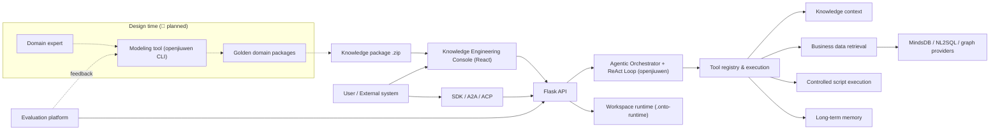

<div align="right">

English | [简体中文](./docs/README_zh-CN.md)

</div>

# 🔬 What is Meta Wise

**Meta Wise** is an Agentic AI platform for enterprise knowledge engineering. It addresses the typical failure modes of general-purpose LLMs in enterprise settings — unfamiliar domain terminology, invented calculation rules, fabricated data fields — with an engineering approach: a business domain's objects, operations, calculation semantics, and data mappings are distilled into a structured **knowledge package** and bound to real enterprise data sources. Agents then answer according to the semantics defined in the package and query real data through the mappings: **every result is traceable, nothing is fabricated by the model.**

The platform follows a three-part split: **design time builds the model** (distill domain knowledge into packages, `modeling/`, planned), **runtime uses the model** (agents serve on top of the packages, `consumer/`, the current core), and **the platform does the wiring** (models, data, and tools). The main application lives under `consumer/`: the Knowledge Engineering Console (React), the Flask backend, the workspace runtime, and an agent evaluation platform. The agent main loop is built on the open-source agent framework **openjiuwen**.

## Application Scenarios

Meta Wise targets scenarios where answers must follow **domain semantics and established calculation rules** rather than free-form model output:


Each scenario ships as an importable knowledge package (ZIP) with sample datasets and test cases.

## Core Features

> ✅ available today · 🚧 planned / in design

- ✅ **Knowledge-package-driven agents**
    + Importing a package equips the agent with the domain's business objects, operations, query boundaries, and controlled scripts.
    + Package contents are browsable online in the console (objects / operations / scripts / mappings, rendered as Markdown).
- ✅ **Unified business data access**
    + Business objects map to real tables and fields via `mappings/object-data-mappings.json`; queries never guess table or column names.
    + Pluggable data providers: NL2SQL HTTP, NL2SQL template, MindsDB, DataAgent, Neo4j, HugeGraph — bound per workspace.
- ✅ **Multi-agent orchestration**
    + A ReAct main loop drives model reasoning, tool invocation, result write-back, and termination; complex tasks fan out to concurrent sub-agents and merge back.
    + Full SSE streaming (`agent-stream.v2`): model reasoning, tool calls, and sub-task progress render live, backed by a Trace panel.
- ✅ **Long-term memory and knowledge evolution**
    + User-level memory injection and explicit memory capture; agents file operation-evolution proposals at runtime, **applied only after human review**.
- ✅ **Layered configuration and access control**
    + Three scopes: Global (model pool, web search, observability, agent limits) → Workspace (data connections, knowledge-data binding, runtime parameters) → Personal (preferences, themes).
    + API keys live only in the global scope; workspaces reference model profiles without ever touching keys.
- ✅ **Protocols and SDK**
    + A2A and ACP adapter layers plus an SDK expose the same runtime capabilities to external systems.
- ✅ **Evaluation platform**
    + `evaluation/agent_eval/` evaluates agent quality against scenario test cases: evaluation runs, trace replay, capability inventories, test-case generation.
- 🚧 **Knowledge modeling (design time, planned)**
    + **Knowledge-package modeling tool**: an expert-facing interactive CLI built on openjiuwen that structures domain expertise into knowledge packages through interview-style dialogue, lowering the barrier of hand-authoring.
    + **Golden domain packages**: expert-curated, benchmark-quality packages serving both as warm-start templates for new domains and as golden references for tuning the modeling pipeline.
    + **Modeling–evaluation loop**: modeling output is validated by the evaluation platform and iterated on its feedback, closing the model–evaluate–optimize cycle.
    + The `modeling/` directory currently holds the capability boundary as scaffolding (bindings / frontend / ontology / operations); the capabilities above land within it incrementally.

## System Architecture



A typical request enters the Flask API from the console or a protocol adapter; the `AgenticOrchestrator` creates the run state and the ReAct loop calls the model, triggering tools on demand. Tools read knowledge context, query business data, execute controlled scripts, or spawn sub-agents; results stream back to the frontend as SSE events. The dashed portion is the planned design-time modeling loop: experts produce packages through the modeling tool, and evaluation feedback drives continuous package iteration.

- **Console** (runtime): login, masked onboarding tour, New Chat (with a Trace panel), Knowledge Package Workbench (browse full package directories online), and the three-scope Configuration Center.
- **Orchestrator / ReAct loop** (runtime): run lifecycle, iteration limits, cancellation, usage accounting.
- **Workspace runtime**: packages, connections, sessions, and configuration isolated per workspace under `.onto-runtime/`.
- **Evaluation platform**: offline agent-quality evaluation on scenario test cases; planned to also provide feedback for the modeling loop (🚧).
- **Knowledge modeling** (design time, 🚧 planned): build knowledge packages from domain material and expert interviews, warm-started from golden domain packages.

# 📦 Installation

## Quick start with Docker Compose

For users who want the complete system (backend + console UI):

```bash
cd consumer
cp backend/.env.example backend/.env
cp frontend/.env.example frontend/.env
docker compose up --build
```

Default endpoints:

| Service | Address |
| --- | --- |
| Backend API | `http://localhost:5055` |
| Console UI | `http://localhost:8888` |

Before starting, configure at least one OpenAI-compatible model in `consumer/backend/.env`:

```bash
LLM_BASE_URL=<openai-compatible-base-url>
LLM_MODEL=<model-id>
LLM_API_KEY=<api-key>
```

## Local development setup

Backend:

```bash
cd consumer/backend
python -m venv venv
source venv/bin/activate
pip install -r requirements.txt
cp .env.example .env
python run.py
```

Frontend:

```bash
cd consumer/frontend
npm install
npm run dev
```

Local development defaults:

| Service | Address |
| --- | --- |
| Backend API | `http://localhost:5055` |
| Frontend dev server | `http://localhost:6600` |

On Windows, if Python dependency paths exceed the length limit, enable long-path support first; see [consumer/README.md](consumer/README.md).

# 🚀 Quick Start

1. **Log in** — a first-time admin account is created on startup and must change its password at first login. A masked onboarding tour walks through the setup path (skippable, reopenable from the top bar).
2. **Configure models** — Configuration Center → Global → Model Pool: add model profiles (keys stored encrypted, global scope only) and pick a default.
3. **Connect data** — Configuration Center → Workspace → Data Connections: create a connection with the schema form, then test it.
4. **Import a knowledge package** — Knowledge Package Workbench → Import (.zip). Ready-to-import examples live under [examples/](examples/).
5. **Bind knowledge to data** — Configuration Center → Workspace → Knowledge & Data Binding: map the package to a connection. Queries only use connections bound in the current workspace.
6. **Ask** — start a New Chat and try the package's typical questions, e.g. *"Which SourceItem versions does TargetItem M-3021 map to?"*; tool-call details for each step are available in the Trace panel on the right.

**_Notes:_**

* **_Use a reasonably capable OpenAI-compatible model; weak models may degrade tool-calling stability and answer quality._**
* **_Reasoning-heavy models produce better analyses but increase latency; prefer non-thinking models when response speed matters._**

# 💻 Development Guide

Repository layout:

```text
.
├── consumer/                 # Runtime main app: backend, frontend, deploy scripts, SDK, app docs
├── modeling/                 # Design-time knowledge modeling boundary (🚧 planned, scaffolding today)
├── common/                   # Lightweight shared code across modules
├── evaluation/agent_eval/    # Agent evaluation platform
├── examples/                 # Scenario cases, knowledge packages, sample scripts
├── docs/                     # Repository-level docs (translated READMEs, etc.)
├── tests/                    # Repository-level test entry
└── .onto-runtime/            # Local runtime workspace (not committed)
```

Verification:

```bash
# Backend tests
cd consumer/backend
PYTHONPATH=. python -m pytest tests

# Frontend checks
cd consumer/frontend
npm run lint
npm run build
```

Build and deploy:

```bash
cd consumer
./build.sh latest
./run_docker.sh latest all
```

Documentation map:

| Document | Content |
| --- | --- |
| [consumer/README.md](consumer/README.md) | Full startup, runtime directory, configuration and architecture guide |
| [consumer/backend/README-CN.md](consumer/backend/README-CN.md) | Backend modules, API entries, runtime config and tests |
| [consumer/frontend/README.md](consumer/frontend/README.md) | Frontend pages, dev commands, run flow and verification |
| [consumer/docs/api.md](consumer/docs/api.md) | HTTP API and event stream reference |
| [consumer/docs/consumer-agent-specs.md](consumer/docs/consumer-agent-specs.md) | Agent runtime specs and behavior constraints |
| [consumer/docs/business-data-provider-extension.md](consumer/docs/business-data-provider-extension.md) | How to extend business data providers |
| [consumer/sdk/README.md](consumer/sdk/README.md) | SDK layout and publishing |
| [consumer/deploy/README.md](consumer/deploy/README.md) | Image building, deployment packages and installation |
| [evaluation/agent_eval/docs/architecture.md](evaluation/agent_eval/docs/architecture.md) | Evaluation platform architecture |

# ❓ FAQ

- **The console starts but chat replies fail** — check that a model profile is configured and reachable (Configuration Center → Global → Model Pool → Test), and that `LLM_*` variables are set when starting from `.env`.
- **Business data queries return nothing** — packages only query connections bound in the *current workspace*; verify the binding under Configuration Center → Workspace → Knowledge & Data Binding.
- **Windows dependency install fails with path errors** — enable long-path support; see [consumer/README.md](consumer/README.md).

# 🤝 Contributing

Issues and pull requests are welcome, especially around:

- Knowledge package format, import validation, and example cases
- Business data providers, graph providers, and tool extensions
- Agent loop, sub-agent orchestration, memory and evolution strategies
- Knowledge modeling toolchain and golden domain packages (🚧 co-build)
- Evaluation platform, test-case generation, trace replay and quality metrics
- Documentation, deploy scripts, and developer experience

Keep changes focused, and describe verification steps, blast radius, and compatibility implications in your PR.
