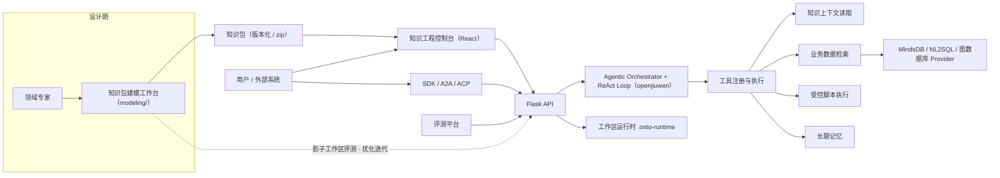

<div align="right">

[English](./docs/README_en-US.md) | 简体中文

</div>

# 🔬 什么是 Meta Wise

**Meta Wise** 是一个面向企业知识工程的 Agentic AI 平台。它针对通用大模型在企业场景中的典型问题——不掌握领域术语、自行虚构指标口径与数据字段——给出工程化解法：将业务领域的对象、操作、计算口径与数据映射沉淀为结构化的**知识包**，并与企业真实数据源绑定。此后智能体基于知识包定义的语义作答、经映射查询真实数据，**输出结果可溯源，不由模型虚构**。

平台按三层分工组织：**设计期造模型**（知识包建模工作台把领域经验结构化为知识包，`modeling/`）、**运行期用模型**（智能体基于知识包提供服务，`consumer/`）、**平台做接线**（连接模型、数据与工具）。运行期主应用位于 `consumer/`：知识工程控制台（React）、Flask 后端、工作区运行时与智能体评测平台，Agent 主循环基于开源 agent 框架 **openjiuwen** 构建；设计期建模工作台位于 `modeling/`，与 consumer 打通「建模 → 评测 → 优化」闭环。

## 应用场景

Meta Wise 面向的是回答必须遵循**领域语义与既定计算口径**、而非模型自由生成的场景：


每个场景均附带知识包源文件（明文目录）、示例数据集与测试用例，打包为 zip 后即可导入 consumer 使用；也可以用建模工作台从自己的领域资料从零构建知识包。

## 核心特性

> ✅ 当前版本可用 · 🚧 规划/建设中

- ✅ **知识包驱动的智能体**
    + 导入知识包后，智能体即获得该领域的业务对象、操作、查询边界与受控脚本。
    + 知识包内容可在控制台在线浏览（objects / operations / scripts / mappings，Markdown 渲染）。
- ✅ **统一业务数据入口**
    + 业务对象经 `mappings/object-data-mappings.json` 映射到真实数据源的表与字段，查询不推测表名或字段。
    + 可插拔 provider：NL2SQL HTTP、NL2SQL 模板、MindsDB、DataAgent、Neo4j、HugeGraph，按工作区绑定。
- ✅ **多 Agent 编排**
    + ReAct 主循环组织模型推理、工具调用、结果写回与终止判断；复杂任务可拆分为独立子任务并发 fan-out/fan-in 后汇总。
    + 全程 SSE 流式输出（`agent-stream.v2`）：模型思考、工具调用、子任务进度实时呈现，配套 Trace 运行轨迹面板。
- ✅ **长期记忆与知识演化**
    + 用户级记忆注入与显式记忆沉淀；智能体在运行中提出知识操作演化建议，**经人工评审通过后方可落库**。
- ✅ **分层配置与访问控制**
    + 三层配置作用域：**全局**（模型池、联网搜索、观测、Agent 限额）→ **工作空间**（数据连接、知识与数据绑定、运行参数）→ **个人**（偏好、主题）。
    + 模型密钥仅存全局层；工作空间只引用模型 profile，不接触 API Key。
    + 可选接入独立鉴权服务（`auth-server/`，OAuth2/OIDC 子集）：默认内置认证零配置可用，设 `AUTH_MODE=remote` 即切换到解耦鉴权，支持开放注册与邮箱验证。
- ✅ **协议与 SDK 扩展**
    + A2A、ACP 适配层与 SDK，外部系统可集成同一套运行能力。
- ✅ **评测平台**
    + `evaluation/agent_eval/` 基于场景测试用例评测智能体质量：评测执行、trace 回放、能力清单与用例生成。
- ✅ **知识包建模工作台（设计期）**
    + 面向领域专家的 Web 建模工具（`modeling/`，Fastify + React + SQLite）：上传 Excel 数据表与业务文档，沿固定主干流程完成一次建模——**项目创建 → 资料上传与解析 → 领域分析 → 知识萃取访谈 → 知识包生成 → 知识包完善 → 评测用例录入 → 评测运行 → 优化建议与应用**。
    + **访谈式知识萃取**：系统解读资料产出领域概览、候选业务对象与「领域问题」（知识包建成后必须能答对的业务问题），再像顾问一样分批向专家提问，确认对象划分、字段含义与计算口径，回答沉淀为建模依据。
    + **知识包完善**：知识包体检（规则引擎 + 语义检查双层，发现口径冲突、兜底缺失、路由重复等问题）；文件可直接人工修订（修订稿优先生效）；修缮对话支持用自然语言改包——先给影响分析，确认后才落新版本。
    + **建模—评测闭环**：知识包经 API 导入 consumer 的影子工作区实测运行评测用例，LLM Judge 判分并支持人工改判；优化器按未通过用例生成结构化改进建议，勾选采纳一键生成新版本（`1.N.0` 递增）再回评验证，逐版本可导出 zip 交付。
    + **演示模式**：LLM 端点填 `faux` 即可无 API Key 全流程试玩建模。
- 🚧 **领域知识包（golden）沉淀**
    + 经专家沉淀、达到标杆质量的知识包，兼作新领域建模的热启动模板与建模调优的标准答案。

## 系统架构



一次典型请求：从控制台或协议入口进入 Flask API，由 `AgenticOrchestrator` 创建运行状态，ReAct Loop 调用模型并按需触发工具；工具侧读取知识上下文、查询业务数据、执行受控脚本或派生子 Agent，结果经 SSE 事件流实时返回前端。图中虚线为建模评测闭环：建模工作台把知识包导入 consumer 影子工作区实测评分，评测结果驱动知识包持续迭代。

- **控制台**（运行期）：登录、蒙版式新手引导、新建对话（含 Trace 运行轨迹面板）、知识包工作台（整包目录在线浏览）、三层作用域配置中心。
- **编排器 / ReAct 循环**（运行期）：运行生命周期、轮次限额、取消与用量统计。
- **工作区运行时**：知识包、数据连接、会话与运行配置在 `.onto-runtime/` 下按工作区隔离。
- **评测平台**：基于场景测试用例离线评测智能体质量。
- **知识包建模工作台**（设计期）：从领域资料与专家访谈构建知识包，与 consumer 打通评测闭环；登录复用 consumer 账号（modeling → consumer → 可选 auth-server）。
- **鉴权服务**（可选）：`auth-server/` 提供独立的身份与 token 签发（OAuth2/OIDC 子集），consumer 以 `AUTH_MODE=remote` 对接；默认不启用，内置认证行为不变。

# 📦 安装指导

## 使用 Docker Compose 快速安装

适用于希望直接使用运行期完整系统（后端 + 控制台界面）的用户：

```bash
cd consumer
cp backend/.env.example backend/.env
docker compose up --build
```

默认服务地址：

| 服务 | 地址 |
| --- | --- |
| 后端 API | `http://localhost:5055` |
| 前端控制台 | `http://localhost:8888` |

启动前至少需要在 `consumer/backend/.env` 中配置一个 OpenAI-compatible 模型（也可以启动后在控制台的 配置中心 → 全局配置 → 模型池 中配置）：

```bash
LLM_BASE_URL=<openai-compatible-base-url>
LLM_MODEL=<model-id>
LLM_API_KEY=<api-key>
```

全栈部署（consumer + 建模工作台 + 可选鉴权/评测库）的完整步骤与一键脚本见 [deploy/README.md](deploy/README.md)。

## 启动知识包建模工作台

建模工作台依赖 consumer 提供登录（复用 consumer 账号），请先启动 consumer。需要 Node ≥ 22：

```bash
cd modeling
cp .env.example .env    # MODELING_LLM_* 填模型端点；或填 faux 进入无 Key 演示模式
npm install
NODE_OPTIONS=--experimental-sqlite node --env-file=.env node_modules/.bin/tsx src/server.ts
```

启动后访问 `http://localhost:5100`，用 consumer 的账号登录。前端本地开发另起 `cd modeling/frontend && npm install && npm run dev`（端口 6700，代理到 5100）。

## 本地开发安装

后端：

```bash
cd consumer/backend
python -m venv venv
source venv/bin/activate
pip install -r requirements.txt
cp .env.example .env
python run.py
```

前端：

```bash
cd consumer/frontend
npm install
npm run dev
```

本地开发默认地址：

| 服务 | 地址 |
| --- | --- |
| 后端 API | `http://localhost:5055` |
| 前端开发服务 | `http://localhost:6600` |

Windows 用户如果遇到 Python 依赖安装路径过长，可以先启用系统长路径支持；详见 [consumer/README.md](consumer/README.md)。

# 🚀 快速上手

## 使用知识包（运行期）

1. **登录** — 首次启动会创建管理员账号，首次登录需修改初始密码。登录后的蒙版式操作向导会一步步带你完成初始化（可跳过，顶栏可随时重新打开）。
2. **配置模型** — 配置中心 → 全局配置 → 模型池：添加模型（密钥加密存储、仅存全局层）并设置默认。
3. **连接数据** — 配置中心 → 工作空间 → 数据连接：按表单新建业务数据库连接并测试连通性。
4. **导入知识包** — 知识包工作台 → 导入（.zip）。示例知识包源文件见 [examples/](examples/)，打包为 .zip 后导入。
5. **知识与数据绑定** — 配置中心 → 工作空间 → 知识与数据绑定：把知识包和数据连接对应起来。业务数据查询只会使用当前工作区下已绑定的连接。
6. **提问** — 新建对话，尝试知识包的典型问题，例如"TargetItem M-3021 对应哪些 SourceItem 版本？"，并可在右侧 Trace 面板查看每一步工具调用明细。

## 构建知识包（设计期）

1. **配置建模工具** — 打开 `http://localhost:5100` 登录后，右上角「⚙ 配置中心」配置大模型（可一键测试有效性）、consumer 服务地址与评测数据；试玩可直接把 LLM Base URL 填 `faux`。
2. **新建建模项目并上传资料** — Excel 数据表（每个 sheet 一张表、首行字段名、次行可选中文注释）加业务文档（md / docx / pdf / txt）。
3. **领域分析与知识萃取访谈** — 系统解读资料产出领域概览、候选业务对象与领域问题（勾选 ≥5 条解锁访谈），再分批向你提问确认对象划分、字段含义与口径。
4. **生成并完善知识包** — 自动生成对象/操作/映射并检查领域问题覆盖；用知识包体检、人工修订和修缮对话打磨内容。
5. **评测与优化** — 录入评测用例（可从领域问题一键预填），在 consumer 影子工作区实测评分；按优化建议一键生成新版本回评，满意后导出 zip 交付。

**_注意：_**

* **_请使用能力较强的 OpenAI-compatible 模型；模型能力不足可能影响工具调用稳定性与回答质量。_**
* **_思考类模型分析质量更好但耗时明显增加；对响应速度有要求时建议优先使用非思考模型。_**

# 💻 开发指南

仓库结构：

```text
.
├── consumer/                 # 运行期主应用：后端、前端、部署脚本、SDK 和应用文档
├── modeling/                 # 设计期知识包建模工作台（Fastify + React + SQLite）
├── auth-server/              # 可选独立鉴权服务（OAuth2/OIDC 子集，opt-in）
├── common/                   # 跨模块共享的轻量公共代码
├── evaluation/agent_eval/    # 智能体评测平台
├── examples/                 # 场景案例、知识包和示例脚本
├── deploy/                   # 全栈部署文档与编排脚本
└── docs/                     # 仓库级文档（多语言 README 等）
```

开发验证：

```bash
# consumer 后端测试
cd consumer/backend
pip install pytest   # requirements.txt 不含测试依赖
PYTHONPATH=. python -m pytest tests

# consumer 前端验证
cd consumer/frontend
npm run lint
npm run build

# modeling 类型检查与构建
cd modeling
npm run typecheck && npm run build
cd frontend && npm run build
```

构建与部署（两条独立路径）：

```bash
# 路径一：源码 compose 启动（开发/体验）
cd consumer
./run_docker.sh latest all

# 路径二：构建离线发布包（生产交付，含 deploy/upgrade/rollback 脚本）
cd consumer
./build.sh <version>
```

全栈部署（含建模工作台）见 [deploy/README.md](deploy/README.md)，consumer 发布包细节见 [consumer/deploy/README.md](consumer/deploy/README.md)。

文档地图：

| 文档 | 内容 |
| --- | --- |
| [deploy/README.md](deploy/README.md) | 全栈部署手册与一键编排脚本（适合自动化执行） |
| [consumer/README.md](consumer/README.md) | 主应用完整启动、运行时目录、配置和架构说明 |
| [consumer/backend/README-CN.md](consumer/backend/README-CN.md) | 后端模块、接口入口、运行配置和测试方式 |
| [consumer/frontend/README.md](consumer/frontend/README.md) | 前端页面、开发命令、运行流和验证命令 |
| [consumer/docs/api.md](consumer/docs/api.md) | HTTP API 与事件接口说明 |
| [consumer/docs/consumer-agent-specs.md](consumer/docs/consumer-agent-specs.md) | Agent 运行规格和行为约束 |
| [consumer/docs/business-data-provider-extension.md](consumer/docs/business-data-provider-extension.md) | 业务数据 provider 扩展方式 |
| [consumer/sdk/README.md](consumer/sdk/README.md) | SDK 目录与发布说明 |
| [consumer/deploy/README.md](consumer/deploy/README.md) | consumer 镜像构建、发布包和安装说明 |
| [modeling/README.md](modeling/README.md) | 建模工作台启动、验证与 API 说明 |
| [modeling/docs/design.md](modeling/docs/design.md) | 建模工具设计定稿：定位、工作流、数据模型与评测闭环 |
| [modeling/docs/real-e2e-setup.md](modeling/docs/real-e2e-setup.md) | 建模—评测真实端到端环境搭建 |
| [auth-server/README.md](auth-server/README.md) | 独立鉴权服务：端点、配置与运行方式 |
| [evaluation/agent_eval/docs/architecture.md](evaluation/agent_eval/docs/architecture.md) | 评测平台架构说明 |

# ❓ FAQ

- **控制台能打开但对话失败** — 检查模型是否已配置（配置中心 → 全局配置 → 模型池：确认已添加模型、密钥显示"已配置"且默认模型已选），以及通过 `.env` 启动时 `LLM_*` 变量是否设置。
- **业务数据查询没有结果** — 知识包只会查询*当前工作区*已绑定的连接；到 配置中心 → 工作空间 → 知识与数据绑定 核对绑定关系。
- **建模工作台登录失败** — 建模工具的登录经 consumer 转发（`AUTH_ISSUER_URL`），确认 consumer 已启动且地址配置正确；账号就是 consumer 的账号。
- **建模评测一直失败** — 到建模工具 配置中心 → consumer 服务 做连通性测试（服务可达 / 认证通过 / 模型就绪三项都要绿）；查询类用例还需要配置评测数据连接。
- **Windows 安装依赖报路径错误** — 启用系统长路径支持，详见 [consumer/README.md](consumer/README.md)。

# 🤝 贡献方式

欢迎围绕以下方向提交 Issue 和 Pull Request：

- 知识包格式、导入校验和示例案例
- 业务数据 provider、图数据库 provider 和工具扩展
- Agent Loop、子智能体编排、记忆与演化策略
- 知识建模工作台、建模评测闭环与领域知识包沉淀
- 评测平台、用例生成、trace 回放和质量指标
- 文档、部署脚本和开发体验改进

提交前请保持改动聚焦，并在 PR 中说明验证方式、影响范围和可能的兼容性变化。
