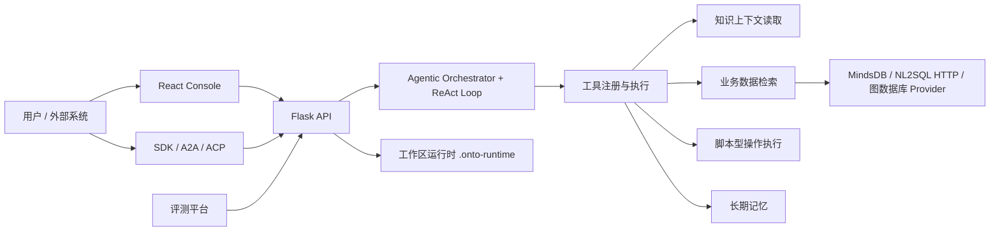

# Meta Wise

Meta Wise 是一个面向企业知识工程的 Agentic AI 平台。它把知识包、业务数据连接、工具调用、长期记忆和多 Agent 编排放在同一个运行时里，让智能体能够围绕企业知识完成查询、分析、计划拆解、脚本执行和结果汇总。

当前仓库以 `consumer/` 为主应用入口，包含 React 控制台、Flask 后端、OpenAI-compatible LLM 接入、工作区运行时、知识包管理、业务数据检索和评测平台。

## 核心能力

- **知识驱动的 Agent Loop**：基于 ReAct 流程组织模型推理、工具调用、结果写回和终止判断。
- **知识包管理**：支持上传知识包，读取知识对象、知识操作、规则、脚本和技能说明。
- **统一业务数据入口**：通过 `business_data_search` 对接 MindsDB、NL2SQL HTTP 等数据 provider，并按工作区绑定连接。
- **工具与脚本执行**：提供工具注册、工具批处理、脚本型操作直执行和执行结果追踪。
- **多 Agent 编排**：支持主 Agent 拆分独立子任务，并发 fan-out/fan-in，再统一汇总。
- **长期记忆与演化**：支持用户级记忆注入、显式记忆沉淀，以及知识操作演化建议。
- **协议与 SDK 扩展**：提供 A2A、ACP 适配层和 SDK，便于外部系统集成同一套运行能力。
- **评测平台**：`evaluation/agent_eval/` 沉淀智能体评测、trace、能力清单和用例生成相关能力。

## 架构速览



一次典型请求会从前端或协议入口进入 Flask API，由 `AgenticOrchestrator` 创建运行状态，ReAct Loop 调用模型并按需触发工具。工具侧会读取知识上下文、查询业务数据、执行脚本或派生子 Agent，最终通过 SSE 事件流返回给前端。

## 快速开始

### 使用 Docker Compose

```bash
cd consumer
cp backend/.env.example backend/.env
cp frontend/.env.example frontend/.env
docker compose up --build
```

默认服务地址：

| 服务 | 地址 |
| --- | --- |
| 后端 API | `http://localhost:5055` |
| 前端控制台 | `http://localhost:8888` |

启动前至少需要在 `consumer/backend/.env` 中配置一个 OpenAI-compatible 模型：

```bash
LLM_BASE_URL=<openai-compatible-base-url>
LLM_MODEL=<model-id>
LLM_API_KEY=<api-key>
```

### 本地开发

后端：

```bash
cd consumer/backend
python -m venv venv
source venv/bin/activate
pip install -r requirements.txt
cp .env.example .env
python run.py
```

前端：

```bash
cd consumer/frontend
npm install
npm run dev
```

本地开发默认地址：

| 服务 | 地址 |
| --- | --- |
| 后端 API | `http://localhost:5055` |
| 前端开发服务 | `http://localhost:6600` |

Windows 用户如果遇到 Python 依赖安装路径过长，可以先启用系统长路径支持；详细说明见 [consumer/README.md](consumer/README.md)。

## 示例

仓库提供可复用的场景数据和知识包示例：

| 目录 | 说明 |
| --- | --- |
| [examples/](examples/) | 可直接导入的知识包 ZIP、场景数据和示例脚本 |
| [examples/scripts/](examples/scripts/) | 示例运行脚本 |

导入知识包后，需要在前端控制台中进入对应工作区，完成数据连接创建和知识绑定。业务数据查询只会使用当前工作区下已绑定的连接。

## 仓库结构

```text
.
├── consumer/                 # 主应用：后端、前端、部署脚本、SDK 和应用文档
├── common/                   # 跨模块共享的轻量公共代码
├── modeling/                 # 知识建模边界，承载后续建模能力
├── evaluation/agent_eval/    # 智能体评测平台
├── examples/                 # 场景案例、知识包和示例脚本
├── tests/                    # 仓库级测试入口
├── logs/                     # 本地日志输出目录
└── .onto-runtime/            # 本地运行时工作区，默认不提交
```

`consumer/.onto-runtime/` 是主应用默认运行时根目录，用于保存系统配置、用户文件、工作区、知识包、技能和运行产物。容器部署时会映射到 `/app/.onto-runtime`。

## 文档地图

| 文档 | 内容 |
| --- | --- |
| [consumer/README.md](consumer/README.md) | 主应用完整启动、运行时目录、配置和架构说明 |
| [consumer/backend/README-CN.md](consumer/backend/README-CN.md) | 后端模块、接口入口、运行配置和测试方式 |
| [consumer/frontend/README.md](consumer/frontend/README.md) | 前端页面、开发命令、运行流和验证命令 |
| [consumer/docs/api.md](consumer/docs/api.md) | HTTP API 与事件接口说明 |
| [consumer/docs/consumer-agent-specs.md](consumer/docs/consumer-agent-specs.md) | Agent 运行规格和行为约束 |
| [consumer/docs/business-data-provider-extension.md](consumer/docs/business-data-provider-extension.md) | 业务数据 provider 扩展方式 |
| [consumer/docs/nl2sql-template-provider.md](consumer/docs/nl2sql-template-provider.md) | NL2SQL 模板 provider 使用说明 |
| [consumer/docs/](consumer/docs/) | API、运行规格、知识包上传模板和 provider 扩展文档 |
| [consumer/sdk/README.md](consumer/sdk/README.md) | SDK 目录与发布说明 |
| [consumer/deploy/README.md](consumer/deploy/README.md) | 镜像构建、部署包和安装说明 |
| [evaluation/agent_eval/docs/architecture.md](evaluation/agent_eval/docs/architecture.md) | 评测平台架构说明 |

## 开发验证

后端测试：

```bash
cd consumer/backend
PYTHONPATH=. python -m pytest tests
```

前端验证：

```bash
cd consumer/frontend
npm run lint
npm run build
```

仓库级测试会随模块逐步补齐。提交前建议至少运行与你改动范围相关的后端测试、前端构建或文档链接检查。

## 构建与部署

主应用支持 Docker Compose 本地启动，也支持生成部署包：

```bash
cd consumer
./build.sh latest
./run_docker.sh latest all
```

更多部署细节见 [consumer/deploy/README.md](consumer/deploy/README.md)。如果目标环境无法访问 Docker Hub，需要提前配置镜像源或在可联网环境构建后再导入镜像。

## 参与贡献

欢迎围绕以下方向提交 issue 或 PR：

- 知识包格式、导入校验和示例案例
- 业务数据 provider、图数据库 provider 和工具扩展
- Agent Loop、子 Agent 编排、记忆与演化策略
- 评测平台、用例生成、trace 回放和质量指标
- 文档、部署脚本和开发体验改进

提交前请保持改动聚焦，并在 PR 中说明验证方式、影响范围和可能的兼容性变化。
