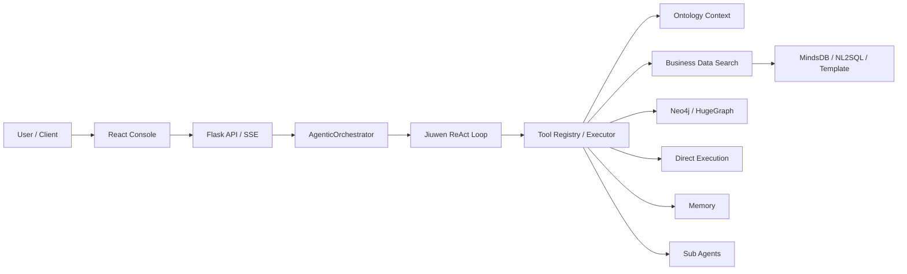

# Meta Wise

企业本体驱动的 Agent 工作台与运行时。


Meta Wise 把企业本体、业务数据连接、工具调用和多 Agent 编排放进同一个工作区。你可以导入本体包，绑定 MindsDB、NL2SQL、Neo4j 或 HugeGraph 等数据源，再让 Agent 在受控上下文中完成业务问答、数据检索、操作执行和结果汇总。

> 当前项目处于活跃开发阶段。开源发布前建议补充 `LICENSE`、`CONTRIBUTING.md` 和 `SECURITY.md`。

## Why Meta Wise

企业内部的 Agent 常常卡在三个问题上：

- 业务语义分散在文档、表结构、图谱和脚本里，模型不知道应该按什么口径回答。
- 数据源和本体之间缺少显式绑定，查询链路容易变成隐式配置和人工约定。
- Agent 运行过程难以复盘，工具调用、子任务、性能和记忆都散在不同地方。

Meta Wise 的做法是把“本体”作为 Agent 的运行上下文，而不只是静态知识文件。本体包可以描述业务对象、关系、操作逻辑、脚本和数据绑定。运行时再通过统一的 Agent loop、工具系统和 workspace 配置消费这些上下文。

## Key Features

- **本体工作区**：按 workspace 管理本体、技能、文件、运行配置和用户资源。
- **Agentic runtime**：基于 Flask 的后端运行 ReAct loop，支持 SSE 流式事件、取消、状态持久化和会话管理。
- **工具注册与执行**：统一管理 `ontology_context`、`skill`、`business_data_search`、`execute_script`、`web_search`、`memory` 和 `spawn_sub_agent`。
- **业务数据检索**：通过 workspace 数据连接和 ontology 绑定接入 MindsDB、NL2SQL HTTP、NL2SQL Template、Neo4j、HugeGraph 等 provider。
- **图检索能力**：Neo4j 和 HugeGraph provider 可用于本体实例图查询。
- **直执行脚本**：本体包中的脚本型 operation 可通过 `execute_script` 直接运行。
- **长期记忆与演化**：支持文件系统记忆、operation evolution 缓冲、补丁生成和审批。
- **观测与评测**：支持本地性能分析、Langfuse 导出，并集成独立的本体评测平台 `evaluation/agent_eval`。
- **协议适配**：提供 A2A 与 ACP 协议入口，复用同一套 orchestrator、事件流和工具执行能力。

## Quick Start

### Backend

```bash
cd platform/server
python -m venv .venv
source .venv/bin/activate
pip install -r requirements.txt
cp .env.example .env
python run.py
```

默认后端地址：

```text
http://localhost:5055
```

首次运行前建议在 `platform/server/.env` 中配置模型，或启动后在系统设置页面配置模型 profile：

```bash
LLM_BASE_URL=<openai-compatible-base-url>
LLM_MODEL=<model-id>
LLM_API_KEY=<api-key>
```

### Frontend

```bash
cd platform/console
npm install
npm run dev
```

默认前端地址：

```text
http://localhost:6600
```

更完整的本地开发、Windows/WSL 注意事项和 Docker 启动方式见 [Getting Started](docs/getting-started.md)。

## Docker

在仓库根目录启动前后端：

```bash
cp platform/server/.env.example platform/server/.env
cp platform/console/.env.example platform/console/.env
docker compose up --build
```

默认端口：

| 服务 | 地址 |
| --- | --- |
| 后端 | `http://localhost:5055` |
| 前端 | `http://localhost:8888` |

也可以使用脚本启动指定目标：

```bash
./run_docker.sh latest all
./run_docker.sh latest backend
./run_docker.sh latest frontend
```

## Try the Examples

示例场景放在 [examples](examples)：

| 目录 | 说明 |
| --- | --- |
| `examples/ontology-packages` | 可直接导入的本体包 |
| `examples/data` | 示例数据和初始化脚本 |
| `examples/scripts` | 示例导入、迁移和辅助脚本 |

本体 ZIP 包格式见 [Ontology Upload Template](docs/ontology-upload-template.md)。业务数据 provider 扩展见 [Business Data Provider Extension](docs/business-data-provider-extension.md)。

## Architecture



核心运行路径从 `POST /agentic/runs/stream` 开始，后端返回统一的 `agent.v2` SSE 事件。完整模块说明和事件流见 [Architecture](docs/architecture.md) 与 [API Reference](docs/api.md)。

## Project Structure

```text
.
├── modeling/        # 本体、operation、技能、绑定与建模前端
├── runtime/         # Agent、工具、数据检索、图检索、直执行、记忆与网页检索
├── platform/        # Flask server、React console、配置、workspace、协议、部署与观测
├── examples/        # 场景样例、本体包、示例数据、示例脚本和场景 testcase
├── evaluation/      # 本体评测平台 agent_eval、benchmark 和报告输出
├── tests/           # meta-wise 自身工程测试
├── docs/            # 用户文档、架构说明、配置参考和 API 文档
├── .onto-runtime/   # 本地运行时资源，默认不应提交
├── docker-compose.yml
├── build.sh
└── run_docker.sh
```

当前迁移策略保持 Python 包名 `agentic` 不变，通过 `platform/server/agentic/__init__.py` 扩展 package search path 到 `runtime/`、`platform/` 和 `modeling/` 下的实现模块。

## Documentation

| 文档 | 说明 |
| --- | --- |
| [docs/README.md](docs/README.md) | 文档索引 |
| [docs/getting-started.md](docs/getting-started.md) | 本地启动、Docker 启动和排障 |
| [docs/architecture.md](docs/architecture.md) | 架构、运行流、工具系统和模块边界 |
| [docs/configuration.md](docs/configuration.md) | 运行时目录、环境变量、模型、数据连接和观测配置 |
| [docs/api.md](docs/api.md) | HTTP API 与 SSE 事件 |
| [docs/ontology-upload-template.md](docs/ontology-upload-template.md) | 本体 ZIP 包格式 |
| [platform/deployment/README.md](platform/deployment/README.md) | 发布包、部署、升级和回滚 |

## Development

后端测试：

```bash
PYTHONPATH=platform/server:modeling/skills python -m pytest tests/backend
```

前端验证：

```bash
cd platform/console
npm run lint
npm run build
```

## Deployment

构建发布包：

```bash
./build.sh <tag> [amd|arm] [all|backend|frontend]
```

运行 Docker 镜像：

```bash
./run_docker.sh <tag> [all|backend|frontend]
```

生产部署、升级、备份和回滚流程见 [Deployment Guide](platform/deployment/README.md)。

## Contributing

欢迎通过 issue 和 pull request 参与。提交前请至少运行与你改动相关的后端测试或前端构建命令。开源发布前建议补充独立的 `CONTRIBUTING.md`，用于说明分支策略、代码风格、测试要求和 PR 模板。

## Security

请不要在公开 issue 中披露真实密钥、业务数据或漏洞细节。开源发布前建议补充 `SECURITY.md`，说明漏洞报告邮箱、响应周期和支持版本范围。

## License

许可证尚未在仓库中声明。开源发布前请在根目录添加 `LICENSE`，并在本节写明许可证类型。
