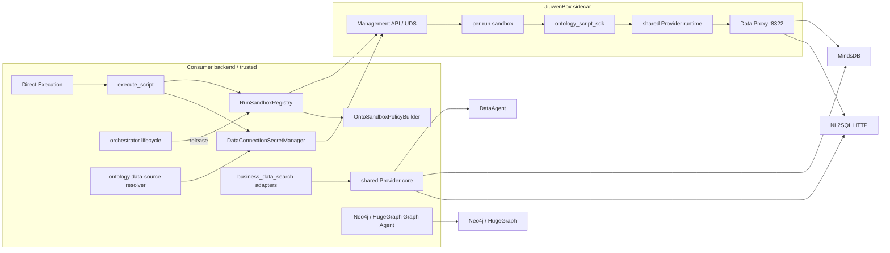

# knowledge-scaffold 本体脚本沙箱（JiuwenBox）端到端设计

> 文档状态：当前架构设计
>
> 编写日期：2026-07-16
>
> 当前实现范围：Phase 1 已落地，覆盖 JiuwenBox 脚本隔离、共享业务数据 Provider、NL2SQL/MindsDB data proxy、运行期清理及发布拓扑
>
> 后续能力：Phase 2 因 JiuwenBox proxy 的 HTTP Basic 鉴权头注入特性正在排期当中，当前保持 Pending

本文是 `knowledge-scaffold/consumer` 本体维护脚本沙箱的完整架构合同。它从脚本入口、业务数据连接、沙箱控制面、沙箱内运行时、网络与文件隔离、生命周期、部署、观测和测试描述设计内容。

## 1. 设计结论

knowledge-scaffold 采用 **Consumer backend 控制面 + JiuwenBox sidecar + per-run sandbox + run-scoped data proxy** 的脚本执行架构。

核心结论如下：

1. `prefer` 模式下，Linux 部署中 `script_catalog` 注册的 Python 维护脚本优先由 JiuwenBox 隔离执行；默认 `legacy` 模式保持本地执行。
2. 一个 agent run 最多复用一个 sandbox；同一 run 不允许跨 workspace 或 ontology 复用。
3. sandbox 只读当前 workspace 和镜像内最小 Python runtime，仅 `/tmp` 可写。
4. sandbox 不继承 backend 环境，不可见完整 backend、其他 workspace、Docker socket 或 JiuwenBox 管理 UDS。
5. sandbox 默认拒绝通用网络访问；存在业务数据连接时，只放行本 run 的 JiuwenBox data proxy 地址和端口。
6. backend 负责解析 ontology 数据源、解密 secret、创建 sandbox 和 proxy route。
7. Agent、可信本地脚本和 sandbox 脚本共享同一份普通业务数据 Provider 协议实现。
8. 脚本只通过无参 `DataProviderClient()` 使用业务数据；连接由 backend 以 version 1 Envelope 注入。
9. sandbox 只获得 proxy URL、placeholder 和非敏感 options，真实 target、token、password 和运行期 JWT 不进入 sandbox。
10. 当前 sandbox 脚本只支持 `nl2sql_http` 和 `mindsdb`；其他 Provider 在准备连接时明确拒绝，往后根据实际脚本调用情况扩展。
11. `execute_script`、Direct Execution 和经 backend workflow 进入的 MCP Chat 共用同一执行入口和 run 生命周期。
12. run success、failure、cancel 均释放 sandbox 和 proxy route；官方 Compose 默认关闭 sandbox 并允许本地 fallback。

## 2. 目标与非目标

### 2.1 目标

- 将维护脚本与 backend 进程的文件系统、环境变量、网络、进程和资源边界分离。
- 保持 `execute_script` 的脚本注册、参数校验、输出和错误契约稳定。
- 让同一份脚本源码在可信本地模式和 sandbox 模式下使用相同 import 与调用接口。
- 统一 Agent 和脚本使用的 Provider 请求、认证、重试、结果、事件和异常语义。
- 保证真实业务数据 secret 不进入 sandbox env、policy、runtime、命令行和普通日志。
- 以固定 target 的 data proxy 收敛 sandbox 的数据访问目标。
- 使沙箱创建、复用、取消和释放与 run 生命周期一致。
- 通过固定上游 commit 和白名单源码构建可重复发布的 JiuwenBox 派生镜像。
- 以兼容性优先的 `legacy` / `prefer` 模式渐进引入 JiuwenBox；`prefer` 的本地 fallback 必须产生高可见安全事件。

### 2.2 非目标

- 不支持 Windows 或 macOS 上的 JiuwenBox 沙箱执行。
- 不提供任意 HTTP proxy、任意 target、任意 header 或通用网络出口。
- 不向 sandbox 暴露 Flask API、workspace store、auth、LLM、Agent orchestration 或完整 backend。
- 不在创建 sandbox 时动态安装 Python 依赖。
- 不把 Agent 的 Neo4j/HugeGraph Graph Agent、`GraphScope`、图 schema、路径规划或图工具放入共享脚本运行时。
- 当前不支持 Neo4j `run_cypher`，也不允许 Basic 鉴权透传降级。
- 不承诺同一 workspace 内不同 ontology 在文件系统上彼此不可见；ontology 是执行、数据绑定和审计边界，不是独立挂载边界，挂载workspace目录是为了脚本能够访问workspace下的共享资源。

## 3. 术语与职责边界

| 术语 | 定义 |
|---|---|
| Shared Provider Core | 调用方中立的普通业务数据协议实现，包含连接、能力、结果、事件、transport 和 Provider client。 |
| Agent Adapter | 将共享 Provider 的结果和事件转换为 `business_data_search` 工具输出的薄适配层。 |
| Ontology Script SDK | 维护脚本唯一公开的业务数据 facade；从环境读取连接并委托 Shared Provider Core。 |
| ProviderCapabilities | Provider 的技术实现事实，回答某项 operation 是否真实存在。 |
| Effective Connection | backend 可信侧使用的 versioned 运行期连接，包含 endpoint、auth 和 options。 |
| Safe Connection | 注入 sandbox 的 Effective Connection，只含 proxy endpoint、placeholder auth 和非敏感 options。 |
| Control Plane | backend 解析绑定、解密 secret、创建/删除 sandbox 与 proxy route 的链路。 |
| Data Plane | sandbox 脚本经 SDK、共享 Provider 和 JiuwenBox proxy 访问固定业务数据目标的链路。 |
| Run-scoped Sandbox | 生命周期和策略范围绑定到一个 `run_id` 的 JiuwenBox sandbox。 |
| Run-scoped Route | 由 `run_id + ontology source id` 确定、run 结束时删除的 data proxy route。 |

必须保持以下命名和依赖边界：

```text
agent.tools.business_data
  = workspace/ontology 数据源控制面 + Agent 工具适配

shared_capabilities.business_data
  = 调用方中立的 Provider 协议执行层

shared_capabilities.ontology_script_sdk
  = 维护脚本公开 API

integration.sandbox
  = JiuwenBox 沙箱与 data proxy 控制面适配
```

共享层不得反向依赖 Agent、Flask、workspace store、ontology store 或 sandbox 控制面。

## 4. 系统上下文与总体架构



架构中存在两条互不混淆的数据访问路径：

- Agent 数据查询：backend 内的 Agent Adapter 直接调用 Shared Provider Core；Neo4j/HugeGraph 继续调用原有 Graph Agent。
- 维护脚本数据查询：脚本通过 Ontology Script SDK 调用 Shared Provider Core；sandbox 模式下 endpoint 是 run-scoped proxy。

## 5. Provider 能力与调用方矩阵

### 5.1 当前能力矩阵

| Provider | Agent 查询 | 可信本地脚本 | Sandbox 脚本 | 实现位置 |
|---|---:|---:|---:|---|
| `nl2sql_http` | 支持 | 支持 | 支持 | Shared Provider Core |
| `mindsdb` | 支持 | 支持 | 支持 | Shared Provider Core |
| `dataagent` | 支持 | 支持  | 拒绝 | Shared Provider Core + Agent Adapter |
| `nl2sql_template` | 支持 | 拒绝 | 拒绝 | Agent 模板匹配 + shared NL2SQL client |
| `neo4j` | 支持 | 拒绝 | 拒绝，Phase 2 Pending | 现有 Graph Agent / Bolt |
| `hugegraph` | 支持 | 拒绝 | 拒绝 | 现有 Graph Agent / HTTP |

`nl2sql_template` 不是独立传输协议。模板加载、matcher、命中、回落和 dedupe 保留在 Agent Adapter，最终请求委托 `NL2SQLProvider`。

### 5.2 ProviderCapabilities

当前共享能力声明为：

```python
@dataclass(frozen=True)
class ProviderCapabilities:
    query: bool
    query_sql: bool
    native_streaming: bool
    probe: bool
```

| Provider | query | query_sql | native_streaming | probe |
|---|---:|---:|---:|---:|
| NL2SQL HTTP | 是 | 是 | 否 | 是 |
| MindsDB | 是 | 是 | 是 | 是 |
| DataAgent | 是 | 否 | 否 | 是 |

统一事件入口 `iter_query_events()` 对非原生流 Provider 合成 `start -> final/error -> done`；MindsDB 使用原生事件迭代器。

### 5.3 能力开放边界

能力边界由以下三层事实形成：

1. **共享 Provider registry**：决定 `DataProviderClient` 能否根据 Envelope 创建 Provider。当前注册 `mindsdb`、`nl2sql_http`、`dataagent`。
2. **ProviderCapabilities**：决定已创建 Provider 是否实现 `query`、`query_sql`、`iter_query_events` 或 `probe`。不支持的 operation 在请求发出前抛出 `UnsupportedCapabilityError`。
3. **Sandbox data proxy 白名单**：决定 backend 能否为 sandbox 生成 Safe Connection。当前只允许 `mindsdb` 和 `nl2sql_http`，这是独立于 SDK 的安全纵深。

Agent 的公开范围由 `provider_registry.py` 中的 Provider spec、对应 Adapter 和 Graph Provider factory 决定。只要 backend 注入了合法 Envelope 且 shared registry 存在对应 Provider，脚本即可调用该 Provider 实际声明支持的 operation。

因此：

```text
可信本地 DataAgent 脚本
  -> registry 可创建 DataAgentProvider
  -> query/probe 可用
  -> query_sql 被 ProviderCapabilities 拒绝

Sandbox DataAgent 脚本
  -> data proxy preparation 拒绝 dataagent
  -> 不生成 Safe Connection，不创建 sandbox route
```

## 6. 共享业务数据能力

### 6.1 目录与依赖

```text
consumer/backend/shared_capabilities/
  business_data/
    connection.py
    contracts.py
    capability.py
    registry.py
    events.py
    errors.py
    providers/
      nl2sql.py
      mindsdb.py
      dataagent.py
    transport/
      http.py
      sse.py
  ontology_script_sdk/
    connection_env.py
    data_provider_client.py
    errors.py
```

`business_data` 只接受显式 `EffectiveConnection`，禁止自行读取 workspace、ontology、环境变量或 secret store。

`ontology_script_sdk` 只依赖标准库和 `business_data`，公开 import 固定为：

```python
from shared_capabilities.ontology_script_sdk import DataProviderClient
```

### 6.2 结果与事件契约

```python
@dataclass(frozen=True)
class ProviderResult:
    success: bool
    data: Any = None
    message: str = ""
    error: str = ""
    metadata: dict[str, Any] = field(default_factory=dict)

@dataclass(frozen=True)
class ProviderEvent:
    type: Literal["start", "intermediate", "final", "done", "error"]
    content: str = ""
    result: ProviderResult | None = None
    metadata: dict[str, Any] = field(default_factory=dict)
```

`metadata` 可承载 `sql`、`row_count`、`confidence`、`from_template`、`provider_request_id` 和 `error_code` 等非敏感信息。

### 6.3 Transport 与生命周期

- 每个 Provider client 拥有自己的 HTTP Session，不跨 workspace、ontology、run 或脚本进程共享。
- `DataProviderClient` 和 Provider client 均支持显式 `close()`；脚本推荐使用 context manager。
- 公共 HTTP transport 对 GET/POST 的 500、502、503、504 按 `max_retries` 重试，backoff factor 为 0.5。
- 4xx 默认不由公共 retry adapter 重试。
- timeout 和 retry 从 `EffectiveConnection.options` 读取。
- Provider 负责将 transport/protocol 失败转换为稳定、脱敏的 `ProviderResult`。

### 6.4 普通 Provider 行为

`NL2SQLProvider`：

- `query()` 调用 `/api/v1/query`；
- `query_sql()` 调用 `/api/v1/sql`；
- 可附带 `scene`；
- bearer auth 写入 `Authorization`；
- `probe()` 使用“连接测试”查询和短 timeout。

`MindsDBProvider`：

- `query()` 使用 Agent completions stream；
- `query_sql()` 使用 `/api/sql/query`；
- `mindsdb_password` 模式在可信 backend/本地侧登录并持有 JWT；
- `bearer` 模式用于 sandbox placeholder，由 proxy 替换；
- 原生流事件统一映射为 `ProviderEvent`。

`DataAgentProvider`：

- 通过 A2A REST `message:send` 查询；
- 通过 AgentCard endpoint 执行 probe；
- 只对 Agent consumer 开放。

## 7. Effective Connection 与脚本 SDK

### 7.1 Version 1 Envelope

```python
@dataclass(frozen=True)
class EffectiveConnection:
    version: int
    provider: str
    endpoint: str
    auth: AuthSpec
    options: dict[str, Any]
```

当前认证类型：

```text
none | bearer | mindsdb_password
```

可信侧连接示例：

```json
{
  "version": 1,
  "provider": "mindsdb",
  "endpoint": "https://mindsdb.example.com",
  "auth": {
    "type": "mindsdb_password",
    "username": "mindsdb",
    "password": "<secret>"
  },
  "options": {
    "default_database": "analytics",
    "default_agent_name": "my_agent",
    "project_name": "mindsdb",
    "timeout_seconds": 600,
    "max_retries": 3
  }
}
```

Sandbox Safe Connection 示例：

```json
{
  "version": 1,
  "provider": "mindsdb",
  "endpoint": "http://<proxy-ip>:8322/onto-<run-hash>-<source-hash>",
  "auth": {
    "type": "bearer",
    "token": "onto-placeholder-<opaque>"
  },
  "options": {
    "default_database": "analytics",
    "default_agent_name": "my_agent",
    "project_name": "mindsdb",
    "timeout_seconds": 600,
    "max_retries": 3
  }
}
```

Safe Connection 禁止包含原始 target URL、MindsDB login/password、真实 token/JWT、完整 source config、workspace 路径或 backend API 地址。

### 7.2 脚本环境变量

连接通过固定变量传递：

```text
ONTO_SCRIPT_BUSINESS_DATA_CONNECTION_JSON
```

SDK 只接受合法 JSON 和 `version=1` Envelope。无连接时，只有真正调用 `DataProviderClient()` 的脚本才会收到“未配置业务数据源”错误；不访问业务数据的脚本可正常执行。

### 7.3 DataProviderClient

```python
with DataProviderClient() as client:
    result = client.query("查询供应商")
```

职责：

1. 从固定环境变量读取 Effective Connection；
2. 从共享 registry 创建 Provider client；
3. 每次方法调用通过 ProviderCapabilities 检查 operation；
4. 委托 `query()`、`query_sql()`、`iter_query_events()` 或 `probe()`；
5. 统一 client close。

不允许脚本通过构造参数传入 endpoint、token、password 或 Provider config。SDK 不接受自定义能力声明；能力以 Provider class 的 `ProviderCapabilities` 为准。

## 8. 三条执行数据流

### 8.1 Agent Tool

```text
business_data_search
  -> resolve(workspace_id, ontology_id)
  -> decrypt ontology-scoped source
  -> build EffectiveConnection
  -> Agent Adapter
  -> Shared Provider Core
  -> ProviderEvent / ProviderResult
  -> tool.progress / ToolOutcome
```

Neo4j/HugeGraph 例外：它们不进入 Shared Provider Core，继续使用现有 Graph Agent 及其 runtime context。

### 8.2 可信本地脚本

```text
execute_script
  -> resolve ontology source
  -> build direct EffectiveConnection
  -> inject real connection Envelope
  -> local Python subprocess
  -> DataProviderClient
  -> shared provider registry + ProviderCapabilities
  -> Shared Provider Core
```

该路径用于 `SANDBOX_ENABLED=false` 的开发模式，或部署方显式允许的安全降级。真实 secret 可能进入本地子进程环境，因此不能等同于 sandbox 隔离。

### 8.3 Sandbox 脚本

```text
execute_script
  -> validate registered script and CLI arguments
  -> DataConnectionSecretManager.prepare
  -> resolve/decrypt source on backend
  -> create run-scoped proxy route
  -> build Safe Connection
  -> RunSandboxRegistry.ensure
  -> JiuwenBox exec
  -> DataProviderClient
  -> Shared Provider Core
  -> JiuwenBox data proxy
  -> fixed business-data target
```

JiuwenBox exec 是阻塞式调用。脚本内部可迭代 Provider events，但 backend 在脚本结束后一次取得 stdout/stderr，不提供跨 sandbox 的实时事件通道。

## 9. 脚本执行入口

### 9.1 公共校验

`handle_execute_script_path()` 在选择本地或 sandbox 前统一校验：

- 必须配置 project root；
- 拒绝绝对路径；
- 拒绝 `..` traversal；
- resolved path 必须位于 project root；
- 只允许 `.py`；
- 文件必须存在且为普通文件；
- CLI 参数统一转为字符串；
- 执行 timeout 至少为 1 秒。

`handle_execute_script()` 还负责 `script_catalog`、operation、参数定义和 placeholder 校验。

### 9.2 Sandbox 进入条件

当 `SANDBOX_ENABLED=true` 时，还必须满足：

- 当前平台为 Linux；
- `run_id` 非空；
- CLI 参数没有超过 sandbox 命令行限制；
- `workspace_id` 可解析为合法 workspace；
- script path 和 ontology directory 都位于当前 workspace。

任一前置条件失败均经过统一 fallback gate，不允许某个入口自行绕过。

### 9.3 Direct Execution 与 MCP

- Direct Execution 构造脚本参数、ontology directory 和运行上下文后，调用同一个 `handle_execute_script_path()`。
- MCP 服务不直接持有 JiuwenBox UDS；MCP Chat 通过 backend workflow bridge 进入同一 orchestrator run。
- 三类入口不建立第二套 sandbox registry、proxy manager 或 cleanup 逻辑。

### 9.4 输出兼容

Sandbox exec 的 `exit_code/stdout/stderr` 被转换为 `subprocess.CompletedProcess`，再复用公共工具层格式：

- 非零退出：`Error: Script exited with code N.` 并附 stdout/stderr；
- timeout：`Error: Script execution timed out after N seconds.`；
- 成功有输出：返回合并后的 stdout/stderr；
- 成功无输出：返回固定成功文本。

## 10. Sandbox 隔离粒度与生命周期

### 10.1 粒度

```text
1 run -> 1 sandbox
1 run + 1 ontology source -> 1 proxy route
1 sandbox -> N 次 script exec
```

`sandbox_id` 由 `run_id` 的 SHA-256 生成：

```text
onto-<11 hex chars>
```

总长度为 16，符合 JiuwenBox sandbox id 约束。

### 10.2 Lazy create

run 开始时不创建 sandbox。只有第一次实际执行脚本时才依次准备数据连接和创建 sandbox；没有脚本调用的 run 不产生相关资源。

### 10.3 Scope 一致性

`RunSandboxRegistry` 对同一 run 的 create 使用 single-flight，并以如下内容计算 scope hash：

```text
run_id
workspace_id
ontology_id
workspace_root
sandbox_runtime_python_dir
data_proxy_url
完整 policy
```

同一 run 后续调用的任一 scope 内容变化，直接抛出 `SandboxCreateError`。JiuwenBox create 返回 409 也视为冲突，不能把未知 policy 的既有 sandbox 当作幂等成功。

`DataConnectionSecretManager` 独立记录 `run_id -> workspace_id + ontology_id`，在 proxy 创建前再次拒绝跨 scope 复用。

### 10.4 Release 与 cancel

orchestrator 最外层 `finally` 调用 `release_run_sandbox(run_id)`；`cancel_run()` 也主动调用该入口缩短清理延迟。

清理顺序：

1. 删除 sandbox，终止其中仍在运行的进程；
2. 删除本 run 的全部 proxy routes；
3. 清除 registry、scope 和 route 缓存；
4. 不因其中一类清理失败而跳过另一类清理。

删除 sandbox 时 404 视为已清理；删除 route 时 404 同样幂等。

## 11. 挂载、路径与运行时

### 11.1 三层同名路径

backend、JiuwenBox 容器和 sandbox 对 workspace 使用相同绝对路径：

```text
/app/.onto-runtime/workspaces/<workspace_id>
```

脚本路径示例：

```text
/app/.onto-runtime/workspaces/<workspace_id>/ontologies/<ontology_id>/versions/<version>/scripts/check.py
```

workspace 是 sandbox 的最小业务文件挂载单位。当前 ontology 用于注册、路径校验、业务数据绑定和审计；同一 workspace 下其他只读文件可见。

### 11.2 容器层挂载

```text
host consumer/.onto-runtime
  -> backend:   /app/.onto-runtime      rw
  -> jiuwenbox: /app/.onto-runtime      ro
```

容器层需要让 JiuwenBox 能访问全部 workspace 以创建不同 run 的 bind mount；真正暴露给某个 sandbox 的范围由 per-run policy 决定。

### 11.3 Sandbox 层挂载

只读 bind：

```text
/app/.onto-runtime/workspaces/<workspace_id>
/app/sandbox-runtime/python
必要的 /bin /sbin /usr /usr/local /lib /lib64 和系统证书/解析文件
```

可写：

```text
/tmp
```

禁止挂载：

- `/app` 根；
- 完整 `.onto-runtime`；
- 完整 backend 源码；
- backend config 和 secret 文件；
- 其他 workspace；
- Docker socket；
- JiuwenBox management UDS。

### 11.4 最小 Python runtime

固定目录：

```text
/app/sandbox-runtime/python/shared_capabilities/
  business_data/
  ontology_script_sdk/
```

runtime 属于 Onto 维护的 JiuwenBox 派生镜像，不属于 backend 镜像，也不通过共享 volume 在运行期覆盖。

脚本命令固定为：

```text
/usr/bin/python3 -u <absolute-script-path> <cli-args...>
```

## 12. 环境变量白名单

Sandbox exec 不使用 `os.environ.copy()`，固定注入：

| 变量 | 值 |
|---|---|
| `PATH` | `/usr/local/bin:/usr/bin:/bin` |
| `PYTHONPATH` | `/app/sandbox-runtime/python:<active-ontology-dir>` |
| `PYTHONIOENCODING` | `utf-8` |
| `PYTHONUTF8` | `1` |

唯一允许的请求级 override：

```text
ONTO_SCRIPT_BUSINESS_DATA_CONNECTION_JSON=<Safe Connection>
```

调用方提供的其他 `env_overrides`、backend 模型密钥、auth 配置和宿主环境变量全部丢弃。

## 13. Data proxy 与 secret 处理

### 13.1 Route 标识与固定 target

route prefix：

```text
/onto-<sha256(run_id)[:12]>-<sha256(source_id)[:12]>
```

当前 ontology-scoped source 的 `source_id` 等于 ontology id。route 是单层 path，target 在创建时固定，sandbox 不能通过参数修改 host、port 或 scheme。

`DataConnectionSecretManager` 对同一 `run_id + source_id` 使用细粒度初始化锁，保证并发脚本只创建一条 route。任何 create 非成功响应都视为失败；不存在“already exists 即可复用”。start 失败会立即尝试删除已创建 route。

### 13.2 NL2SQL HTTP

```text
backend
  -> resolve source and decrypt token
  -> validate secret transport
  -> create proxy(target=url, api_key=real token)
  -> inject Safe Connection(proxy URL + bearer placeholder)

sandbox
  -> NL2SQLProvider
  -> Authorization: Bearer <placeholder>
  -> JiuwenBox proxy injects route api_key
  -> fixed NL2SQL target
```

无 token 的 NL2SQL 连接使用 `auth.type=none`，proxy route 不携带 secret。

### 13.3 MindsDB no-auth

- proxy target 固定为 MindsDB URL；
- `api_key` 为空；
- Safe Connection 使用 `auth.type=none`；
- 脚本通过 proxy 访问 SQL 和 Agent stream endpoint。

### 13.4 MindsDB password

```text
backend
  -> validate HTTP/HTTPS secret transport
  -> POST <target>/api/login
  -> receive token/access_token
  -> create proxy(api_key=JWT)
  -> inject Safe Connection(proxy URL + bearer placeholder)

sandbox
  -> MindsDBProvider
  -> Authorization: Bearer <placeholder>
  -> JiuwenBox proxy injects JWT
  -> MindsDB query/stream
```

约束：

- login/password 只用于 backend 登录请求；
- JWT 只进入 backend 到 JiuwenBox 的管理面请求和 proxy 运行期状态；
- password、JWT 和真实 endpoint 不进入 Safe Connection；
- 同一 run/source 只登录一次；
- 登录失败、非 200、非法 JSON 或无 token 时不创建 route 和新 sandbox；
- sandbox 查询阶段的 401 不触发 backend 重新登录或脚本请求重放；
- run 结束删除 route，不调用 MindsDB token revoke API。

### 13.5 明文 HTTP gate

`SANDBOX_SECRET_ALLOW_PLAIN_HTTP=true` 允许 backend 登录请求或 proxy 在 HTTP 上游发送 secret。这只适用于部署方确认的可信内网，不提供传输机密性，也不会自动验证目标是否属于可信网络。

跨不可信网络必须设置：

```text
SANDBOX_SECRET_ALLOW_PLAIN_HTTP=false
```

并使用 HTTPS、专线或 VPN。

### 13.6 当前拒绝的 Provider

以下 Provider 进入 sandbox 数据准备时返回稳定的 unsupported：

```text
dataagent
nl2sql_template
neo4j
hugegraph
```

系统不得把 unsupported Provider 转换为任意 URL 直连、放宽 egress 或自动切换鉴权模式。

## 14. Sandbox 安全策略

### 14.1 文件与进程

- workspace 和 runtime 只读；
- `/tmp` 可写；
- 进程以 `sandbox:sandbox` 运行；
- user、pid、ipc、cgroup、uts namespace 开启；
- Landlock 使用 `best_effort`；
- 仅提供 `/dev/null` 和 `/dev/urandom`；
- x86_64/arm64 都阻断 mount、namespace、ptrace、module、bpf、keyring、io_uring 等高风险 syscall。

### 14.2 网络

```yaml
network:
  mode: isolated
  egress:
    default: deny
    allowed_domains: [<proxy-host-if-needed>]
    allowed_ips: [<proxy-ip>/32]
    allowed_ports: [<proxy-port>]
    blocked_ips: [169.254.169.254/32]
    blocked_ports: [53]
```

backend 会优先把 Docker service hostname 解析为 sandbox 可达 IP；无法解析时，policy 使用精确域名规则。不存在业务数据连接时，allowed host 和 port 列表为空。

真实 Provider host/port 不进入 sandbox allowlist。sandbox 不可访问 JiuwenBox Management API、backend API、metadata service 或通用外网。

### 14.3 资源

每个 sandbox policy 设置：

- memory cgroup；
- CPU cgroup；
- PID cgroup；
- 单次 exec timeout。

Sandbox timeout 不回落本地重试，避免可能有副作用的脚本执行两次。

### 14.4 安全边界说明

ProviderCapabilities 只校验 Provider 是否实现某项 operation，不是用户授权、脚本授权或恶意代码隔离边界。脚本 SDK 不包含 ConsumerPolicy；而且 sandbox runtime 同时包含 Shared Provider Core，脚本从技术上可以尝试直接 import 共享实现。系统的真正安全边界是：

```text
Safe Connection
  + fixed-target data proxy
  + proxy-held secret
  + default-deny egress
  + read-only mounts
  + namespace/cgroup/syscall policy
```

生产脚本规范和静态检查仍应要求只 import `ontology_script_sdk`。

## 15. 模块设计

```text
consumer/backend/integration/sandbox/
  config.py
  client.py
  executor.py
  registry.py
  policy_builder.py
  paths.py
  env_allowlist.py
  data_proxy.py
  alerts.py
  errors.py
```

| 模块 | 职责 |
|---|---|
| `config.py` | 冷启动开关、资源限制、client timeout 和 HTTP secret 策略。 |
| `client.py` | 唯一直接访问 JiuwenBox sandbox/proxy Management API 的模块。 |
| `executor.py` | 单次执行编排：workspace/path、数据连接、policy context、command 和 env。 |
| `registry.py` | per-run sandbox、single-flight、scope hash 和 release。 |
| `policy_builder.py` | 文件系统、namespace、network、cgroup、syscall policy。 |
| `paths.py` | project-relative path 到三层同名绝对路径的转换。 |
| `env_allowlist.py` | 构造最小脚本环境。 |
| `data_proxy.py` | ontology source、secret、MindsDB 登录、route 和 Safe Connection。 |
| `alerts.py` | 本地 fallback 的高可见安全事件。 |
| `errors.py` | sandbox unavailable/create/exec 分类。 |

依赖方向：

```text
execute_script
  -> SandboxScriptExecutor
       -> DataConnectionSecretManager -> JiuwenboxClient(proxy API)
       -> RunSandboxRegistry
            -> OntoSandboxPolicyBuilder
            -> JiuwenboxClient(sandbox API)
       -> env_allowlist / paths
```

JiuwenBox Management API 当前使用：

```text
POST   /api/v1/sandboxes
POST   /api/v1/sandboxes/{sandbox_id}/exec
DELETE /api/v1/sandboxes/{sandbox_id}
POST   /api/v1/proxies
POST   /api/v1/proxies/{proxy_name}/start
DELETE /api/v1/proxies/{proxy_name}
```

backend 通过共享 UDS `unix:///run/jiuwenbox/jiuwenbox.sock` 调用这些接口；sandbox 不挂载该 UDS。

## 16. 配置与降级

### 16.1 冷启动配置

| 环境变量 | 代码默认 | 官方 Compose 默认 | 说明 |
|---|---:|---:|---|
| `SANDBOX_EXECUTION_MODE` | `legacy` | `legacy` | `legacy` 保持本地执行；`prefer` 尽力使用 JiuwenBox 并允许审计后回落。 |
| `SANDBOX_ENABLED` | `false` | `false` | 沙箱总开关。 |
| `SANDBOX_FALLBACK_LOCAL` | `true` | `true` | setup/create/exec 失败时是否允许本地 subprocess。 |
| `SANDBOX_MEMORY_MAX` | `512M` | 同代码 | memory cgroup。 |
| `SANDBOX_CPU_MAX` | `1.0` | 同代码 | CPU cgroup。 |
| `SANDBOX_PIDS_MAX` | `64` | 同代码 | PID cgroup。 |
| `SANDBOX_CLIENT_TIMEOUT` | `30.0` | 同代码 | Management API client timeout。 |
| `SANDBOX_SECRET_ALLOW_PLAIN_HTTP` | `true` | `true` | 可信内网 HTTP secret gate。 |

这些值只从进程环境和代码默认读取，不属于 system-config 热更新范围，修改后需要重启 backend。显式配置 `SANDBOX_EXECUTION_MODE` 时由模式统一决定 `enabled` 和 `fallback_local`；未配置时继续按旧布尔变量解析，保证已有部署升级兼容。未知模式不会阻断现网请求，而是记录 `sandbox_invalid_execution_mode` 告警并按 `legacy` 处理。

固定部署/镜像契约：

| 字段 | 固定值 |
|---|---|
| JiuwenBox Management API | `unix:///run/jiuwenbox/jiuwenbox.sock` |
| sandbox Python | `/usr/bin/python3` |
| sandbox runtime root | `/app/sandbox-runtime` |
| data proxy base URL | `http://jiuwenbox:8322` |

### 16.2 错误分类

```text
SandboxError
├─ SandboxUnavailableError
│  └─ SandboxUnsupportedProviderError
├─ SandboxCreateError
└─ SandboxExecError
```

- 数据源、proxy 或平台前置条件失败：`SandboxUnavailableError`；不支持的 Provider 使用其子类 `SandboxUnsupportedProviderError`；
- create 或同 run scope 冲突：`SandboxCreateError`；
- exec/delete 请求失败或超时：`SandboxExecError`。

`execute_script` 是唯一 fallback 决策点。

### 16.3 兼容模式与本地 fallback

官方 Compose 默认与代码默认一致：

```text
SANDBOX_EXECUTION_MODE=legacy
```

`legacy` 保持当前本地 subprocess 行为，不要求 JiuwenBox 可用。部署方可以显式设置 `SANDBOX_EXECUTION_MODE=prefer`，使已支持的脚本优先进入 JiuwenBox；unsupported Provider、缺少 run id、平台不支持、参数过大、proxy 失败、create 冲突和 exec 基础设施失败均审计后回落本地执行，不把 JiuwenBox 作为发布或请求的强制边界。

`prefer` 发生 fallback 时，系统记录 `SANDBOX_SECURITY_FALLBACK` / `security_event=sandbox_bypass`，说明脚本已暴露于宿主环境。exec timeout 永不 fallback，防止脚本重复执行产生副作用；该限制属于避免重复副作用的执行一致性约束，不代表 fail-close 安全模式。

如果 sandbox 已返回进程结果但工具启动器、脚本文件、运行时模块不存在，或策略拒绝了该执行，`prefer` 仍按原默认本地路径重试，并分别记录 `sandbox_tool_missing` 或 `sandbox_policy_unavailable`。普通脚本业务错误（非零退出但不含上述启动/策略特征）不自动重跑。

## 17. 构建、部署与发布

### 17.1 JiuwenBox 派生镜像

`deploy/build_jiuwenbox.sh` 固定 JiuwenSwarm commit：

```text
d7c2ab2f299cd2c73201afb41ebb8b9c00cc7015
```

构建流程：

```text
fetch exact JiuwenSwarm commit
  -> build upstream JiuwenBox image
  -> copy explicit shared_capabilities allowlist
  -> install runtime requests dependency
  -> build onto-agent-jiuwenbox image
  -> import smoke test
```

白名单只复制：

```text
backend/shared_capabilities/__init__.py
backend/shared_capabilities/business_data/
backend/shared_capabilities/ontology_script_sdk/
```

镜像构建必须成功 import `requests`、`ProviderResult` 和 `DataProviderClient`。不复制完整 backend，不挂载 backend site-packages。

### 17.2 官方拓扑

```text
backend
  - .onto-runtime rw
  - JiuwenBox UDS ro

jiuwenbox
  - .onto-runtime ro
  - JiuwenBox UDS rw
  - policy file ro
  - host cgroup
  - SYS_ADMIN + NET_ADMIN
  - internal data proxy :8322

mcp
  - no JiuwenBox UDS
  - calls backend workflow
```

JiuwenBox sidecar 需要较高宿主权限以建立 namespace、网络和 cgroup。部署方必须把它视为受信基础设施组件，限制镜像来源、宿主访问和容器网络。

根目录 `docker-compose.yml` 和 `deploy/docker-compose.release.yml` 是当前 sandbox-enabled 拓扑。`backend/docker-compose.yml` 未配置 JiuwenBox sidecar 和 UDS，不是生产沙箱部署入口。

### 17.3 Proxy bootstrap

`deploy/jiuwenbox-policy.yaml` 提供一个不可达的 bootstrap route，使 JiuwenBox 启动全局 proxy listener；真正的业务 route 均由 backend 按 run 动态创建。

### 17.4 发布包

release bundle 同时包含 backend、frontend、auth-server 和 JiuwenBox 镜像，manifest 记录 JiuwenBox image 与固定上游 commit。部署、备份、重启和回滚脚本都把 JiuwenBox image 作为同一发布单元管理。

## 18. 观测与审计

普通日志至少记录：

| 操作 | 字段 |
|---|---|
| sandbox create | run_id、sandbox_id、workspace_id、ontology_id、policy scope hash |
| sandbox release | run_id、sandbox_id、脱敏错误 |
| proxy prepare | run_id、route、provider、source/connection id |
| proxy release | run_id、route、source/connection id、脱敏错误 |
| HTTP secret gate | provider、source id、target host、允许/阻断 |
| local fallback | reason、run/session/turn/tool context、安全事件标记 |
| image build | 固定 JiuwenSwarm commit、架构、基础和派生镜像 |

禁止记录：

- 真实 token、password、JWT；
- 完整 Authorization header；
- Safe Connection 之外的原始连接 JSON；
- 未脱敏的上游响应体；
- secret-bearing Management API payload。

建议生产告警：

- 任意 `sandbox_bypass`；
- sandbox create/exec 连续失败；
- route start/rollback/delete 失败；
- 同 run scope 冲突；
- plain HTTP secret injection；
- run 结束后 route 或 sandbox 残留。

## 19. 测试设计

### 19.1 Shared Provider

- version 1 Envelope round-trip 和非法 version/auth/options；
- ProviderCapabilities 对每项 operation 的技术能力校验；
- shared registry 对未知 Provider 的拒绝；
- NL2SQL request、response、metadata、retry 和脱敏；
- MindsDB password、SQL、native events 和 401 行为；
- DataAgent A2A request、AgentCard、结果解析和脱敏；
- 合成事件与原生事件序列；
- session close；
- shared core 无控制面依赖。

### 19.2 Script SDK

- 只允许无参 `DataProviderClient()`；
- 只接受 version 1 Envelope；
- DataProviderClient 可创建 DataAgent，并按 ProviderCapabilities 拒绝其 `query_sql`；
- query/query_sql/events/probe 正确委托；
- 直接 import 规范和 runtime allowlist。

### 19.3 Sandbox 单元与 mock 集成

- sandbox id 稳定且合法；
- create 409 冲突；
- 同 run create single-flight；
- scope 变化拒绝；
- path、traversal、文件类型和 workspace 边界；
- env 不继承宿主；
- workspace/runtime 只读挂载；
- egress 只允许 proxy；
- NL2SQL Safe Connection 不含真实 token/target；
- data proxy 明确拒绝 unsupported Provider，`prefer` 由统一 fallback gate 审计后转为本地执行；
- proxy create 非成功不复用；
- route start 失败回滚；
- MindsDB 每 run 只登录一次；
- 登录失败不创建 route/sandbox；
- HTTP secret gate；
- success/failure/cancel 释放。

### 19.4 真实 Linux E2E

- 无数据连接脚本在 JiuwenBox 内运行；
- NL2SQL target 收到真实 bearer，sandbox 只有 placeholder；
- MindsDB password 每 run 只登录一次，后续请求收到 proxy JWT；
- sandbox 不能读 backend、其他 workspace、UDS 或 Docker socket；
- sandbox 不能写 workspace/runtime；
- sandbox 不能直连真实 Provider、metadata service、backend 或外网；
- timeout、cancel 和异常均清理资源；
- release 镜像 smoke test 和健康检查通过。

### 19.5 建议验证命令

```bash
cd consumer
PYTHONPATH=backend python -m pytest \
  backend/tests/test_shared_business_data_contracts.py \
  backend/tests/test_shared_business_data_providers.py \
  backend/tests/test_shared_business_data_architecture.py \
  backend/tests/test_ontology_script_sdk.py \
  backend/tests/test_sandbox.py \
  backend/tests/test_execute_script_sandbox_fallback.py \
  backend/tests/test_jiuwenbox_image_build.py -q
```

真实 JiuwenBox E2E 必须在满足 bubblewrap、network namespace、cgroup 和相关 capability 的 Linux 环境运行。

## 20. 当前验收标准

1. `legacy` 默认保持本地执行；`prefer` 在 JiuwenBox 和 Provider 均受支持时让已注册 Python 维护脚本运行于 per-run sandbox。
2. 同一 run 同 scope 复用；workspace、ontology、runtime、proxy 或 policy 变化时拒绝复用。
3. sandbox 只读当前 workspace 和最小 runtime，仅 `/tmp` 可写。
4. sandbox 不可见完整 backend、其他 workspace、管理 UDS 和 Docker socket。
5. sandbox egress 只允许当前 data proxy；无 data connection 时没有业务网络出口。
6. Shared Provider Core 是 NL2SQL、MindsDB、DataAgent 的唯一普通协议实现。
7. Agent 普通 Provider 通过薄 Adapter 复用共享实现，Neo4j/HugeGraph Graph Agent 保持原有边界。
8. 本地和 sandbox 脚本使用相同 `DataProviderClient` import、方法、结果和异常契约。
9. 可信本地脚本可使用 shared registry 中的 Provider 及其实际能力，sandbox 仍由 data proxy 白名单限制为 NL2SQL HTTP 和 MindsDB。
10. Sandbox data proxy 只支持 NL2SQL HTTP 和 MindsDB；其他 Provider 明确 unsupported。
11. NL2SQL token、MindsDB password/JWT 和原始 target 不进入 sandbox。
12. route target 固定，sandbox 不能选择 target host/port。
13. success、failure、cancel 均释放 sandbox 和 routes；清理失败可观测。
14. Direct Execution 和 MCP Chat 不产生第二套沙箱生命周期。
15. 官方 Compose 默认关闭 sandbox 并允许本地 fallback，与代码默认一致。
16. JiuwenBox 镜像从固定 commit 构建，只包含白名单 runtime，并通过 import smoke test。

## 21. Phase 2：Neo4j `run_cypher` Pending

当前实现对应 Phase 1。绑定 `neo4j` 的 Agent 查询继续使用现有 Graph Agent 和 Bolt；绑定 `neo4j` 的维护脚本在 sandbox 数据准备阶段返回 unsupported。

Phase 2 计划向 ontology script consumer 增加一项能力：

```text
neo4j -> run_cypher(statement, parameters)
```

该能力当前 **Pending**，原因是 JiuwenBox proxy 的 HTTP 协议完整 Basic 鉴权头注入特性正在排期当中。当前 `JiuwenboxClient.create_proxy()` 只具备 `api_key` 形式的 Bearer 注入契约，不能证明以下安全条件：

1. Management API 可配置完整 `Authorization: Basic ...`；
2. proxy 会强制覆盖 sandbox 传入的同名 header；
3. header 大小写不能绕过覆盖；
4. 真实 Basic 不出现在 create/status/error/log；
5. route 可固定 Neo4j database Query API endpoint；
6. route 删除后 secret 从运行期状态清理。

在 JiuwenBox 特性排期完成并通过真实 E2E 前：

- 不实现 sandbox `Neo4jHttpProvider`；
- 不向 shared Provider registry 注册 `Neo4jHttpProvider`，也不向 `ProviderCapabilities` 和 `DataProviderClient` 增加 `run_cypher`；
- 不向 Safe Connection 增加 Basic auth；
- 不增加 Basic passthrough；
- 不把真实 username/password 或 Basic header 放入 sandbox；
- 不放宽 sandbox egress 直连 Neo4j；
- 不允许失败后自动本地执行绕过生产隔离。
