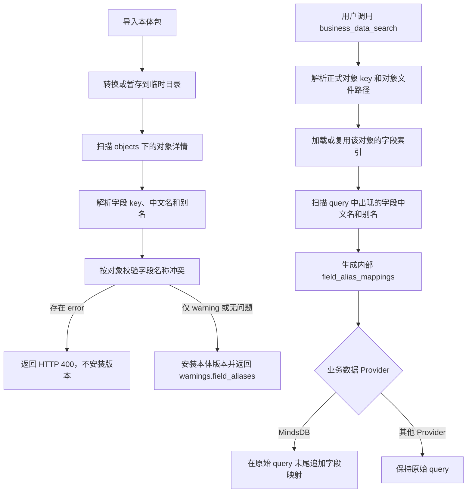

# Consumer 字段别名适配方案

> 状态：已实现。

## 1. 目标

在不修改 `business_data_search` 对外工具参数的前提下，让 consumer 能从对象定义中读取字段别名，建立“用户字段称呼 -> 正式字段 key”的确定性映射，并把用户问题中实际命中的映射提供给业务数据 Provider。

首版优先解决 MindsDB 场景。MindsDB 当前只接收自然语言 `query`，因此 consumer 在调用 MindsDB 前内部构造增强 query，将命中的字段映射以简短、受控的上下文追加到原始查询后。

## 2. 现状

- 标准对象详情已有“字段 key / 中文名 / 别名”列，modeling 也能将字段 `alias` 渲染到“别名”列。
- consumer 导入转换也能保留旧格式“中文名称 / 英文名称 / 属性别名”表格。
- consumer 目前没有字段级别名解析器，字段表只作为 Markdown 上下文交给模型理解。
- `business_data_search` 只对对象 `entity` 做正式 key 归一化，`query` 中的字段称呼保持原样。
- MindsDB Adapter 丢弃 `entity`，最终只把 `query` 作为 `messages[].question` 发送给 MindsDB Agent。

因此，当用户使用“变更单号”等字段别名时，当前仍由 Provider 内的模型自行推理它是否对应 `CHANGE_ORDER_ID`。

## 3. 范围

### 3.1 本期范围

1. consumer 解析对象字段表中的正式字段 key、中文名和别名。
2. 以对象为作用域建立字段引用索引。
3. 在导入安装版本前校验字段别名冲突。
4. `business_data_search` 解析到正式对象后，从该对象的字段索引中选出当前 query 实际命中的映射。
5. MindsDB 查询前将命中的映射追加到内部 query。
6. 增加单元测试、导入接口测试和 MindsDB Adapter 传参测试。

### 3.2 非目标

- 不修改 `business_data_search` 对外 schema，不新增 `filters`、`fields` 等结构化参数。
- 不支持在一次 `business_data_search` 调用中同时解析多个普通业务对象的字段别名。
- 不处理 MindsDB Adapter 未使用 `entity` 的问题。
- 不修改 Provider 中的数据表或物理字段 mapping。
- 不修改 modeling 生成 logic 的逻辑，不自动改写客户原始规则文本。
- 不自动生成、推断、翻译或模糊匹配字段别名。
- 不将 `sourceColumn`、数据库列名等技术标识自动当作业务别名。

## 4. 整体流程

本方案包含两条相互独立但使用同一字段解析规则的链路：

1. **导入链路**：在本体版本安装前发现字段定义错误。
2. **查询链路**：在运行时把用户实际使用的字段称呼转换为正式字段 key，并仅为 MindsDB 补充查询上下文。



### 4.1 数据来源与边界

| 数据 | 在本方案中的作用 |
| --- | --- |
| `objects/<对象>.md` 字段表 | 字段 key、中文名和别名的唯一来源 |
| 对象详情 frontmatter | 提供对象 key、title 等对象级信息，不提供字段映射 |
| `objects/index.md` | 提供对象目录和对象别名，不承载字段别名 |
| `mappings/object-data-mappings.json` | 继续负责对象与业务数据源的映射；本方案不读取其中的字段映射、`property_map` 或 `sourceColumn` |
| `business_data_search.query` | 运行时查找字段中文名和别名的自然语言文本 |
| `_field_alias_mappings` | consumer 内部传递字段命中结果，不属于工具对外参数 |

因此，本方案中的“字段匹配”不是匹配 data mapping。它只匹配对象详情字段表中已经明确声明的中文名和别名，并返回同一行的正式字段 key。

### 4.2 导入阶段

导入入口对标准包和需要转换的历史包使用相同的安装前校验语义：

1. ZIP 包先解压到临时目录。
2. 历史包先标准化到临时标准目录；标准包先构建暂存目录。
3. 完成现有 operation 目录限制校验。
4. 执行对象别名校验。
5. 扫描暂存包的 `objects/*.md`，跳过 `objects/index.md`。
6. 对每个对象选择字段定义表，解析正式字段 key、中文名和别名。
7. 以单个对象为作用域构建名称声明集合，检查重复 key、跨字段名称冲突、重复别名和空别名。
8. 将对象别名 error 与字段别名 error 聚合，一次性返回所有问题：
   - 存在 error：返回 HTTP 400，正式版本目录不会安装该版本。
   - 只有 warning：继续安装，并在成功响应的 `warnings.field_aliases` 中返回。
   - 没有字段表或没有别名列：按历史包兼容规则继续导入。
9. 只有全部阻断校验通过后，才把暂存目录安装为正式本体版本。

导入校验直接读取暂存目录，不使用运行时缓存，确保本次待安装内容一定被重新检查。

### 4.3 查询阶段

字段别名适配发生在 `BusinessDataSearchTool.execute()` 到 Provider 调用之间：

1. Agent 仍按原有结构调用 `business_data_search`：

   ```json
   {
     "ontology_id": "example-domain-knowledge-agent",
     "entity": "设计变更影响对象",
     "query": "查询影响编号为 0001 的物料变更类型"
   }
   ```

2. consumer 先加载本体 manifest，并使用对象引用解析器处理 `entity`。
3. 对象引用解析器可以通过对象正式 key、title 或对象别名命中，最终得到：
   - 正式对象 key，例如 `CHANGE_ORDER受影响对象`；
   - 对象详情文件路径，例如 `objects/CHANGE_ORDER受影响对象.md`。
4. consumer 按对象文件路径加载字段索引。缓存命中时直接复用；文件修改时间或大小变化时重新解析。
5. consumer 只扫描当前 `query` 中出现的字段中文名和字段别名：
   - 正式字段 key 不追加冗余映射；
   - 歧义名称不进入结果；
   - 同一位置存在包含关系时保留最长名称；
   - 同一短名称在其他独立位置出现时仍可保留。
6. 命中结果形成 consumer 内部参数：

   ```text
   _field_alias_mappings = (
     ("影响编号", "AffectedObjectCode"),
     ("物料变更类型", "MaterialType")
   )
   ```

7. `handle_business_data_search()` 将它放入内部 `BusinessDataSearchRequest.field_alias_mappings`。外部工具 schema 不包含该参数，外部调用者传入的同名私有参数也会被移除。
8. 业务数据 Service 完成 Provider 分流：
   - MindsDB：在原始 query 末尾追加本次命中的映射块。
   - Neo4j、HugeGraph、NL2SQL、DataAgent：继续接收原始 query。
9. MindsDB Adapter 最终仍只发送 query；差别是 query 已带有明确的字段 key 上下文。

#### 4.3.1 单对象调用约束

字段引用索引以单个对象为作用域，`business_data_search.entity` 也是单值。因此，一次 `business_data_search` 调用必须只查询一个对象，query 中用于过滤或返回的字段必须属于该 `entity`：

- 不同对象可以声明相同的字段中文名或别名，例如两个对象都可以使用“编号”；这不属于导入冲突。
- 多对象用户问题必须由 Agent 拆成多个单对象 `business_data_search` 调用，再汇总查询结果。
- 如果业务关系已被明确建模为一个关联对象，可以查询该关联对象；此时只使用关联对象自身字段表中的中文名和别名，不合并两端对象的字段索引。
- 如果一个调用同时包含多个普通对象，consumer 仍只会加载 `entity` 对应对象的字段索引。当前追加的映射也不带对象限定，因此其他对象的字段可能不映射，或者同名别名被错误理解；该调用的结果不在本期能力保证范围内。

例如两个对象分别定义：

```text
CHANGE_ORDER受影响对象.编号 -> AffectedObjectCode
CHANGE_ORDER变更单.编号 -> CHANGE_ORDER_ID
```

当前映射块只能表达无对象限定的：

```text
编号 -> AffectedObjectCode
```

它无法在同一个 query 中同时表达两个“编号”。未来若支持多对象查询，必须使用带对象限定的映射，例如：

```text
CHANGE_ORDER受影响对象.编号 -> CHANGE_ORDER受影响对象.AffectedObjectCode
CHANGE_ORDER变更单.编号 -> CHANGE_ORDER变更单.CHANGE_ORDER_ID
```

或者通过 Provider 的结构化上下文传递对象、字段和别名关系；不能继续使用当前无对象限定的 `字段名称 -> 字段 key` 形式。

### 4.4 完整示例

对象详情中定义：

```markdown
# 字段

| 字段 key | 中文名 | 别名 |
| --- | --- | --- |
| AffectedObjectCode | 受影响编码 | 影响编号 |
| MaterialType | 物料变更类型 | 变更类型 |
```

用户问题：

```text
查询影响编号为 0001 的物料变更类型
```

consumer 的处理结果：

1. `影响编号` 完整命中字段别名，得到 `AffectedObjectCode`。
2. `物料变更类型` 完整命中字段中文名，得到 `MaterialType`。
3. 未命中的其他字段不会进入映射。
4. 传给 MindsDB 的最终 query 为：

   ```text
   查询影响编号为 0001 的物料变更类型

   字段映射（使用右侧正式字段 key）：
   - 影响编号 -> AffectedObjectCode
   - 物料变更类型 -> MaterialType
   ```

字段映射只帮助 MindsDB 理解用户使用的字段称呼，不会改写用户问题中的过滤值 `0001`，也不会直接生成 data mapping 或查询条件。

### 4.5 分支与降级结果

| 场景 | 处理结果 |
| --- | --- |
| 对象成功解析且 query 命中字段名称 | 构建内部字段映射 |
| 对象存在，但没有字段表 | 不构建映射，继续原查询 |
| 字段表没有别名列，但包含字段中文名 | 仍匹配中文名并映射到正式字段 key；仅没有字段别名可匹配 |
| query 只使用正式字段 key | 不追加冗余映射 |
| query 未命中字段中文名或别名 | 不追加映射 |
| 历史包绕过导入且字段名称存在歧义 | 跳过歧义名称，不替 Provider 选择字段 |
| 无法取得对象详情文件路径 | 不进行字段扫描，沿用原有 mapping 或图查询降级逻辑 |
| Provider 为 MindsDB | 使用增强 query |
| Provider 不是 MindsDB | 使用原始 query |
| 导入校验出现字段 error | HTTP 400，并阻断版本安装 |
| 导入校验只有字段 warning | 安装成功，通过 `warnings.field_aliases` 返回 |

## 5. 字段定义解析

### 5.1 兼容表头

consumer 只从对象详情的字段章节中读取字段表。标准章节标题为
`字段`，同时兼容 `字段定义`、`字段清单`、`属性定义`、`属性清单`、
`对象属性清单` 和 `实体属性清单` 等历史标题。

字段表解析以下语义：

| 语义 | 标准表头 | 兼容表头 |
| --- | --- | --- |
| 正式字段 key | `字段 key` | `field key`、`field_key`、`key`、`英文名称` |
| 字段中文名 | `中文名` | `中文名称`、`字段名称`、`title`、`name` |
| 字段别名 | `别名` | `aliases`、`alias`、`属性别名` |

解析器只在上述字段章节内查找同时包含可识别“正式字段 key”列，
以及“字段中文名”或“字段别名”列的表格。对象正文中的关系、说明、
示例和其他章节直接跳过，不参与字段表候选判断；解析器不解释这些内容
中的行内代码、HTML 或其他 Markdown 语法。

字段章节内的围栏代码块会被整体跳过。没有可识别字段章节时，按“没有
字段表”降级，不构建字段索引，也不阻断历史包导入。通用 `key/name`
表头只在明确的字段章节内作为兼容表头使用。

字段章节内独立成行的 `<!-- ... -->` 注释块会被跳过；正文中的 `<!--`
字面量不触发注释状态。

Markdown 表格按未转义的 `|` 分列；单元格中的 `\|` 会还原为字面量 `|`，不会导致该字段行因列数不一致而被丢弃。

### 5.2 别名分拆与归一化

- 字段别名使用专用分拆函数，分隔符为 `,`、`，`、`、`、`;`、`；`。
- `/` 不作为分隔符，避免拆开合法的业务名称。
- 别名和中文名执行 trim 和 Unicode NFC 归一化。
- 纯 ASCII 名称使用不区分大小写的比较值。
- 保留原始展示文本，归一化值只用于匹配和冲突判定。

字段章节存在多个表格时，只读取首个满足字段表头约束的表格。

### 5.3 字段引用优先级

字段引用在单个对象内按以下优先级解析：

```text
正式字段 key > 中文名 > 别名
```

无论通过哪种名称命中，最终都返回正式字段 key。字段别名不跨对象生效，不检查不同对象之间的同名字段或别名。

因此，同一对象内的名称冲突必须阻断导入，不同对象之间复用相同中文名或别名则允许。运行时只使用当前 `business_data_search.entity` 对应对象的字段索引。

## 6. Query 命中规则

### 6.1 只传递当前 query 命中的映射

不把对象的全量字段别名每次都发给 Provider。consumer 先在当前 query 中扫描字段中文名和别名，只保留实际出现的条目。

匹配规则：

- 中文及其他非 ASCII 名称使用 NFC 归一化后的完整子串匹配。
- ASCII 名称使用不区分大小写的完整 token 匹配，避免 `id` 错误命中 `order_id`。
- 同一位置命中相互包含的多个名称时优先最长名称；短名称在 query 的其他独立位置出现时仍保留。
- 相同名称重复命中时只输出一次；query 中不同名称指向同一字段时，可分别输出对应映射。
- query 未命中任何字段中文名或别名时，不增强 query。

### 6.2 MindsDB Query 增强

`business_data_search` 对外仍保持：

```json
{
  "ontology_id": "example-domain-knowledge-agent",
  "entity": "CHANGE_ORDER受影响对象",
  "query": "查询变更单号为 CHANGE_ORDER-001 的物料变更类型"
}
```

假设字段定义为：

```text
变更单号 -> CHANGE_ORDER_ID
物料变更类型 -> MaterialType
```

consumer 发送给 MindsDB 的内部 query 为：

```text
查询变更单号为 CHANGE_ORDER-001 的物料变更类型

字段映射（使用右侧正式字段 key）：
- 变更单号 -> CHANGE_ORDER_ID
- 物料变更类型 -> MaterialType
```

约束：

- 原始 query 保持不变，映射块只追加在末尾。
- 一个增强 query 只对应一个 `entity`，不得把多个普通对象的字段映射合并到同一个映射块。
- 映射块只包含字段名称和正式 key，不包含对象 Markdown 中的自由文本。
- 按正式字段 key 和别名稳定排序，保证相同输入产生相同 query。
- 首版最多追加 20 条映射，单个名称和 key 分别限制为 128 个字符，避免不可控的 token 增长。
- 记录日志时不单独输出全量字段索引。

### 6.3 其他 Provider

首版只将 query 增强应用于 MindsDB，不直接改变 Neo4j、HugeGraph、NL2SQL 和 DataAgent 的现有传参。

后续如果 Provider 有独立 schema/context 入口，应将字段映射作为结构化上下文传递，不应继续拼接到 query。

## 7. 导入校验

字段别名校验与对象别名校验一样，在临时目录或标准化目录安装到正式版本目录之前执行，并聚合全部错误后一次返回。

| 校验项 | 级别 |
| --- | --- |
| 字段别名指向同一对象内多个字段 key | error |
| 字段别名与另一字段的正式 key 冲突 | error |
| 字段别名与另一字段的中文名冲突 | error |
| 字段中文名指向多个字段，或与另一字段的正式 key 冲突 | error |
| 同一对象中正式字段 key 归一化后重复 | error |
| 同一字段内别名重复 | warning |
| 已填写的别名单元格包含空项 | warning |
| 对象没有别名列 | 允许，兼容历史包 |

错误信息应简短并包含对象、冲突名称和字段 key，例如：

```text
对象“CHANGE_ORDER受影响对象”的字段名称“编号”同时指向 [AffectedObjectCode, CHANGE_ORDER_ID]
```

这里统一使用“字段名称”，因为同一校验同时覆盖正式字段 key、中文名和别名之间的冲突。

任何 error 都返回 HTTP 400 并阻断版本安装。warning 不阻断导入，在现有 `warnings` 对象中增加 `field_aliases: []`，与 `object_aliases` 分类存放，不改变 `warnings` 的顶层类型。消息必须带对象名和字段 key。

## 8. 运行时索引与缓存

- 字段索引按对象文件构建，不扫描其他对象。
- 索引包含原始名称、归一化比较值、正式字段 key 和命中类型（key / 中文名 / alias）。
- 使用有界进程内缓存，缓存 key 包含对象文件绝对路径、修改时间和大小。
- 对象文件变化时自动重建，不需要手动清理缓存。
- 导入校验直接读取暂存目录，不依赖运行时缓存。

## 9. 失败与降级策略

- 找不到字段章节或字段表时，保持原始 query，不阻断历史包查询。
- 字段表没有别名列时，仍匹配字段中文名；仅不提供字段别名匹配。
- query 中使用正式字段 key 时不追加冗余映射。
- 绕过导入流程的历史包如果存在歧义，运行时不把歧义别名加入 query，也不代替 Provider 选择字段。
- query 增强失败不得改变原有查询可用性；静默使用原始 query，不向用户展示额外工具错误。

## 10. 对 Logic 的影响

本方案不修改 operation/logic Markdown。当 Agent 依据 logic 生成 `business_data_search.query`，且 query 中出现已声明的字段中文名或别名时，consumer 才向 MindsDB 补充正式字段 key 映射。

这能降低 MindsDB 对字段名的语义猜测，但不代表客户原始规则文本可以无校验地直接生成可执行 logic。logic 的提取、字段引用改写和静态校验属于 modeling 的独立议题。

## 11. 必须测试

### 11.1 解析与匹配

1. 标准表头和历史表头均能识别正式字段 key、中文名和别名。
2. 中英文分隔符、Unicode NFC 和 ASCII 大小写归一化正确。
3. `/` 不被当作别名分隔符。
4. 命中字段 key、中文名或别名时都得到正式字段 key。
5. ASCII 短别名不误命中更长标识符。
6. 相互包含的中文字段名称在同一位置只保留最长匹配，在其他独立位置出现的短名称仍能命中。
7. 字段表单元格包含转义竖线 `\|` 时仍能正确解析。
8. 字段章节之外即使存在相同表头的示例表，也只读取字段章节内的正式字段表。
9. 历史包中大小写不同的字段 key 声明同一名称时，运行时按歧义跳过映射。

### 11.2 校验

1. 同一别名指向多个字段时导入返回 HTTP 400。
2. 别名与另一字段 key 或中文名冲突时导入失败。
3. 同一包的多个字段别名错误一次性聚合返回。
4. 无别名列的历史包导入成功。
5. 不同对象使用相同字段中文名或别名时导入成功，冲突校验不跨对象。
6. 字段表没有别名列但包含中文名时，导入成功且运行时仍可匹配中文名。

### 11.3 MindsDB

1. query 命中字段中文名或别名时，MindsDB Adapter 收到原始 query 和稳定映射块。
2. query 只有正式字段 key 或没有字段命中时，不追加映射块。
3. 只追加当前 query 命中的字段，不发送整个对象的全量别名。
4. 超过数量或长度上限时稳定截断，不影响原始 query。
5. `business_data_search` 对外工具 schema 保持不变。
6. 单对象调用只使用当前 `entity` 的字段索引，不合并其他对象的同名字段或别名。

## 12. 落地文件

| 文件 | 修改 |
| --- | --- |
| `consumer/backend/ontology/ontology_catalog.py` | 增加字段表解析、字段引用索引、query 命中识别和校验 |
| `consumer/backend/ontology/package_import.py` | 导入前聚合字段别名校验结果 |
| `consumer/backend/api/routes/ontologies.py` | 复用现有导入 error 通道，并增加 `warnings.field_aliases` 返回字段别名 warning |
| `consumer/backend/agent/tools/business_data_search.py` | 正式对象解析后构建当前 query 的字段映射 |
| `consumer/backend/agent/tools/business_data/service.py` | 仅在 Provider 为 MindsDB 时选择增强 query |
| `consumer/backend/tests/test_package_import.py` | 增加字段解析、冲突和兼容测试 |
| `consumer/backend/tests/test_ontology_routes.py` | 增加字段别名错误阻断导入测试 |
| `consumer/backend/tests/test_business_data_search_resolution.py` | 增加 MindsDB query 增强和非 MindsDB 不变测试 |
| `consumer/backend/tests/test_graph_service_injection.py` | 验证仅 MindsDB 接收增强 query，其他 Provider 保持原样 |

## 13. 验收标准

- consumer 能从对象字段表稳定生成字段名称到正式 key 的映射。
- 同一对象内的字段别名歧义在版本安装前被阻断。
- MindsDB 仅在 query 命中已声明字段名称时收到简短的正式字段 key 映射。
- 字段别名按对象隔离；一次 `business_data_search` 只处理一个对象，多对象问题由 Agent 拆分查询。
- `business_data_search` 对外参数和 mapping 结构保持不变。
- 无字段别名的历史包和非 MindsDB Provider 的现有行为保持兼容。
