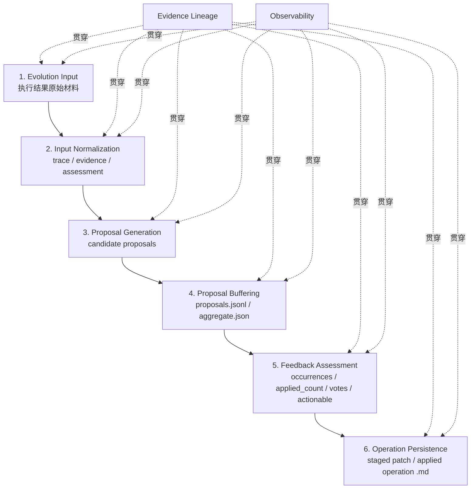
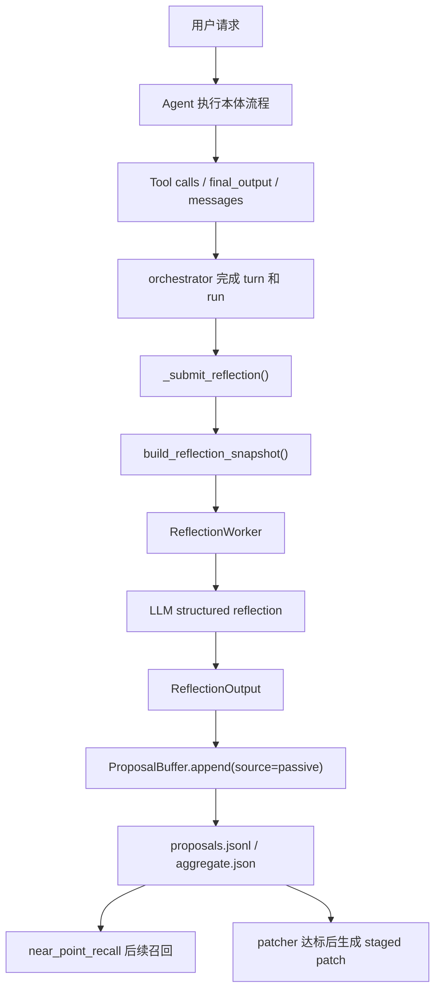
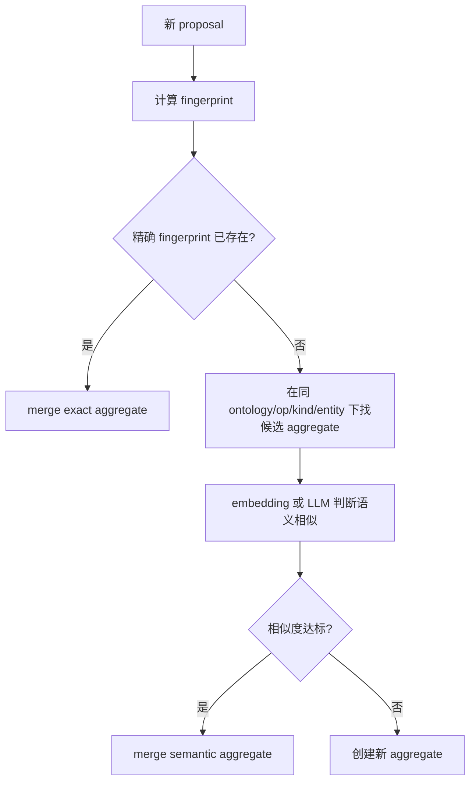

# Reflection / Operation Evolution 优化决策记录

## 背景

当前 reflection 是 operation evolution 的被动入口：一次本体执行完成后，后台 worker 从本轮执行过程里提炼 `procedure`、`pitfall`、`schema` 三类 proposal，并写入 proposal buffer。后续 buffer 达到阈值后，由 patcher 生成待审 operation `.md` patch。

这个机制的目标不是记录用户偏好，也不是普通长期记忆，而是改进本体 operation 本身的执行规范。

当前实现已经完成了基本闭环，但在数据完整性、反思可信度、proposal 归并、成功判定和 ontology 绑定上还有几个需要优化的关键点。

## 功能定位与竞争力愿景

这个功能不应定位成“自动反思总结工具”，而应定位成：

> **Ontology Operation Intelligence Layer**：从真实执行中持续学习、验证、归纳、审计并演进企业本体流程的智能层。

核心竞争力不是“LLM 会反思”，而是：

> **把模型执行经验变成可验证、可审批、可回写的企业流程资产。**

最终产品应能回答：

- 这个 operation 最近执行中反复出现了哪些问题？
- 哪些流程优化已经被多次验证有效？
- 哪些字段 / schema 经常被 agent 误用？
- 哪些 proposal 只是模型猜测，证据不足？
- 哪些 proposal 可以安全进入 staged patch？
- 这次 patch 为什么合理，证据来自哪些 run？
- 应用 patch 后，流程遵从性或执行效率是否改善？

理想形态不是“记忆列表”，而是一条可审计的 operation intelligence graph：

```text
Run Evidence -> Candidate Proposal -> Aggregate -> Validated Improvement -> Staged Patch -> Operation Spec
```

## 第一性原则

1. **反思不能靠模型猜完整过程**  
   反思输入必须来自结构化执行证据，而不是截断后的对话文本。

2. **执行模型不能独立裁判自己的执行质量**  
   模型可以归纳经验，但合规性、成功性、效率问题应尽量由规则和 trace 信号判断。

3. **operation evolution 必须绑定明确的 ontology / operation**  
   无法唯一确定归属时，宁可不写 proposal，也不能污染错误 operation。

4. **运行成功不等于业务成功**  
   `turn.finished(status=success)` 只能表示系统正常完成，不代表答案正确或流程合规。

5. **fingerprint 只适合精确去重，不适合语义归并**  
   语义相似需要单独的 clustering / merge 机制。

## 优化目标定义

operation evolution 的优化目标不是直接证明业务结论的真值准确性。Agent 按 ontology 中的文字流程执行，系统通常没有外部 ground truth 来判断最终业务结论是否真实正确。

本系统优化的是 operation 的三类能力：

1. **可执行性**  
   operation 文本是否足够明确、结构化、低歧义，使 agent 能稳定执行。

2. **流程遵从性**  
   agent 是否按 operation 中定义的输入、分支、对象定义、工具约束和逻辑步骤执行。

3. **执行效率**  
   在不破坏流程完整性和合规性的前提下，是否能减少无效步骤、重复查询、无意义 retry，并支持批量化、并行化或脚本化执行。

因此，reflection / proposal 不应表达为“业务结论一定正确”，而应表达为“基于可验证执行证据，operation 文本或执行路径应如何改进，以提升可执行性、流程遵从性和执行效率”。

## Optimization Taxonomy

| 优化类型 | 主要目标 | 可自动判断程度 | 是否适合 patch operation | 风险 | 说明 |
|---|---|---:|---|---|---|
| 流程遵从性修正 | 流程遵从性 | 高 | 是 | 中 | 当 trace 显示 agent 经常漏读、漏执行或误解某个已定义步骤时，应增强 operation 文本，让必做步骤更明确。 |
| 输入前置校验 | 可执行性 / 执行效率 | 高 | 是 | 低 | 将缺失参数、格式校验、必要前置条件提前，避免后续无效工具调用。 |
| 查询字段 / schema 修正 | 可执行性 / 流程遵从性 | 中高 | 是 | 中 | 当执行证据显示字段名、实体名、值格式与 object definition 或真实工具结果不一致时，生成 schema 类 proposal。 |
| 空结果处理规则 | 可执行性 / 流程遵从性 | 中高 | 是 | 中 | 明确空结果是正常业务结果、阻断条件还是需要报告的不充分信息，避免重复改写 query。 |
| 并行化 / fan-out | 执行效率 | 中 | 是，但需确认独立性 | 中高 | 只有在各迭代项无跨项依赖、无顺序写依赖、无共享中间状态时，才可建议并行。 |
| script 替代手工流程 | 可执行性 / 执行效率 | 中 | 是 | 中 | 当 operation 已有维护脚本或可稳定脚本化时，应声明 script-backed，减少 agent 手动重放流程。 |
| 重复工具调用消除 | 执行效率 | 中 | 不一定 | 低中 | 如果是 operation 文本歧义导致重复，应 patch operation；如果是 agent runtime 行为问题，应改 runtime/prompt，不应污染 ontology。 |
| 步骤合并 / 重排 | 执行效率 | 中 | 谨慎 | 中高 | 可以合并批量查询、前置筛选或重排无依赖步骤，但不能破坏业务语义和审计要求。 |
| 步骤省略 | 执行效率 | 低到中 | 高风险，需要强证据 | 高 | 只有确认该步骤冗余、已被其他步骤覆盖、或只是 agent 误执行时，才可建议删除或弱化。 |
| 业务结论准确性 | 不作为直接目标 | 低 | 通常不直接 patch | 高 | 系统通常没有外部 truth，只能评估证据链、流程遵从和工具结果一致性。 |

## Spec Improvement 与 Runtime Improvement 的区分

不是所有优化都应该写回 operation `.md`。

适合进入 operation evolution 的情况：

- operation 文本有歧义，导致 agent 稳定误解。
- operation 缺少必要输入校验或前置条件。
- operation 引用的字段、实体、格式需要修正。
- operation 可以明确声明并行 fan-out。
- operation 应声明为 script-backed 或补充脚本调用约束。
- operation 对空结果、失败分支、停止条件描述不足。

不应进入 operation spec，优先改 agent runtime / prompt / tool layer 的情况：

- agent 重复读取同一个文件。
- tool result 太长导致 reflection 缺信息。
- 已经写清楚的步骤没有被模型遵守。
- subagent context 传递不完整。
- near-point recall 注入时机或格式不合理。
- SSE、持久化、日志、取消等运行时机制问题。

proposal generation 前必须先判断归因：

```text
这是 operation 文本需要改，还是 agent 执行器 / prompt / tooling 需要改？
```

只有前者才应进入 proposal buffer 并最终 patch operation。

## 目标生命周期划分

这里讨论的是 **operation evolution 自身的生命周期**，不是 agent runtime 从用户请求到最终回答的完整链路。生命周期的起点是“一次模型执行结束后，哪些执行结果进入 evolution”，终点是“经过审批后最终 patch operation `.md`”。

主流程划分为六段：

| 阶段 | 中文名 | 输入 | 输出 | 说明 |
|---|---|---|---|---|
| 1. `Evolution Input` | 初始化信息输入 | 模型执行后的原始材料 | raw evolution input | 收集本轮执行到底发生了什么 |
| 2. `Input Normalization` | 初始化信息处理 | raw evolution input | normalized trace / evidence / assessment | 把原始材料处理成可反思、可比较、可引用的结构化事实 |
| 3. `Proposal Generation` | proposal 生成 | normalized trace / assessment | candidate proposals | 基于结构化事实提炼候选 `procedure` / `pitfall` / `schema` |
| 4. `Proposal Buffering` | 中间信息落盘 | candidate proposals | proposal records / aggregates | 将 proposal 作为中间态落盘和聚合，不直接改 operation |
| 5. `Feedback Assessment` | 持续反馈评估 | aggregates + 后续执行 + 用户/管理员反馈 | updated metrics / actionable decision | 持续判断 proposal 是否真的有效、是否达标 |
| 6. `Operation Persistence` | 结果持久化 | actionable aggregates | staged patch / applied operation `.md` | 生成待审 patch，经审批后最终回写 operation |

横切能力只保留两个：

| 能力 | 作用 |
|---|---|
| `Evidence Lineage` | 每条 proposal、aggregate、patch 都能追溯到 run、tool event、validation signal、用户反馈等证据 |
| `Observability` | 每个阶段都输出结构化状态、原因、指标和 skip reason，便于解释为什么写入或没有写入 |

## 六个阶段的核心能力与竞争力

### 1. Evolution Input / 初始化信息输入

核心能力：高保真采集一次执行的真实证据。

竞争力在于：不是只保存 chat history，而是把一次业务执行变成结构化观测对象。系统应能知道谁执行了什么 ontology、什么 operation、读了哪些文件、查了哪些实体、哪些工具成功或失败、哪些分支被走过、哪些子任务完成。

理想形态：

- 每次 run 自动生成 `EvolutionInput`。
- 包含 resolved ontology / operation / entity scope。
- 包含工具调用摘要、结果摘要、错误、空结果、子 agent 结果。
- 对敏感或一次性业务值做抽象，保留规则证据。
- 每条输入都有可追踪 evidence id。

当前代码状态：

- 主要依赖 `messages`、截断后的 `tool_events`、`user_request`、`final_output`。
- `ontology_id` 依赖前端 selected ontology。
- 没有真正的一等结构化 evolution input。
- 信息采集是“从对话历史里事后捞”，不是运行时稳定记录。

要做出竞争力，第一步是把执行过程变成企业级 event trace，而不是模型聊天记录。

### 2. Input Normalization / 初始化信息处理

核心能力：把原始执行材料转成稳定、可比较、可验证的事实层。

竞争力在于：同样一段执行，不同模型可以有不同解释，但 normalized trace 必须稳定。它应成为 evolution 系统的事实底座。

理想形态：

- 自动解析 `resolved_ontology_id`。
- 自动解析 `resolved_operation_key`。
- 识别 execution mode：script-backed / parallel fan-out / in-loop。
- 生成 compliance signals。
- 生成 efficiency signals。
- 生成 task status。
- 生成 evidence refs。
- 对工具结果做结构化摘要。
- 对无法确定的归属明确 skip，并记录原因。

当前代码状态：

- `execution_summary` 从 final output 解析，但主 prompt 未稳定要求输出。
- `operation_hint` 主要依赖 `execution_summary.operation`。
- 工具事件只是轻量截断文本。
- 没有统一 normalization 层。
- 没有真正的 task status，当前容易把 runtime success 当作业务成功。

这一层的竞争力是“客观”。越少靠模型自由发挥，系统越可信。

### 3. Proposal Generation / Proposal 生成

核心能力：从事实中生成“可改进 operation 的候选经验”。

竞争力在于：不是总结“这次发生了什么”，而是判断“哪些东西值得变成流程资产”。这是普通日志分析和自进化系统的分界。

理想形态：

- 输入只接受 normalized trace + assessment。
- 输出候选 proposal：
  - `procedure`
  - `pitfall`
  - `schema`
- 每条 proposal 都有：
  - target section
  - target anchor
  - evidence refs
  - confidence breakdown
  - proposed wording
  - scope
- LLM 负责归纳表达，不负责凭空裁判。
- 可以生成“不要写入”的理由。

当前代码状态：

- `ReflectionWorker` 直接把 snapshot 给 LLM。
- LLM 输出 `new_procedure` / `new_pitfalls` / `new_schemas`。
- confidence 主要来自模型。
- 没有 target section / anchor。
- evidence lineage 较弱。
- 模型既做判断又做文案，权力太大。

理想状态下，模型像“流程分析师”，但证据来自系统，裁决受规则约束。

### 4. Proposal Buffering / 中间信息落盘

核心能力：把候选经验变成可聚合、可追踪、可治理的中间资产。

竞争力在于：不急着改流程，而是把经验放进一个可以累积证据、合并同类项、被反馈修正的缓冲层。

理想形态：

- raw proposal append-only。
- aggregate 聚合同类经验。
- fingerprint 做精确去重。
- semantic cluster 做语义归并。
- 每条 aggregate 维护：
  - occurrences
  - sources
  - confidence
  - evidence refs
  - applied_count
  - rejection_count
  - status
  - target section
- 支持人工 merge / split / edit / reject。
- 支持冲突标记：和现有 spec 冲突、和 rejected 冲突、和其他 proposal 冲突。

当前代码状态：

- 已有 proposal buffer。
- 已有 `proposals.jsonl`。
- 已有 `aggregate.json`。
- 已有 fingerprint 聚合。
- 已有 source：`active_chat` / `passive`。
- 已有 status 和基础指标。
- 但 fingerprint 是文本归一化 SHA1，不支持语义归并。
- aggregate 没有 target section / evidence lineage。
- 冲突检测和人工整理能力还弱。

这一层已有雏形，是当前最接近产品竞争力的部分。下一步应把它做成“企业流程经验池”。

### 5. Feedback Assessment / 持续反馈评估

核心能力：判断经验是否真的有效，而不是只判断它出现过。

竞争力在于：很多系统会“记住经验”，但很少系统能持续验证经验是否改善了未来执行。这里是护城河。

理想形态：

- proposal 被 recall 后，系统知道它是否真的被使用。
- 后续 run 评估：
  - task 是否成功
  - compliance 是否提升
  - efficiency 是否提升
  - 用户是否点赞 / 点踩
  - 管理员是否 endorse / reject
- `applied_count` 不等于 runtime success。
- 增加更细的指标：
  - `observed_count`
  - `recalled_count`
  - `used_count`
  - `validated_count`
- 能回答：
  - 这条经验被召回几次？
  - 哪次真的被使用？
  - 哪次有效？
  - 哪次失败？
  - 失败原因是什么？
  - 是否应该升级成 patch？

当前代码状态：

- near-point recall 会返回 used fingerprints。
- turn success 后会增加 `applied_count`。
- 用户反馈可以 vote。
- 但 runtime success 被当成有效使用。
- 没有 task quality / compliance validation。
- 没有区分 recall、实际使用、业务成功、用户确认。

伟大的功能必须把“经验有效性”做成核心指标，否则 evolution 会变成噪声放大器。

### 6. Operation Persistence / 结果持久化

核心能力：把经过验证的经验安全写回 operation spec。

竞争力在于：企业系统最怕自动污染流程。真正强的系统应该既能演进，又能审计、审批、回滚。

理想形态：

- patcher 只处理 actionable aggregate。
- patch 必须受 target section / anchor 约束。
- staged patch 展示：
  - 原文 diff
  - proposal 内容
  - evidence lineage
  - 指标
  - 冲突提示
- 人工可以 apply / reject / edit。
- apply 后保存 snapshot。
- operation `.md` 记录 learned version。
- rejected 决策反向影响后续 proposal。
- 已 applied 的经验从 recall 过渡为 spec 本身。

当前代码状态：

- 已有 patcher。
- 可以根据 proposal 生成 staged patch。
- 有人工 review / apply / reject 的路线。
- 但 patcher 对落点控制还粗。
- evidence 展示不足。
- proposal 到 patch 的可解释性还不够。
- apply 后的反馈闭环可以更强。

这一层如果做得好，产品会从“智能体执行器”升级成“流程持续改进系统”。

目标数据流：



### 各阶段职责边界

#### 1. Evolution Input / 初始化信息输入

输入的是模型执行后的原始材料，不是执行前上下文。

包括：

- `run_id` / `turn_id` / `session_id` / `user_id` / `workspace_id`
- resolved `ontology_id` / `operation_key`
- 用户原始请求
- 最终输出
- 工具调用轨迹
- 读取过的 operation / object 文件
- `ontology_search` / `execute_python_script` / `spawn_sub_agent` 的结果摘要
- runtime status
- task status
- validation signals
- 用户反馈，如果已有

#### 2. Input Normalization / 初始化信息处理

把原始执行结果处理成可反思、可归档、可比较的结构化材料。

包括：

- 归一化 execution trace
- 提取 operation scope
- 生成或校正 execution summary
- 生成 compliance / efficiency signals
- 判断是否具备 reflection 条件
- 去掉一次性业务数据和敏感值
- 生成 evidence refs

该阶段只产出结构化事实，不直接生成 proposal。

#### 3. Proposal Generation / Proposal 生成

基于 normalized trace 和 assessment 生成候选经验。

包括：

- `procedure`：可复用执行流程或效率优化
- `pitfall`：应避免的错误路径、失败模式或注意事项
- `schema`：实体字段名、格式、含义等修正

该阶段可以使用 LLM，但 LLM 只能基于结构化证据归纳，不应凭 final output 自行判断执行是否成功。

#### 4. Proposal Buffering / 中间信息落盘

这里的“中间信息”就是 proposal 层。

包括：

- raw proposal
- aggregate
- fingerprint
- semantic cluster
- source: `passive | active_chat`
- kind: `procedure | pitfall | schema`
- target section / anchor
- evidence refs
- confidence
- status: `pending | rejected | promoted | applied`

该阶段对应当前 proposal buffer 的 `proposals.jsonl` 和 `aggregate.json`。它是中间态，不直接修改 operation markdown。

#### 5. Feedback Assessment / 持续反馈评估

对 proposal / aggregate 持续更新指标，判断它是否真的有效。

反馈来源包括：

- 后续 near-point recall 是否注入了该 proposal
- 注入后本轮 task 是否成功
- compliance / efficiency 是否改善
- 用户 👍/👎
- 管理员 endorse / reject / edit
- 重复出现次数
- 语义相似 proposal 合并
- 是否与现有 spec 冲突

核心产出：

- `occurrences`
- `avg_confidence`
- `applied_count`
- `active_endorsements`
- `rejection_count`
- `status`
- `actionable`
- `reason`

#### 6. Operation Persistence / 结果持久化

这里才是最终修改 operation spec。

包括：

- patcher 选择达标 aggregate
- 生成 staged patch
- 人工 review
- edit / apply / reject
- apply 后写回 operation `.md`
- 保存 applied snapshot
- aggregate 状态变为 `applied`
- 后续 near-point recall 不再只是临时经验，而是 operation 文件本身已演进

## 当前实现数据流概览



当前 `ReflectionSnapshot` 主要包含：

| 字段 | 当前来源 | 主要问题 |
|---|---|---|
| `user_request` | 原始用户请求，截断到 1000 chars | 长请求会丢失关键约束 |
| `final_output` | 最终回答，截断到 2000 chars | 用户可见结论不等于执行过程 |
| `execution_summary` | 从 final output 的 `<execution_summary>` 解析 | 主 prompt 未强制输出，质量不稳定 |
| `operation_hint` | 主要来自 `execution_summary.operation` | summary 不稳定时也不稳定 |
| `tool_events` | 从 messages 收集 tool call/result，最多 40 条 | 长流程会丢步骤；单条结果截断后可能缺失关键字段 |
| `ontology_id` | 前端 `selected_ontology_id` | 未选择本体时直接 skip reflection |

## 问题 1：Reflection 输入信息不完整

### 当前问题

当前 reflection 依赖截断后的 `user_request`、`final_output`、`tool_events` 和不稳定的 `execution_summary`。这会导致：

- 长用户请求中的约束被截断。
- final output 只反映最终展示，不包含完整推理和工具路径。
- tool result 被按字符截断，可能丢失真实错误、字段名、空结果原因。
- tool events 只保留最后一部分，复杂流程的早期关键错误不可见。
- `execution_summary` 没有稳定生成契约，不能作为可靠输入。

### 决策

引入结构化 `ExecutionTrace`，把 reflection 输入从“截断文本”改为“结构化证据 + 少量原文引用”。

### Operation Invocation Trace 切分

operation evolution 的优化单位是 operation，但一次 run 可能同时涉及多个 operation，也可能存在 operation 嵌套、subagent 并行 fan-out、同一 operation 多次执行等情况。因此 trace 不能只按 run 切分，也不能只按 `operation_key` 切分。

推荐引入新的运行时概念：

```text
OperationInvocation = 某次具体 operation 激活实例
```

关系如下：

```text
run_id 是一次完整执行容器
operation_key 是流程定义
operation_invocation_id 是本次执行中的某个 operation 实例
span 是具体证据，如 ontology_context / business_data_search / script / subagent
```

目标结构：

```json
{
  "run_id": "run_001",
  "operation_invocations": [
    {
      "id": "opinv_root_1",
      "ontology_id": "example",
      "operation_key": "主流程",
      "parent_id": null,
      "activation_source": "read_operation_file",
      "status": "active | completed | blocked | failed",
      "confidence": 0.8,
      "input_bindings": {}
    },
    {
      "id": "opinv_child_1",
      "ontology_id": "example",
      "operation_key": "子流程",
      "parent_id": "opinv_root_1",
      "activation_source": "spawn_sub_agent_context",
      "status": "completed",
      "confidence": 0.9,
      "input_bindings": {
        "对象ID": "A"
      }
    }
  ],
  "spans": [
    {
      "id": "span_1",
      "type": "ontology_context",
      "operation_invocation_id": "opinv_root_1"
    },
    {
      "id": "span_2",
      "type": "ontology_search",
      "operation_invocation_id": "opinv_child_1"
    }
  ]
}
```

### 当前问题：没有显式 operation started 信号

当前代码里没有可靠的“模型开始执行某个 operation”的显式事件。模型通过 ontology_context、spawn_sub_agent、execute_script 等工具行为隐式进入 operation。不能假设 `operation_invocation` 已经天然存在，必须把它设计成新的 trace 概念。

### 创建信号优先级

operation invocation 不应只靠模型声明。创建信号的可信度优先级如下：

```text
显式 runtime event
> tool boundary signal
> structured context signal
> operation file read signal
> final output / model statement
```

短期可以从现有工具边界自动创建 invocation；长期应由显式 operation routing 创建。

### 短期 MVP 创建规则

#### 规则 A：ontology_context 加载 operation

当 `ontology_context(resource="operation")` 加载：

```text
ontologies/<ontology>/operations/<operation>.md
```

创建或激活一个 invocation：

```json
{
  "activation_source": "read_operation_file",
  "operation_key": "<operation>",
  "confidence": 0.8
}
```

注意：读了 operation 文件不等于一定执行了 operation。因此初始状态可以是 `observed`，只有后续 tool calls / subagent / final output 与它关联时，再升级为 `active`。

#### 规则 B：spawn_sub_agent context 带 operation_file

如果 `spawn_sub_agent` task context 包含：

```json
{
  "operation_file": "operations/子流程.md"
}
```

创建 child invocation：

```json
{
  "activation_source": "spawn_sub_agent_context",
  "parent_invocation_id": "当前 invocation",
  "operation_key": "子流程",
  "actor": "subagent",
  "confidence": 0.9
}
```

subagent 不是 operation 边界，它只是执行 actor。subagent trace 仍应挂到对应 operation invocation 下。

#### 规则 C：operation 文本引用子流程

如果 parent operation 文本里有 `[[子流程]]`，只创建 possible child reference。只有后续 read/subagent/tool trace 对应这个子流程时，才创建 active child invocation。

#### 规则 D：execute_python_script 映射 operation

如果 script 来自 `scripts-list.md`，且 scripts-list 能映射到 operation，则创建 script-backed invocation：

```json
{
  "activation_source": "script_mapping",
  "operation_key": "...",
  "execution_mode": "script_backed",
  "confidence": 0.9
}
```

#### 规则 E：final output / execution_summary 只做弱信号

最终回答或 execution_summary 中声称“使用了某 operation”，只能作为弱信号，不应单独创建高置信 invocation。

### Operation Stack

为了让 tool span 自动归属 invocation，需要维护 operation stack：

```json
{
  "current_operation_invocation_id": "opinv_x",
  "operation_stack": ["opinv_root", "opinv_child"],
  "operation_invocations": {}
}
```

基本规则：

1. 主 agent 读第一个 operation file，push root invocation。
2. 后续 tool calls 默认归属当前 stack top。
3. `spawn_sub_agent` 带 operation_file 时，创建 child invocation。
4. subagent 内部 ontology_context / business_data_search 默认归属它的 child invocation。
5. run 结束时 close 所有 open invocations。

每个 tool span 应带：

```json
{
  "span_id": "tool_123",
  "type": "ontology_search",
  "operation_invocation_id": "opinv_child",
  "operation_stack": ["opinv_root", "opinv_child"],
  "actor": "subagent:item_42",
  "status": "success",
  "duration_ms": 820
}
```

共享工具调用，例如读取 root `objects-list.md`，可以不归属单个 invocation，而使用：

```json
{
  "span_id": "read_objects_list",
  "operation_invocation_id": null,
  "linked_invocation_ids": ["opinv_001", "opinv_002"]
}
```

无法归属的 span 标记为 `unattributed`，不能直接驱动 operation patch，只能作为 observability 问题。

### 事后推断兜底

如果短期无法在 runtime 中显式维护 operation stack，可以做 post-hoc segmentation：

- 从读取 operation file 开始。
- 到下一个 operation file / subagent boundary / run end 之间的 spans，暂时归属该 operation。
- 如果有 spawn_sub_agent context，则优先以 context 指定 operation 作为 child invocation。
- 如果只有 final output 声明，则标记低 confidence。

推断 invocation 必须带：

```json
{
  "attribution": "inferred",
  "confidence": 0.62
}
```

低置信 invocation 不应自动写 proposal，只能进入人工 review 或 observability。

### Proposal 归属规则

生成 proposal 时使用最具体归属原则：

```text
能归属 child operation，就不要写到 parent。
只有 orchestration / delegation / aggregation 问题才写 parent。
```

示例：

- 子流程查询字段错了 -> patch 子 operation 或 entity schema。
- parent 未说明多个子流程可以并行 -> patch parent operation。
- subagent context 缺字段 -> 先判断 parent 是否已明确传参；如果已明确，则是 runtime 问题；如果未明确，则可能 patch parent。
- 多个 sibling operation 都重复读同一个 root 文件 -> 更可能是 runtime/cache 优化，不应 patch operation。

### 长期方案

长期应在 operation routing 阶段引入显式状态转移：

```text
resolve_operation -> start_operation_invocation -> execute -> finish_operation_invocation
```

显式事件示例：

```json
{
  "type": "operation.invocation.started",
  "operation_invocation_id": "opinv_...",
  "ontology_id": "...",
  "operation_key": "...",
  "parent_invocation_id": null,
  "activation_source": "operation_match",
  "input_bindings": {},
  "actor": "main_agent"
}
```

结束事件：

```json
{
  "type": "operation.invocation.finished",
  "operation_invocation_id": "opinv_...",
  "status": "completed | blocked | failed",
  "output_summary": {},
  "actor": "main_agent"
}
```

一句话：当前没有明确信号，所以 `operation_invocation` 应作为新的 runtime trace 概念引入；短期从 operation file read / subagent context / script mapping 自动创建，长期由显式 operation routing 创建。

### 建议的 ExecutionTrace 字段

```json
{
  "resolved_ontology_id": "example-domain-operations-manual",
  "resolved_operation_key": "CHANGE_ORDER变更对批次周期的影响分析",
  "operation_files_read": ["operations/CHANGE_ORDER变更对批次周期的影响分析.md"],
  "object_files_read": ["objects/CHANGE_ORDER.md", "objects/受影响对象.md"],
  "execution_mode": "script_backed | parallel_fanout | in_loop",
  "tool_calls": [
    {
      "name": "ontology_search",
      "entity": "受影响对象",
      "query": "查询...",
      "status": "success | error | empty",
      "result_summary": {
        "row_count": 12,
        "fields": ["对象编号", "设备型号"],
        "error": null
      }
    }
  ],
  "branch_decisions": [
    {
      "condition": "是否存在受影响对象",
      "decision": "yes",
      "evidence": "ontology_search returned 12 rows"
    }
  ],
  "subagent_results": [
    {
      "task_id": "obj_001",
      "status": "success",
      "summary": "完成周期影响分析"
    }
  ],
  "final_task_status": "completed | blocked | insufficient_data | failed_validation"
}
```

### 实现建议

- 运行时直接写 `resolved_ontology_id` 和 `resolved_operation_key`，不要从最终回答里解析。
- tool 结果不要只截断原文，要生成结构化摘要：
  - 成功：row count、字段列表、关键 id、输出类型。
  - 空结果：entity、query、是否允许继续。
  - 错误：error type、message、是否重试。
- 保留原始长结果在日志或 store 中，reflection 只消费摘要。
- `execution_summary` 可以保留为用户可见总结，但不再作为 reflection 的主证据。

## 问题 2：模型自评和内部最优循环

### 当前问题

当前反思结果主要由 LLM 判断：

- 是否执行了某个 operation。
- compliance / efficiency 分数。
- 是否有新 procedure / pitfall / schema。
- confidence 多少。

如果执行模型和反思模型相同，可能出现自我强化：

- 执行时漏读 object，反思时也未发现。
- 错误查询被总结成合理策略。
- 不合规执行被描述成成功经验。
- 模型偏好的执行路径不断被 passive proposal 强化。

### 决策

把 reflection 拆成三层：

| 层级 | 责任 | 是否依赖 LLM |
|---|---|---|
| 规则校验层 | 判断流程是否违反硬约束 | 否 |
| 证据评分层 | 计算 compliance / efficiency signals | 尽量否 |
| 经验归纳层 | 把证据归纳为 proposal 文案 | 是 |

### 建议的规则信号

```json
{
  "compliance_signals": {
    "read_operation_file": true,
    "read_required_object_defs_before_search": true,
    "used_script_for_tool_flow": true,
    "missing_required_input": false,
    "repeated_empty_search_rewrites": 0,
    "fabricated_field_detected": false
  },
  "efficiency_signals": {
    "tool_call_count": 6,
    "duplicate_file_reads": 0,
    "duplicate_searches": 0,
    "parallelizable_loop_executed_serially": false
  }
}
```

### 实现建议

- reflection prompt 只允许基于规则信号和 trace 生成 proposal。
- `confidence` 不应完全由 LLM 自评，可以由规则信号参与计算。
- 被动 reflection 的 proposal 不 fast-track，仍然需要多次出现、成功应用或用户反馈。
- 反思模型可以与执行模型分离，但这不是根本解决方案；根本方案是减少模型自评权重。

## 问题 3：Proposal 是否绑定具体 content block

### 当前问题

当前 proposal 写入时只绑定：

- `ontology_id`
- `operation_key`
- `kind`
- `entity_key`，仅 schema 使用
- `content`

它不绑定 operation markdown 的具体区块。patcher 后续根据 `kind` 粗略决定：

- `procedure` 增强 `# 逻辑描述`
- `pitfall` 增强 `# 注意事项`
- `schema` 修正输入/输出或实体字段事实

### 决策

proposal 产生时就应带上目标区块意图，patch 阶段只做验证和落点细化。

### 建议扩展字段

```json
{
  "target_section": "logic | notes | input_schema | output_schema | entity_schema | script_flow",
  "target_anchor": "可选，指向 step id、heading、字段名或实体名",
  "evidence_refs": [
    {
      "type": "tool_event",
      "id": "call_xxx",
      "summary": "ontology_search returned empty because field cycle was invalid"
    }
  ]
}
```

### 实现建议

- reflection 可以建议 `target_section`。
- patcher 必须校验 `target_section` 是否与 `kind` 一致。
- UI 支持人工修改 target section。
- patcher 不应完全自由决定插入位置。

## 问题 4：未前端选择本体时如何触发 reflection

### 当前问题

现在 `_submit_reflection()` 依赖前端传入的 `selected_ontology_id`。如果用户没有主动选择本体，即使 agent 实际执行了某个 ontology，也会因为缺少 `ontology_id` 而跳过 reflection。

### 决策

reflection 不应依赖前端选择，应依赖后端运行时解析出的唯一 ontology / operation。

### 建议方案

1. 在运行时 state 中写入：

```json
{
  "resolved_ontology_id": "...",
  "resolved_operation_key": "...",
  "resolution_source": "selected_context | manifest_read | operation_file_read | tool_trace",
  "resolution_confidence": 1.0
}
```

2. reflection 触发条件：

| 条件 | 行为 |
|---|---|
| 前端已选择 ontology | 使用 selected ontology |
| 未选择，但 trace 唯一确定一个 ontology | 使用 trace resolved ontology |
| 多 ontology 或无法确定 | skip reflection |

3. operation key 也必须唯一确定；否则不写 proposal。

## 问题 5：Fingerprint 不能处理语义相似

### 当前问题

当前 fingerprint 是：

```text
SHA1(kind + workspace_id + ontology_id + operation_key + entity_key + normalized_content)
```

`normalized_content` 只是小写并去掉空白、标点、下划线。因此它只能合并文本几乎一致的 proposal，不能合并语义相似内容。

示例：

- “查询库存前先校验输入参数”
- “执行库存查询之前必须检查必填参数”

这两条语义相近，但 fingerprint 不同。

### 决策

保留 fingerprint 作为精确审计 ID，新增语义归并层。

### 建议方案



### 实现建议

- 新增 `semantic_cluster_id` 或 `canonical_fingerprint`。
- 每条原始 proposal 仍保留自己的 fingerprint。
- aggregate 可以包含多个 raw fingerprints。
- UI 支持人工 merge / split。
- 语义归并只在相同 `workspace_id + ontology_id + operation_key + kind + entity_key` 范围内发生。

## 问题 6：turn finished 是否等于执行成功

### 当前问题

`turn.finished(status=success)` 当前代表系统执行链路完成，不代表业务结果正确。

风险：

- 错误答案也可能触发 reflection。
- 错误使用过的 proposal 也可能增加 `applied_count`。
- buffer 会把“运行完成”误当作“经验有效”。

### 决策

拆分 runtime success 和 business success。

### 建议状态模型

```json
{
  "runtime_status": "success | error | cancelled",
  "task_status": "completed | blocked | insufficient_data | failed_validation",
  "answer_quality": "unknown | accepted | rejected",
  "compliance_score": 0.0,
  "efficiency_score": 0.0,
  "user_feedback": "up | down | none"
}
```

### outcome 计数建议

`applied_count` 不应只因 runtime success 增加。更合理的条件：

- proposal 本轮确实被召回。
- trace 显示相关步骤被实际使用。
- task_status 是 `completed`。
- 没有 rule validation failure。
- 没有用户 downvote。

如果只有 runtime success，但 task_status unknown，则最多记录为 `observed_count`，不增加 `applied_count`。

## 推荐实施优先级

### P0：补齐 Evolution Input 和 Input Normalization

目标：

- 后端写入 `resolved_ontology_id` / `resolved_operation_key`。
- 未前端选择本体时，只要 trace 唯一确定 ontology，也能触发 reflection。
- 建立结构化 raw evolution input。
- 将执行结果归一化为 trace、evidence refs、validation signals、task status。
- reflection 输入改用 normalized trace，而不是截断后的 request/output/tool events。

原因：

- 这是后续所有优化的基础。
- 没有稳定 operation 归属，任何 proposal 都有污染风险。
- 没有 normalized trace，proposal generation 仍然只能依赖模型猜测。

### P1：拆出 Proposal Generation

目标：

- 将“事实处理”和“候选经验生成”拆开。
- reflection model 只负责基于 trace / assessment 生成 candidate proposals。
- proposal 输出包含 `kind`、`target_section`、`target_anchor`、`evidence_refs`、`confidence`。
- 区分 `model_confidence` 和规则/证据支撑。

原因：

- 拆开后能明确定位问题：trace 不完整、模型没生成、生成错误、落盘失败分别属于不同阶段。
- 降低执行模型自评导致的内部最优循环风险。

### P2：强化 Proposal Buffering

目标：

- proposal buffer 持久化 raw proposal、aggregate、evidence refs、target section。
- fingerprint 继续做精确去重。
- semantic cluster 做语义相似合并。
- UI 支持人工 merge / split / edit / reject。

原因：

- 提升被动 reflection 的聚合质量。
- 避免语义相似 proposal 被分散成多个低频 aggregate。

### P3：改造 Feedback Assessment

目标：

- 区分 runtime success 和 business/task success。
- 用规则信号计算 compliance / efficiency。
- outcome 计数不再只依赖 `turn.finished(success)`。
- `applied_count` 只在 proposal 被实际使用且 task 质量未被否定时增加。

原因：

- 解决错误经验被强化的问题。
- 让 buffer 指标代表“有效经验”，而不是“运行完成次数”。

### P4：收紧 Operation Persistence

目标：

- patcher 按 proposal target 做受约束的 patch。
- staged patch 审批页展示 evidence lineage。
- apply 后保存 applied snapshot，并将 aggregate 状态更新为 `applied`。

原因：

- 最终持久化才会修改 operation `.md`，必须可审计、可回滚。
- evidence lineage 能让审批从“看文案是否合理”变成“看证据是否支持修改”。

### P5：贯穿 Observability

目标：

- 每个阶段都输出结构化事件：
  - stage
  - status
  - reason
  - evidence_refs
  - metrics
- skip path 也必须有明确 reason。

建议事件示例：

```json
{
  "event": "evolution.proposal_generation.completed",
  "run_id": "run_xxx",
  "turn_id": 12,
  "workspace_id": "default",
  "ontology_id": "example-domain-operations-manual",
  "operation_key": "CHANGE_ORDER变更对批次周期的影响分析",
  "status": "success",
  "reason": "candidate_proposals_generated",
  "evidence_refs": ["trace:tool_call:call_xxx"],
  "metrics": {
    "proposal_count": 2,
    "duration_ms": 180
  }
}
```

原因：

- 需要能解释为什么没有 reflection、为什么没有 proposal、为什么没有 patch、为什么没有 apply。
- observability 是排查 evolution 行为的基础，不应是事后补日志。

## 非目标

- 不把 reflection 输出写入普通长期记忆。
- 不让 agent 自动 apply patch。
- 不在无法唯一确定 ontology / operation 时写 proposal。
- 不把 final output 自称成功当作业务成功证据。
- 不用纯 fingerprint 解决语义相似问题。
