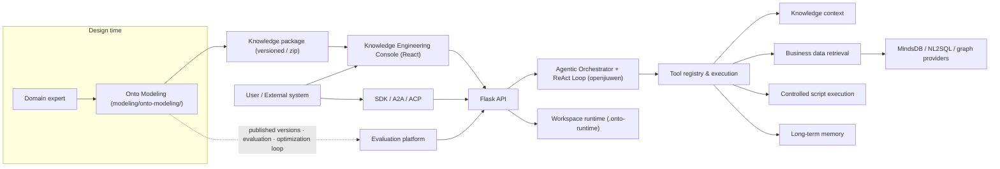

<div align="right">

English | [简体中文](../README.md)

</div>

# 🔬 What is Meta Wise

**Meta Wise** is an Agentic AI platform for enterprise knowledge engineering. It addresses the typical failure modes of general-purpose LLMs in enterprise settings — unfamiliar domain terminology, invented calculation rules, fabricated data fields — with an engineering approach: a business domain's objects, operations, calculation semantics, and data mappings are distilled into a structured **knowledge package** and bound to real enterprise data sources. Agents then answer according to the semantics defined in the package and query real data through the mappings: **every result is traceable, nothing is fabricated by the model.**

The platform follows a three-part split: **design time builds the model** (the Onto Modeling workbench structures domain expertise into packages, `modeling/onto-modeling/`), **runtime uses the model** (agents serve on top of the packages, `consumer/`), and **the platform does the wiring** (models, data, and tools). The runtime main application lives under `consumer/`: the Knowledge Engineering Console (React), the Flask backend, the workspace runtime, and an agent evaluation platform, with the agent main loop built on the open-source agent framework **openjiuwen**. The design-time Onto Modeling workbench lives under `modeling/onto-modeling/`; it publishes packages to the Knowledge Hub, and the standalone evaluation service evaluates published versions to close the **model → evaluate → optimize** loop.

## Application Scenarios

Meta Wise targets scenarios where answers must follow **domain semantics and established calculation rules** rather than free-form model output:

- **Engineering change impact analysis**: change-record impact analysis, object/version mapping, inventory and supply risks, cost and schedule calculations.
- **Production workflow planning**: production-plan decision support built on equipment, batch, material, and capacity knowledge.

Domain knowledge packages are built in Onto Modeling, published to the Knowledge Hub or exported as ZIP files, then imported into consumer.

## Core Features

> ✅ available today · 🚧 planned / in design

- ✅ **Knowledge-package-driven agents**
    + Importing a package equips the agent with the domain's business objects, operations, query boundaries, and controlled scripts.
    + Package contents are browsable online in the console (objects / operations / scripts / mappings, rendered as Markdown).
- ✅ **Unified business data access**
    + Business objects map to real tables and fields via `mappings/object-data-mappings.json`; queries never guess table or column names.
    + Pluggable data providers: NL2SQL HTTP, NL2SQL template, MindsDB, DataAgent, Neo4j, HugeGraph — configured independently per workspace and ontology.
- ✅ **Multi-agent orchestration**
    + A ReAct main loop drives model reasoning, tool invocation, result write-back, and termination; complex tasks fan out to concurrent sub-agents and merge back.
    + Full SSE streaming (`agent-stream.v2`): model reasoning, tool calls, and sub-task progress render live, backed by a Trace panel.
- ✅ **Long-term memory and knowledge evolution**
    + User-level memory injection and explicit memory capture; agents file operation-evolution proposals at runtime, **applied only after human review**.
- ✅ **Layered configuration and access control**
    + Three scopes: Global (model pool, web search, platform connection, agent parameters) → Workspace (model selection, ontology-private data sources, runtime parameters, observability, MCP) → Personal (preferences, themes).
    + API keys live only in the global scope; workspaces reference model profiles without ever touching keys.
    + Authentication is provided by the standalone auth server (`auth-server/`, an OAuth2/OIDC subset): consumer and Onto Modeling share one account system, the backend requires `AUTH_SERVER_URL`, and self-registration is enabled by default (one-step signup, no email verification code; it can be disabled explicitly).
- ✅ **Protocols and SDK**
    + A2A and ACP adapter layers plus an SDK expose the same runtime capabilities to external systems.
- ✅ **Onto Modeling workbench (design time)**
    + An expert-facing web modeling tool (`modeling/onto-modeling/`, FastAPI + React): upload business material, then a modeling assistant guides the stages — **material analysis → flowcharts → object and operation extraction → rules and metrics → quality check → mock data → scenario validation → code generation → solver adaptation**.
    + **Traceable extraction**: uploads are classified by structure (data tables, glossaries), and extracted knowledge keeps anchors back to the original material so it can be verified.
    + **Package refinement**: Studio graph, table and entry views with structured editing, item-by-item report review, and revisions through the chat; generated scripts are run and verified in the JiuwenBox sandbox before they can be committed.
    + **Publish, evaluate, optimize**: packages are published to the Knowledge Hub; the standalone evaluation service evaluates a published version, and its report and suggestions can be imported back to optimize the package before the next release.
- 🚧 **Golden domain packages**
    + Expert-curated, benchmark-quality packages serving both as warm-start templates for new domains and as golden references for tuning the modeling pipeline.

## System Architecture



A typical request enters the Flask API from the console or a protocol adapter; the `AgenticOrchestrator` creates the run state and the ReAct loop calls the model, triggering tools on demand. Tools read knowledge context, query business data, execute controlled scripts, or spawn sub-agents; results stream back to the frontend as SSE events. The dashed edge is the modeling–evaluation loop: the evaluation service runs published package versions against consumer, and the results drive continuous package iteration in Onto Modeling.

- **Console** (runtime): login, masked onboarding tour, New Chat (with a Trace panel), Knowledge Package Workbench (browse full package directories online), and the three-scope Configuration Center.
- **Orchestrator / ReAct loop** (runtime): run lifecycle, iteration limits, cancellation, usage accounting.
- **Workspace runtime**: packages, connections, sessions, and configuration isolated per workspace under `.onto-runtime/`.
- **Evaluation platform**: offline agent-quality evaluation on scenario test cases.
- **Onto Modeling** (design time): builds knowledge packages from domain material with a guided modeling assistant and publishes them to the Knowledge Hub; login shares the auth-server account system with consumer.
- **Auth server**: `auth-server/` provides standalone identity and token issuance (an OAuth2/OIDC subset). It is a required dependency of the consumer backend (`AUTH_SERVER_URL` must be set); consumer and Onto Modeling share one account system.

# 📦 Installation

## Quick start with Docker Compose

For users who want the complete runtime system (backend + console UI):

```bash
cd consumer
cp backend/.env.example backend/.env
docker compose up --build
```

Default endpoints:

| Service | Address |
| --- | --- |
| Backend API | `http://localhost:5055` |
| Console UI | `http://localhost:8888` |

Before starting, configure at least one OpenAI-compatible model in `consumer/backend/.env` (or configure it later in the console under Configuration Center → Global → Model Pool):

```bash
LLM_BASE_URL=<openai-compatible-base-url>
LLM_MODEL=<model-id>
LLM_API_KEY=<api-key>
```

For full-stack deployment (Consumer, Onto Modeling, Knowledge Hub and the evaluation service) with a one-shot orchestration script, see [deploy/README.md](../deploy/README.md).

## Start the modeling workbench

The modeling workbench is Onto Modeling (`modeling/onto-modeling/`). `./deploy/deploy.sh` deploys it together with consumer; for standalone startup, development and deployment see [modeling/onto-modeling/README.md](../modeling/onto-modeling/README.md).

The NL2SQL service and MySQL database used for data evaluation are not part of the full-stack deployment. Deploy them on their own with `bash modeling/nl2sql-service/deploy.sh`; see [modeling/nl2sql-service/README.md](../modeling/nl2sql-service/README.md).

## Local development setup

Backend:

```bash
cd consumer/backend
python -m venv venv
source venv/bin/activate
pip install -r requirements.txt
cp .env.example .env
python run.py
```

Frontend:

```bash
cd consumer/frontend
npm install
npm run dev
```

Local development defaults:

| Service | Address |
| --- | --- |
| Backend API | `http://localhost:5055` |
| Frontend dev server | `http://localhost:6600` |

On Windows, if Python dependency paths exceed the length limit, enable long-path support first; see [consumer/README.md](../consumer/README.md).

# 🚀 Quick Start

## Use a knowledge package (runtime)

1. **Log in** — an admin account is created on first startup; you must change the initial password at first login. A masked onboarding tour walks through the setup path (skippable, reopenable from the top bar).
2. **Configure models** — Configuration Center → Global → Model Pool: add model profiles (keys stored encrypted, global scope only) and pick a default.
3. **Import a knowledge package** — Knowledge Package Workbench → Import (.zip).
4. **Configure its data source** — select the imported package in the Knowledge Package Workbench, open the Data Source tab, choose a provider, complete the form, test it, and save. The source belongs only to that package in the current workspace.
5. **Ask** — start a New Chat and try the package's typical questions, e.g. *"Which design versions does manufacturing item MAT-3021 map to?"*; tool-call details for each step are available in the Trace panel on the right.

## Build a knowledge package (design time)

Knowledge packages are built in Onto Modeling. See [modeling/onto-modeling/README.md](../modeling/onto-modeling/README.md) for the modeling workflow, evaluation setup and package publishing.

**_Notes:_**

* **_Use a reasonably capable OpenAI-compatible model; weak models may degrade tool-calling stability and answer quality._**
* **_Reasoning-heavy models produce better analyses but increase latency; prefer non-thinking models when response speed matters._**

# 💻 Development Guide

Repository layout:

```text
.
├── consumer/                 # Runtime main app: backend, frontend, deploy scripts, SDK, app docs
├── modeling/                 # Design-time modeling
│   ├── onto-modeling/        # Guided ontology modeling workbench (FastAPI + React)
│   ├── nl2sql-service/       # NL2SQL service and MySQL for data evaluation, deployed on its own
│   └── deploy/cce/           # CCE deployment of Onto Modeling, Knowledge Hub and the evaluation service
├── auth-server/              # Standalone auth service (OAuth2/OIDC subset, required by consumer and Onto Modeling)
├── common/                   # Lightweight shared code across modules
├── deploy/                   # Full-stack deployment guide and orchestration scripts
└── docs/                     # Repository-level docs (translated READMEs, etc.)
```

Verification:

```bash
# consumer backend tests
cd consumer/backend
pip install pytest   # not included in requirements.txt
PYTHONPATH=. python -m pytest tests

# consumer frontend checks
cd consumer/frontend
npm run lint
npm run build

# onto-modeling tests and build
cd modeling/onto-modeling/backend
./venv/bin/python -m pytest tests/
cd ../frontend
npm test && npm run build

# nl2sql-service typecheck, tests and build
cd modeling/nl2sql-service
npm run typecheck && npm test && npm run build
```

Build and deploy (two independent paths):

```bash
# Path 1: source compose startup (development / trial)
cd consumer
./run_docker.sh latest all

# Path 2: offline release package (production delivery, with deploy/upgrade/rollback scripts)
cd consumer
./build.sh <version>
```

See [deploy/README.md](../deploy/README.md) for full-stack deployment and [consumer/deploy/README.md](../consumer/deploy/README.md) for consumer release-package details.

Documentation map:

| Document | Content |
| --- | --- |
| [deploy/README.md](../deploy/README.md) | Full-stack deployment guide and orchestration script (automation-friendly) |
| [consumer/README.md](../consumer/README.md) | Full startup, runtime directory, configuration and architecture guide |
| [consumer/backend/README-CN.md](../consumer/backend/README-CN.md) | Backend modules, API entries, runtime config and tests |
| [consumer/frontend/README.md](../consumer/frontend/README.md) | Frontend pages, dev commands, run flow and verification |
| [consumer/docs/api.md](../consumer/docs/api.md) | HTTP API and event stream reference |
| [consumer/docs/consumer-agent-specs.md](../consumer/docs/consumer-agent-specs.md) | Agent runtime specs and behavior constraints |
| [consumer/docs/business-data-provider-extension.md](../consumer/docs/business-data-provider-extension.md) | How to extend business data providers |
| [consumer/sdk/README.md](../consumer/sdk/README.md) | SDK layout and publishing |
| [consumer/deploy/README.md](../consumer/deploy/README.md) | Consumer image building, release packages and installation |
| [modeling/onto-modeling/README.md](../modeling/onto-modeling/README.md) | Onto Modeling startup, deployment and evaluation integration |
| [modeling/nl2sql-service/README.md](../modeling/nl2sql-service/README.md) | NL2SQL service and evaluation MySQL: deployment and API |
| [auth-server/README.md](../auth-server/README.md) | Standalone auth service: endpoints, configuration, and operation |

# ❓ FAQ

- **The console starts but chat replies fail** — check that a model profile is configured (Configuration Center → Global → Model Pool: a profile is added, its key shows "configured", and a default model is selected), and that `LLM_*` variables are set when starting from `.env`.
- **Business data queries return nothing** — a package only queries its own data source in the *current workspace*; select the package in the Knowledge Package Workbench, open Data Source, verify the configuration, and test it again.
- **Windows dependency install fails with path errors** — enable long-path support; see [consumer/README.md](../consumer/README.md).

# 🤝 Contributing

Issues and pull requests are welcome, especially around:

- Knowledge package format, import validation, and example cases
- Business data providers, graph providers, and tool extensions
- Agent loop, sub-agent orchestration, memory and evolution strategies
- Onto Modeling, the modeling–evaluation loop, and golden domain packages
- Evaluation platform, test-case generation, trace replay and quality metrics
- Documentation, deploy scripts, and developer experience

Keep changes focused, and describe verification steps, blast radius, and compatibility implications in your PR.
