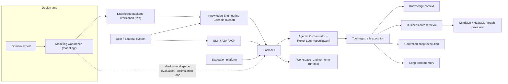

<div align="right">

English | [简体中文](../README.md)

</div>

# 🔬 What is Meta Wise

**Meta Wise** is an Agentic AI platform for enterprise knowledge engineering. It addresses the typical failure modes of general-purpose LLMs in enterprise settings — unfamiliar domain terminology, invented calculation rules, fabricated data fields — with an engineering approach: a business domain's objects, operations, calculation semantics, and data mappings are distilled into a structured **knowledge package** and bound to real enterprise data sources. Agents then answer according to the semantics defined in the package and query real data through the mappings: **every result is traceable, nothing is fabricated by the model.**

The platform follows a three-part split: **design time builds the model** (the knowledge-package modeling workbench structures domain expertise into packages, `modeling/`), **runtime uses the model** (agents serve on top of the packages, `consumer/`), and **the platform does the wiring** (models, data, and tools). The runtime main application lives under `consumer/`: the Knowledge Engineering Console (React), the Flask backend, the workspace runtime, and an agent evaluation platform, with the agent main loop built on the open-source agent framework **openjiuwen**. The design-time modeling workbench lives under `modeling/` and closes the **model → evaluate → optimize** loop with consumer.

## Application Scenarios

Meta Wise targets scenarios where answers must follow **domain semantics and established calculation rules** rather than free-form model output:


Each scenario ships with knowledge-package source files (plain directories), sample datasets, and test cases — zip the package directory to import it into consumer, or build a package from scratch out of your own domain material with the modeling workbench.

## Core Features

> ✅ available today · 🚧 planned / in design

- ✅ **Knowledge-package-driven agents**
    + Importing a package equips the agent with the domain's business objects, operations, query boundaries, and controlled scripts.
    + Package contents are browsable online in the console (objects / operations / scripts / mappings, rendered as Markdown).
- ✅ **Unified business data access**
    + Business objects map to real tables and fields via `mappings/object-data-mappings.json`; queries never guess table or column names.
    + Pluggable data providers: NL2SQL HTTP, NL2SQL template, MindsDB, DataAgent, Neo4j, HugeGraph — bound per workspace.
- ✅ **Multi-agent orchestration**
    + A ReAct main loop drives model reasoning, tool invocation, result write-back, and termination; complex tasks fan out to concurrent sub-agents and merge back.
    + Full SSE streaming (`agent-stream.v2`): model reasoning, tool calls, and sub-task progress render live, backed by a Trace panel.
- ✅ **Long-term memory and knowledge evolution**
    + User-level memory injection and explicit memory capture; agents file operation-evolution proposals at runtime, **applied only after human review**.
- ✅ **Layered configuration and access control**
    + Three scopes: Global (model pool, web search, observability, agent limits) → Workspace (data connections, knowledge-data binding, runtime parameters) → Personal (preferences, themes).
    + API keys live only in the global scope; workspaces reference model profiles without ever touching keys.
    + Authentication is provided by the standalone auth server (`auth-server/`, an OAuth2/OIDC subset): consumer and modeling share one account system, the backend requires `AUTH_SERVER_URL`, with opt-in open registration (one-step signup, no email verification code).
- ✅ **Protocols and SDK**
    + A2A and ACP adapter layers plus an SDK expose the same runtime capabilities to external systems.
- ✅ **Evaluation platform**
    + `evaluation/agent_eval/` evaluates agent quality against scenario test cases: evaluation runs, trace replay, capability inventories, test-case generation.
- ✅ **Knowledge-package modeling workbench (design time)**
    + An expert-facing web modeling tool (`modeling/`, Fastify + React + SQLite): upload Excel data tables and business documents, then follow a fixed trunk workflow — **project setup → material upload & parsing → domain analysis → knowledge-elicitation interview → package generation → package refinement → test-case entry → evaluation runs → optimization suggestions & application**.
    + **Interview-style knowledge elicitation**: the system reads the material and produces a domain overview, candidate business objects, and "domain questions" (business questions the finished package must answer), then interviews the expert in batches — object boundaries, field semantics, calculation rules — and turns the answers into modeling evidence.
    + **Package refinement**: a package health check (rule engine + semantic checks catching rule conflicts, missing fallbacks, duplicated routing); direct manual file revisions (revisions take precedence); and a repair chat that edits the package from natural language — impact analysis first, new version only after confirmation.
    + **Modeling–evaluation loop**: packages are imported via API into a consumer shadow workspace and run against real test cases; an LLM judge scores each run (with manual overrides); the optimizer turns failing cases into structured suggestions — accept them to cut a new version (`1.N.0`) and re-evaluate; every version exports as a ZIP.
    + **Demo mode**: set the LLM endpoint to `faux` to walk the whole modeling flow without an API key.
- 🚧 **Golden domain packages**
    + Expert-curated, benchmark-quality packages serving both as warm-start templates for new domains and as golden references for tuning the modeling pipeline.

## System Architecture



A typical request enters the Flask API from the console or a protocol adapter; the `AgenticOrchestrator` creates the run state and the ReAct loop calls the model, triggering tools on demand. Tools read knowledge context, query business data, execute controlled scripts, or spawn sub-agents; results stream back to the frontend as SSE events. The dashed edge is the modeling–evaluation loop: the modeling workbench imports packages into a consumer shadow workspace for real evaluation runs, and the results drive continuous package iteration.

- **Console** (runtime): login, masked onboarding tour, New Chat (with a Trace panel), Knowledge Package Workbench (browse full package directories online), and the three-scope Configuration Center.
- **Orchestrator / ReAct loop** (runtime): run lifecycle, iteration limits, cancellation, usage accounting.
- **Workspace runtime**: packages, connections, sessions, and configuration isolated per workspace under `.onto-runtime/`.
- **Evaluation platform**: offline agent-quality evaluation on scenario test cases.
- **Modeling workbench** (design time): builds knowledge packages from domain material and expert interviews, wired to consumer for the evaluation loop; login shares the auth-server account system with consumer.
- **Auth server**: `auth-server/` provides standalone identity and token issuance (an OAuth2/OIDC subset). It is a required dependency of the consumer backend (`AUTH_SERVER_URL` must be set); consumer and modeling share one account system.

# 📦 Installation

## Quick start with Docker Compose

For users who want the complete runtime system (backend + console UI):

```bash
cd consumer
cp backend/.env.example backend/.env
docker compose up --build
```

Default endpoints:

| Service | Address |
| --- | --- |
| Backend API | `http://localhost:5055` |
| Console UI | `http://localhost:8888` |

Before starting, configure at least one OpenAI-compatible model in `consumer/backend/.env` (or configure it later in the console under Configuration Center → Global → Model Pool):

```bash
LLM_BASE_URL=<openai-compatible-base-url>
LLM_MODEL=<model-id>
LLM_API_KEY=<api-key>
```

For full-stack deployment (consumer + modeling workbench + auth server / evaluation database) with a one-shot orchestration script, see [deploy/README.md](../deploy/README.md).

## Start the modeling workbench

The modeling workbench delegates login to consumer (it reuses consumer accounts), so start consumer first. Requires Node ≥ 22:

```bash
cd modeling
cp .env.example .env    # set MODELING_LLM_*, or use `faux` for a key-less demo mode
npm install
NODE_OPTIONS=--experimental-sqlite node --env-file=.env node_modules/.bin/tsx src/server.ts
```

Then open `http://localhost:5100` and log in with a consumer account. For frontend development, run `cd modeling/frontend && npm install && npm run dev` (port 6700, proxied to 5100).

## Local development setup

Backend:

```bash
cd consumer/backend
python -m venv venv
source venv/bin/activate
pip install -r requirements.txt
cp .env.example .env
python run.py
```

Frontend:

```bash
cd consumer/frontend
npm install
npm run dev
```

Local development defaults:

| Service | Address |
| --- | --- |
| Backend API | `http://localhost:5055` |
| Frontend dev server | `http://localhost:6600` |

On Windows, if Python dependency paths exceed the length limit, enable long-path support first; see [consumer/README.md](../consumer/README.md).

# 🚀 Quick Start

## Use a knowledge package (runtime)

1. **Log in** — an admin account is created on first startup; you must change the initial password at first login. A masked onboarding tour walks through the setup path (skippable, reopenable from the top bar).
2. **Configure models** — Configuration Center → Global → Model Pool: add model profiles (keys stored encrypted, global scope only) and pick a default.
3. **Connect data** — Configuration Center → Workspace → Data Connections: create a connection with the schema form, then test it.
4. **Import a knowledge package** — Knowledge Package Workbench → Import (.zip). Example package sources live under [examples/](../examples/); zip a package directory before importing.
5. **Bind knowledge to data** — Configuration Center → Workspace → Knowledge & Data Binding: map the package to a connection. Queries only use connections bound in the current workspace.
6. **Ask** — start a New Chat and try the package's typical questions, e.g. *"Which SourceItem versions does TargetItem M-3021 map to?"*; tool-call details for each step are available in the Trace panel on the right.

## Build a knowledge package (design time)

1. **Configure the modeling tool** — open `http://localhost:5100`, log in, then use "⚙ Configuration Center" (top right) to set the LLM (with a one-click validity test), the consumer service address, and the evaluation data source; for a demo, set the LLM base URL to `faux`.
2. **Create a project and upload material** — Excel data tables (one sheet per table, first row = field names, optional second row = notes) plus business documents (md / docx / pdf / txt).
3. **Domain analysis and knowledge-elicitation interview** — the system reads the material into a domain overview, candidate objects, and domain questions (select ≥5 to unlock the interview), then interviews you in batches about object boundaries, field semantics, and calculation rules.
4. **Generate and refine the package** — objects/operations/mappings are generated with domain-question coverage checks; polish the content with the package health check, manual revisions, and the repair chat.
5. **Evaluate and optimize** — enter test cases (prefillable from domain questions), run real evaluations in a consumer shadow workspace, apply optimization suggestions to cut new versions, and export the final ZIP.

**_Notes:_**

* **_Use a reasonably capable OpenAI-compatible model; weak models may degrade tool-calling stability and answer quality._**
* **_Reasoning-heavy models produce better analyses but increase latency; prefer non-thinking models when response speed matters._**

# 💻 Development Guide

Repository layout:

```text
.
├── consumer/                 # Runtime main app: backend, frontend, deploy scripts, SDK, app docs
├── modeling/                 # Design-time modeling workbench (Fastify + React + SQLite)
├── auth-server/              # Standalone auth service (OAuth2/OIDC subset, required by consumer/modeling)
├── common/                   # Lightweight shared code across modules
├── evaluation/agent_eval/    # Agent evaluation platform
├── examples/                 # Scenario cases, knowledge packages, sample scripts
├── deploy/                   # Full-stack deployment guide and orchestration scripts
└── docs/                     # Repository-level docs (translated READMEs, etc.)
```

Verification:

```bash
# consumer backend tests
cd consumer/backend
pip install pytest   # not included in requirements.txt
PYTHONPATH=. python -m pytest tests

# consumer frontend checks
cd consumer/frontend
npm run lint
npm run build

# modeling typecheck and build
cd modeling
npm run typecheck && npm run build
cd frontend && npm run build
```

Build and deploy (two independent paths):

```bash
# Path 1: source compose startup (development / trial)
cd consumer
./run_docker.sh latest all

# Path 2: offline release package (production delivery, with deploy/upgrade/rollback scripts)
cd consumer
./build.sh <version>
```

See [deploy/README.md](../deploy/README.md) for full-stack deployment (including the modeling workbench) and [consumer/deploy/README.md](../consumer/deploy/README.md) for consumer release-package details.

Documentation map:

| Document | Content |
| --- | --- |
| [deploy/README.md](../deploy/README.md) | Full-stack deployment guide and orchestration script (automation-friendly) |
| [consumer/README.md](../consumer/README.md) | Full startup, runtime directory, configuration and architecture guide |
| [consumer/backend/README-CN.md](../consumer/backend/README-CN.md) | Backend modules, API entries, runtime config and tests |
| [consumer/frontend/README.md](../consumer/frontend/README.md) | Frontend pages, dev commands, run flow and verification |
| [consumer/docs/api.md](../consumer/docs/api.md) | HTTP API and event stream reference |
| [consumer/docs/consumer-agent-specs.md](../consumer/docs/consumer-agent-specs.md) | Agent runtime specs and behavior constraints |
| [consumer/docs/business-data-provider-extension.md](../consumer/docs/business-data-provider-extension.md) | How to extend business data providers |
| [consumer/sdk/README.md](../consumer/sdk/README.md) | SDK layout and publishing |
| [consumer/deploy/README.md](../consumer/deploy/README.md) | Consumer image building, release packages and installation |
| [modeling/README.md](../modeling/README.md) | Modeling workbench startup, verification, and API reference |
| [modeling/docs/design.md](../modeling/docs/design.md) | Modeling tool design: positioning, workflow, data model, evaluation loop |
| [modeling/docs/real-e2e-setup.md](../modeling/docs/real-e2e-setup.md) | Real end-to-end modeling–evaluation environment setup |
| [auth-server/README.md](../auth-server/README.md) | Standalone auth service: endpoints, configuration, and operation |
| [evaluation/agent_eval/docs/architecture.md](../evaluation/agent_eval/docs/architecture.md) | Evaluation platform architecture |

# ❓ FAQ

- **The console starts but chat replies fail** — check that a model profile is configured (Configuration Center → Global → Model Pool: a profile is added, its key shows "configured", and a default model is selected), and that `LLM_*` variables are set when starting from `.env`.
- **Business data queries return nothing** — packages only query connections bound in the *current workspace*; verify the binding under Configuration Center → Workspace → Knowledge & Data Binding.
- **Modeling workbench login fails** — modeling delegates login to consumer (`AUTH_ISSUER_URL`); make sure consumer is running and the address is correct. The account is your consumer account.
- **Modeling evaluations keep failing** — run the connectivity test under the modeling tool's Configuration Center → consumer service (service reachable / auth OK / model ready must all pass); query-style test cases also require an evaluation data connection.
- **Windows dependency install fails with path errors** — enable long-path support; see [consumer/README.md](../consumer/README.md).

# 🤝 Contributing

Issues and pull requests are welcome, especially around:

- Knowledge package format, import validation, and example cases
- Business data providers, graph providers, and tool extensions
- Agent loop, sub-agent orchestration, memory and evolution strategies
- The modeling workbench, the modeling–evaluation loop, and golden domain packages
- Evaluation platform, test-case generation, trace replay and quality metrics
- Documentation, deploy scripts, and developer experience

Keep changes focused, and describe verification steps, blast radius, and compatibility implications in your PR.
