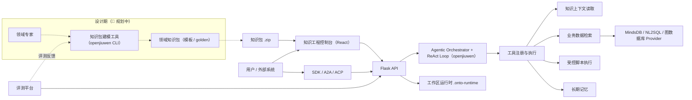

<div align="right">

[English](../README.md) | 简体中文

</div>

# 🔬 什么是 Meta Wise

**Meta Wise** 是一个面向企业知识工程的 Agentic AI 平台。它针对通用大模型在企业场景中的典型问题——不掌握领域术语、自行虚构指标口径与数据字段——给出工程化解法：将业务领域的对象、操作、计算口径与数据映射沉淀为结构化的**知识包**，并与企业真实数据源绑定。此后智能体基于知识包定义的语义作答、经映射查询真实数据，**输出结果可溯源，不由模型虚构**。

平台按三层分工组织：**设计期造模型**（将领域知识沉淀为知识包，`modeling/`，规划中）、**运行期用模型**（智能体基于知识包提供服务，`consumer/`，当前主体）、**平台做接线**（连接模型、数据与工具）。主应用位于 `consumer/`：知识工程控制台（React）、Flask 后端、工作区运行时与智能体评测平台；Agent 主循环基于开源 agent 框架 **openjiuwen** 构建。

## 应用场景

Meta Wise 面向的是回答必须遵循**领域语义与既定计算口径**、而非模型自由生成的场景：

- **工程变更影响分析**：基于变更单、物料映射、库存与供应数据分析成本和周期影响。
- **生产流程规划**：基于设备、批次、物料和容量知识辅助生产计划决策。

领域知识包通过建模工作台构建并导出为 ZIP，再导入消费端使用。

## 核心特性

> ✅ 当前版本可用 · 🚧 规划/建设中

- ✅ **知识包驱动的智能体**
    + 导入知识包后，智能体即获得该领域的业务对象、操作、查询边界与受控脚本。
    + 知识包内容可在控制台在线浏览（objects / operations / scripts / mappings，Markdown 渲染）。
- ✅ **统一业务数据入口**
    + 业务对象经 `mappings/object-data-mappings.json` 映射到真实数据源的表与字段，查询不推测表名或字段。
    + 可插拔 provider：NL2SQL HTTP、NL2SQL 模板、MindsDB、DataAgent、Neo4j、HugeGraph，按工作空间与本体独立配置。
- ✅ **多 Agent 编排**
    + ReAct 主循环组织模型推理、工具调用、结果写回与终止判断；复杂任务可拆分为独立子任务并发 fan-out/fan-in 后汇总。
    + 全程 SSE 流式输出（`agent-stream.v2`）：模型思考、工具调用、子任务进度实时呈现，配套 Trace 运行轨迹面板。
- ✅ **长期记忆与知识演化**
    + 用户级记忆注入与显式记忆沉淀；智能体在运行中提出知识操作演化建议，**经人工评审通过后方可落库**。
- ✅ **分层配置与访问控制**
    + 三层配置作用域：**全局**（模型池、联网搜索、运维监控平台接入、Agent 参数）→ **工作空间**（模型选用、本体私有数据源、运行参数、观测、MCP）→ **个人**（偏好、主题）。
    + 模型密钥仅存全局层；工作空间只引用模型 profile，不接触 API Key。
- ✅ **协议与 SDK 扩展**
    + A2A、ACP 适配层与 SDK，外部系统可集成同一套运行能力。
- 🚧 **知识建模（设计期，规划中）**
    + **知识包建模工具**：基于 openjiuwen 的专家交互式 CLI，通过访谈式对话将领域专家经验结构化为知识包，降低手工编写门槛。
    + **领域知识包**：经专家沉淀、达到标杆质量的知识包，兼作新领域建模的热启动模板与建模调优的标准答案（golden）。
    + **建模—评测闭环**：建模产出经 Modeling 内置评测验证，按评测反馈迭代优化，形成建模、评测、优化的循环。
    + 当前 `modeling/` 目录为能力边界占位（bindings / frontend / ontology / operations），上述能力将按此边界逐步落地。

## 系统架构



一次典型请求：从控制台或协议入口进入 Flask API，由 `AgenticOrchestrator` 创建运行状态，ReAct Loop 调用模型并按需触发工具；工具侧读取知识上下文、查询业务数据、执行受控脚本或派生子 Agent，结果经 SSE 事件流实时返回前端。图中虚线为设计期建模闭环（规划中）：专家经建模工具产出知识包，评测平台的反馈驱动知识包持续迭代。

- **控制台**（运行期）：登录、蒙版式新手引导、新建对话（含 Trace 运行轨迹面板）、知识包工作台（整包目录在线浏览）、三层作用域配置中心。
- **编排器 / ReAct 循环**（运行期）：运行生命周期、轮次限额、取消与用量统计。
- **工作区运行时**：知识包、数据连接、会话与运行配置在 `.onto-runtime/` 下按工作区隔离。
- **评测平台**：基于场景测试用例离线评测智能体质量；规划中同时为建模闭环提供评测反馈（🚧）。
- **知识建模**（设计期，🚧 规划中）：从领域资料与专家访谈构建知识包，支持以领域知识包为模板热启动。

# 📦 安装指导

## 使用 Docker Compose 快速安装

适用于希望直接使用完整系统（后端 + 控制台界面）的用户：

```bash
cd consumer
cp backend/.env.example backend/.env
cp frontend/.env.example frontend/.env
docker compose up --build
```

默认服务地址：

| 服务 | 地址 |
| --- | --- |
| 后端 API | `http://localhost:5055` |
| 前端控制台 | `http://localhost:8888` |

启动前至少需要在 `consumer/backend/.env` 中配置一个 OpenAI-compatible 模型：

```bash
LLM_BASE_URL=<openai-compatible-base-url>
LLM_MODEL=<model-id>
LLM_API_KEY=<api-key>
```

## 本地开发安装

后端：

```bash
cd consumer/backend
python -m venv venv
source venv/bin/activate
pip install -r requirements.txt
cp .env.example .env
python run.py
```

前端：

```bash
cd consumer/frontend
npm install
npm run dev
```

本地开发默认地址：

| 服务 | 地址 |
| --- | --- |
| 后端 API | `http://localhost:5055` |
| 前端开发服务 | `http://localhost:6600` |

Windows 用户如果遇到 Python 依赖安装路径过长，可以先启用系统长路径支持；详见 [consumer/README.md](../consumer/README.md)。

# 🚀 快速上手

1. **登录** — 首次启动会创建管理员账号，首次登录需修改初始密码。登录后的蒙版式操作向导会一步步带你完成初始化（可跳过，顶栏可随时重新打开）。
2. **配置模型** — 配置中心 → 全局配置 → 模型池：添加模型（密钥加密存储、仅存全局层）并设置默认。
3. **导入知识包** — 知识包工作台 → 导入（.zip）。
4. **配置数据源** — 在知识包工作台选择已导入的知识包，打开“数据源”页签，选择 provider、填写配置并测试后保存。数据源只属于当前工作空间下的这个知识包。
5. **提问** — 新建对话，尝试知识包的典型问题，例如"制造物料 MAT-3021 对应哪些设计版本？"，并可在右侧 Trace 面板查看每一步工具调用明细。

**_注意：_**

* **_请使用能力较强的 OpenAI-compatible 模型；模型能力不足可能影响工具调用稳定性与回答质量。_**
* **_思考类模型分析质量更好但耗时明显增加；对响应速度有要求时建议优先使用非思考模型。_**

# 💻 开发指南

仓库结构：

```text
.
├── consumer/                 # 运行期主应用：后端、前端、部署脚本、SDK 和应用文档
├── modeling/                 # 设计期知识建模边界（🚧 规划中，当前为占位）
├── common/                   # 跨模块共享的轻量公共代码
├── docs/                     # 仓库级文档（多语言 README 等）
├── tests/                    # 仓库级测试入口
└── .onto-runtime/            # 本地运行时工作区，默认不提交
```

开发验证：

```bash
# 后端测试
cd consumer/backend
PYTHONPATH=. python -m pytest tests

# 前端验证
cd consumer/frontend
npm run lint
npm run build
```

构建与部署：

```bash
cd consumer
./build.sh latest
./run_docker.sh latest all
```

文档地图：

| 文档 | 内容 |
| --- | --- |
| [consumer/README.md](../consumer/README.md) | 主应用完整启动、运行时目录、配置和架构说明 |
| [consumer/backend/README-CN.md](../consumer/backend/README-CN.md) | 后端模块、接口入口、运行配置和测试方式 |
| [consumer/frontend/README.md](../consumer/frontend/README.md) | 前端页面、开发命令、运行流和验证命令 |
| [consumer/docs/api.md](../consumer/docs/api.md) | HTTP API 与事件接口说明 |
| [consumer/docs/consumer-agent-specs.md](../consumer/docs/consumer-agent-specs.md) | Agent 运行规格和行为约束 |
| [consumer/docs/business-data-provider-extension.md](../consumer/docs/business-data-provider-extension.md) | 业务数据 provider 扩展方式 |
| [consumer/sdk/README.md](../consumer/sdk/README.md) | SDK 目录与发布说明 |
| [consumer/deploy/README.md](../consumer/deploy/README.md) | 镜像构建、部署包和安装说明 |

# ❓ FAQ

- **控制台能打开但对话失败** — 检查模型是否已配置且连通（配置中心 → 全局配置 → 模型池 → 测试），以及通过 `.env` 启动时 `LLM_*` 变量是否设置。
- **业务数据查询没有结果** — 知识包只会查询*当前工作空间 + 当前知识包*的数据源；在知识包工作台选择对应知识包，打开“数据源”页签检查配置并重新测试。
- **Windows 安装依赖报路径错误** — 启用系统长路径支持，详见 [consumer/README.md](../consumer/README.md)。

# 🤝 贡献方式

欢迎围绕以下方向提交 Issue 和 Pull Request：

- 知识包格式、导入校验和示例案例
- 业务数据 provider、图数据库 provider 和工具扩展
- Agent Loop、子智能体编排、记忆与演化策略
- 知识建模工具链与领域知识包沉淀（🚧 方向共建）
- 评测平台、用例生成、trace 回放和质量指标
- 文档、部署脚本和开发体验改进

提交前请保持改动聚焦，并在 PR 中说明验证方式、影响范围和可能的兼容性变化。
