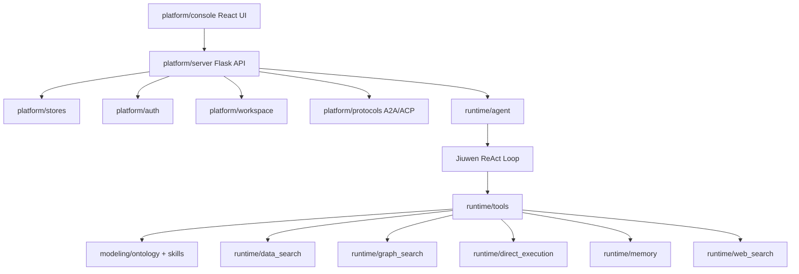

# Architecture

Meta Wise 由建模、运行、平台、示例、测试和评测几个部分组成。当前第一阶段目录重构采用“目录变，Python 包名先不变”的策略：源码被拆到领域目录下，但 Python 包仍然通过 `agentic` 暴露，兼容现有导入路径。

## Runtime Flow

一次 Agent 执行从 `POST /agentic/runs/stream` 开始：

```text
POST /agentic/runs/stream
        |
        v
AgenticOrchestrator.run()
  - 解析 user、workspace、session 和 memory context
  - 构造 AgenticState
  - 后台线程执行 stream loop
        |
        v
JiuwenReactLoopEngine.run()
  1. 构建 system prompt 和 Jiuwen agent 配置
  2. 注册当前可用工具
  3. 调用 openJiuwen ReAct agent
  4. 记录 LLM 子轮次、推理摘要和工具调用
  5. 通过 execute_tool_batch 执行工具
  6. 写入 tool result、state_updates 和最终输出
  7. 遇到取消、终止工具批次或迭代上限时返回
```

前端通过 SSE 消费统一事件：

```text
event: agent.v2
data: { "protocol": "agent-stream.v2", ... }
```

完整 HTTP API 和事件字段见 [API Reference](api.md)。

## High-level Components



## Directory Boundaries

| 目录 | 职责 |
| --- | --- |
| `modeling/ontology` | 本体包、manifest、版本、上传转换和 ontology context |
| `modeling/operations` | operation、rule、metric、script 的建模与演化 |
| `modeling/skills` | 技能建模、技能包管理和 skill parser |
| `modeling/bindings` | 本体与业务数据连接绑定 |
| `runtime/agent` | `AgenticOrchestrator`、Jiuwen loop、sub-agents 和 prompt |
| `runtime/tools` | 工具注册、工具执行、工具事件和工具 schema |
| `runtime/data_search` | `business_data_search`、MindsDB、NL2SQL 和 provider registry |
| `runtime/graph_search` | Neo4j、HugeGraph 和本体实例图检索 |
| `runtime/direct_execution` | 脚本型 operation 的直执行 |
| `runtime/memory` | 长期记忆和 operation evolution 运行期能力 |
| `runtime/web_search` | 外部网页检索 provider |
| `platform/server` | Flask app、routes 和 HTTP 接口聚合 |
| `platform/console` | React 前端应用壳和业务页面 |
| `platform/config` | 系统配置、运维配置和运行配置 |
| `platform/workspace` | workspace 与 `.onto-runtime` 路径管理 |
| `platform/auth` | 用户、认证、权限和 secret 处理 |
| `platform/stores` | RunStore、ChatStore、ExecutionStore 等持久化 |
| `platform/protocols` | ACP、A2A 和 SDK 对接 |
| `platform/observability` | 日志、trace、Langfuse 和 local exporter |
| `platform/deployment` | Docker、release、部署和升级脚本 |
| `platform/contracts` | 工具 schema、事件 schema 和接口契约 |
| `examples` | 场景样例、本体包、示例数据、脚本和场景 testcase |
| `tests` | Meta Wise 自身工程测试 |
| `evaluation` | 本体评测平台、benchmark 和报告输出 |

## Tool System

工具通过 `ToolSpec` 注册，并按调用方限制访问。

| 类型 | 工具 | 调用方 |
| --- | --- | --- |
| 常规工具 | `ontology_context`, `skill`, `business_data_search`, `web_search`, `execute_script` | `main`, `subagent`, `acp` |
| 编排工具 | `spawn_sub_agent` | `main`, `subagent`, `acp` |
| 记忆工具 | `memory` | `main` |

`execute_tool_batch` 会按工具阶段执行。上下文读取、业务检索、脚本执行等工具可以分阶段并发或串行执行，避免上下文尚未加载就直接检索数据。

## Business Data Search

`business_data_search` 的入口参数保持稳定：

```text
ontology_id
entity
query
```

运行时不会使用全局 provider。它会根据当前 user、workspace 和 ontology 解析绑定的数据连接，再把请求交给对应 provider。

当前 provider 类型包括：

- MindsDB
- NL2SQL HTTP
- NL2SQL Template
- Neo4j graph search
- HugeGraph graph search

扩展 provider 的方式见 [Business Data Provider Extension](business-data-provider-extension.md)。

## Runtime Workspace

默认运行时根目录是仓库根目录下的 `.onto-runtime/`：

```text
.onto-runtime/
├── config/
│   ├── system_config.json
│   └── ops_config.json
├── system/
│   └── skills/
├── workspaces/
│   └── <workspace_id>/
│       ├── metadata.json
│       ├── runtime_config.json
│       ├── ontologies/
│       ├── skills/
│       ├── files/
│       └── runtime/
├── users.json
└── workspace-settings.json
```

后端通过 `PROJECT_ROOT` 指向运行时根目录。容器中默认映射到 `/app/.onto-runtime`。

## Protocol Adapters

ACP 和 A2A 是协议适配层，不是独立执行引擎。它们复用 `AgenticOrchestrator.run()`、`agent-stream.v2` 事件和同一套工具执行能力。

主要入口：

- `/.well-known/a2a/agent-card.json`
- `/a2a/tasks...`
- `/acp/agent`
- `/acp/runs...`

## Observability

观测配置由系统设置或 `.onto-runtime/config/system_config.json` 管理：

- `observability.enabled` 控制是否启用观测。
- `observability.mode=local` 输出本地性能 JSONL。
- `observability.mode=langfuse` 导出到 Langfuse。

本地性能分析供聊天页和管理员本地观测页面读取。更多配置项见 [Configuration](configuration.md)。
