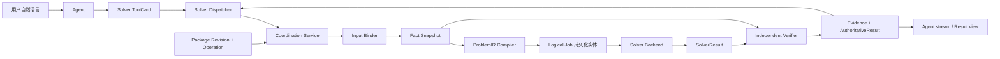
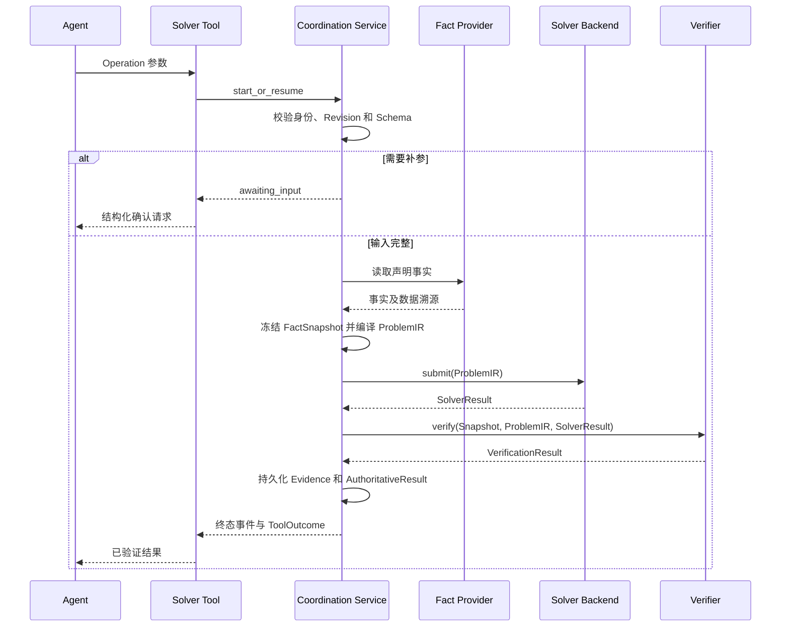

# Agent Tool 驱动的求解器协调平台技术设计规范

> 实现说明：当前代码落地以
> [2026-08-19 Consumer Connector 与 OR-Tools Solver Service 边界校正设计](superpowers/specs/2026-08-19-consumer-connector-ortools-solver-service-design.md)
> 为准。旧手工工作台的兼容边界见 [solver-coordination-design.md](solver-coordination-design.md)。

| 文档属性 | 内容 |
| --- | --- |
| 文档标识 | `solver-coordination-agent-tool-design` |
| 文档类型 | 跨团队技术设计规范 |
| 发布状态 | 正式发布 |
| 版本 | V1.0 |
| 发布及生效日期 | 2026-08-17 |
| 信息分级 | Internal / Cross-team |
| 文档 Owner | Consumer 平台架构负责人 |
| 发布批准角色 | 产品负责人、Agent/Runtime 负责人、Consumer 平台架构负责人、信息安全负责人 |
| 发布记录 | `solver-coordination-agent-tool-design@V1.0` |
| 契约命名空间 | `solver.*.v1` |

本文中的“必须”“不得”表示强制契约；“应”表示默认要求，偏离时必须提供等价的安全性、可靠性和可审计性；“可以”表示实现可选择的行为。

## 目录

1. [文档目的](#1-文档目的)
2. [适用范围](#2-适用范围)
3. [设计原则与能力目标](#3-设计原则与能力目标)
4. [术语与实体模型](#4-术语与实体模型)
5. [角色与责任](#5-角色与责任)
6. [总体架构](#6-总体架构)
7. [信任边界与安全规则](#7-信任边界与安全规则)
8. [契约治理](#8-契约治理)
9. [Knowledge Package、Operation 与 ToolCard](#9-knowledge-packageoperation-与-toolcard)
10. [核心数据契约](#10-核心数据契约)
11. [Job 生命周期、幂等与恢复](#11-job-生命周期幂等与恢复)
12. [服务与 Backend 接口](#12-服务与-backend-接口)
13. [结果、事件与错误语义](#13-结果事件与错误语义)
14. [Agent 与前端展示规范](#14-agent-与前端展示规范)
15. [运行与可观测性](#15-运行与可观测性)
16. [一致性与验收要求](#16-一致性与验收要求)
17. [变更控制](#17-变更控制)

## 1. 文档目的

本规范定义 Agent 调用求解能力时的统一架构、职责边界、数据契约、Job 生命周期、验证机制、安全要求和验收标准。各接入团队以本规范定义的 `solver.*.v1` 契约命名空间作为共同集成依据。

V1.0 规定以下核心能力：

1. 所有求解请求进入持久化的 Logical Job 生命周期。Agent Tool 通过可恢复订阅等待终态并持续报告进度，传输连接断开不影响 Logical Job 执行。
2. Knowledge Package 定义业务求解 Operation、输入输出 Schema、事实映射、约束、目标和展示规则；模型只提供本次业务输入。
3. Consumer 平台锁定 Package Revision、Fact Snapshot、Solver Binding、Compiler Revision 和 Verifier Revision，并将业务求解内容编译为引擎无关的 `ProblemIR`。
4. Solver Backend 只接收标准化 `ProblemIR` 和执行策略，不读取 Knowledge Package、实时 Fact Provider、用户身份或凭据。
5. 独立 Verifier 复算可行性、目标值、结果身份和证明等级。只有验证完成且 Evidence 持久化成功的字段可以进入权威结果。
6. Agent 和前端只展示结构化补参、执行进度、结果、Evidence 和运行记录，不承担求解编排或可信字段判定。

## 2. 适用范围

### 2.1 适用角色

| 角色 | 使用本规范的内容 |
| --- | --- |
| 产品 | 求解能力边界、用户结果语义和服务启用条件 |
| Agent / Runtime | ToolCard、补参、订阅恢复、事件投影和 Tool Outcome |
| Consumer 平台 | 身份、版本锁、Input Binder、Fact Snapshot、ProblemIR、Job、Evidence 和权限 |
| Knowledge Package 团队 | `solver_workflow` Operation、Decision Model、Schema 和展示声明 |
| Solver Backend 团队 | `ProblemIR`、能力握手、Job 操作和 `SolverResult` |
| Verifier / 领域团队 | 验证独立性、证明等级、复算输入和权威字段 |
| 前端团队 | 补参确认、进度、结果、Evidence 和运行记录展示 |
| SRE / 信息安全 | 持久化、容量、恢复、审计、凭据、资源隔离和运行策略 |

### 2.2 规范范围

本规范覆盖：

- Agent Tool 到 Solver Backend 的端到端责任链；
- Knowledge Package、Operation 和 ToolCard 契约；
- NormalizedInput、FactSnapshot、ProblemIR、SolverResult、VerificationResult、AuthoritativeResult 和 Evidence；
- Run、Tool Call、Logical Job、Attempt 和 Subscription 的关系；
- 幂等、重试、取消、超时、断线续读和进程重启恢复；
- 结果、事件、错误、权限、审计和运行限额；
- 跨团队一致性验证和生产启用条件。

### 2.3 非范围

本规范不定义：

- 具体业务求解族的领域变量、约束和目标函数；
- 分布式队列、数据库、容器平台等基础设施产品选型；
- 业务系统写回流程。写回必须由单独、显式、可确认的 Operation 定义；
- 任意 Python、网络请求、数据库查询或动态代码形式的 Decision Model；
- 客户身份、现场数据、内部地址、凭据或专有部署配置。

## 3. 设计原则与能力目标

### 3.1 设计原则

1. **契约优先**：所有跨组件数据先定义版本化 Schema，再实现 Adapter。
2. **平台控制上下文**：Workspace、Access Subject、Run、Session、Package Revision 和 Solver Binding 由平台注入，模型和客户端不得覆盖。
3. **事实冻结**：求解、验证、重试和回放只消费同一 Fact Snapshot，不重新读取实时 Fact Provider。
4. **持久化执行**：请求线程和流式连接只承载订阅，不承载 Logical Job 的真实生命周期。
5. **后端隔离**：Solver Backend 只消费 `ProblemIR`，不感知 Agent、前端、用户身份和业务数据连接。
6. **独立验证**：Solver 输出默认不可信，Verifier 独立生成验证结论和证明等级。
7. **字段级权威**：权威性绑定到 `verified_claims[]` 中的具体字段，不以整个响应成功代替验证。
8. **默认只读**：Solver Tool 不写回业务系统；任何写操作使用独立 Operation 和授权流程。
9. **失败关闭**：Schema、版本、权限、摘要或能力握手不一致时停止执行，不进行隐式降级。

### 3.2 能力目标

```text
意图可被 Agent 准确选择
输入可被 Schema 确定性校验
事实可被冻结并追溯
业务求解内容可被确定性编译
Job 可重试、取消、恢复和审计
结果可被独立验证
证据可被授权读取
各端对结果语义保持一致
```

## 4. 术语与实体模型

### 4.1 术语表

| 术语 | 定义 |
| --- | --- |
| Knowledge Package | 定义业务求解内容及声明资源的不可变知识包。 |
| Package Revision | Knowledge Package 的不可变修订版。一次运行只绑定一个明确 Revision。 |
| Operation | 面向 Agent 的业务动作声明，定义输入、补参行为、执行模式和结果展示方式。 |
| Decision Model | 受限、类型化的决策模型，描述变量、事实引用、约束和目标，不允许任意代码。 |
| Fact Provider | 提供业务事实的受控适配器，不是模型 Provider 或 Solver Backend。 |
| Fact Snapshot | 求解开始前冻结的事实集合及其数据溯源、时间和摘要。 |
| Solver Binding | 平台为求解族解析的不可变执行绑定，包含 Backend Adapter、能力、协议版本和 Runtime Profile 引用。 |
| Verifier Binding | 平台为验证策略解析的不可变验证绑定，包含 Verifier Revision、独立性等级和证明能力。 |
| Runtime Profile | Solver Binding 引用的不可变运行限额、SLO、恢复目标和重试预算。 |
| Execution Policy | Logical Job 使用的 Deadline、重试、取消和优先级策略。 |
| Contract Digest | 绑定一次 Tool Call 所有 Schema、Revision、Binding、Runtime Profile 和 Execution Policy Schema 的规范摘要。 |
| ProblemIR | Consumer 平台编译出的引擎无关标准求解表示。 |
| Solver Backend | 接收 ProblemIR、推进 Backend Job 并返回结构化 SolverResult 的执行器。 |
| Backend Job | Solver Backend 内部任务，只通过 Opaque ID 和 Backend Port 被平台访问。 |
| Verifier | 独立复算并决定结果字段是否可采信的组件。 |
| Access Subject | 认证系统解析出的调用主体，是默认授权和数据隔离边界。 |
| Run | 一次 Agent 业务运行的可追踪上下文。 |
| Tool Call | Agent 在某个 Run 中对 Solver Tool 的一次逻辑调用。 |
| Logical Job | 由规范化输入、事实快照、Solver Binding 和运行策略确定的持久化求解任务。 |
| Attempt | Logical Job 向 Solver Backend 发起的一次实际提交。 |
| Subscription | Run/Tool Call 对 Logical Job 的可恢复订阅关系。 |
| Evidence | 支撑结果和验证结论的不可变制品及其摘要、权限和数据溯源。 |
| Tool Outcome | Coordination Service 向 Agent/前端发布的稳定 Tool Call 结果分类。 |

本文单独使用 `Job` 时均指 Logical Job；只有明确写作 `Backend Job` 时才表示 Solver Backend 内部任务。

### 4.2 实体关系

```text
Workspace
  └── Access Subject
       └── Run
            └── Tool Call
                 └── Subscription ──> Logical Job
                                      └── Attempt(s)
                                           └── Evidence
```

### 4.3 标识与所有权规则

- Run、Tool Call、Logical Job、Attempt、Subscription 和 Evidence 必须携带 Workspace 作用域。
- Access Subject 是最小默认可见范围。相同 Workspace、相同 Access Subject 的多个 Run 可以订阅同一 Logical Job。
- 跨 Access Subject 共享默认禁止。任何共享能力必须具有显式授权、Evidence ACL 和审计记录。
- `logical_job_key` 必须绑定 Workspace、Access Subject、Solver Binding、Problem Digest、运行策略摘要和 `retry_generation`。
- 网络重放复用原 Attempt。Logical Job 进入终态前，重试策略可以在预算内创建新 Attempt，并复用已冻结制品。
- Logical Job 进入终态后不得追加 Attempt。显式重试必须创建新的 Tool Call 和 Logical Job，递增 `retry_generation`，保存 `parent_job_id` 并记录 lineage。
- 输入、约束、Package Revision、Solver Binding 或 Contract Digest 变化时，必须创建新的 Tool Call 和 Logical Job，不得重新解释原 Logical Job。
- 除内容摘要、`logical_job_key` 和 ToolCard 名称外，实体 ID 均为区分大小写的 Opaque ASCII String，满足 `[A-Za-z0-9][A-Za-z0-9_-]{0,127}`。消费者不得解析 ID，也不得在 ID 中编码客户身份、业务数据或凭据。
- 实体 ID 必须在 Workspace 和对象类型内唯一；`event_id` 必须在 Workspace 内唯一；`event_seq` 是从 1 开始且不超过 `9007199254740991` 的 JSON 安全整数。

## 5. 角色与责任

RACI 中，R 表示执行责任，A 表示最终责任，C 表示协作责任，I 表示知会责任。每项交付物只有一个 A。

| 交付物或责任 | 产品 | Agent/Runtime | Consumer 平台 | Knowledge Package | Backend | Verifier/领域 | 前端 | SRE/安全 |
| --- | --- | --- | --- | --- | --- | --- | --- | --- |
| ToolCard 与补参行为 | C | R/A | C | C | I | I | C | C |
| Package、Operation、Decision Model | I | C | C | R/A | I | C | I | C |
| Input Binder 与运行时身份 | I | I | R/A | C | I | I | I | C |
| Fact Snapshot 契约 | I | I | A | R | I | C | I | C |
| ProblemIR 与 Solver Binding | I | I | R/A | C | R | C | I | C |
| Solver Backend 实现 | I | I | C | I | R/A | C | I | C |
| Verifier 独立性与证明等级 | C | I | C | C | C | R/A | I | C |
| Job Store、恢复和制品回收 | I | I | R/A | I | C | I | I | R/C |
| 事件与结果展示 | C | R | R | C | I | C | R/A | C |
| SLO、告警、备份和安全控制 | I | I | R | I | C | C | I | R/A |
| 生产启用与服务策略 | R/A | C | R | C | C | C | R | R |

## 6. 总体架构

### 6.1 组件关系



### 6.2 依赖方向

```text
Agent/Runtime
  → Solver Tool
  → Coordination Service
  → Contracts and Ports
  → Binder / Snapshot / Compiler / Job
  → Problem Family / Backend / Verifier
  → Artifact / Ledger / Provider Adapters
```

以下反向依赖被禁止：

```text
Domain Core → HTTP Route
Domain Core → Frontend DTO
Solver Core → Tool Runtime Context
Solver Core → Model Provider
Solver Core → Fact Provider Credentials
```

### 6.3 执行序列



### 6.4 组件边界

- Agent 层只负责 Tool 注册、参数投影、补参和事件订阅。
- Consumer 平台负责作用域、版本、事实快照、编译、Job、Evidence 和恢复。
- 求解族 Adapter 只消费不可变输入和 Fact Snapshot，不访问 HTTP 框架、前端状态或凭据。
- Solver Backend 只消费 ProblemIR 和执行策略。
- Verifier 不依赖 Solver 的内部状态或中间计算结果。
- 前端只渲染稳定事件和结果，不选择 Backend Endpoint，不拼装平台身份。

## 7. 信任边界与安全规则

### 7.1 信任边界

```text
不可信：用户文本、模型输出、客户端状态、传输连接
        │ Schema、权限、版本和作用域校验
        ▼
受治理：Operation、Binder、Fact Snapshot、ProblemIR、Job、Evidence
        │ Backend 能力握手和独立验证
        ▼
可发布：带 Evidence 和明确证明等级的 AuthoritativeResult
```

### 7.2 强制安全规则

- 模型不得传入 Workspace、Access Subject、Run、Session、Revision、凭据、脚本路径、Endpoint 或 Evidence 引用。
- Decision Model、ProblemIR 和 Tool 参数不得声明 Endpoint、Token、Secret、数据库表名、环境路径或任意可执行代码。
- Solver Backend 不得读取 Knowledge Package、Fact Provider、用户身份或凭据。
- Verifier 不得将 Solver 的中间值或评价函数输出直接作为独立证明。
- Solver Tool 默认只读。业务写回必须由单独 Operation 显式声明、授权和确认。
- Secret 只能通过受控引用注入执行边界，不得进入模型上下文、ProblemIR、日志、事件或 Evidence。
- 所有制品必须按 Workspace 和 Access Subject 授权读取，并使用内容摘要、原子写入、完整性校验和留存策略。
- 日志和事件不得包含完整 ProblemIR、原始业务数据、内部堆栈、文件路径或未授权制品内容。
- 本地进程和远程服务都必须执行 CPU、内存、运行时间、输出大小和并发限制。

## 8. 契约治理

### 8.1 契约注册与命名空间

V1.0 的机器可读契约统一使用 `solver.*.v1` 命名空间。契约注册表必须包含以下对象：

```text
solver.package.v1
solver.operation.v1
solver.tool-card.v1
solver.tool-request.v1
solver.runtime-context.v1
solver.run.v1
solver.tool-call.v1
solver.input-request.v1
solver.input-confirmation.v1
solver.normalized-input.v1
solver.fact-snapshot.v1
solver.fact-provider-binding.v1
solver.problem-ir.v1
solver.logical-job.v1
solver.attempt.v1
solver.subscription.v1
solver.execution-policy.v1
solver.binding.v1
solver.verifier-binding.v1
solver.runtime-profile.v1
solver.capabilities.v1
solver.backend-job.v1
solver.backend-status.v1
solver.solver-result.v1
solver.verification-result.v1
solver.verification-attempt.v1
solver.evidence.v1
solver.authoritative-result.v1
solver.tool-call-handle.v1
solver.tool-call-status.v1
solver.event-page.v1
solver.cancellation-request.v1
solver.cancellation-ack.v1
solver.tool-outcome.v1
solver.event.v1
solver.error.v1
solver.contract-manifest.v1
solver.contract-bundle.v1
solver.contract-registry.v1
solver.coordination-service.v1
solver.backend-port.v1
```

Contract Registry 是 `solver.*.v1` 机器契约的唯一发现入口，必须提供以下只读操作：

| 操作 | 输入 | 返回 |
| --- | --- | --- |
| `resolve_manifest` | `contract_digest` | `solver.contract-manifest.v1` |
| `read_schema` | `schema_id`、`schema_digest` | 媒体类型为 `application/schema+json` 的不可变 Schema 内容 |
| `export_bundle` | `contract_digest` | `solver.contract-bundle.v1` 的内容寻址制品引用和 Bundle Digest |

Contract Manifest 必须包含 `contract_digest`、`manifest_digest`，以及按 `schema_id` 排序的 `schemas[]`。每个 Schema 条目必须包含 `schema_id`、`schema_version`、`schema_digest`、`media_type` 和内容寻址引用。Manifest 和 Bundle 必须不可变；读取到的内容摘要与条目不一致时必须 fail closed。

Consumer 平台负责契约注册、Schema 摘要计算和运行时校验。Agent、Knowledge Package、Backend、Verifier 和前端只能通过 Contract Registry 获取指定 Digest 的 Schema 或 Bundle，不得复制并修改字段语义。

### 8.2 版本规则

- `schema_version` 是每个跨组件对象的必填字段。
- 主版本内只允许增加可选字段或扩展明确声明为开放的枚举。
- 删除字段、改变字段类型、改变默认值或收紧既有合法输入必须发布新的主版本。
- 未识别的主版本必须 fail closed。
- Contract Digest 必须覆盖完整 Schema Digests、Package Revision、Operation、Compiler Revision、Fact Provider Binding、Solver Binding、Verifier Binding、Runtime Profile，以及 Execution Policy 的 Schema 和 Revision。
- Job 创建后必须保存 Contract Digest 和 Execution Policy Digest；恢复时任一摘要不一致都返回 `solver_contract_drift`。

### 8.3 规范化、摘要与标识算法

所有跨组件摘要使用以下固定算法：

1. 文本编码为 UTF-8；进入任何摘要计算前，业务字符串按 Unicode NFC 规范化。
2. JSON 解析器必须在规范化前拒绝重复对象键；通过解析后使用 JSON Canonicalization Scheme（JCS，RFC 8785）序列化，不保留无意义空白。
3. 需要精确小数语义的业务数值使用 Schema 约束的十进制字符串；JSON Number 只用于 Schema 明确允许的整数。
4. 内容摘要使用 SHA-256，编码为 `sha256:` 加 64 位小写十六进制字符。
5. 摘要输入不得包含摘要字段自身、传输时间、日志字段或非确定性生成值。
6. 表示集合的数组必须按稳定标识、再按内容摘要升序排列并拒绝重复项；表示业务顺序的数组保持 Compiler 生成顺序。

各摘要的输入固定如下：

| 摘要 | 规范输入 |
| --- | --- |
| Problem Digest | 移除 `problem_id` 后的完整 ProblemIR |
| Fact Snapshot Digest | 完整 FactSnapshot，移除自身 Digest 字段 |
| Tool Request Digest | `tool_name`、严格解析并按 NFC 规范化的 `arguments`、Contract Digest，以及首次调用的 Workspace、Access Subject、Run、Package Revision 和 Deadline |
| Contract Digest | 按 Schema ID 排序的完整 Schema Digests、Package Revision Digest、Operation Digest、Compiler Revision Digest、Fact Provider Binding Digest、Solver Binding Digest、Verifier Binding Digest、Runtime Profile Digest、Execution Policy Schema Digest 和 Revision |
| Execution Policy Digest | 单个 Logical Job 的有效 Deadline、重试预算、取消策略、优先级和 Runtime Profile Digest |
| Runtime Profile Digest | 完整 Runtime Profile，移除自身 Digest 字段 |
| Evidence Digest | Evidence 内容、媒体类型、Schema Version 和授权作用域摘要 |

`ProblemIR.problem_id` 必须等于按上述规则计算的 Problem Digest。Backend、Verifier 和恢复 Worker 都必须重新计算并校验；不一致时返回 `backend_result_invalid` 或 `solver_contract_drift`，不得继续执行。

`logical_job_key` 由 Consumer 平台生成：

```text
payload = JCS([
  workspace_id,
  access_subject_id,
  contract_digest,
  solver_binding_digest,
  problem_digest,
  execution_policy_digest,
  retry_generation
])

logical_job_key = "ljob_" + base32lower_no_padding(
  HMAC-SHA-256(platform_hmac_key[key_version], payload)
)
```

平台必须保存 `key_version` 和完整 256 位输出。相同 Key 对应不同规范输入时必须返回冲突并触发安全告警。

## 9. Knowledge Package、Operation 与 ToolCard

### 9.1 Package 声明

一个可用于求解的 Package Revision 必须声明：

| 字段 | 语义 |
| --- | --- |
| `package_key` | Package 稳定标识 |
| `revision` | 不可变修订标识 |
| `solver_operations[]` | 可被 Agent 调用的求解 Operation |
| `decision_models[]` | 受限 Decision Model |
| `fact_requirements[]` | 逻辑事实、数据质量、时效和权限要求，不包含实际 Endpoint |
| `solver_requirements` | 求解族、规模、证明能力和资源特征等抽象能力要求 |
| `verification_policy` | 必须验证的字段、证明等级和独立性要求 |
| `presentation` | 可展示字段及展示规则 |

Package Revision 发布后不得原地修改。任一声明资源的内容变化都必须生成新的 Revision 和内容摘要。

Knowledge Package 不得声明 Endpoint、服务身份或实际 Fact Provider、Solver、Verifier Binding。Consumer 平台根据 `fact_requirements`、`solver_requirements` 和 `verification_policy` 解析不可变 Fact Provider Binding、Solver Binding、Verifier Binding 与 Runtime Profile，并将四者摘要写入 Contract Digest。

ToolCard 注册时必须绑定具体的 Solver Binding、Verifier Binding 和 Runtime Profile。运行期间的副本选择与负载均衡只能发生在该 Solver Binding 内部，不得改变 Contract Digest。

### 9.2 Operation 契约

`solver_workflow` Operation 至少声明：

| 字段 | V1.0 要求 |
| --- | --- |
| `key` | 在 Package Revision 内唯一、稳定、可审计，并满足 `[a-z][a-z0-9_]{0,31}` |
| `execution.mode` | 固定为 `solver_workflow` |
| `decision_model` | 指向同一 Revision 内的 Decision Model |
| `input_schema` | 仅包含业务字段，不包含平台身份字段 |
| `on_missing_input` | 固定为 `await_input` |
| `on_ambiguous_input` | 固定为 `await_input` |
| `on_infeasible` | 固定为 `return_infeasible`，不得自动放宽约束 |
| `on_solver_error` | 固定为 `fail` |
| `on_verification_error` | 固定为 `reject` |
| `presentation` | 只允许投影已验证字段 |

### 9.3 ToolCard

默认情况下，每张 ToolCard 只绑定一个 Operation。V1.0 名称示例为：

```text
solve_optimize_delivery_route_8f31a2c4d7e9
```

名称算法固定如下：

- `operation_slug` 必须与 Operation `key` 完全相同，不执行大小写转换、字符替换或截断；
- 名称格式为 `solve_{operation_slug}_{contract_digest 前 12 位十六进制字符}`，总长度不超过 64；
- ToolCard 注册表必须保存完整 Contract Digest，不得只保存 12 位前缀；
- 相同名称对应不同完整 Digest 时，注册失败并返回 `solver_tool_name_collision`，不得动态改名。

ToolCard 注册表必须保存 Package Revision、Operation Key、Input Schema Digest 和 Contract Digest。注册映射失效或摘要不一致时，Dispatcher 必须拒绝调用。

Agent Runtime 必须能够从 ToolCard 元数据或本地 ToolCard 注册映射取得完整 Contract Digest，并据此调用 Contract Registry 的 `resolve_manifest`。模型只看到 Tool 名称和业务 Input Schema，不接收 Contract Registry 地址或制品引用。

当 Agent Provider 需要聚合 ToolCard 时，聚合 Schema 必须使用带 Operation discriminator 的严格 `oneOf`。禁止将多个 Operation 的字段平铺为一个联合对象。

## 10. 核心数据契约

本节 JSON 仅使用合成值说明对象结构；字段、类型、约束和摘要算法以 `solver.*.v1` 契约定义为准。

### 10.1 NormalizedInput

```json
{
  "schema_version": "solver.normalized-input.v1",
  "operation_key": "optimize_delivery_route",
  "values": {},
  "source_evidence": [],
  "normalization": {
    "unit_conversions": [],
    "precision": "declared-by-schema"
  }
}
```

NormalizedInput 只包含业务字段及其 Evidence，不包含平台身份。输入异常使用唯一映射：

- 缺少可由用户提供的必填业务字段，或存在需要用户选择的多个合法候选值：Tool Call 进入 `awaiting_input`；
- JSON 重复键、字段类型错误、非法枚举、非法单位或精度不符合 Input Schema：Tool Call 进入 `failed` 并返回 `solver_schema_invalid`；
- Tool Call 已 `ready` 后，Fact Provider 返回必需事实缺失、重复或相互冲突：Logical Job 在 `snapshotting` 阶段进入 `failed` 并返回 `fact_snapshot_invalid`。

上述异常不得跨分类降级，也不得进入 Solver Backend。

### 10.2 FactSnapshot

FactSnapshot 必须记录：

- 规范字段、值、单位和精度；
- 实体标识和 Fact Provider Binding；
- 业务生效时间和采集时间；
- 缺失、重复和冲突检查结果；
- Package Revision、Workspace 和 Access Subject；
- 内容摘要和 Evidence 引用。

求解、验证、重试和回放只消费该快照，不得重新读取实时 Fact Provider。

### 10.3 ProblemIR

```json
{
  "schema_version": "solver.problem-ir.v1",
  "problem_id": "sha256:4d8f7a0e5b9c2d1f6a3e8b0c7d4f9a1e2b6c8d0f3a5e7b9c1d4f6a8e0b2c3d5f",
  "problem_family": "delivery_route.v1",
  "decision_space": {},
  "parameters": {},
  "constraints": [],
  "objectives": [],
  "limits": {}
}
```

ProblemIR 是 Solver Backend 的唯一业务输入。它不得携带数据库查询语义、凭据、原始 Provider 连接或 Package 外路径。规范化排序、数值精度和摘要算法由 Compiler Revision 固定。

### 10.4 结果分层

```text
SolverResult          = Backend 计算输出，默认不可信
VerificationResult    = Verifier 独立复算结论和证明等级
AuthoritativeResult   = 允许向 Agent 和前端发布的字段投影及 Evidence 引用
```

AuthoritativeResult 必须追溯到：

- Run、Tool Call、Logical Job 和 Attempt；
- Package Revision、Solver Binding 和 Verifier Revision；
- Fact Snapshot Digest 和 Problem Digest；
- SolverResult、VerificationResult 和 Evidence Digest。

AuthoritativeResult 必须包含 `verified_claims[]`。每项 Claim 至少包含字段路径、验证结论、证明类型和 Evidence 引用。`authoritative=true` 只能由完整、非空且通过校验的 `verified_claims[]` 派生，调用方不得直接设置。

以下语义必须分开表达：

```text
verified_feasible != proven_optimal
no_feasible_found != proven_infeasible
execution_failed  != infeasible
```

## 11. Job 生命周期、幂等与恢复

### 11.1 Tool Call 状态机

输入绑定发生在 Tool Call 层。输入满足要求后才创建或订阅 Logical Job。

```text
received → awaiting_input → ready → subscribed → completed
         ↘ failed | cancelled
```

| 起始状态 | 触发条件 | 下一状态 | 原子副作用 | 公开事件或错误 |
| --- | --- | --- | --- | --- |
| `received` | Binder 检测到缺失、歧义或需要确认 | `awaiting_input` | 保存确认内容、Schema Digest 和 Run Checkpoint | `solver.input.awaiting_confirmation` |
| `awaiting_input` | 用户确认值通过相同 Schema 和 Revision 校验 | `ready` | 写入不可变 NormalizedInput | `solver.input.confirmed` |
| `received` | 输入一次校验通过 | `ready` | 写入不可变 NormalizedInput | `solver.input.ready` |
| `ready` | Job 和 Subscription 在同一事务中写入成功 | `subscribed` | 记录 `job_id`、`subscription_id` 和最后事件序号 | `solver.job.created` 或 `solver.job.subscribed` |
| `subscribed` | Job 完成且存在权威结果 | `completed` | 幂等写入 Authoritative Tool Outcome | `solver.tool.completed` |
| `subscribed` | Job 完成且只有非权威结果 | `completed` | 幂等写入非权威 Tool Outcome | `solver.tool.completed` |
| `subscribed` | Job 超时 | `completed` | 幂等写入 `timed_out`，不生成业务结论 | `solver.tool.completed` |
| `subscribed` | 本 Subscription 被显式取消 | `cancelled` | 终止本订阅；根据剩余有权订阅者计算 `job_cancel_requested` | `solver.tool.cancelled` |
| `subscribed` | Job 取消 | `cancelled` | 写入取消终态 | `solver.tool.cancelled` |
| `subscribed` | Job 失败 | `failed` | 写入稳定错误和安全诊断引用 | `solver.tool.failed` |
| 任一 Job 创建前状态 | 显式取消或不可恢复的输入、契约错误 | `cancelled` 或 `failed` | 写入终态和安全诊断引用 | `solver.tool.cancelled` 或 `solver.tool.failed` |

### 11.2 Logical Job 状态机

Logical Job 是 Consumer 平台拥有的持久化实体。它承载事实冻结、编译、Backend Attempt、验证和 Evidence 持久化的完整生命周期。

```text
created → snapshotting → compiling → submitting
        → waiting_solver → solver_completed → verifying
        → persisting_evidence → completed

任何非终态 → timed_out | cancelled | failed
```

重试预算内的 Backend 重试执行 `waiting_solver → submitting`；Verifier 和 Evidence 持久化重试分别停留在 `verifying` 和 `persisting_evidence`。这些转移不得越过 Job 终态。

Backend 状态和 Verification Outcome 不得直接替代 Logical Job 状态：

```text
Backend: accepted → running → completed | failed | cancelled | timed_out
Verify : not_run → verified_feasible | verified_optimal
                  | verified_infeasible | solver_result_rejected
                  | unproven_no_feasible_solution
                  | verification_runtime_failed
```

### 11.3 Job 状态转移

| 起始状态 | 触发条件 | 下一状态 | 原子副作用 | 公开事件或失败码 |
| --- | --- | --- | --- | --- |
| 无 | Tool Call=`ready`，作用域、Revision 和 Operation 有效 | `created` | 创建 Job、Subscription 和 lineage，记录 Contract Digest 与 Execution Policy Digest | `solver.job.created` |
| `created` | Worker 获得有效 Lease 和 Fencing Token | `snapshotting` | 锁定 Fact Provider Binding | `solver.stage.started`，`payload.stage=snapshotting` |
| `snapshotting` | 快照完整性校验通过 | `compiling` | 原子登记 Snapshot Ref 和 Digest | `solver.stage.completed`，`payload.stage=snapshotting`；失败为 `fact_snapshot_invalid` |
| `compiling` | ProblemIR Schema 和 Digest 有效 | `submitting` | 登记 ProblemIR Ref、Compiler Revision 和 Attempt | `solver.stage.completed`，`payload.stage=compiling`；失败为 `model_compile_failed` |
| `submitting` | Backend 接受或幂等查询确认已接受 | `waiting_solver` | 登记 Opaque Backend Job ID 和 Attempt 状态 | `solver.attempt.accepted` |
| `submitting` | 提交响应丢失 | `submitting` | 使用同一 Attempt 幂等键对账 | `solver.attempt.reconciling` |
| `waiting_solver` | Backend 返回匹配 Attempt 的完整结果 | `solver_completed` | 原子登记 SolverResult Ref 和 Digest | `solver.attempt.completed`；格式错误为 `backend_result_invalid` |
| `waiting_solver` | Backend 返回可重试失败，Job 未终态且重试预算充足 | `submitting` | 将原 Attempt 标记为失败，创建下一 Attempt，复用冻结制品 | `solver.attempt.retrying` |
| `waiting_solver` | Attempt Deadline 到达，Job Deadline 未到且重试预算充足 | `submitting` | 将原 Attempt 标记为超时，创建下一 Attempt，复用冻结制品 | `solver.attempt.retrying` |
| `waiting_solver` | Backend 返回不可重试失败，或重试预算耗尽 | `failed` | 保存 Attempt 诊断和非权威结果引用 | `solver.job.failed` / `backend_execution_failed` |
| `waiting_solver` | Job Deadline 到达 | `timed_out` | 保存 Attempt 诊断，不生成不可行结论 | `solver.job.timed_out` / `timed_out_no_solution` |
| `waiting_solver` | Backend 返回 `cancelled` 且匹配平台取消意图 | `cancelled` | 保存取消确认 | `solver.job.cancelled` |
| `waiting_solver` | Backend 返回无法匹配平台意图的 `cancelled` | `failed` | 保存异常取消诊断并告警 | `solver.job.failed` / `backend_unexpected_cancelled` |
| `solver_completed` | Verifier Revision 可用 | `verifying` | 创建 Verification Execution Record | `solver.verification.started` |
| `verifying` | 得到已验证可行、最优或不可行结论 | `persisting_evidence` | 登记 VerificationResult 和 Verified Claims | `solver.verification.completed` |
| `verifying` | 未找到可行解且不足以证明不可行 | `persisting_evidence` | 登记 Outcome=`unproven_no_feasible_solution` 的非权威 VerificationResult | `solver.verification.unproven` |
| `verifying` | SolverResult 被拒绝 | `failed` | 保存拒绝 Evidence，不生成权威结果 | `solver.verification.rejected` / `solver_result_rejected` |
| `verifying` | Verifier 临时失败且仍有预算 | `verifying` | 创建新 Verification Attempt，复用冻结制品 | `solver.verification.retrying` |
| `verifying` | Verifier 失败且预算耗尽 | `failed` | 保存失败 Evidence，不生成权威结果 | `solver.verification.failed` / `verification_runtime_failed` |
| `persisting_evidence` | 权威结果和 Evidence 原子写入成功 | `completed` | 写入 AuthoritativeResult 和 Outbox 终态 | `solver.result.authoritative` |
| `persisting_evidence` | 非权威结果和诊断 Evidence 原子写入成功 | `completed` | 写入非权威 Outcome 和 Outbox 终态 | `solver.result.unproven` |
| `persisting_evidence` | 制品写入临时失败且仍有预算 | `persisting_evidence` | 重试同一内容摘要，不发布结果 | `solver.evidence.retrying` |
| `persisting_evidence` | 制品写入失败且预算耗尽 | `failed` | 保存安全诊断，不发布半成品 | `solver.job.failed` / `artifact_persist_failed` |
| 任一非终态 | 执行 Deadline 到达 | `timed_out` | 请求 Backend 取消并执行终态 CAS | `solver.job.timed_out` |
| 任一非终态 | 最后一个有权 Subscription 显式取消，或管理员终止 | `cancelled` | 请求 Backend 取消并执行终态 CAS | `solver.job.cancelled` |
| 任一非终态 | 不可恢复错误 | `failed` | 保存稳定错误和安全诊断引用 | `solver.job.failed` |

所有状态更新必须同时校验 `job.version` 和有效 Fencing Token，并在同一事务中递增版本。跨组件传输时，`job.version` 和 `fencing_token` 使用满足 `[1-9][0-9]*` 的十进制字符串，避免不同语言的整数精度差异。`completed`、`timed_out`、`cancelled` 和 `failed` 是不可逆终态。迟到回调只能写入审计记录，不得覆盖终态。

### 11.4 幂等与订阅

- 首次 Tool 调用先持久化 Run 和 Tool Call；输入有效后，在提交 Attempt 前原子持久化 Logical Job 和 Subscription。
- 同一 Attempt 的重放必须返回同一 Backend Job；相同 Attempt 携带不同规范化载荷必须返回冲突。
- 网络和进程重放复用原 Attempt。Logical Job 终态前，由版本化重试策略触发的临时 Backend 故障重试创建新 Attempt，并复用冻结制品和锁定契约。
- Logical Job 终态后的显式重试创建新的 Tool Call 和 Logical Job，递增 `retry_generation`，并通过 `parent_job_id` 关联原 Job。
- 同一 Workspace、同一 Access Subject 下的多个有权 Run 可以订阅同一 Logical Job。
- 取消一个 Subscription 只影响该订阅。仅当没有其他有权订阅者时，平台才向 Backend 发起 Job 取消。
- 传输断开只停止事件传输；Run 恢复时从最后事件序号续读。

### 11.5 重启恢复

恢复 Worker 必须根据持久化 Logical Job、Subscription、Lease 和 Checkpoint：

1. 重新 Claim 未完成 Job；
2. 识别 Backend 已接受但响应丢失的 Attempt；
3. 恢复 `waiting_solver`，不得再次调用模型或重复提交；
4. 处理事件缺口、迟到结果、制品写入失败和 Contract Drift；
5. 将不可恢复任务转换为带安全诊断引用的稳定终态。

## 12. 服务与 Backend 接口

### 12.1 Coordination Service

Agent Tool 只调用 Coordination Service，不直接选择或访问 Solver Backend。

| 操作 | 必填输入 | 返回 |
| --- | --- | --- |
| `start_or_resume` | `tool_name`、`arguments`、`runtime_context`、`tool_call_id` | `ToolCallHandle` |
| `confirm_input` | `runtime_context`、`run_id`、`tool_call_id`、`input_request_id`、`confirmation_id`、`values`、`schema_digest` | `ToolCallHandle` |
| `get_status` | `runtime_context`、`run_id`、`tool_call_id` | `ToolCallStatus` |
| `read_events` | `runtime_context`、`run_id`、`tool_call_id`、`after_event_seq`、`limit` | `EventPage` |
| `cancel` | `runtime_context`、`run_id`、`tool_call_id`、`cancellation_id`、`reason` | `CancellationAck` |

返回对象的最小字段：

| 对象 | 必填字段 |
| --- | --- |
| `ToolCallHandle` | `run_id`、`tool_call_id`、`status`、`contract_digest`、`tool_request_digest`、`last_event_seq`；Job 创建前 `execution_policy_digest=null`、`subscription_id=null`、`job_id=null` |
| `ToolCallStatus` | Tool Call 状态、可选 Job/Attempt 状态、`last_event_seq`、终态 `tool_outcome_ref` 或安全错误 |
| `EventPage` | 有界 `events[]`、`next_event_seq`、`has_more` |
| `CancellationAck` | `cancellation_id`、`initiator`、Tool Call 状态、可选 Subscription 状态、`job_cancel_requested` 和可选 Job 状态 |

`runtime_context` 是类型化平台上下文，至少包含已认证 Access Subject、Workspace、Run、Session、Package Revision 和 Deadline。上述字段不得由 Tool 参数覆盖。Session 可以在恢复时变化，但 Workspace、Access Subject、Run、Package Revision 和首次 Deadline 与原 Tool Call 绑定后不可改变。

首次 `start_or_resume` 必须原子持久化 `tool_name`、Tool Request Digest、Contract Digest 和平台控制上下文。重放使用 `run_id + tool_call_id + contract_digest` 定位原 Tool Call，并重新计算 Tool Request Digest；`tool_name`、`arguments` 或绑定上下文不同均返回 `solver_idempotency_conflict`。恢复不重新抽取输入，也不伪造尚未产生的 Tool Outcome。

`confirm_input` 只处理 `awaiting_input` 状态。它必须校验 `input_request_id`、Package Revision 和 Schema Digest，并以 `confirmation_id` 幂等；同一 `confirmation_id` 对应不同值返回 `solver_idempotency_conflict`。

`get_status`、`read_events` 和 `cancel` 必须执行与原 Tool Call 相同的 Workspace 和 Access Subject 授权。`cancel` 以 `cancellation_id` 幂等。

### 12.2 Solver Backend Port

| 操作 | 语义 |
| --- | --- |
| `capabilities` | 返回 Backend 类型、协议版本、求解族、规模上限、证明能力和资源特征 |
| `submit` | 使用 ProblemIR、幂等键和 Deadline 创建或恢复 Backend Job |
| `poll` | 返回 Backend Job 的稳定状态和进度摘要 |
| `cancel` | 以 Backend Job ID 和取消原因执行幂等取消 |
| `result` | 返回与 Backend Job、Attempt 和 Problem Digest 匹配的 SolverResult |

Backend Adapter 从平台侧 Solver Binding 解析 Endpoint、服务身份和能力版本。这些值不得进入 Tool 参数或 ProblemIR。

`submit` 必须接受 Opaque 幂等键。同键、不同 Problem Digest 必须返回冲突。`poll` 和 `result` 必须验证 Backend Job 与 Binding、Attempt 的身份关系。

### 12.3 Backend 部署拓扑

V1.0 支持两种由 Solver Binding 选择的部署拓扑，二者遵守相同 Backend Port：

- **受控本地进程**：必须具有进程终止、工作目录限制、路径约束、资源上限和输出上限。
- **受认证远程服务**：必须具有服务身份、传输加密、网络策略、版本协商、请求鉴权和回调或轮询鉴权。

Package、Operation、ToolCard 和 ProblemIR 不得感知具体拓扑。

## 13. 结果、事件与错误语义

### 13.1 结果映射

| 场景 | Operation Policy | Verification Outcome | Agent 响应分类 | 公开事件或错误 |
| --- | --- | --- | --- | --- |
| 缺失或歧义输入 | `await_input` | `not_run` | `awaiting_input` | `solver.input.awaiting_confirmation` |
| 已验证可行，未证明最优 | `not_applicable` | `verified_feasible` | `feasible_not_proven_optimal` | `solver.result.authoritative`，仅包含可行性 Claim |
| 已验证并证明最优 | `not_applicable` | `verified_optimal` | `authoritative_result` | `solver.result.authoritative` |
| 未找到可行解且无不可行证明 | `return_infeasible` | `unproven_no_feasible_solution` | `no_feasible_solution_unproven` | `solver.result.unproven` |
| 已证明不可行 | `return_infeasible` | `verified_infeasible` | `authoritative_result` | `solver.result.authoritative`，包含不可行 Claim |
| SolverResult 被拒绝 | `reject` | `solver_result_rejected` | `failed` | `solver.verification.rejected` / `solver_result_rejected` |
| Verifier 运行失败 | `reject` | `verification_runtime_failed` | `failed` | `solver.verification.failed` / `verification_runtime_failed` |
| 执行超时 | `fail` | `not_run` | `timed_out` | `solver.job.timed_out` |
| 显式取消 Tool Call 或 Subscription | `not_applicable` | `not_run` | `cancelled` | `solver.tool.cancelled`；没有其他有权订阅者时追加 `solver.job.cancelled` |

配置动作 `await_input` 与运行时状态 `awaiting_input` 是固定映射，各端不得自行改名。

Logical Job 终态 `timed_out` 固定映射为 Tool Outcome `timed_out`，并携带稳定诊断码 `timed_out_no_solution`。诊断码不得被 Agent 或前端表述为不可行结论。

### 13.2 Agent 侧响应分类

| 分类 | 类型 | Agent 行为 | 是否产生业务结论 |
| --- | --- | --- | --- |
| `awaiting_input` | 中间状态 | 向用户提出结构化补充或确认 | 否 |
| `progress` | 中间事件 | 展示阶段和进度 | 否 |
| `authoritative_result` | 终态 Tool Outcome | 解释已验证字段并提供 Evidence | 是 |
| `feasible_not_proven_optimal` | 终态 Tool Outcome | 展示已验证可行解，并明确未证明最优 | 是，仅限可行性字段 |
| `no_feasible_solution_unproven` | 终态 Tool Outcome | 展示本次执行未找到可行解，不表述为不可行 | 否 |
| `timed_out` | 终态 Tool Outcome | 说明未得到结论，并允许查询记录或显式重试 | 否 |
| `cancelled` | 终态 Tool Outcome | 说明本次 Tool Call 或 Subscription 已取消，不推断 Job 结果 | 否 |
| `failed` | 终态 Tool Outcome | 展示稳定错误和安全诊断引用 | 否 |

Agent 不得把失败、超时或未证明结果改写成数值答案或确定性结论。

### 13.3 事件封装

所有公开事件必须符合 `solver.event.v1`：

```json
{
  "event_id": "event_demo_0001",
  "event_type": "solver.stage.started",
  "schema_version": "solver.event.v1",
  "stream_id": "solver_tool_call_demo",
  "run_id": "run_demo",
  "tool_call_id": "tool_call_demo",
  "subscription_id": "subscription_demo",
  "job_id": "job_demo",
  "attempt_id": "attempt_demo",
  "event_seq": 1,
  "occurred_at": "2026-01-01T00:00:00Z",
  "payload": {
    "stage": "snapshotting"
  }
}
```

事件采用至少一次投递，并按 `stream_id` 维护单调递增的 `event_seq`。Agent 可见流以 Run 和 Tool Call 为边界；共享 Job 的内部事件通过各 Subscription 投影到对应 Tool Call 流。

客户端必须按 `event_id` 去重。发现序号缺口时，客户端必须重新读取流快照，不得自行补造进度或结果。

字段要求：

- `run_id`、`tool_call_id`、`event_id`、`stream_id` 和 `event_seq` 始终必填；
- `solver.input.awaiting_confirmation` 发生在 Job 创建前，`subscription_id`、`job_id` 和 `attempt_id` 为 `null`；
- `solver.job.*` 要求 `job_id`；
- `solver.attempt.*` 要求 `job_id` 和 `attempt_id`；
- `solver.stage.started` 和 `solver.stage.completed` 必须使用固定事件名，并在 `payload.stage` 中携带 `snapshotting`、`compiling`、`submitting`、`waiting_solver`、`verifying` 或 `persisting_evidence`；阶段不得拼接到 `event_type`。
- `solver.verification.*` 事件要求 `job_id` 和 `attempt_id`；完成、拒绝或失败事件还要求 Verification Record 引用。
- `solver.result.*` 事件要求 `job_id`、支撑结论的 Attempt 引用和 Evidence 引用。
- `solver.tool.completed` 要求 `tool_outcome_ref`；`solver.tool.cancelled` 要求 `cancellation_id`；`solver.tool.failed` 要求稳定 Error 对象引用。

### 13.4 稳定错误码

| 错误码 | 阶段 | 默认可重试 | 处理语义 |
| --- | --- | --- | --- |
| `solver_unauthorized` | auth | 否 | 拒绝访问，不暴露资源是否存在 |
| `solver_not_found` | catalog/read | 否 | 返回受作用域保护的不存在 |
| `solver_schema_invalid` | bind/contract | 否 | 修复调用或契约 |
| `fact_snapshot_invalid` | snapshot | 否 | 修复事实缺失或冲突 |
| `model_compile_failed` | compile | 否 | 修复 Package 或 Decision Model |
| `solver_tool_schema_unsupported` | catalog | 否 | 停止本次 Tool Call |
| `solver_tool_name_collision` | catalog | 否 | 拒绝注册，并检查 Operation Slug 与完整 Contract Digest |
| `solver_input_confirmation_stale` | bind | 否 | 确认对象与 Input Request、Revision 或 Schema Digest 不匹配，拒绝确认 |
| `solver_idempotency_conflict` | bind/submit/resume | 否 | 相同幂等标识对应不同规范载荷，拒绝执行并记录安全诊断 |
| `solver_unavailable` | submit/poll | 是，受预算限制 | 提交结果不明时使用同一 Attempt 对账；已确认的可重试失败在 Job 终态前创建新 Attempt |
| `solver_capability_drift` | handshake | 否 | 修复 Solver Binding |
| `solver_contract_drift` | resume | 否 | 保留原 Tool Call 和 Job；原 Run 非终态时在该 Run 中创建新 Tool Call 和 Logical Job，原 Run 已终态时创建新 Run |
| `timed_out_no_solution` | solve | 不自动重试 | 不表述为不可行；显式重试创建新 Tool Call 和 Logical Job |
| `backend_execution_failed` | solve | 否 | 保存安全诊断，不生成业务结论 |
| `backend_unexpected_cancelled` | solve | 否 | 标记失败并告警 |
| `backend_result_invalid` | result | 否 | 拒绝 Backend 结果并告警 |
| `job_lease_lost` | worker | 是，由恢复 Worker 处理 | 停止写入并重新 Claim |
| `job_store_unavailable` | persist | 是，受预算限制 | 停止推进，不发布结果 |
| `solver_result_rejected` | verify | 否 | 不发布业务答案 |
| `verification_runtime_failed` | verify | 是，复用冻结制品 | 重试验证 |
| `artifact_persist_failed` | publish | 是，受预算限制 | 不发布半成品 |

每个错误对象必须包含 `phase`、`retryable`、`retry_budget`、安全诊断引用、`run_id`、`tool_call_id` 和稳定用户文案。`job_id` 和 `attempt_id` 在相应对象创建后必填，在 Job 创建前为 `null`。错误对象不得包含内部路径、凭据或异常堆栈。

用户或管理员发起且被平台接受的取消属于正常 `cancelled` Tool Outcome，不创建 `solver.error.v1`。该 Outcome 必须包含 `cancellation_id`、`initiator=user|administrator`、安全原因分类和 `job_cancel_requested`。只有无法匹配平台取消意图的 Backend 取消才进入 `failed`，并携带 `backend_unexpected_cancelled` Error。

## 14. Agent 与前端展示规范

### 14.1 展示职责

- Agent 根据 Tool Outcome 生成说明，不直接解释 SolverResult 原始字段。
- 前端依据事件和 AuthoritativeResult 渲染，不自行组合验证结论。
- 结果卡片必须区分可行、最优、不可行证明、未找到可行解、超时和执行失败。
- 每个权威字段必须能够打开对应 Evidence 摘要和验证说明。
- 进度展示必须来自事件，不使用客户端计时器推断阶段。
- 取消操作必须说明取消的是 Subscription 还是 Logical Job。
- 运行记录按 Workspace 和 Access Subject 授权检索。

### 14.2 补参交互

`awaiting_input` 必须返回结构化确认对象，至少包含：

- 缺失或歧义字段；
- 字段 Schema、单位、允许值和校验约束；
- 已解析值和对应 Evidence；
- 需要用户确认的候选值；
- Package Revision 和 Schema Digest。

用户确认必须回到相同 Run、Tool Call、Input Request、Package Revision 和 Schema Digest。任一绑定发生变化时，平台返回 `solver_input_confirmation_stale`，保留原 Tool Call，并要求发起新的 Tool Call。

## 15. 运行与可观测性

### 15.1 运行配置

每个 Solver Binding 必须引用一个符合 `solver.runtime-profile.v1` 的不可变 Runtime Profile，并保存 `runtime_profile_id` 和 Runtime Profile Digest。不同部署可以使用不同的具体数值，但不得省略字段或依赖进程内默认值。

Execution Policy 为单个 Logical Job 选择实际 Deadline 和重试预算，其数值不得超过 Runtime Profile 的对应上限。Runtime Profile Digest 进入 Contract Digest；Execution Policy Digest 单独保存在 Logical Job 中，并进入 `logical_job_key`。

| 字段 | 类型和单位 | 约束与测量语义 |
| --- | --- | --- |
| `runtime_profile_id` | ASCII String | 在平台契约注册表内唯一且不可变 |
| `max_input_bytes` | Positive Integer，Byte | JCS 序列化后的 ProblemIR 大小上限 |
| `max_concurrent_jobs` | Positive Integer，Count | 同一 Solver Binding 同时处于非终态的 Logical Job 上限 |
| `job_deadline_ms` | Positive Integer，Millisecond | 从 Job `created` 到进入任一终态的最大时间 |
| `attempt_deadline_ms` | Positive Integer，Millisecond | 单次 Backend Attempt 最大时间，必须小于或等于 `job_deadline_ms` |
| `cpu_limit_millicores` | Positive Integer，Millicore | 单个 Attempt 可使用的 CPU 上限 |
| `memory_limit_bytes` | Positive Integer，Byte | 单个 Attempt 的驻留内存上限 |
| `output_limit_bytes` | Positive Integer，Byte | SolverResult、标准输出和标准错误的合计上限 |
| `retry_budget` | Object | 必须分别给出 `submit`、`solve`、`verify`、`persist` 的 Non-negative Integer 次数 |
| `event_latency_slo` | Object | 包含 Positive Integer `threshold_ms`、范围 `(0,1]` 的 `percentile`、Positive Integer `window_seconds` |
| `availability_slo` | Object | 包含范围 `(0,1]` 的 `target_ratio` 和 Positive Integer `window_seconds` |
| `rto_seconds` | Non-negative Integer，Second | 故障发生到 Coordination Service 恢复 Job 推进能力的最长时间 |
| `rpo_seconds` | Non-negative Integer，Second | Job Store、Artifact Store 和 Outbox 允许丢失的最长时间窗口 |
| `artifact_retention_seconds` | Positive Integer，Second | Evidence 和运行制品从终态开始计算的最短留存时间 |
| `alert_thresholds` | Map | 每项包含指标名、比较符、数值阈值、Positive Integer `window_seconds` 和 `min_samples` |

`event_latency_slo` 从 Outbox 事务提交时刻测量到事件可由 `read_events` 读取的时刻。

`availability_slo` 只衡量 Coordination Service 接口可用性，口径固定如下：

- 分母是进入服务处理器的、已授权且请求 Schema 合法的调用；认证失败、资源标识错误、Schema 错误和客户端在响应前主动断开不进入分母；
- 在服务响应 Deadline 内返回符合 Schema 的正常响应计为成功，包括 `awaiting_input`、进度、业务不可行、Job `timed_out`、正常 `cancelled` 和已持久化的终态 `failed`；
- 服务端 5xx、`job_store_unavailable`、响应 Deadline 超时、传输被服务端中断或响应 Schema 无效计为失败；
- 成功的 `cancel` 请求计为接口成功；被取消的原 Tool Call 不因此计为接口失败；
- Backend 和 Verifier 的执行成功率、权威结果率、超时率及拒绝率作为独立指标统计，不混入 Coordination Service 可用性。

RTO 和 RPO 通过恢复演练验证。

缺少 Runtime Profile、字段值不满足 Schema、Digest 不匹配或 Backend Capability 低于 Profile 要求时，平台不得启用该 Solver Binding。

### 15.2 可观测性

平台必须提供以下指标：

- Tool Call、Logical Job 和 Attempt 的创建量、终态量和阶段耗时；
- 补参率、幂等命中率、重试率、取消率和超时率；
- Backend 能力漂移、Contract Drift 和无效结果数量；
- Verifier 拒绝率、证明等级分布和 Evidence 写入失败率；
- Job Lease 争用、恢复次数、事件积压和事件延迟；
- 按 Solver Binding 和求解族聚合的资源使用量。

指标、日志和 Trace 必须使用内部标识关联，不得包含原始业务输入或凭据。

### 15.3 告警与处置

以下情况必须触发告警：

- Job 非终态持续时间超过 Runtime Profile 中对应 `alert_thresholds`；
- Backend Capability 或 Contract Digest 漂移；
- Job Store、Artifact Store 或 Outbox 不可用；
- Verifier 拒绝率或运行失败率超过运行配置阈值；
- Evidence 完整性校验失败；
- 跨 Workspace 或 Access Subject 的授权拒绝异常增加；
- 资源上限连续触发或存在孤儿 Backend Job。

人工处置不得直接改写终态结果。非终态修复通过版本化策略创建新的 Attempt 或 Verification Attempt；终态后的再次执行通过新的 Tool Call 和 Logical Job 表达。所有动作必须写入审计记录。

## 16. 一致性与验收要求

### 16.1 验收矩阵

| 维度 | 必须证明 | 合格证据 |
| --- | --- | --- |
| 契约 | ToolCard、Operation、ProblemIR、Result、Event 和 Error 版本一致；非法字段被拒绝 | Contract Test、Schema Validation、Schema Diff |
| 领域 | 相同输入和快照得到稳定摘要、候选顺序和验证结论；结果语义分离 | Golden Case、Property Test |
| 幂等 | 同 Attempt 重放不重复提交；不同载荷冲突；Job 内策略重试创建新 Attempt；终态后显式重试创建新 Logical Job | API 和 Integration Test |
| 恢复 | Worker、Backend、Agent 重启后可恢复；断线续读不重复调用模型或写 Tool Outcome | Fault Injection、Recovery Test |
| 隔离 | 跨 Workspace 和 Access Subject 的读取、订阅与制品访问被拒绝 | Authorization Test |
| 安全 | Secret、Endpoint、内部路径和完整业务输入不进入模型、日志和事件；执行资源受限 | Security Test、Sandbox Test、Redaction Scan |
| 验证 | 未经独立验证的字段不能进入 AuthoritativeResult | Adversarial Test、Verifier Test |
| 展示 | 补参、进度、权威结果、Evidence、超时、取消和拒绝均有稳定展示 | Component Test、End-to-End Test |
| 运维 | 运行配置、SLO、告警、备份、恢复和人工处置可执行 | Load Test、Recovery Drill、Runbook Verification |

### 16.2 必测场景

V1.0 必须覆盖以下场景：

1. 输入一次完整和多轮补参；
2. 单位转换、精度约束、重复事实和冲突事实；
3. 同请求重放、同幂等键不同载荷和并发重复提交；
4. Backend 接受响应丢失、轮询超时、异常取消和迟到结果；
5. Job 内自动重试和终态后显式重试的 Attempt、Job 与 Lineage 关系；
6. Worker 在每个非终态阶段重启；
7. 多 Subscription 订阅同一 Job，并分别断线、恢复和取消；
8. SolverResult 格式错误、字段篡改和 Problem Digest 不一致；
9. Verifier 拒绝、临时失败、预算耗尽和证明等级不足；
10. Evidence 写入失败、摘要不一致和 Outbox 重放；
11. 跨 Workspace、跨 Access Subject 和越权 Evidence 访问；
12. 资源上限、Deadline、输出上限和日志脱敏；
13. Agent 与前端对所有 Tool Outcome 的一致投影。

### 16.3 生产启用条件

一个 Solver Binding 只有同时满足以下条件才可以生产启用：

- Package、Operation、ToolCard 和所有核心对象通过 V1.0 Schema 校验；
- Backend Capability 与 Solver Binding 完全匹配；
- 独立 Verifier 和 Evidence 存储可用；
- Job Store、Lease、Fencing、Outbox 和恢复 Worker 通过故障注入；
- 运行配置已发布并由平台强制执行；
- 授权、安全、资源隔离和脱敏验证通过；
- Agent 和前端只消费稳定事件及 Tool Outcome；
- 运行指标、告警和人工处置手册可用。

## 17. 变更控制

### 17.1 契约变更

- 任何跨组件字段变更必须先更新机器可读 Schema 和 Contract Test。
- 主版本内新增字段必须为可选字段，并定义缺省语义。
- 主版本内不得删除字段、重命名枚举或改变既有字段含义。
- 新主版本必须使用独立契约命名空间和 `schema_version`，不得原地覆盖 V1.0。
- Logical Job 始终按创建时保存的 Contract Digest 恢复，不使用不同契约重新解释。

### 17.2 实现变更

- Backend、Verifier、Compiler 或 Fact Provider 的实现变化必须生成新的 Revision 或 Binding Digest。
- 变更不得绕过独立验证、Evidence 持久化、权限校验或资源限制。
- 跨团队变更说明必须包含受影响 Schema、状态、错误码、事件、测试证据和启用策略。
- 任何无法保持字段语义的变更必须通过新主版本提供。

### 17.3 交付物

各团队交付以下可验证制品：

| 团队 | 交付物 |
| --- | --- |
| Agent / Runtime | ToolCard 注册、补参和订阅恢复实现及测试 |
| Consumer 平台 | Binder、Snapshot、Compiler、Job、Artifact、Event 和授权实现及测试 |
| Knowledge Package | Package Revision、Operation、Decision Model、Schema 和 Golden Case |
| Solver Backend | Capability、Backend Port 实现、资源配置和故障语义测试 |
| Verifier / 领域 | 独立验证实现、证明等级定义和对抗测试 |
| 前端 | 稳定 Tool Outcome、Evidence 和运行记录展示测试 |
| SRE / 信息安全 | 运行配置、告警、恢复手册、安全控制和演练证据 |

本规范及其 `solver.*.v1` 契约命名空间共同构成 Agent Tool 求解器协调平台 V1.0 的跨团队技术契约。
