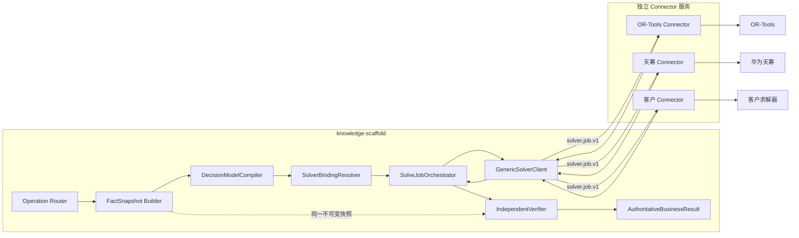

# 联邦式求解器 Connector 架构设计

> 日期：2026-08-18
> 状态：设计已确认
> 适用范围：knowledge-scaffold、求解器公共契约、OR-Tools Connector、华为天筹 Connector、客户私有求解器 Connector

## 1. 执行摘要

knowledge-scaffold 不直接依赖任何具体求解器，也不在 Consumer 进程中加载 OR-Tools、华为天筹或客户求解器 SDK。平台只负责把业务问题编译为版本化、厂商无关的数学问题，治理求解任务，并独立校验求解结果。

具体求解器通过独立部署的 Connector 接入。所有 Connector 向上实现同一套 `solver.job.v1` HTTP/JSON Job API，向下适配各自的本地库、SDK 或远程 API：

- OR-Tools Connector 同时承载标准协议和 OR-Tools Worker；
- 华为天筹 Connector 把标准 ProblemIR 转换为天筹模型，并映射认证、任务和结果；
- 客户求解器可以直接实现标准协议，也可以通过客户 Connector 桥接。

平台运行时只有一个 `GenericSolverClient` 实现，可按 Binding 调用多个标准 endpoint。新增或升级具体求解器不要求修改 knowledge-scaffold 运行时代码，只需部署通过契约测试的 Connector，并创建新的 `SolverBindingRevision`。

本设计取代“仓库内单一 `solver/` 服务 + 进程内多引擎插件”的物理部署方式。既有设计中的 ProblemIR、版本化 Job API、Solver Binding、结果治理和独立 Verifier 原则继续保留。

## 2. 背景与现状

当前 knowledge-scaffold 的可执行能力以 Operation、脚本直执行和确定性工作流为主。业务规则和指标主要保存在知识包文档或 Python 脚本中，Consumer 尚未落地以下求解基础设施：

- 版本化 ProblemIR；
- 求解器连接与不可变 Binding；
- 可恢复的 Solve JobStore；
- 求解器能力协商；
- 独立 Connector 契约；
- 求解结果的独立校验与证据链。

已有求解器协调设计正确划分了“平台拥有语义与信任、求解器只负责搜索”的职责，但将物理形态描述为单一求解器服务及进程内引擎插件。该形态在只接 OR-Tools 时简单，但接入天筹和客户私有求解器后会产生新的耦合：

- 厂商 SDK 和依赖进入同一构建与发布周期；
- 某个厂商的认证、状态和错误语义进入公共服务；
- 求解器升级要求统一服务重新发布；
- 客户私有能力难以独立交付和隔离；
- 单一服务逐渐变成第二套中心化求解平台。

因此必须进一步冻结物理边界：平台、Connector 和实际求解器是三个独立责任域。

## 3. 目标与非目标

### 3.1 目标

1. knowledge-scaffold 不包含具体求解器 SDK、模型构建代码和厂商状态判断。
2. 通过版本化公共协议接入 OR-Tools、天筹和客户求解器。
3. Connector 可独立构建、部署、升级、回滚和认证。
4. 同一 ProblemIR 可以提交给任何声明兼容能力的 Connector。
5. 一次运行锁定知识、Provider、Solver Binding 和全部摘要，可回放、可审计。
6. 求解器结果默认不可信，只有平台独立校验后的结果才能成为业务结论。
7. 首期使用同一客户内网的主动调用模型，避免引入公网回调、反向隧道和拉取 Agent。

### 3.2 非目标

- 不建设集中式 Solver Hub、统一成本路由或跨客户求解资源市场。
- 不实现运行中的自动跨求解器故障转移。
- 不设计可以表达任意厂商特性的通用建模语言。
- 不允许知识包携带 endpoint、token、厂商 SDK 参数或可执行模型代码。
- 不让 Connector 读取本体、Neo4j、业务 Provider、用户 JWT 或平台数据库。
- 不在首期做跨 run 的任务去重。
- 不把求解结果自动写回 ERP、MES 或生产控制系统。

## 4. 方案选择

### 4.1 方案 A：平台进程内适配器

平台定义统一接口，但 OR-Tools、天筹和客户适配器仍随 Consumer 一起构建和发布。

优点是实现直接、部署组件少；缺点是只有接口解耦，没有依赖、凭据和发布周期的物理解耦。该方案不满足目标。

### 4.2 方案 B：独立 Connector 服务

平台只调用标准协议，每个厂商 Connector 独立部署并完成模型、协议和结果转换。

该方案满足依赖隔离、独立发布和客户扩展要求，同时不强制引入新的中心网关，是本设计采用的方案。

### 4.3 方案 C：集中式 Solver Hub

平台只连接一个 Solver Hub，由 Hub 统一路由、排队和适配所有求解器。

该方案适合将来需要跨平台配额、成本路由、统一采购和管理大量求解器的阶段。当前规模下会增加新的中心故障域和治理平台，不作为首期前置条件。未来 Hub 可以作为一个普通 `solver.job.v1` endpoint 接入，平台协议无需改变。

## 5. 总体架构



### 5.1 信任边界

| 边界 | 权威职责 | 明确禁止 |
| --- | --- | --- |
| knowledge-scaffold | 业务语义、事实快照、ProblemIR 编译、任务治理、独立校验、证据与展示 | 具体求解算法、厂商 SDK、厂商凭据 |
| Connector | 标准协议、厂商模型转换、执行调用、状态与错误映射、结果归一化 | 读取知识包、Provider、用户身份和平台业务数据库 |
| 实际求解器 | 数学搜索、可行性判定、目标优化、可选 bound/gap/证书 | 业务解释、事实查询、权威结果发布 |
| Agent | 意图理解、输入确认、解释已验证结果 | 重算、补写或修正求解数值 |

### 5.2 代码和发布边界

- `consumer/backend` 不依赖 `ortools`、天筹 SDK 或客户私有包。
- knowledge-scaffold 不维护按厂商分支的运行时 adapter registry。
- 公共契约作为独立版本化制品发布；Connector 只依赖该制品，不依赖 Consumer 源码。
- 每个 Connector 至少是独立镜像和独立发布单元；组织条件允许时使用独立仓库。
- Connector 和 Consumer 可以在同一客户内网、同一 Kubernetes 集群或同一 Compose 环境中部署，但不能运行在同一进程。

## 6. 平台组件职责

### 6.1 DecisionModelCompiler

输入为锁定的知识包模型、`NormalizedInput` 和不可变 `FactSnapshot`，输出 canonical ProblemIR。

它负责：

- 前置业务规则和输入校验；
- 单位、精度和定点数规范化；
- 把业务公式物化为确定性参数；
- 生成稳定变量 ID、约束 ID 和目标 ID；
- 按 problem family Schema 校验；
- 计算平台内部内容摘要。

它不负责选择具体求解器，也不生成任何厂商请求体。

### 6.2 SolverBindingResolver

按 workspace、Operation、problem family、family version 和 capability 要求解析一个不可变 `SolverBindingRevision`。

首期不做自动最优求解器选择。管理员显式创建和启用 Binding；若没有唯一兼容 Binding，运行明确失败或进入管理员配置提示。

### 6.3 SolveJobOrchestrator

负责平台侧权威任务状态：

- 创建逻辑 `solve_job` 和物理 `solve_attempt`；
- 构造 opaque 幂等键；
- 提交、轮询、取消、超时和受控重试；
- Consumer 重启后的恢复；
- 把 Connector 进度投影成 `solver.*` 平台事件；
- 在完成后触发 Verifier，而不是直接发布结果。

平台必须使用耐久化 JobStore。现有内存 `RunStore` 和 admission queue 不能作为求解任务的权威状态源。

### 6.4 GenericSolverClient

平台运行时只有一个通用客户端，职责仅包括：

- 调用 `solver.job.v1`；
- 注入 Connector 服务凭据和 trace context；
- 校验证书、endpoint 和响应 Schema；
- 归类网络和 HTTP 错误；
- 执行符合幂等规则的有限重试。

它不能导入具体 Connector 类，也不能根据厂商名称修改请求或结果。

### 6.5 IndependentVerifier

Verifier 使用原始模型源文、同一 `NormalizedInput` 和同一 `FactSnapshot` 独立校验：

- assignment 的完整性和取值域；
- 所有硬约束；
- 目标值和排序；
- bound、gap 或问题族支持的证书；
- 结果与请求 fingerprint、family version 的对应关系。

小搜索空间可以独立穷举复核最优性。大搜索空间的 `optimal`、`infeasible` 或 `unbounded` 声明必须有该 problem family 接受的可验证依据；否则只能形成非权威诊断结果。

## 7. Connector 职责

每个 Connector 包含以下内部端口，具体实现可以合并，但职责不得越界：

| 组件 | 职责 |
| --- | --- |
| Standard API | 实现 `solver.job.v1`、认证、请求限制和 Schema 校验 |
| Capability Descriptor | 声明协议、problem family、版本、能力、结果保证和限制 |
| Problem Translator | 把 family-specific ProblemIR 转为厂商模型 |
| Execution Adapter | 调用本地库、厂商 SDK 或远程 API |
| Status Mapper | 把厂商任务状态映射为标准 Job 状态 |
| Result Normalizer | 把厂商结果映射为 `solver.result.v1` |
| Attempt Mapping Store | 保存幂等记录、标准 job ID 与厂商 job ID 的有限 TTL 映射 |

### 7.1 OR-Tools Connector

OR-Tools Connector 可以在同一服务中包含标准 API、模型转换器和 OR-Tools Worker。它独立设置进程、CPU、内存和并发上限。OR-Tools 依赖只存在于该 Connector。

### 7.2 华为天筹 Connector

天筹 Connector 持有天筹 SDK、租户配置、下游凭据、任务状态映射和错误转换。knowledge-scaffold 只持有访问 Connector 的服务凭据，不接触天筹 token。

### 7.3 客户 Connector

客户可选择：

1. 让现有求解器直接实现 `solver.job.v1`；
2. 部署独立 Connector，把 ProblemIR 转为客户内部协议。

客户代码和凭据不进入 knowledge-scaffold 发布物。

## 8. 传输协议

### 8.1 网络模型

首期假设 knowledge-scaffold 与 Connector 部署在同一客户内网，由平台主动调用 Connector。首期不引入：

- Connector 拉取平台任务；
- 公网 webhook；
- 反向隧道；
- 浏览器直连 Connector；
- gRPC 传输绑定。

HTTP/JSON 是首期唯一标准传输。将来可增加 gRPC binding，但不得改变 Job、ProblemIR、Result 和 Error 的语义契约。

### 8.2 Job API

```text
GET    /v1/capabilities
GET    /v1/health
POST   /v1/solve-jobs
GET    /v1/solve-jobs/{job_id}
GET    /v1/solve-jobs/{job_id}/result
DELETE /v1/solve-jobs/{job_id}
```

所有 Connector 向上暴露异步 Job API。底层同步求解器由 Connector 包装为 Job。对于短任务，Connector 可以支持 `Prefer: wait=<ms>`，在提交响应中直接携带终态或结果，但仍必须生成稳定 `job_id`。

### 8.3 提交信封

```json
{
  "protocol_version": "solver.job.v1",
  "request_ref": "req_opaque_...",
  "problem": {
    "schema_version": "solver.problem.v1",
    "problem_family": "binary_ordered_route",
    "family_version": "1.0",
    "payload": {}
  },
  "requirements": {
    "capabilities": ["lexicographic_objective"],
    "result_quality": "optimal",
    "limits": {
      "solve_time_ms": 60000,
      "workers": 4
    }
  }
}
```

传输要求：

- `Idempotency-Key` 放在 HTTP header 中，由平台生成 opaque HMAC；
- `request_ref` 是不可推导 workspace、用户和内部 problem digest 的 opaque 标识；
- 请求可携带 W3C `traceparent`，不能携带用户 JWT；
- Connector 必须原样关联 `request_ref`、problem family 和 family version；
- 同一幂等键和同一请求返回原 job；同一幂等键和不同请求返回冲突；
- 请求和响应均执行严格 Schema 校验并拒绝未知关键字段。

## 9. ProblemIR 与能力模型

### 9.1 稳定信封 + 版本化问题族

ProblemIR 不采用厂商请求透传，也不在首期建设任意数学表达语言。它由稳定公共信封和 family-specific payload 组成。

```json
{
  "schema_version": "solver.problem.v1",
  "problem_family": "binary_ordered_route",
  "family_version": "1.0",
  "payload": {
    "decision_space": {},
    "parameters": {},
    "constraints": [],
    "objectives": []
  }
}
```

每个 problem family 必须发布：

- JSON Schema；
- 数值、ID、排序和 canonicalization 规则；
- 允许的变量、约束和目标语义；
- SolverResult assignment 结构；
- 可接受的最优性、不可行性和无界性验证依据；
- golden problems。

### 9.2 厂商私有能力

知识包和 ProblemIR 首期禁止厂商私有字段和自由 `extensions` 透传。

若业务必须使用天筹或其他厂商的特有能力，需要先把该能力抽象为正式 capability 或新的 problem-family version，并为平台编译器、Verifier 和 Connector 契约补齐测试。不能通过知识包中的 opaque 配置绕过评审。

厂商租户、资源池、算法实现参数等运维配置保存在 Connector。平台 Binding 只保存厂商无关的资源限制，必要时可以引用一个 Connector 侧预先定义的 opaque execution profile，但平台不解释其内部字段。

### 9.3 Capability 响应

```json
{
  "protocol_versions": ["solver.job.v1"],
  "connector": {
    "name": "ortools-connector",
    "version": "1.0.0",
    "build": "sha256:..."
  },
  "execution": {
    "async_jobs": true,
    "cancellation": true,
    "prefer_wait": true
  },
  "problem_families": [
    {
      "name": "binary_ordered_route",
      "versions": ["1.0"],
      "features": ["lexicographic_objective"],
      "result_assurances": ["feasible_solution", "best_bound"],
      "limits": {
        "max_payload_bytes": 1048576,
        "max_solve_time_ms": 3600000,
        "max_workers": 16
      }
    }
  ]
}
```

Binding 创建时保存 capability fingerprint。每次新 run 提交前比较实际 fingerprint 与锁定 revision；不兼容漂移返回 `solver_capability_drift`，不得继续执行。

## 10. SolverResult

```json
{
  "schema_version": "solver.result.v1",
  "request_ref": "req_opaque_...",
  "solve_outcome": "optimal",
  "assignments": {},
  "objective_values": {},
  "assurance": {
    "best_bound": null,
    "gap": null,
    "certificate": null
  },
  "engine": {
    "name": "cp-sat",
    "version": "9.x",
    "connector_build": "sha256:..."
  }
}
```

SolverResult 只能包含结构化数学结果和受控诊断引用，不能包含业务解释 Markdown。结果字段必须引用 ProblemIR 中的稳定 ID。

## 11. Binding 与控制面

`SolverBindingRevision` 至少锁定：

| 字段 | 说明 |
| --- | --- |
| revision ID | 不可变绑定标识 |
| workspace scope | 允许使用该 Binding 的 workspace 范围，仅平台内部使用 |
| endpoint | Connector 私网地址，由管理员配置 |
| protocol version | 锁定 `solver.job.v1` 等协议版本 |
| service credential reference | 平台访问 Connector 的凭据引用 |
| capability fingerprint | 绑定时的能力快照摘要 |
| allowed families | 允许的问题族及版本 |
| neutral limits | 总时限、并发、payload、worker 等平台上限 |
| execution profile reference | 可选的 Connector 侧预定义 profile 引用 |
| enabled state | 新 run 是否可以使用 |

知识包只声明 problem family 和 capability 要求，不声明 Binding、endpoint、Connector 名称和凭据。

一次 run 锁定 `SolverBindingRevision`。同一 run 的传输重试和新 attempt 必须继续使用该 revision；切换到其他 Connector 必须创建新 run，并记录 lineage。

## 12. 状态机与错误语义

### 12.1 三套状态

```text
ConnectorJobStatus:
accepted -> running -> completed | failed | cancelled | attempt_lost

SolveOutcome:
optimal | feasible | infeasible | unbounded | unknown

VerificationOutcome:
not_run -> verified | solver_result_rejected | verification_runtime_failed
```

`completed + optimal` 只是 Connector 声明。只有 `VerificationOutcome=verified` 才能产生 `AuthoritativeBusinessResult`。

若请求要求 `result_quality=optimal`，但 Connector 只返回 `feasible` 或 `unknown`，平台终止为 `quality_requirement_not_met`。该结果可以进入诊断制品，但不能进入权威业务结果。

### 12.2 标准错误

```json
{
  "error": {
    "code": "CAPABILITY_UNSUPPORTED",
    "category": "contract",
    "message": "binary_ordered_route.v2 is not supported",
    "retryable": false,
    "diagnostic_ref": "diag_..."
  }
}
```

错误类别至少包括：

- `contract`：Schema、版本和能力错误；
- `authentication`：服务认证和厂商认证错误；
- `capacity`：限流、队列和资源上限；
- `transport`：连接、超时和非预期 HTTP 响应；
- `execution`：求解器执行失败和 attempt 丢失；
- `result`：结果缺失、损坏或不符合契约。

错误响应禁止包含 token、厂商堆栈、内部文件路径和未脱敏请求体。

## 13. 幂等、重试和取消

### 13.1 幂等范围

首期不做跨 run 的求解任务去重。幂等只用于同一 run、同一 attempt 的网络重试。

幂等键由平台按 binding revision、run、attempt 和内部 problem digest 生成 opaque HMAC。Connector 只能把它当不透明字符串处理。

### 13.2 重试矩阵

| 情况 | 行为 |
| --- | --- |
| 提交连接失败或响应丢失 | 使用同一幂等键重试 |
| 429、502、503 | 按 `Retry-After` 和平台退避策略重试 |
| Schema、版本、能力错误 | 不重试 |
| 认证或授权错误 | 不重试，触发配置告警 |
| 厂商模型拒绝 | 不重试，返回标准 contract/execution 错误 |
| `attempt_lost` 或结果过 TTL | 同一 binding 下显式创建新 attempt |
| Verifier 拒绝结果 | 不自动重试，触发治理告警 |

Job 已被接受后，平台不能通过重新 `POST` 假装继续原任务。新执行必须有新的 attempt ID，并保留旧 attempt 历史。

### 13.3 取消和迟到结果

- `DELETE` 是幂等取消请求；
- 底层不支持强制取消时，Connector 返回已接收取消请求的标准状态；
- 平台超时后先请求取消，再记录平台终态；
- 迟到结果只能进入诊断制品，不能覆盖取消、超时或失败终态；
- 运行中禁止自动切换其他 Connector；换求解器必须创建新 run。

## 14. 安全与多租户

### 14.1 凭据

- 用户 JWT 只在 knowledge-scaffold 验证，不能转发给 Connector；
- 平台使用独立 service token 或 mTLS 访问 Connector；
- 天筹和客户求解器的下游凭据只存在于对应 Connector 的 Docker/Kubernetes Secret；
- Secret 不进入知识包、ProblemIR、Binding 明文、日志、Trace 和 EvidenceBundle。

### 14.2 Endpoint 治理

- endpoint 仅管理员配置，知识包和用户请求不能提供 URL；
- 首期同一客户 Docker 私网内可使用带服务令牌的 HTTP，但必须由管理员显式
  开启、配置精确 host/port allowlist，且不得发布 Connector 宿主机端口；
  跨主机、公共网或不受信网络必须使用 HTTPS 证书校验，可按客户要求启用 mTLS；
- 使用目标 allowlist，禁止重定向逃逸和内网 SSRF；
- Connector 设置请求体、模型规模、并发、CPU、内存和总时限硬上限。

### 14.3 租户隔离

- 平台 JobStore、Binding、artifact、Evidence 和查询必须按 workspace 授权；
- `job_id`、`request_ref` 和内部 digest 不是访问凭证；
- 发给 Connector 的请求不含原始 workspace ID、用户 ID 和数据库标识；
- workspace 配额由平台提交前执行，Connector 只执行服务级硬上限。

## 15. 契约制品与 Connector TCK

公共契约作为独立版本化制品发布，建议初始源码位置为 `contracts/solver/`，但它不能导入 Consumer 运行时代码。

制品包含：

- OpenAPI 3.1：`solver.job.v1`；
- JSON Schema：capabilities、各 problem family、SolverResult 和 Error；
- canonicalization 与版本兼容规则；
- 示例请求、结果和错误；
- 可对任意 endpoint 执行的 Connector TCK；
- 每个 family 的 golden problems。

### 15.1 TCK 必测项

1. health、协议和 capability 声明；
2. family/version 支持与拒绝行为；
3. 严格 Schema 和未知关键字段拒绝；
4. 幂等同键同载荷复用、同键异载荷冲突；
5. submit、poll、cancel、result 完整状态机；
6. 429、临时故障、超时和 `attempt_lost`；
7. 厂商状态与错误码映射；
8. 结果 assignment、objective、bound/gap 和引擎信息；
9. 重启后恢复原 attempt 或明确报告 `attempt_lost`；
10. 日志和响应不泄露 secret、用户和 workspace 信息；
11. family golden problems 的结果可被公共 Verifier 接受。

Connector 的准入单位是“协议版本 + problem family 版本”，不能仅凭 `/health` 成功认定兼容。

## 16. 平台测试

### 16.1 单元与契约测试

- ProblemIR canonicalization 和 Schema；
- capability 匹配与 fingerprint 漂移；
- Binding revision 锁定；
- 幂等键生成和敏感信息隔离；
- 三套状态机转换；
- 标准错误归类和 retryable 规则；
- Verifier 对伪造 assignment、目标、optimal 和摘要的拒绝。

### 16.2 集成测试

使用 Fake Connector 覆盖：

- 正常 optimal、feasible、infeasible；
- 长时间 running、429、503 和连接中断；
- 提交响应丢失后的幂等恢复；
- Connector 重启和 `attempt_lost`；
- 取消与迟到结果；
- Consumer 重启后的 JobStore 恢复；
- capability drift；
- 明确验证没有跨 Connector 自动降级。

### 16.3 端到端测试

Compose 或测试集群启动 knowledge-scaffold、Fake Connector 和 OR-Tools Connector，验证：

- Operation 到 `solver_workflow` 的确定性路由；
- FactSnapshot、ProblemIR、提交、进度、结果和 Verifier 全链路；
- `agent-stream.v2` 中的 `solver.*` 事件；
- 只有 `authoritative=true` 的验证结果进入前端和 Agent；
- workspace 越权、恶意 endpoint 和超大 payload 被拒绝。

## 17. 上线与交付拆分

该架构跨越公共契约、平台控制面、参考 Connector 和业务场景，不应作为一个大提交实施。按独立交付物拆分：

### 阶段 0：公共契约

- 发布 `solver-contracts`、OpenAPI、JSON Schema、示例、TCK 和 Fake Connector；
- 冻结首个 `binary_ordered_route.v1` problem family；
- 不改现有 Operation 运行行为。

### 阶段 1：平台控制面

- 落地 Solver Binding/Revision；
- 落地 GenericSolverClient、耐久化 JobStore、Orchestrator 和状态机；
- 仅接 Fake Connector 验证恢复、错误和事件。

### 阶段 2：OR-Tools 参考 Connector

- 独立交付 OR-Tools Connector 镜像；
- 通过公共 TCK 和首个 family golden；
- OR-Tools 依赖不进入 Consumer。

### 阶段 3：首场景影子运行

- 选择一个 problem family 和真实场景；
- 同一输入与事实快照同时运行旧 evaluator/golden 和新链路；
- 影子结果只用于诊断，不标记 authoritative；
- 达到字段级一致性、稳定性和性能门槛后按 workspace 灰度。

### 阶段 4：外部 Connector

- 天筹 Connector 和客户 Connector 分别独立开发；
- 只需通过 TCK、对应 family golden 和客户网络安全检查；
- 平台运行时代码不得因新增 Connector 改动。

## 18. 兼容与迁移

- 现有 `schema_version: 0.1` 知识包和脚本直执行保持不变；
- 固定方案评估继续走确定性脚本；
- 只有显式声明的优化 Operation 进入新的 `solver_workflow`；
- 求解失败不能降级为 Agent 或脚本自由计算；
- 首期可以在 Compose 中把 OR-Tools Connector 作为可选私网服务共址，但不共享 Consumer 进程、文件系统和凭据；
- 现有 business-data provider registry 的字段 Schema、脱敏和连接探测思想可以复用，但其查询接口、可变数据源存储和厂商 adapter registry 不能直接复用为求解器运行边界。

## 19. 可观测性

平台 Trace 至少记录：

- knowledge、Provider 和 Solver Binding revision；
- problem family/version、ProblemIR fingerprint；
- Connector 名称、版本、build 和 capability fingerprint；
- logical job、attempt、提交、轮询、取消和恢复阶段；
- ConnectorJobStatus、SolveOutcome 和 VerificationOutcome；
- retry、429、attempt_lost、capability drift 和 verifier mismatch；
- 各阶段 P50/P95/P99 时延。

日志和指标不记录 ProblemIR 全文、业务事实、价格、token 和高基数原始 ID。诊断通过受授权 artifact reference 获取。

## 20. 验收标准

1. `consumer/backend` 不包含 OR-Tools、天筹 SDK、客户私有包和厂商状态分支。
2. 平台运行时只有一个 `GenericSolverClient` 实现，所有 Connector 使用相同协议。
3. 新增通过 TCK 的客户 Connector 只需创建 `SolverBindingRevision`，不修改平台代码。
4. 知识包和 ProblemIR 不包含厂商私有字段、endpoint 和凭据。
5. 同一 run 锁定 Solver Binding；不存在运行中自动跨求解器降级。
6. Consumer 和 Connector 任一侧重启后，任务可以恢复或明确进入 `attempt_lost`，不能静默重置。
7. 未通过 IndependentVerifier 的结果不能进入权威结果、前端数值或 Agent 回答。
8. 同一 family golden ProblemIR 在不同合规 Connector 上产生的归一化结果可由同一 Verifier 校验。
9. OR-Tools Connector、Fake Connector 和首个真实 Connector 均通过对应协议与 family TCK。
10. 旧知识包、脚本直执行和固定方案评估路径不受影响。

## 21. 主要后果

### 正向后果

- 具体求解器依赖、凭据和发布周期与平台隔离；
- OR-Tools、天筹和客户求解器获得一致接入路径；
- Connector 可以独立审计、压测、灰度和回滚；
- 将来增加 Solver Hub 或 gRPC 不需要改变平台语义契约；
- 结果信任仍由平台控制，不因外部求解器替换而变化。

### 成本

- 需要维护公共协议、family Schema、TCK 和兼容矩阵；
- 每个厂商需要独立 Connector 工程与运维；
- 平台必须新增耐久化 JobStore、Binding 控制面和 Verifier；
- family 抽象需要业务、平台和求解器团队共同治理；
- 厂商特有能力不能未经评审快速透传。

这些成本是有意承担的，用于换取长期可替换性、可审计性和客户私有部署能力。
