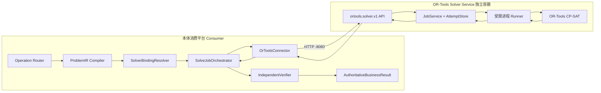

# Consumer Connector 与 OR-Tools Solver Service 边界校正设计

> 日期：2026-08-19
> 状态：设计已确认，进入实施
> 决策：直接切换，不保留服务端旧 `solver.job.v1` 路由
> 适用范围：Consumer 求解器协调层、OR-Tools 独立求解服务、公共契约、部署与测试

## 1. 背景与决策

现有实现已经把 OR-Tools 依赖隔离在独立容器中，但把整个独立服务称为
“OR-Tools Connector”。该服务同时拥有 HTTP API、任务状态、持久化、进程隔离、
并发控制和 OR-Tools CP-SAT Worker，本质上是完整的求解器服务。

本设计校正概念与代码边界：

- **Connector 属于 Consumer**，负责连接、协议适配和平台语义映射；
- **OR-Tools Solver Service 是独立求解器服务**，负责对外 API、任务生命周期和数学搜索；
- 两者通过 OR-Tools 专属的 `ortools.solver.v1` HTTP/JSON API 通信；
- 首期尚无正式生产 Binding，因此直接删除旧服务端 `solver.job.v1` 接口，不做双协议兼容；
- Connector 运行在 Consumer Backend 进程中，不新增 Connector 容器；
- OR-Tools 依赖仍只存在于独立求解器服务镜像中。

本设计取代
`2026-08-18-federated-solver-connectors-design.md` 中“独立 Connector 服务”、
“GenericSolverClient 直连统一 Connector API”和“OR-Tools Connector”相关的部署与职责定义。
ProblemIR、不可变 Binding、耐久化任务编排、独立 Verifier、权威结果门禁等原则继续保留。

## 2. 方案比较

### 2.1 方案 A：只修改展示名称

只把容器和文档改称 OR-Tools Solver Service，保留代码中的 Connector 服务端模型。

优点是改动小；缺点是职责歧义继续存在，后续接入天筹或客户求解器时仍无法明确
“平台适配层”和“求解服务”的归属。该方案不采用。

### 2.2 方案 B：保留统一远端 `solver.job.v1`

Connector 放回 Consumer，但要求所有求解器服务继续实现同一套标准远端协议。

优点是平台接入简单；缺点是名义上有 Connector，实际转换职责仍被推给求解器服务，
无法体现用户确认的边界。该方案不采用。

### 2.3 方案 C：Consumer Connector 适配求解器专属 API

Consumer 中的 `OrToolsConnector` 把平台 ProblemIR 转换为 OR-Tools Service DTO，
再把下游能力、任务、错误和结果映射回平台内部模型。独立服务只实现
`ortools.solver.v1`。

该方案职责最清晰，且不把 OR-Tools Python 依赖放入 Consumer。本设计采用该方案。

## 3. 总体架构



运行时仍只有一个新增容器：OR-Tools Solver Service。没有独立 Connector 容器，
也没有 Nginx 或 TLS Sidecar。

## 4. 职责与信任边界

| 组件 | 权威职责 | 明确禁止 |
| --- | --- | --- |
| Consumer Compiler | 业务输入校验、事实快照、ProblemIR 编译 | 导入 OR-Tools、执行搜索 |
| `OrToolsConnector` | Binding、端点与凭据、请求转换、幂等调用、重试、能力/状态/错误/结果映射 | 数学搜索、读取 OR-Tools SDK、发布未经验证的权威结果 |
| OR-Tools Solver Service | 服务 API、任务状态、资源限制、CP-SAT 执行、数学结果 | 读取知识包、workspace、用户 JWT、Neo4j、Consumer 数据库 |
| Independent Verifier | 独立验证 assignment、约束、目标和证明信息 | 信任服务的 `optimal` 声明而跳过验证 |
| Agent | 收集输入、调用受控 Tool、解释已验证结果 | 重算、补写或更改求解数值 |

Consumer 与求解器服务只共享版本化的纯数据契约，不共享运行时源码、数据库或 SDK。

## 5. 代码与制品边界

### 5.1 Consumer

Consumer 内部形成明确的 Connector 层：

```text
consumer/backend/solver_coordination/connectors/
├── base.py             # SolverConnector Protocol
├── http_transport.py   # HTTP、认证、端点策略、响应大小与有限重试
├── ortools.py          # ProblemIR/Service DTO/平台模型之间的映射
├── endpoint_policy.py  # 管理员控制的服务端点白名单
└── errors.py           # 平台稳定错误分类
```

现有 `GenericSolverBackend` 的 family、capability、submit、poll、cancel 和 result
映射职责直接演化为 `OrToolsConnector`，不再额外包一层空壳。

### 5.2 OR-Tools Solver Service

独立服务从 `connectors/ortools` 迁移为：

```text
solvers/ortools/
├── app.py
├── config.py
├── solver_service.py
├── store.py
├── process_runner.py
├── result_serializer.py
├── engine/
├── Dockerfile
├── requirements.txt
└── tests/
```

核心类型命名为 `OrToolsSolverConfig` 和 `OrToolsSolverService`。服务端源码中不再使用
`ConnectorService`、`ConnectorConfig`、`connector.name` 或 `connector_build`。

### 5.3 公共契约

- `contracts/solver` 保留平台 ProblemIR、problem family、canonicalization 和数学结果语义；
- 新建 `contracts/solver_services/ortools`，保存 `ortools.solver.v1` 的 OpenAPI、JSON Schema、
  示例、校验器和黑盒契约测试；
- Consumer Connector 与 Solver Service 都只依赖该纯契约制品；
- 原远端 Connector OpenAPI/TCK 不再对 OR-Tools Solver Service 执行。

## 6. OR-Tools Solver Service API

### 6.1 协议与端点

协议标识为 `ortools.solver.v1`：

```text
GET    /health
GET    /api/v1/capabilities
POST   /api/v1/jobs
GET    /api/v1/jobs/{job_id}
GET    /api/v1/jobs/{job_id}/result
DELETE /api/v1/jobs/{job_id}
```

- `/health` 仅表示进程存活，免鉴权；
- `/api/v1/*` 使用服务级 Bearer Token；
- 不提供 `/v1/capabilities` 或 `/v1/solve-jobs*` 兼容路由；
- 请求与响应严格校验 Schema，拒绝未知字段、重复 JSON key、非有限数字和不受支持版本；
- `Prefer: wait=<ms>` 只控制提交后等待时间，`POST` 始终返回 Job 和 HTTP 202，不内嵌 Result。

### 6.2 Capabilities

```json
{
  "api_versions": ["ortools.solver.v1"],
  "service": {
    "name": "ortools-solver-service",
    "version": "1.0.0",
    "build": "sha256:..."
  },
  "engine": {
    "name": "ortools-cp-sat",
    "version": "9.15.6755"
  },
  "execution": {
    "async_jobs": true,
    "cancellation": true,
    "prefer_wait": true,
    "job_retention_seconds": 86400,
    "max_concurrent_jobs": 2
  },
  "problem_types": [
    {
      "name": "binary_ordered_route",
      "versions": ["1.0"],
      "features": ["lexicographic_objective"],
      "result_assurances": ["feasible_solution", "best_bound", "gap"],
      "limits": {
        "max_payload_bytes": 1048576,
        "max_solve_time_ms": 3600000,
        "max_search_workers": 1
      }
    }
  ]
}
```

`max_concurrent_jobs` 表示服务并发任务数，`max_search_workers` 表示单个 CP-SAT
任务的搜索线程数。当前引擎实际固定 `num_search_workers=1`，所以首期必须如实声明并只接受 1。

### 6.3 Submit

请求：

```json
{
  "api_version": "ortools.solver.v1",
  "request_id": "req_opaque_...",
  "problem": {
    "type": "binary_ordered_route",
    "version": "1.0",
    "data": {}
  },
  "options": {
    "time_limit_ms": 60000,
    "search_workers": 1
  }
}
```

平台的 `requirements.capabilities` 和 `result_quality` 不原样传给服务。这两项属于
Connector 的能力匹配和 Orchestrator/Verifier 的验收策略。服务只执行明确的时间和搜索参数，
并报告实际 `solve_outcome`。

`Idempotency-Key` 是必需 Header：

- 同 key、同 canonical body，在 TTL 内始终返回同一个 Job；
- 同 key、不同 body 返回 409 `IDEMPOTENCY_CONFLICT`；
- 并发相同请求必须原子复用同一记录，不能因竞争错误返回容量不足；
- 一个新的平台 SolveAttempt 必须生成新 key。

### 6.4 Job

```json
{
  "api_version": "ortools.solver.v1",
  "job_id": "job_...",
  "request_id": "req_opaque_...",
  "problem_type": "binary_ordered_route",
  "problem_version": "1.0",
  "status": "accepted"
}
```

状态为：

```text
accepted | running | completed | failed | cancelled | attempt_lost
```

终态不可逆。`failed` 和 `attempt_lost` 必须携带脱敏的 `failure` 对象；其他状态禁止
携带 `failure`。重复取消返回当前 Job，不能改变已经完成的终态。

### 6.5 Result

```json
{
  "api_version": "ortools.solver.v1",
  "job_id": "job_...",
  "request_id": "req_opaque_...",
  "problem_type": "binary_ordered_route",
  "problem_version": "1.0",
  "solve_outcome": "optimal",
  "assignments": {},
  "objective_values": {},
  "assurance": {
    "best_bound": null,
    "gap": null,
    "certificate": null
  },
  "engine": {
    "name": "ortools-cp-sat",
    "version": "9.15.6755",
    "service_build": "sha256:..."
  }
}
```

Connector 必须同时校验 `job_id` 和 `request_id`，防止串单。只有 completed Job 的结果返回
200；运行中返回 409 且 `retryable=true`；失败、取消或丢失返回 409 且
`retryable=false`；不存在或 TTL 过期返回 404。

### 6.6 Error

```json
{
  "error": {
    "code": "CAPACITY_UNAVAILABLE",
    "category": "capacity",
    "message": "Solver service capacity is exhausted",
    "retryable": true,
    "diagnostic_ref": "diag_opaque_..."
  }
}
```

服务错误分类为：

```text
validation | authentication | capacity | execution | result | internal
```

Consumer 不把远端 `message` 直接提升为用户可见错误，只保留受控分类、HTTP 状态、
`retryable` 和 opaque `diagnostic_ref`。只有 429、503 和执行前的瞬态传输失败可按同一
幂等键有限重试。

## 7. Consumer `OrToolsConnector`

`OrToolsConnector` 实现平台 `SolverConnector` Protocol，并承担：

1. 从不可变 Binding 解析 endpoint、凭据引用和 API 版本；
2. 把平台 `ProblemIR` 转为 `ortools.solver.v1` Submit DTO；
3. 把服务 Capabilities 映射为平台内部标准 capability；
4. 把 Service Job/Result/Error 映射为平台 Job、`SolverResult` 和稳定错误；
5. 执行端点白名单、认证、响应大小限制、禁止重定向和幂等重试；
6. 在 result 阶段校验 job、request、problem type/version 与锁定上下文一致。

平台 capability fingerprint 同时覆盖：

```text
connector_code_build + canonical(service_capabilities)
```

Connector 转换代码或下游服务能力任一变化都会触发 capability drift。服务自身 build
不能冒充 Connector build；审计制品分别记录 Connector build、Solver Service build 和
OR-Tools engine version。

## 8. Binding 与直接切换

`SolverBindingRevision` 新增并锁定：

| 字段 | 首期值/含义 |
| --- | --- |
| `connector_type` | `ortools`，选择 Consumer 内的 `OrToolsConnector` |
| `service_api_version` | `ortools.solver.v1` |
| `endpoint` | `http://ortools-solver:8080` |
| `service_credential_ref` | 服务级凭据引用，不保存明文 |
| `capability_fingerprint` | Connector build 与服务能力组合摘要 |
| `allowed_families` | 平台允许的问题族及版本 |
| `neutral_limits` | 平台总时限、payload 和并发上限 |

直接切换规则：

- 不修改旧不可变 Binding；创建新的 Binding Revision；
- 旧运行任务不跨 API 恢复，切换前完成或取消；
- 删除旧 `/v1/*` 路由、旧 DNS 和旧运行容器；
- 不读取 `ORTOOLS_CONNECTOR_*` 或 `SOLVER_CONNECTOR_*` 旧环境变量；
- 使用新服务状态卷，不迁移未正式投产的测试 AttemptStore。

## 9. 配置与部署

首期部署保持：同一私有 Docker 网络、HTTP 8080、Bearer Token、无宿主机端口。

命名统一为：

| 类型 | 新名称 |
| --- | --- |
| Compose service/DNS | `ortools-solver` |
| image | `solver-ortools-service` |
| container | `solver-ortools`（测试环境可加后缀） |
| volume | `ortools-solver-state` |
| state path | `/var/lib/ortools-solver` |
| service env prefix | `ORTOOLS_SOLVER_*` |
| Consumer outbound env prefix | `SOLVER_SERVICE_*` |
| secret file | `/run/secrets/ortools_solver_service_token` |
| Compose profile | `solver-ortools`（保持） |

安全边界保持：只读根文件系统、`cap_drop: ALL`、`no-new-privileges`、tmpfs、CPU/内存
限制、精确 host/port allowlist 和请求大小上限。跨主机部署的 HTTPS/TLS 属于后续增强，
首期不启动 Nginx 或 Sidecar。

## 10. 测试策略

### 10.1 Solver Service

- `ortools.solver.v1` Schema/OpenAPI 一致性；
- health、认证、submit、poll、result、cancel；
- 幂等冲突及并发相同 key 原子复用；
- 429/503、payload 上限、超时、取消和终态 fencing；
- failed/attempt_lost 的脱敏 `failure`；
- capability 如实声明 `max_search_workers=1`；
- 九项纯合成问题返回前四项 `OPTION_0`、后五项 `OPTION_1`。

### 10.2 Consumer Connector

- ProblemIR 到 Service DTO 的确定性转换；
- Capabilities 到平台 capability 的映射与组合 fingerprint；
- endpoint、鉴权、重试、响应大小和禁止重定向；
- Job 状态、错误与 Result 映射；
- job_id/request_id/problem type/version 防串单校验；
- `result_quality=optimal` 仍由平台验收，不传给 Service。

### 10.3 集成与部署

- Consumer 镜像确认没有 `ortools` 包；
- Solver Service 独立镜像确认包含实际 OR-Tools；
- Compose 只有 Backend 与一个 `ortools-solver` 求解器服务增量，不含 Connector 容器、
  Nginx 或 TLS Sidecar；
- 真实 HTTP 链路完成 submit、poll、result、Verifier 和 presentation；
- 使用纯合成九项测试夹具，最终分配必须为前四项 `OPTION_0`、后五项
  `OPTION_1`。

## 11. 验收标准

1. Consumer 内存在明确的 `OrToolsConnector`，独立服务端不再使用 Connector 命名。
2. 服务只暴露 `/health` 和 `/api/v1/*`，旧 `/v1/*` 返回 404。
3. API 身份为 `ortools.solver.v1` 和 `ortools-solver-service`。
4. OR-Tools 只安装在 `solver-ortools-service` 镜像中。
5. 新 Binding 使用 `connector_type=ortools`、`service_api_version=ortools.solver.v1`。
6. 首期链路为私有 Docker HTTP 8080，无 Nginx、TLS Sidecar 和宿主机端口。
7. 并发同幂等键只产生一个 Job，能力声明与实际 worker 数一致。
8. 单元、契约、集成、Compose、依赖边界和九项合成端到端测试全部通过。
9. 运行环境只新增一个独立求解器服务容器。

## 12. 非目标

- 首期不建设通用 Solver Hub；
- 不设计任意 CP-SAT DSL；
- 不把求解器 endpoint 或凭据放入知识包；
- 不在运行中自动切换其他求解器；
- 不兼容尚未正式投产的旧 Connector 服务 API、环境变量和测试状态卷；
- 不让 Solver Service 生成业务解释或绕过平台 Verifier。
