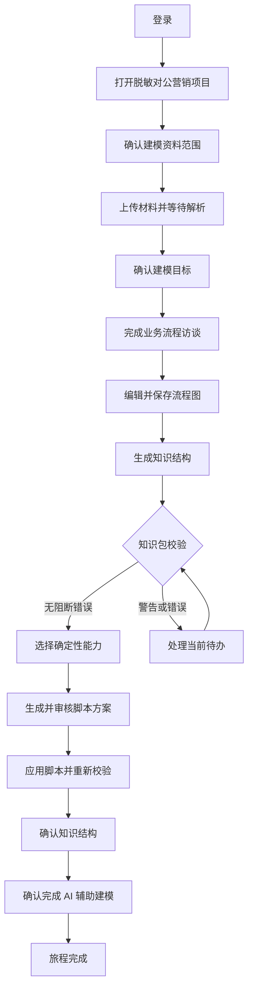

# 建模端到端浏览器用户旅程

## 1. 文档目的

本文定义一条可复用的建模端到端用户旅程，用于在已授权的建模环境中验证“资料接入 → AI 辅助建模完成”的完整闭环。案例使用脱敏的“某对公营销业务”项目，不在文档中记录真实项目名、环境地址、端口、账号、凭据、客户资料或业务数据。

本旅程的操作约束是：

- 所有改变状态的动作只能通过浏览器可见页面完成。
- 只允许鼠标点击、键盘文本输入、文件选择、页面滚动和浏览器导航。
- 不调用业务 API，不执行前端或后端脚本，不读写数据库，不直接修改容器或工作区文件。
- 浏览器自动化只能用页面控件（按钮、输入框、下拉框、文件选择器）和页面可见文本作判断。
- 截图和记录中必须遮挡项目名、账号、地址、文件内容和其他敏感信息。

## 2. 旅程总览



## 3. 浏览器操作步骤

### 3.1 登录和进入项目

1. 在浏览器地址栏打开已授权的建模环境。
2. 在登录页的“用户名”和“密码”输入框中输入由环境管理员提供的临时凭据，点击“登录”。
3. 在项目列表中用页面搜索或滚动定位脱敏的“某对公营销业务”项目。
4. 点击项目卡片进入建模工作台，确认页面显示 AI 辅助建模区、项目步骤区和建模助手区。
5. 截图记录：项目工作台已打开、当前步骤名称和页面无错误提示。截图不得包含账号、地址或资料正文。

### 3.2 确认资料范围并上传材料

1. 在 AI 辅助建模助手中点击“确认建模资料范围”或等价按钮。
2. 在资料选择页面点击“上传资料”，通过系统文件选择器选择已授权的脱敏材料；不要把真实客户材料复制到仓库或测试目录。
3. 点击“开始解析”或页面上的等价操作。
4. 等待页面从“解析中”变为“解析完成”；若出现“失败/重试”，先点击页面提供的“重试”，不要刷新后直接猜测状态。
5. 确认每个材料卡片均有可见的解析状态、文件类型和大小；解析失败时保留页面错误提示截图并走恢复出口。

### 3.3 完成建模目标访谈

1. 等待“建模目标”题卡出现。题卡出现后，页面应停止“正在分析”计时，并展示可操作的输入控件。
2. 对单选、多选和文本框逐项作答。文本只填写脱敏的业务目标、使用角色、典型场景和成功标准。
3. 点击“提交答案/确认”。提交后等待题卡关闭或出现下一张题卡。
4. 若页面显示“等待回答”但没有题卡：
   - 点击“重新加载访谈题卡”；
   - 观察题卡是否回源出现；
   - 不重复点击原提交按钮，不关闭项目页。
5. 若同时出现多个待办，按页面队列从上到下处理；不可执行的历史卡片应明确显示已完成/已过期，不能遮挡当前可执行卡片。

### 3.4 完成业务流程访谈

1. 在助手题卡中确认核心业务流程、参与角色、输入、输出、异常分支和交接点。
2. 对需要补充说明的问题，在题卡文本框中输入脱敏描述；不在聊天框中伪造结构化 JSON。
3. 点击“提交答案/确认流程”。
4. 等待助手生成流程草案。观察状态应在“排队/运行”和“等待回答”之间准确切换；`waiting` 状态不能继续显示为“正在访谈”。
5. 若业务流程需要补充，继续回答新题卡；若没有题卡但运行状态为 `waiting`，使用“重新加载访谈题卡”出口。

### 3.5 流程图编辑和保存

1. 在 AI 辅助建模步骤中点击“打开流程图”或“编辑流程图”。
2. 在流程图编辑器中用鼠标点击“新建流程/添加节点/添加连线”。
3. 在节点和边的文本框中输入脱敏的流程名称、角色、条件、输入、输出和异常说明。
4. 用鼠标拖动节点调整布局；用连线控制点连接前后节点。
5. 点击“保存”。等待页面显示保存成功、修订号更新或“已保存”状态。
6. 特殊字符验证：流程标题可以包含中文、斜线、半角/全角括号等字符；保存后只检查页面显示标题和图形内容，不直接查看文件系统。预期是图形正常保存，派生文件名由系统安全转换，不造成路径错误或同名覆盖。
7. 刷新当前项目页面，再次点击流程图，确认保存的节点、边和标题仍存在。
8. 若页面有“未保存修改”提示，先点击“保存”或“放弃修改”，再切换步骤；不得通过浏览器脚本强行切换。

### 3.6 生成知识结构并处理校验反馈

1. 返回建模助手，点击“生成知识结构”。
2. 等待后台任务结束；观察页面应展示阶段、进度、最后心跳和可用恢复动作。
3. 生成完成后查看知识包校验卡：错误、警告和提示应有数量及明细。
4. 对警告点击“查看知识文件/先不修改/让助手逐项修复”之一；每个选择都必须在页面产生下一步：
   - “让助手逐项修复”应生成待确认修复方案；
   - “先不修改”应要求填写理由，并继续展示下一条待办；
   - “查看知识文件”应打开目标文件，且页面提供“修改完成，重新校验”出口。
5. 候选修订校验失败时，阅读页面反馈，点击“调整方案”或“重新生成”；不能把 500 错误当成完成，也不能重复点击造成并发锁。
6. 若页面存在多个待办，确认当前待办队列全部可见，当前可执行项不被旧卡片隐藏。

### 3.7 生成、审核和应用脚本

1. 在“确定性能力”待办中选择需要脚本的计算、转换或判断；无需脚本时选择“暂不生成”。
2. 需要脚本时点击“生成脚本方案”。等待脚本候选卡片出现。
3. 在候选卡片中检查脚本目标、输入输出契约、测试样例和引用的业务操作；页面不应显示绑定到不存在脚本的幽灵操作。
4. 点击“确认/采用建议”，等待脚本生成和校验完成。
5. 若脚本格式、规则或语义校验失败，点击页面提供的“重新生成/调整方案/查看详情”；不能直接跳到下一步骤。
6. 应用成功后，点击“重新校验”或页面等价按钮，确认脚本状态为通过；校验失败必须回到可见的脚本修复出口。

### 3.8 完成 AI 辅助建模

1. 在知识结构、流程图、脚本和校验均完成后，等待助手出现一次性的“确认完成 AI 辅助构建”卡片。
2. 点击“确认完成 AI 辅助构建”。
3. 确认页面显示建模完成、验证阶段入口或下一步导航；不得只刷新状态而没有可操作出口。
4. 截图记录最终状态和页面下一步，不截图资料正文、账号、环境地址或项目内部标识。

## 4. 异常与恢复出口验收表

| 触发条件 | 页面应显示 | 用户可执行动作 | 通过标准 |
|---|---|---|---|
| 后台 `queued/running` | 处理中、阶段、进度、心跳 | 等待或取消 | 不误报完成 |
| 后台 `waiting` 且有题卡 | 可操作题卡 | 选择/输入并提交 | 不显示运行计时 |
| 后台 `waiting` 但无题卡 | 题卡加载失败 | 重新加载访谈题卡 | 30 秒内出现恢复出口 |
| 校验有错误 | 错误明细和修复卡 | 逐项修复/调整/暂缓 | 处理后展示下一待办 |
| 候选修订过期 | 修订已过时 | 重新生成候选 | 不写入旧版本 |
| 生成任务失败 | 失败原因 | 重试当前步骤 | 不留下假运行 |
| 项目不可访问或认证失效 | 项目不可用/需要重新登录 | 返回项目列表/重新登录 | 事件流停止重连 |
| 脚本校验失败 | 脚本错误明细 | 查看详情并重新生成 | 不产生幽灵脚本 |
| 流程图有未保存修改 | 离开确认 | 保存或放弃 | 不丢失用户选择 |
| 多个待办 | 队列顺序和每项状态 | 逐项处理 | 不隐藏可执行项 |

## 5. 记录模板

执行时只记录页面可见、已脱敏的事实：

```text
执行日期：YYYY-MM-DD
浏览器：Chrome/Chromium（版本可选）
案例标签：某对公营销业务（脱敏）
操作方式：鼠标点击 + 键盘输入 + 文件选择
资料解析：通过 / 失败后重试通过
建模目标：通过 / 待补充
业务流程访谈：通过 / 需要补充
流程图编辑：保存通过 / 保存失败
知识结构：生成通过 / 校验后修复
脚本生成：无需脚本 / 生成并校验通过 / 失败后重试通过
AI 辅助建模：完成 / 未完成（注明页面给出的下一步）
截图编号：按步骤编号保存，已脱敏
```

## 6. 完成判定

只有同时满足以下条件，才算本次用户旅程完成：

- 所有资料在页面显示解析成功；
- 建模目标和业务流程访谈均有已提交记录；
- 流程图至少完成一次鼠标编辑、保存、刷新后复核；
- 知识结构生成完成，校验错误已处理或明确暂缓并有审计理由；
- 脚本能力已按页面选择完成“无需生成”或“生成、审核、应用、重新校验”闭环；
- 所有待办均有明确终态，没有隐藏的可执行项；
- 页面出现并成功提交“确认完成 AI 辅助构建”；
- 最终页面给出验证阶段或其他明确下一步。

任何一步只有状态变化、没有可见页面出口，都判定为失败，并记录当时页面文字和截图，不能用接口或数据库状态替代浏览器验证。
