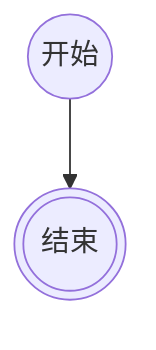

# Mermaid Flowchart

## Intent

Convert user-provided business operation into draw.io-compatible Mermaid `flowchart` code.

Use this skill only after the user provides the business operation. The business operation can be:

- inline text in the request;
- a file path to a document that contains the business operation.

If no business operation text or file path is provided, stop and ask the user to provide one. Do not infer the process from the repository or from prior context unless the user explicitly says to use that context.

## Input Handling

- If the input is inline text, use that text as the source of truth.
- If the input is a file path, read the file before generating the diagram.
- If both text and a file path are provided, read the file and treat the inline text as additional constraints.
- If a provided file path does not exist or cannot be read, stop and ask for a valid path.
- Preserve business terminology from the source. Only shorten labels when needed for diagram readability.

## Storage Path

- Save generated Mermaid flowchart files under `ontology/mermaid/`.
- Do not save Mermaid flowcharts to other ontology artifact directories.
- Create `ontology/mermaid/` when saving a file and the directory does not exist.
- If the user explicitly specifies an output filename, use it under `ontology/mermaid/`.
- If the business operation input is a file path and no output filename is specified, keep the flowchart filename aligned with the source document basename. For example, `docs/采购流程.md` becomes `ontology/mermaid/采购流程.md`.
- If the business operation input is inline text and no output filename is specified, derive a concise filename from the business topic.

## Workflow

1. Identify the start event, end event, activities, decisions, parallel work, data objects, notifications, calculations, manual steps, and subprocess calls from the business operation.
2. Group related activities into phases when the source operation clearly has stages.
3. Assign stable node IDs that start with English letters.
4. Generate Mermaid code using `flowchart TD`.
5. Save the flowchart under `ontology/mermaid/` with the filename rule above when file output is requested.
6. Check the code against the compatibility rules below before returning it.

If required branch conditions, phase boundaries, or end states are missing, make the smallest reasonable assumption and list it after the code. If the missing information would change the diagram structure materially, ask the user instead of guessing.

## Mermaid Rules

### Node IDs

- Node IDs must start with an English letter, such as `S1`, `T1`, or `G1`.
- Never use pure numbers or Chinese text as node IDs.
- Keep IDs stable and readable:
  - `S` for start events;
  - `E` for end events;
  - `T` for tasks;
  - `G` for gateways;
  - `D` for data objects;
  - `Sub` for subprocesses.

### Node Shapes And Semantics

- Start event: `S1@{ shape: circle, label: "开始" }`
- End event: `E1@{ shape: dbl-circ, label: "结束" }`
- Exclusive gateway: `G1{条件描述}`
  - Every outgoing edge must have a label, such as `G1 -->|是| T1` or `G1 -->|否| T2`.
- Parallel gateway: `G2{并行}`
  - Use the text `并行`; do not use `+` or other special symbols.
- Normal task: `T1[任务描述]`
- Service or query task: `T2[查询: xxx]`
- Send or notification task: `T3[发送: xxx]`
- Calculation or aggregation task: `T4[计算: xxx]`
- Manual operation: `T5[人工: xxx]`
- Subprocess call: `Sub1@{ shape: subproc, label: "子流程名" }`
  - Add a style line at the end: `style Sub1 fill:#d5e8d4,stroke:#82b366`
- Data object: `D1@{ shape: doc, label: "数据名" }`
- Loop or traversal:
  - Add a suffix to node text, such as `(顺序)`, `(并行)`, or `(循环)`;
  - or wrap the repeated body in a `subgraph`.

### Layout And Grouping

- The first line must be `flowchart TD`.
- Use `subgraph 组名 ["阶段: xxx"]` for clear business phases.
- Add a phase style line at the end:
  - `style 组名 fill:none,stroke:#0000FF,stroke-dasharray: 5 5`

### Forbidden Content

- Do not use emoji as icons.
- Do not use the `graph` keyword; use `flowchart`.
- Do not use pure numeric node IDs.
- Do not use Chinese node IDs.
- Do not use unescaped special characters in node text or edge labels.
- If quotes are needed inside labels, wrap the label with double quotes and keep Mermaid syntax valid.

## Output

Return the Mermaid code in a `mermaid` fenced block:

After the code, include a short `假设` section only when assumptions were necessary.
