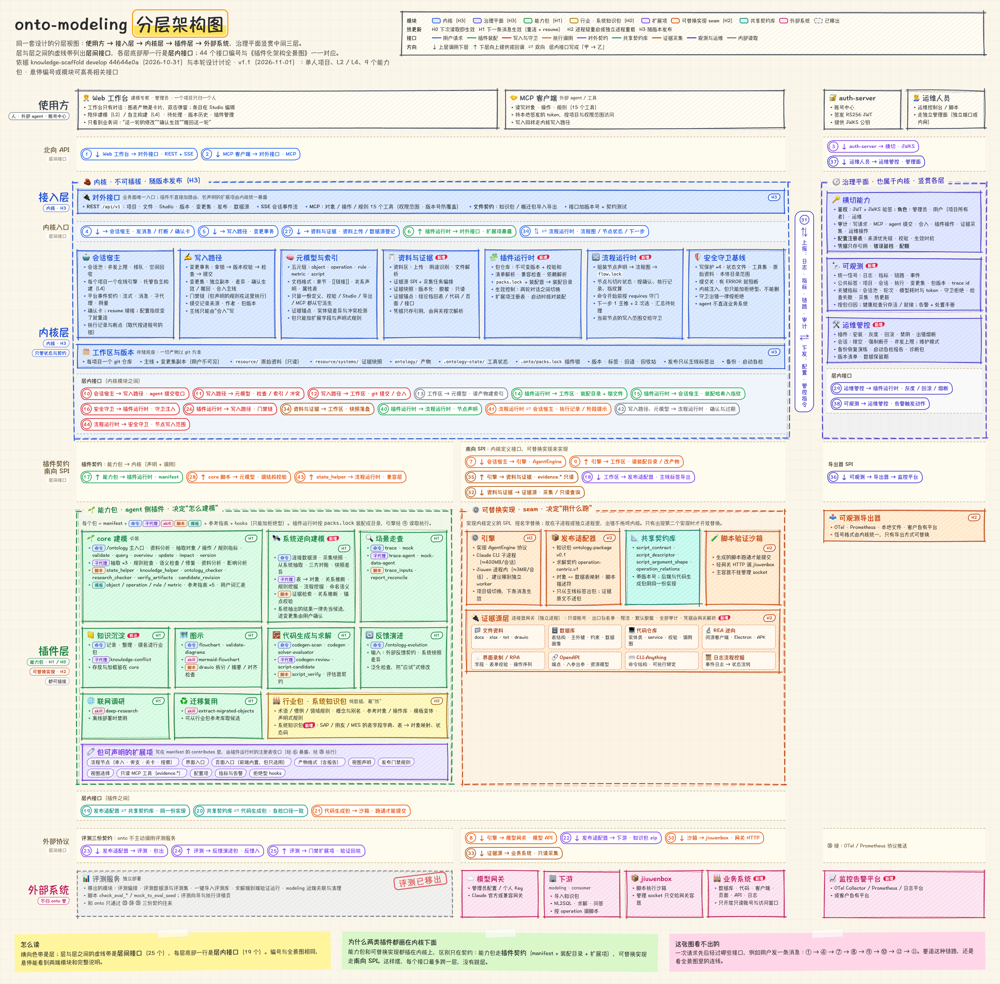
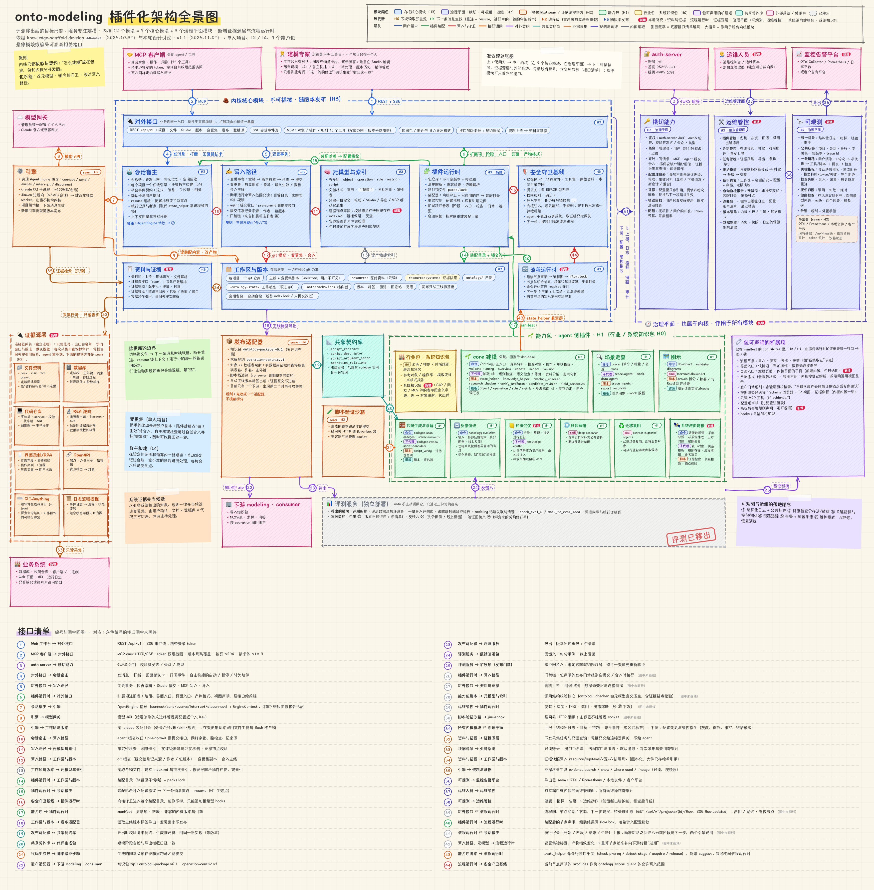

# onto-modeling 插件化架构详细设计

| 项 | 内容 |
|---|---|
| 版本 | v1.1（评审稿） |
| 日期 | 2026-11-01 |
| 修订 | v1.1 按 2026-11-01 的产品决定修改：单人项目、陪伴建模（L2）与自主构建（L4）两种构建方式、工作台只有对话、内核能力 4 项加插件页面。约束见 1.6，逐处改动见附录 E |
| 依据代码 | knowledge-scaffold `develop` 44644e0a（2026-10-31），目录 `modeling/onto-modeling` |
| 参考项目 | deepseek-ai/deepseek-harness ce7073d5（2026-10-30） |
| 演练记录 | 内部测试环境上的两次场景演练：全流程一次、增量路径一次（缺陷记录未入库） |
| 配套图 | `layered-architecture`（分层架构图，.html / .png）<br>`architecture-overview`（全景图，.html / .png） |

**阅读说明**

- 正文讲设计，代码位置和资产清单放在附录。
- 文中的"现状"都以上面这个提交为准。凡是读代码推断、没有实际运行验证的结论，都标了"（未实测）"。
- 接口编号 ①～㊹ 和两张配套图一致。HTML 版的图可以悬停查看每个接口的说明。

---

## 0 术语

| 术语 | 含义 |
|---|---|
| 内核 | 不可插拔、只随版本发布（H3）的部分，共 12 个模块：9 个核心模块 + 3 个治理平面模块 |
| 能力包 | agent 侧插件，决定"怎么建模"。由清单（manifest）加命令、子代理、skill、脚本、hooks、模板、参考指南组成 |
| 行业包 / 系统知识包 | 只有数据的能力包，内容是术语、规则、参考库、模板变体。系统知识包针对 SAP、用友这类具体商用系统 |
| 扩展项 | 能力包在清单 `contributes` 里声明、由内核统一接入的内容，如流程节点、界面入口、页面入口、产物格式、视图声明、门禁规则 |
| 内核能力 | 界面口径，指必装、不能停用的能力，等于内核模块加 core 包。左栏的工作台、Studio、资料、发布，以及增量更新，都属于内核能力 |
| 插件页面 | 能力包启用后才出现的页面，如场景走查页。页面由前端内置，包只声明打开哪些（见 5.9） |
| 插件产物 | 能力包登记给内核的产物类型，如场景、求解契约。不是本体实体，内核按登记解析、建索引、提供读写接口（见 5.9） |
| seam / 可替换实现 | 内核定义接口（SPI），实现可以按名字替换，如引擎、发布适配器、证据源提供方、沙箱、导出器 |
| 流程节点 | 建模流程里的一个步骤，由能力包声明。主流程节点由 core 包提供 |
| 主线 | 已确认、可以发布的工作区状态。只有"合入"能写主线 |
| 变更集 | 一份有目的的改动，包含独立副本、差异、校验结论，合入后才进主线。陪伴建模下由用户点"确认生效"合入，自主构建下检查通过自动合入（见 8.2） |
| 构建方式 | 陪伴建模（L2）：每个决定等用户确认；自主构建（L4）：在设定的范围和预算内一路建完，结束后集中复核（见 1.6、8.5） |
| 切片 | 一条业务流程或一类单据。建模按切片纵向推进，每片走完抽取、检查、场景、确认（见第 9 章） |
| 需复核 | 产出没有经过人逐项确认，需要专家看一眼。来源有三种：自主构建的自动决定、节点升级、导入（见 6.6） |
| 待处理 | 工作台里汇总的、等用户处理的事项（见 4.7） |
| 证据快照 | 从业务系统采集、脱敏后冻结的一份只读证据，存放在 `resource/systems/` |
| 证据锚点 | 指向快照里一条记录、或资料里一个位置的稳定 ID |
| 装配目录 | 插件运行时按项目锁文件，把"内核守卫 + 已启用的包"组装出来的目录。工作区的 `.claude` 指向它 |
| H0～H3 | 热更新级别，见 3.5 |

---

## 1 背景与目标

### 1.1 onto-modeling 现在是什么

一句话：它把一套跑在 Claude Code 上的本体建模工具箱，包装成了多用户 Web 服务；后来又加了一个发布器，把建模结果转成 modeling 和 consumer 能读的知识包。ADR 0001 把 Web 层的职责收缩为三件事：工作区管理，会话编排加 SSE，把交互确认做成界面。

按代码看分三层：

| 层 | 内容 | 位置 |
|---|---|---|
| 方法论层（真正的建模能力） | 22 个命令、18 个子代理、3 个 skill、41 个确定性脚本，加上模板、参考指南，以及 `settings.json` 里的写保护 hooks | `assets/workspace-toolkit/`，每个项目的 `.claude/`、`CLAUDE.md` 都软链到这里 |
| 宿主层（通用的 agent 工作台） | 每个项目一个 git 工作区、会话池与 resume 续接、SSE 事件流、确认卡、模型配置、引擎抽象（Claude CLI 子进程或 Jiuwen 进程内） | `workspace.py`、`agent_sessions.py`、`engines/` |
| 下游契约层（对齐 modeling / consumer） | 五元组知识包导出、对象与数据表的映射、求解契约、脚本描述符、评测编排、本地 MCP 的 15 个工具、Studio 编辑与门禁 | `solver_contract.py`、`modeling_eval.py`、`package_mapping.py`、`eval_import.py`、`onto_mcp/`、`studio.py` |

代码重心已经偏到第三层。第三层的主要文件加起来约 290KB，会话编排加两个引擎约 140KB。`workspace.py` 一个文件就有约 100KB，工作区管理和包的导出、导入、发布都混在里面。

### 1.2 评测移出后的定位

评测服务独立部署之后，onto-modeling 只做一件事：**把业务资料和业务系统建成本体，并发布成版本化的知识包**。它和评测服务之间只保留三份契约（见第 11 章）。

### 1.3 目标

1. 方法论和内核分开发版：方法论（怎么建模）可以按周迭代，内核按季度发版。
2. 能力按包启用，按项目锁定版本；升级可以灰度、可以回滚，从下一条消息开始生效。
3. 流程可插拔：主流程之外的步骤，可以通过导入节点插件来增加。
4. 能从业务系统（数据库、代码、界面、接口、日志）直接取证据，每条结论都能指回来源。
5. 补齐 DFX：崩溃后能恢复，改动能确认、能撤回，可观测，可运维。
6. 支持两种构建方式：陪伴建模（L2）每个决定等用户确认；自主构建（L4）在设定的范围和预算内一路建完，结束后集中复核。

### 1.4 非目标

- 不允许插件修改元模型，即五元组和文档格式。
- 不在 agent 循环内部挂中间件。循环跑在 Claude CLI 子进程里，对我们是黑盒。
- 不做动态加载前端代码的插件。视图渲染器和页面都由前端内置，包只负责选用；包新加的产物靠登记和通用视图显示（见 5.9）。
- 不做多人协作。一个项目只归一个人（见 1.6）。
- 只有一个实现的地方不提前抽象，比如发布目标、引擎类型。

### 1.5 设计原则

1. **内核小而稳，方法论放在包里。** core 建模包必装，但它仍然是一个包。
2. **插件只能接在两个面上。**
   - agent 资产面：沿用 Claude Code 的 `.claude/` 约定，两个引擎都能读；
   - 后端扩展点：SPI 和扩展项。
3. **产物就是提交。** agent、网页、MCP 的写入都要走内核的写入路径：拿锁、跑检查、git 提交。插件可以写，但不能绕过这条路径。
4. **安全守卫只能加，不能减。** 内核守卫是基线，包只能追加拒绝型守卫。
5. **热更新按会话边界生效。** 配置指纹一变，就在下一条消息之前断开重连，用 resume 续上上下文；正在进行的那一轮不切版本。
6. **不提前拆分。** 出现第二个实现时再做抽象。

### 1.6 产品形态约束（v1.1 新增）

以下是 2026-11-01 定下的产品形态。后文相关章节已经同步修改；如有冲突，以本节为准。

1. **一个项目 = 一个知识包 = 一个人。**
   - 没有成员共享、评审人和多人变更集。
   - 管理员和运维只能看到项目元数据（名称、所有者、阶段、占用），项目内容只归所有者。
   - 变更集保留为内核机制，用来做"确认生效 / 撤回这一轮"、隔离助手的改动和崩溃恢复（见 8.2）。
2. **两种构建方式，在项目设置里选。**

   | | 陪伴建模（L2） | 自主构建（L4） |
   |---|---|---|
   | 谁来拍板 | 用户，逐张决策卡 | 按策略自动决定，记进决策台账 |
   | 什么时候停 | 每个决定点 | 跑完、预算用完，或用户让它暂停 |
   | 怎么合入 | 用户点"确认生效" | 检查通过自动合入，产出标"需复核" |
   | 拿不准时 | 追问用户 | 挂起这个问题，跳到下一片继续 |
   | 不会做 | — | 发布、删除已确认内容、改资料区、采集未授权的生产库 |

   开始自主构建有三种方式：把它设成项目的默认方式、在对话里说"剩下的你自己做完"、用命令面板。运行中可以随时转回陪伴建模。机制见 8.5。
3. **工作台只有对话。**
   - 助手占满工作台，不再有中栏和切片 / 产物栏。顶部是一条主线进度，数据来自流程运行时；切片进度收进"建模步骤"抽屉。
   - 图、表类产物（资料地图、建模蓝图、流程图、变更点清单）在对话里是卡片，双击打开弹窗。流程图弹窗就是 Studio 的编辑器，保存后和 Studio 里是同一份。
   - 对象、操作、规则这类文字条目，点卡片里的名字去 Studio 编辑。在 Studio 里选中条目可以"问助手"，把它作为引用带回对话。
   - 所有编辑都走写入路径。助手的修改确认生效之前，写入范围内的条目只读（见 4.3）。
   - 等用户处理的事项集中在"待处理"里（见 4.7）。
4. **左栏 = 内核能力 4 项 + 插件页面。**
   - 内核能力：工作台、Studio、资料、发布，每个项目都有。增量更新也属于内核能力（core 包里的按需节点），不单独设页面，在对话里走完。
   - 插件页面：场景走查、知识沉淀、代码生成与求解。对应的能力包启用后，才出现在左栏。
   - 不是所有包都带页面：系统逆向建模只给资料页加 3 个子页（数据源、采集与快照、证据浏览器）；图示、联网调研、反馈演进、迁移复用、行业包都没有页面，只在对话、Studio 和检查里起作用。
   - 包和页面怎么分工、包新加的产物怎么显示，见 5.9。
5. **评测移出**，onto 只做建模（见第 11 章）。

---

## 2 参考：DeepSeek Harness 的插件化做法

### 2.1 底座

dsh 跑在仓库内置的 Cordis 插件框架上。它的文档原话是"不存在需要打补丁的特权内核"，连 agent loop 本身也是插件。Cordis 提供五个基本件：

- **插件**：带 `apply(ctx)` 的函数或对象，也可以是 Service 子类；
- **ctx 服务容器**：按名字取服务，不直接 import 具体实现；
- **`inject` 声明依赖**：依赖的服务就绪后插件才加载；服务消失时插件自动卸载，服务恢复后自动重载；
- **类型化事件**：有 emit、waterfall、parallel、serial、bail 五种分发模式；
- **注册可撤销**：通过 `ctx.effect()` / `ctx.on()` 注册的东西，卸载时自动撤销，所以热重载不需要额外写代码。

### 2.2 八种范式和我们怎么借鉴

| 范式 | dsh 的做法 | onto 怎么用 |
|---|---|---|
| 1 能力 seam | 接口定义、实现、使用方三个角色分开，仓库里有 36 个 seam | 引擎、发布适配器、证据源提供方、沙箱、导出器（见 5.7、5.8） |
| 2 事件拦截 | waterfall 中间件；工具调用流水线按约束力分五层 | 只能用 hooks 和门禁链近似实现（见 4.8、第 6 章）；循环内的中间件做不了 |
| 3 注册扩展 | 往注册表里加工具、提示词片段、命令 | 能力包提供命令、子代理、skill；后端有扩展项注册表 |
| 4 会话事件记录状态 | "模型可见即已记录"，状态都从事件派生 | 工作区 git 作为唯一事实来源；执行记录和变更集归内核管 |
| 5 作用域隔离 | `agent.ctx`、preset、`isolate` | 按项目锁定包版本，按项目装配目录 |
| 6 分层 YAML 组合 | profile → bundle → patch 逐层叠加 | 包清单 + `packs.lock` + 装配器 |
| 7 前后端两半 + Slot | 包导出 `./client`，用 `ctx.slots` 挂组件 | 不做前端动态加载；包只声明界面入口和要用的视图 |
| 8 接入外部生态 | `hooks-claude-code`、`defineMod`、把别家 agent 当作 subagent | 资产沿用 Claude Code 约定；Jiuwen 用 `ClaudeHooksRail` 执行同一批 hook；REA、CLI-Anything 作为证据源提供方接入 |

### 2.3 根本差别

dsh 能在循环里挂中间件，onto 做不到。ADR 0001 写明，可用的扩展点只有 hooks、canUseTool、MCP 和 commands。Jiuwen 有 rail 机制可以做，但如果只在一个引擎上做，两个引擎的行为就会不一致。

所以：

- onto 的插件边界只能放在**资产格式**和**平台侧流程**上；
- dsh 那种在进程内卸载、重载单个插件的做法也用不了，生效边界只能放在"两轮对话之间"。

---

## 3 总体架构

### 3.1 分层视图



| 层 | 包含的模块 | 类别 |
|---|---|---|
| 使用方 | Web 工作台（建模专家、管理员）、MCP 客户端、auth-server、运维人员 | 外部 |
| 接入层 | 对外接口 | 内核 · H3 |
| 内核层 | 会话宿主、写入路径、元模型与索引、资料与证据、插件运行时、流程运行时、安全守卫基线；存储底座是工作区与版本 | 内核 · H3 |
| 治理平面（从接入层竖贯到内核层） | 横切能力、可观测、运维管控 | 内核 · H3 |
| 插件层 | 能力包区：9 个能力包、行业包与系统知识包、扩展项<br>可替换实现区：引擎、发布适配器、共享契约库、脚本验证沙箱、证据源层<br>可观测导出器 | 插件 · H0 / H1 / H2 |
| 外部系统 | 模型网关、下游 modeling · consumer、jiuwenbox、业务系统、监控告警平台、评测服务（已移出） | 外部 |

**接口怎么分布。** 层与层之间的接口分四组：北向 API、内核入口、插件契约与南向 SPI、外部协议，共 25 个；另有层内接口 19 个。完整清单见第 7 章。

**为什么两类插件都画在内核下面。** 能力包和可替换实现的区别在契约，不在层次：

- 如果把能力包画在内核上面，④⑤⑥㉗㊴ 就要跳过能力包那一层，⑳㉑ 还要穿过整个内核；
- 现在这样摆，每个接口最多只跨一层。

**分层图表达不了调用顺序。** 比如用户发一条消息，要依次经过 ① → ④ → ⑦ → ⑧ → ⑨ → ⑩ → ⑫ → ⑪。要追这种链路，请看全景图。

### 3.2 全景视图



全景图按模块之间的实际连线来画，圆圈里的编号就是第 7 章的接口编号。灰色编号的接口只列在清单里，图上没有画线。

### 3.3 模块总表

| 模块 | 归属 | 热更新 | 一句话职责 | 章节 |
|---|---|---|---|---|
| 对外接口 | 内核 | H3 | 业务面的唯一入口：REST、SSE、MCP、文件契约 | 4.1 |
| 会话宿主 | 内核 | H3 | 会话池、引擎编排、事件契约、确认卡、执行记录 | 4.2 |
| 写入路径 | 内核 | H3 | 变更事务、变更集、门禁链、合入主线 | 4.3 |
| 元模型与索引 | 内核 | H3 | 本体长什么样，以及怎么查 | 4.4 |
| 资料与证据 | 内核 | H3 | 资料区、数据源登记、采集编排、快照、证据检索 | 4.5、5.8 |
| 插件运行时 | 内核 | H3 | 包仓库、清单、锁文件、装配、生效、扩展项注册表 | 4.6、8.1 |
| 流程运行时 | 内核（新增） | H3 | 组装流程图、计算节点和切片状态、守门、推荐下一步、汇总待处理 | 4.7、第 6 章 |
| 安全守卫基线 | 内核 | H3 | agent 不能越过的边界 | 4.8 |
| 工作区与版本 | 内核 | H3 | 每个项目一个 git 仓库，是所有产物的唯一来源 | 4.9 |
| 横切能力 · 可观测 · 运维管控 | 内核（治理平面） | H3 | 鉴权审计配置、统一信号、运维动作 | 4.10 |
| 能力包（9 个） | 插件 | H1 | 怎么建模 | 5.1～5.4 |
| 行业包 · 系统知识包 | 插件 | H0 | 行业和系统的知识资产 | 5.5 |
| 扩展项 | 插件声明 | H0 / H1 | 节点、入口、页面、报告格式、门禁等 | 5.6 |
| 引擎、发布适配器、沙箱、导出器 | 可替换实现 | H2 | 用什么跑 | 5.7 |
| 共享契约库 | 共享库 | 随版本加载 | 后端与代码生成包共用的契约实现 | 5.7 |
| 证据源层 | 可替换实现 | H2 | 连接器网关 + 8 个提供方 | 5.8 |

### 3.4 两类插件，两种契约

| | 能力包 | 可替换实现 |
|---|---|---|
| 决定什么 | 怎么建模 | 用什么跑 |
| 契约 | **插件契约**：manifest + 装配目录（`.claude` 约定）+ 扩展项 | **南向 SPI**：内核定义的接口 |
| 谁来执行 | 引擎读取装配目录来执行；扩展项由内核注册表接入 | 内核调用，实现跑在子进程或独立进程里 |
| 热更新 | H1，其中纯数据部分是 H0 | H2 |
| 例子 | core 建模、场景走查、行业包 | 引擎、发布适配器、证据源提供方 |

### 3.5 热更新分级

| 级别 | 生效时机 | 适用对象 |
|---|---|---|
| H0 | 下次读取就生效 | 纯数据：模板、参考指南、词表、示例、声明式规则 |
| H1 | 下一条消息时重连生效，上下文靠 resume 保留；正在进行的一轮跑完旧版本 | 提示词、子代理、skill、hooks 列表、脚本、节点声明 |
| H2 | 进程级：滚动重启，或独立进程重载 | 后端代码插件、SPI 实现 |
| H3 | 随版本发布 | 内核 |

**为什么按会话边界生效。**

- agent 循环在 CLI 子进程里，没法在进程内卸载单个插件。
- 现有的"配置指纹变了 → 断开重连 → resume"已经是一套按会话粒度工作的热更新机制，只是目前只接了模型配置。
- 检查点在发消息之前（`agent_sessions._deliver`）。每个项目同一时刻只有一个在线引擎，所以不会和正在进行的一轮冲突。

**现在各部件的实际生效时机**（develop 44644e0a）：

| 部件 | 何时生效 |
|---|---|
| 模型网关、Key、模型名 | 下一条消息（指纹变化触发重连） |
| 子代理 prompt、脚本、模板、参考指南、hook 脚本内容 | 立即生效，因为运行时每次都现读 |
| CLAUDE.md、`settings.json` 里的 hooks 列表、MCP 配置、权限模式 | 新会话或重连之后 |
| 后端加载的 4 个工具箱脚本（`script_contract` 等） | 必须重启。`toolkit.py` 启动时只加载一次，缓存在 `sys.modules` 里 |
| `.env` | 要重建容器 |

由此带来两个问题：

1. **上传资产包后三个版本同时运行。** agent 立刻用上新的脚本和 prompt；在线会话仍用旧的 CLAUDE.md 和 hooks；后端导出时仍用旧的契约脚本。
2. **替换不是原子操作。** 上传和回滚都是先移走旧目录、再移入新目录，中间有一段时间 `.claude` 指向空处。

---

## 4 内核模块设计

### 4.1 对外接口

**职责：** 业务面的唯一入口。

**现状：**

- **REST**：6 个 router 共 130 个接口，`main.py` 里还有一个健康检查。

  | router | 接口数 |
  |---|---|
  | projects | 75 |
  | settings | 23 |
  | admin | 12 |
  | sessions | 11 |
  | auth_routes | 5 |
  | onto_mcp | 4 |

- **SSE**：推送会话事件。
- **onto MCP**：15 个工具，覆盖对象、操作、规则三类实体的列出、读取、校验和修改。
  - 权限范围分三级：`ontology.read`、`ontology.change.validate`、`ontology.change.apply`；
  - token 只存摘要，放在工作区之外的 SQLite 里；
  - 用版本号防覆盖，每页最多 200 条，请求体最大 1MiB。
- **文件契约**：导出项目搬迁包、知识包（ontology-package v0.1）、求解契约（operation-centric.v1）；导入支持原样导入和已发布知识包的反向转换。

**目标设计：**

1. 路径加版本号，统一为 `/api/v1/...`；知识包格式和 MCP 由契约测试守住。
2. 评测移出后，把 `projects.py` 按领域拆开。
3. 插件不能直接加 REST 路由。包声明的扩展项（流程节点、界面入口、页面入口、产物格式、视图声明）由内核统一暴露（⑥）。
4. 新增接口：
   - 流程：`GET /api/v1/projects/{id}/flow`（㊴）；
   - 数据源登记与采集任务（㉗）；
   - 变更集的确认生效与撤回；
   - 待处理汇总：`GET /api/v1/projects/{id}/inbox` 和 SSE `inbox.updated`（㊴）；
   - 自主构建：启动、暂停、在安全点停下、转为陪伴，读取决策台账（④）；
   - 插件产物：按类型列表（筛选、排序、分页）、读单条、看历史、保存，SSE `artifacts.updated`（见 5.9.4）；
   - 插件管理；
   - 运维管理面：独立端口或内网（㊲）。
5. MCP 新增只读工具 `flow.get`、`evidence.*`、`artifact.list` / `artifact.get`。插件可以贡献只读的 MCP 工具，写操作一律走写入路径。

**涉及接口：** ①②④⑤⑥㉗㊴。

### 4.2 会话宿主

**现状：**

- **会话池：** 最多 12 个活跃会话（`ONTO_WEB_MAX_SESSIONS`）。超限时先驱逐最久空闲的；全都在忙就排队，并告诉用户排第几位。空闲 600 秒后回收（`ONTO_WEB_SESSION_IDLE_TTL`）。
- **多对话：** 一个项目可以有多条对话，但同一时刻只有一个在线引擎。别人的会话正忙时返回 409。
- **引擎抽象：**
  - `AgentEngine` 协议包括 connect、send、events、interrupt、disconnect、config_stale、context_limits；
  - `EngineContext` 规定引擎不得反过来依赖会话层。
- **事件与持久化：**
  - 平台事件契约：引擎产出流式增量、消息、工具结果、子代理进度、用量、轮次结果；宿主产出用户消息、状态、确认请求、排队位次、工作区变化、中断等事件。
  - 历史按行追加写入 JSONL。崩溃后，历史里会自动补上中断标记（`_reconcile_stale_history`）。
- **配置生效：** 配置指纹变化，就断开重连并 resume；个人 Key 场景下换人发消息，同样处理。
- **确认卡：** 超时 600 秒按拒绝处理。但默认权限模式是 `bypassPermissions`，此时确认回调根本不会触发。

**目标设计：**

1. **一个项目同一时刻只有一个在线引擎**（v1.1 定）。引擎在助手变更集的独立副本里工作（见 8.2）。同一项目并发多个引擎留作后续项：单人项目里唯一的需求是自主构建并行跑切片，等单片耗时成为瓶颈再做。到时并发多，Jiuwen（约 3MB/会话）比 Claude 引擎（约 400MB/会话）更合适。
2. **配置指纹扩展。** 装配哈希、`flow.lock` 哈希、MCP 配置、权限模式都计入指纹（⑮）。
3. **执行记录归宿主管**（见 8.4），取代 `state_helper` 靠进程号推断的锁。
4. **阶段提示和下一步改由宿主注入。** 在两轮对话之间注入（㊶），不再依赖 SessionStart hook。原因是 Jiuwen 只执行 PreToolUse hook（见 6.1）。
5. **平台事件契约作为插件观察会话的唯一入口。** 可观测据此按包、按节点统计。
6. **Jiuwen 会话移到独立 worker 进程统一托管。** 出错时不拖垮内核。
7. **自主构建的运行控制归宿主：** 运行策略、预算、安全点、暂停和转为陪伴、决策台账，见 8.5。

**涉及接口：** ④⑦⑩⑮㊶。

### 4.3 写入路径

**现状：四个写入方，走三条路。**

| 写入方 | 怎么写 | 防护 |
|---|---|---|
| 网页文件编辑 | `write_file`：拿项目锁 → 校验版本号 → 写文件 → 同步脚本描述符 → `git commit "web: 保存 X"` | 项目锁（线程锁 + `fcntl` 文件锁）+ 版本号 |
| Studio 结构化编辑 | 先占 30 分钟租约，在草稿区修改；提交时跑确定性检查，按结果分三路：硬伤直接拒绝；通过的走 `write_file` 落盘；超出确定性检查范围的交给 agent 复核 | 租约 + 确定性检查 |
| MCP 写入 | 用内容摘要做版本号，过期就拒绝；和网页共用项目锁；条目有租约或草稿时返回 `PROJECT_EDITING_BUSY` | 同网页 |
| agent 写入 | 直接用文件工具改工作区，自己执行 `git commit` | 守卫 hooks；提交前跑校验器；改已确认的文档要走 `candidate_revision` |

**现在的问题：**

- agent 写入不拿项目锁，也不校验版本。人在 agent 一轮进行中保存的修改，可能被 agent 随后的写入覆盖（未实测）。
- 写文件和提交是两步，不是原子操作。

**目标：统一的变更事务。**

1. **开始：** 拿锁，记下基准版本号；
2. **暂存改动；**
3. **跑检查：** 内核检查，加上门禁链里包声明的规则（㉖）；
4. **提交：** 提交信息末尾写明来源和版本，格式如下：

   ```
   Onto-Source: agent
   Onto-Author: zhangsan
   Onto-Changeset: cs-12
   Onto-Packs: core@1.4.2, trace@0.9.1
   Onto-Node: core.object@1.4.2
   ```
5. **发出变更事件：** 交给流程运行时和可观测（㊷）。

**配套规则：**

- **agent 提交收口：** `pre_commit_check` 改为调用内核的提交接口（⑩），agent 的写入也就同样拿锁、跑检查、记录来源。
- **主线只能由"合入"写。** 变更集的设计见 8.2。
- **助手的修改确认之前，写入范围内的条目只读**（v1.1 定，取代原来的"实体认领提示"）。
  - 范围：当前执行节点声明的 `produces`，落到当前切片包含的条目上（切片规划时已经定了每片有哪些对象、操作、规则），再加上这一轮已经改过的条目，以及等用户决定的决策卡在改动预览里列出的条目（例如一个口径决定会改到片外的硬度限值）。节点不按切片执行时（如全局一致性检查的修复），范围就是 `produces` 声明的整类条目。
  - 范围内的条目在 Studio、流程图弹窗等所有编辑器里只读，一直持续到这组修改确认生效或撤回为止；自主构建下持续到这一片自动合入为止。陪伴建模的一个变更集会跨好几轮，如果这一轮结束就解除，用户改了助手碰过的条目，合入时必然冲突。
  - 界面提示"确认生效或撤回后才能编辑"，并给出"去确认"入口；助手还在跑时，也可以回到对话里打断它。
  - 范围外的条目照常编辑，保存即合入主线。
  - 助手写不出这个范围（守卫按 ㊹ 拦截），所以人和助手不会改到同一个条目。
  - Studio 的 30 分钟硬租约随之取消；受管目录（求解契约）保留硬锁。
- **崩溃恢复：** 写入前先记一条写入意图，启动时把没提交的意图补提交或回滚（见 8.3）。

**涉及接口：** ⑤⑩⑪⑫㉖㊷。

### 4.4 元模型与索引

**现状：**

- **实体与目录：** 五类实体对应五个目录（`studio.py` 的 `KIND_DIRS`）：object、operation、rule、metric、scripts。旧的 `ontology/logic` 作为 operation 的只读别名保留。
- **文档格式：**
  - 章节结构；
  - `[[维基链接]]` 是关系边的唯一来源；
  - 关系声明写在一级标题"关联对象"下；
  - 属性表里的英文名就是真实数据表的列名。
- **命名与关系：** 业务名到文件名的映射（`document_metadata`），重名判定（`name_conflict`），主操作和子操作的调用关系（`operation_relations`）。
- **索引与查询：** `_refresh_indexes` 生成各目录的 `index.md`；Studio 提供图、表、条目三种视图；`query.py` 支持反查引用；`ontology_checker` 维护一份链接索引。

**问题：定义分散。**

- 实体类型和格式规则在后端、Studio、校验器、导出、MCP 里各写一份。
- 光是维基链接的正则，就在 `workspace.py`、`ontology_checker.py`（多处）、`field_semantics.py`、`operation_relations.py`、`impact_analysis.py` 等 7 处以上各写各的，对 `#`、`|`、`/` 的处理不一致。
- 对象名里带 `#` 时，Studio 图谱会断边，在内部测试环境上已经遇到过。
- ADR 0004 把 logic 改名为 operation 时，每一层都要跟着改，根源就在这里。

**目标：**

1. **内核里只保留一份元模型声明**，包括实体类型、目录、章节结构、链接语法、关系语法。校验器、Studio、导出、MCP、前端都从这一份派生。
2. **插件只能加扩展字段和声明式规则**，不能新增实体类型。
3. **新增"证据"字段和证据锚点校验**（见 5.8.5）。
4. **提供实体级差异和冲突检测**，供变更集合入使用（见 8.2）。
5. **提供产物指纹**，供流程运行时判断节点是否"过期"（㊷）。
6. **按登记解析插件产物**（v1.1）：包登记的产物类型由这里统一解析、建索引、按格式定义校验，并按 `refs` 字段算引用和过期。插件产物不是实体，不建关系边、不进知识包（见 5.9.4）。

**涉及接口：** ⑪⑬㉘㊷。

### 4.5 资料与证据

**职责：** 资料区（上传、用途识别、文件解析），数据源登记，采集编排，快照入库，证据检索，锚点解析。

**现状：** 只有资料区，对应 `material_detect`、`source_extract`、`excel_context`、`excel_preview`；还没有证据源的概念。

**设计：** 见 5.8。

**涉及接口：** ㉗㉜㉞㉟。

### 4.6 插件运行时

**现有雏形：**

| 部件 | 现状 |
|---|---|
| `assets_admin` | 上传、回滚、备份资产包。全局只有一个版本，替换也不是原子的 |
| `_mount_assets` | 把资产软链进每个项目 |
| `jiuwen_assets` | 按 Claude Code 的目录约定加载资产 |
| `toolkit.py` | 在后端进程里加载 4 个工具箱脚本 |
| 引擎注册表 | 写死在 `engines/__init__.py` 里 |

**要新建的 6 件事：**

1. **包仓库：** 每个版本的目录不可修改，附校验和。
2. **清单与兼容检查：** 检查内核接口版本范围、兼容哪些引擎、依赖哪些包。
3. **项目锁文件：** `.onto/packs.lock`，记录项目用哪些包的哪个版本。
4. **装配器：** 把内核守卫和已启用的包组装成按内容寻址的目录，然后原子地切换软链。
5. **生效控制：** 靠配置指纹，在两轮对话之间生效。
6. **扩展项注册表与启动恢复：**
   - 注册表收集节点、界面入口、页面入口、产物格式、视图声明、门禁规则、配置项、指标；
   - 启动时逐个项目核对装配目录，不对就重新装配。

**必须守住的规则：**

- 包不能改元模型；
- 包不能删内核守卫；
- 包不能绕过写入路径；
- 包出问题，只影响锁定了它的项目。

**详细流程：** 见 8.1。

**涉及接口：** ⑥⑭⑮⑯⑰㉖㉙㊵。

### 4.7 流程运行时（新增）

**职责：**

- 把各个包声明的流程节点组装成一张流程图；
- 计算每个节点的状态；
- 命令开始前守门；
- 推荐下一步；
- 把"过期"沿依赖往下游传；
- 把当前节点的写入范围交给守卫；
- 按切片计算建模节点的状态（见 6.6）；
- 汇总待处理。

前端进度条、聊天建议、待处理、agent 侧的前置检查、阶段提示、项目列表的进度，全部从这里取数，不再各写一份。

**待处理（v1.1 新增）。** 工作台里等用户处理的事项都汇总在这里，工作台图标上的角标就是它的计数：

| 事项 | 来源 |
|---|---|
| 决策：陪伴建模里还没回答的决策卡、自主构建挂起的问题 | 执行记录、决策台账 |
| 证据冲突：资料和系统快照说法不一致 | 三方对账节点的报告 |
| 变更清单：增量更新识别出的变更点 | 增量更新节点 |
| 需复核：自主构建的自动决定、节点升级、导入带进来的产物 | 节点状态的附加标记 |
| 过期：上游改了、需要刷新的节点 | 节点状态 |
| 可续跑：中途中断的执行 | 执行记录（见 8.4） |
| 报告里的待处理条目 | `report_items` |

对外暴露为 `GET /api/v1/projects/{id}/inbox` 和 SSE `inbox.updated`（㊴）。待处理不另存一份状态，处理完一项，对应的来源随之改变，计数自动减少。

**设计：** 见第 6 章。

**涉及接口：** ㊴㊵㊶㊷㊸㊹。

### 4.8 安全守卫基线

**现有六层：**

1. **CLI 权限规则**（`settings.json`）：放行一批 git 命令；禁止修改 `.claude/**` 和 `CLAUDE.md`。
2. **工具调用前的守卫 hooks**（PreToolUse）：
   - 匹配 `Edit|Write|MultiEdit` 时依次执行：`lock_file_guard`、`toolset_write_guard`、`resource_write_guard`、`ontology_scope_guard`；
   - 匹配 `Bash` 时依次执行：`pre_commit_check`、`toolset_write_guard`、`resource_write_guard`、`ontology_scope_guard`；
   - Jiuwen 引擎通过 `ClaudeHooksRail` 按同样的协议执行同一批脚本，超时 15 秒。
3. **提交关：** `pre_commit_check` 遇到 ERROR 就阻断提交。
4. **进程隔离：** jiuwenbox 的管理 socket 不挂进主容器，只交给一个无特权的网关容器。
5. **导入安全：** zip 包里的符号链接和 `..` 路径一律拒绝。
6. **人工确认：** 确认卡，超时按拒绝处理。

**`resource_write_guard` 实测结果。** 把脚本从 develop 取出，在本地喂入不同写法：

| 写法 | 结果 |
|---|---|
| `Write resource/a.md`、`echo x > resource/a.md`、`rm -rf resource/systems`、`sed -i ... resource/a.md` | 拦截 |
| `python3 -c "open('resource/a.md','w')..."` | 放行 |
| `cd resource && touch a.md` | 放行：相对路径按原工作目录解析 |
| `find resource ... -delete`、`git checkout -- resource/` | 放行 |
| `D=resource; touch $D/a.md` | 放行：带变量的路径直接跳过 |
| 输入不是合法 JSON | 放行 |

另外，脚本出错或超时时也会放行。Jiuwen 那边的代码注释写明：守卫失效不阻断建模，与 Claude CLI 的 hook 失败语义一致。

**现在的问题：**

1. 默认权限模式是 `bypassPermissions`，守卫 hooks 是唯一的硬约束，而它们只能防误改，防不住有意绕过。
2. 守卫只管写，不管读和网络。agent 能读到同一数据卷里其他项目的工作区（未实测）。
3. 守卫写在资产包的 `settings.json` 里，上传新资产包就能把它删掉。
4. Jiuwen 只执行 PreToolUse 类 hook，SessionStart、UserPromptSubmit、PostToolUse 都不执行（未实测）。

**目标：**

1. **守卫由内核注入装配目录**（⑯），包删不掉，只能追加拒绝型守卫。
2. **守卫出错一律拒绝。** Claude CLI 对 hook 脚本自身的异常按非阻断处理，所以要在脚本内部捕获异常，主动输出 deny。
3. **补上常见的绕过写法：** `python -c`、cd 之后的相对路径、`find -delete`、`git checkout` / `git rm`。
4. **当前节点声明的写入范围作为 `ontology_scope_guard` 的允许范围**（㊹）。
5. **受保护目录做四层保护：**
   1. hook：拦常规写法；
   2. 内容哈希：能发现被改过；
   3. 写入路径：合入时检查，改动进不了主线；
   4. 进程隔离：真正改不了。
6. **agent 不直连业务系统**，取证据只能通过连接器网关（见 5.8）。
7. **下一步按项目隔离 agent 的读取和进程**，例如每个项目一个容器、只挂载自己的目录，或者用 Jiuwen 的 `sandbox_root`。

**涉及接口：** ⑯㊹。

### 4.9 工作区与版本

**现状：**

| 目录 / 文件 | 内容 | 是否进 git |
|---|---|---|
| `.onto-web.json` | 项目元数据：名称、所有者、成员、引擎、归档状态等 | — |
| `resource/` | 用户上传的原始资料（diagrams、excel、others），对 agent 只读 | 进 |
| `ontology/` | 建模产物 | 进 |
| `research/`、`reports/` | 资料分析报告、校验报告 | 进 |
| `.ontology-state/` | 工具状态：命令锁、进度、评审回执 | 不进，也不导出 |
| `.claude`、`CLAUDE.md`、`README.md` | 软链到共享资产（`_mount_assets`） | — |

**版本能力：**

- 每次保存就是一次提交；支持版本历史、打标签、回退、读取任意版本的文件；有回收站，可以克隆项目。
- 删除分两段：先移走，再清除。用 `PURGE_MARKER` 标记，进程重启后能识别删到一半的残留并接着清。
- 备份：管理员手动触发或定时任务，打包全部 workspace，保留最近 3 份（`BACKUP_KEEP = 3`）。会话历史、各类配置、MCP token、Jiuwen 存档都不在备份范围内。

**目标：**

1. **拆分 `workspace.py`：** 工作区核心、项目所有权（并入鉴权）、发布适配器、求解契约四块。
2. **主线加变更集副本：** 用 git worktree 实现，用户看不到。
3. **新增几个目录和文件：** `resource/systems/`（证据快照）、`.onto/packs.lock`、`.onto/flow.lock`。
4. **启动自检：** 检查残留的 `index.lock`、未提交的改动、装配目录是否正确（见 8.3）。
5. **补齐备份范围**，并定期做恢复演练。

**涉及接口：** ⑨⑫⑬⑭⑱㉞。

### 4.10 治理平面

治理平面也属于内核，作用于所有模块。所有内核模块和它之间是一个双向接口（㉛）：上报日志、指标、链路、审计，下发配置和管控指令。

**为什么放进内核，而不做成插件：** 信号格式必须统一，而且必须一直开着。如果做成可插拔，关掉某个包就看不见了。真正可替换的只有导出器。

#### 4.10.1 横切能力

| 能力 | 现状 | 目标 |
|---|---|---|
| 鉴权 | 对接 auth-server，用 RS256 JWT，按 JWKS 验签，校验签发方、受众、类型。没配置 `ONTO_WEB_AUTH_URL` 时鉴权整体关闭；SSE 请求可以把 token 放在查询参数里 | 保持不变 |
| 角色 | admin、owner、editor、viewer；没有所有者的历史项目对所有人按 editor 开放 | 收成管理员、用户、运维三种：项目只归所有者，没有成员和评审人；管理员和运维只能看到项目元数据。历史项目迁移时指定所有者 |
| 审计 | 记录所有写请求和 MCP 写入，管理页能看最近 200 条 | 补上 agent 提交、合入、插件安装 / 切换 / 回滚、证据采集与查询、运维操作 |
| 配置 | 分三层：26 个 `ONTO_WEB_*` 环境变量、数据目录里的配置文件、内置默认值 | 做成配置注册表：每一项声明来源优先级、校验规则、生效时机（立即 / 下一条消息 / 新会话 / 重启）；插件也在清单里声明自己的配置项 |
| 凭据 | 个人 Key、评测数据源的密码存在数据目录，文件权限 0600 | 配置里只存引用；证据源的凭据只放在网关里（见 5.8.6） |
| 错误留档 | 用户只看到友好提示，原始错误进运维页 | 记录是哪个包、哪个节点出的错 |
| 配额 | 无 | 按项目和用户限制并发、token 预算、采集频率；自主构建的预算只能在这个上限之内设（见 8.5） |

#### 4.10.2 可观测（新增）

- **统一信号：** 结构化日志、指标、链路、事件。
- **公共标签：** 项目、会话、执行、变更集、包版本、节点、trace id。
- **一条完整链路：** 用户消息 → 轮次 → 子代理 → 工具或脚本 → 提交 → 检查。
- **关键指标：**
  - 会话池与排队；
  - 轮次时长；
  - 模型的耗时、token 用量、失败次数；
  - 守卫拒绝次数、检查失败次数；
  - 合入、采集、热更新与重连；
  - 各节点的耗时、重跑次数、首次被接受的比例。
- **按包、按节点归因：** 调用次数、失败次数、耗时。
- **健康检查：** 分成"存活"和"就绪"两种。就绪检查要探测模型网关、auth、两个网关、磁盘和 git。
- **告警：** 告警规则加处置手册。包可以在清单里声明自己的指标和告警规则。
- **导出器：** 这是一个 seam，见 5.7。
- **现有基础：** `/api/health`、错误留档、审计、token 统计、沙箱状态。

#### 4.10.3 运维管控（新增）

运维管控走独立的管理面（独立端口或内网），所有操作都写审计。

| 管控对象 | 能做什么 |
|---|---|
| 插件 | 安装、灰度、回滚、禁用、出错时熔断（经 ㉛ 下发，㉙） |
| 会话 | 查看在线会话、排空、强制断开、调整并发上限 |
| 任务 | 证据采集、导出、备份、清扫 |
| 维护模式 | 设为只读或拒绝新会话 → 排空 → 升级 → 恢复 |
| 备份恢复 | 工作区、会话历史、配置、存档，定期做恢复演练 |
| 启动自检报告 | 残留锁、未提交改动、装配目录、依赖服务是否可达 |
| 诊断包 | 一键导出脱敏日志、配置、版本清单、最近的错误 |
| 版本清单 | 内核、包、引擎、数据格式的版本 |
| 数据保留 | 历史、快照、日志的保留期和清理规则 |

**涉及接口：** ③㉙㉛㊱㊲㊳。

---

## 5 插件设计

### 5.1 能力包的组成

现在的 `assets/workspace-toolkit` 就是未来 core 能力包的雏形，里面共 9 类东西：

| 组成 | 数量 | 作用 | 谁读、何时读 |
|---|---|---|---|
| 命令（commands） | 22 | 流程入口：编排步骤、派子代理、跑脚本、请用户确认 | 用户或界面触发。Claude 引擎在会话启动时加载，Jiuwen 在发消息时展开 |
| 子代理（agents） | 18 | 每个只做一件专门的事：抽取、检查、修复、走查、mock、知识冲突检查、影响分析等 | 命令执行过程中先 Read 再派出 |
| skill | 3 | 不在阶段主线上，靠用户的话触发：deep-research、extract-migrated-objects、mermaid-flowchart | 用户说的话匹配到时 |
| 脚本（scripts） | 41（33 个 py + 8 个 sh） | 处理所有能确定判定的事，不调用模型（见 5.4） | Bash 调用、hook 调用；后端也 import 其中 4 个 |
| hooks（settings.json） | 5 类挂点 | 工具调用前（写保护）、用户提交消息时、工具调用后（提交提示）、会话开始时；外加权限的允许和拒绝清单 | 引擎在对应时机自动执行 |
| 规则与约定文档 | 6 | `workspace-rules.md`（挂载成 CLAUDE.md），以及交互约定、通用前置检查模板（STEP0）、规则与语义的分工、用户可见措辞表、业务知识守则 | CLAUDE.md 常驻上下文；其余由命令和子代理引用 |
| 模板（templates） | 11 | 产物的格式骨架 | 子代理生成产物前读取 |
| 参考指南（reference） | 5 | 判断拿不准时翻阅：BFO 建模、对象抽取启发式、操作范式、操作写作风格、断言驱动测试 | 子代理在固定的决策点读取 |
| 资源模板 | 1 | `图示说明定义.drawio` | 流程图相关脚本读取 |

拆成能力包后，每个包还要带一份**清单（manifest）**。下面这些东西现在都写死在后端或前端里，以后统一由包在 `contributes` 里声明：流程节点、界面入口、报告格式说明、声明式校验规则。

**各组成怎么配合**，以 `/ontology-extract-object` 为例：

1. **命令先做前置检查：** 跑 STEP0，用 `state_helper.py` 加锁并确认当前阶段；用 `knowledge_helper.py load` 取出相关的业务知识。
2. **派出子代理：** extract-objects-agent 读对象模板，拆、合拿不准时查参考指南里的抽取启发式，然后写 `ontology/object/*.md`。
3. **hooks 拦截越界写入：** 不许改原始资料目录、工具集和工具自管的状态文件。
4. **脚本核验并提交：** `verify_artifacts.py` 和 `ontology_checker.py` 核验通过、用户确认后，提交 git。`pre_commit_check.sh` 在提交前再跑一次检查，`post_commit_hook.sh` 在提交后给出提示。
5. **全程措辞：** 面向用户的话遵守约定文档里的用户词汇表，比如不说"commit"，说"保存版本"。

### 5.2 包清单（manifest）

```yaml
name: trace
version: 0.9.1
kind: capability                # capability | knowledge | node
kernel_api: ">=1.0 <2.0"        # 兼容的内核接口版本
engines: [claude, jiuwen]
depends:
  core: ">=1.4"
contributes:
  commands: [ontology-trace, ontology-trace-single, ontology-trace-batch,
             ontology-trace-interactive, ontology-mock]
  agents: [trace-agent, mock-data-agent]
  scripts: [trace_inputs.py, report_reconcile.py]
  templates: [testcase-template.md, mock-data-template.md]
  hooks: {}                     # 只能追加拒绝型守卫
  nodes: [nodes/mock.yaml, nodes/trace.yaml]     # 流程节点，见第 6 章
  entries: []                   # 界面入口：快捷项、附加操作
  pages: [scenarios]            # 页面入口：从前端内置页面里选，启用后左栏出现「场景走查」，见 5.9
  artifacts: [artifacts/scenario.yaml, artifacts/mock.yaml]   # 产物格式：位置、格式、字段、引用，见 5.9.4
  views: [views/scenario.yaml]  # 视图声明：列表、详情、对话卡片怎么显示
  reports: [reports/trace-report.schema.yaml]    # 报告格式（产物格式的一种），供逐条评审
  gates: []                     # 声明式门禁规则
  config: []                    # 配置项声明，进配置注册表
  metrics: []                   # 指标与告警规则声明
checksums: checksums.sha256
```

**装配时的规则：**

- 命令、子代理、skill 的名字在所有已启用的包之间必须唯一，非 core 包的命令带包前缀；
- 脚本暂时仍放在扁平的 `.claude/scripts/` 下，这样现有命令里写的路径不用改；脚本名同样要求唯一；
- 有冲突时装配失败，不会切到一半。

### 5.3 包的划分

| 包 | 内容 | 是否必装 | 界面（v1.1） | 热更新 |
|---|---|---|---|---|
| core 建模 | `/ontology` 主入口、资料分析、抽取对象 / 操作 / 规则指标、validate、query、overview、update、impact、version；对应的子代理、模板、参考指南；主流程节点声明；业务知识的存放与加载（`knowledge_helper`、`ontology/knowledge/`） | 必装 | 内核能力：工作台、Studio、资料、发布；增量更新在对话里走完 | H1 |
| 场景走查 | trace 的 4 个命令、mock；trace-agent、mock-data-agent；`trace_inputs`、`report_reconcile` | 推荐 | 左栏页面「场景走查」；切片里多出「场景」一步 | H1 |
| 知识沉淀（v1.1 拆出） | 纠错与惯例的信号提示（原 `knowledge_signal_probe`）；knowledge-conflict-agent 入库前查重、查冲突；记录、整理、提名进行业包 3 个命令 | 推荐 | 左栏页面「知识沉淀」 | H1 |
| 代码生成与求解 | codegen-scan、codegen、solver-evaluator；codegen-review-agent、script-candidate-agent；`script_verify`、`jiuwenbox_client` | 可选 | 左栏页面「代码生成与求解」 | H1 |
| 图示 | flowchart、validate-diagrams；mermaid-flowchart skill；drawio 相关脚本 | 可选 | 没有页面；启用后对话里出现流程图卡，Studio 多出「流程图」条目类型 | H1 |
| 系统逆向建模（新增） | 连接数据源、采集快照、从系统抽取、三方对账、快照差异；表 → 对象、关系推断、规则挖掘、流程挖掘、命名语义等子代理；证据检索、锚点校验脚本 | 可选 | 资料页加 3 个子页：数据源、采集与快照、证据浏览器 | H1 |
| 反馈演进 | `/ontology-evolution`，输入改为外部反馈契约和系统快照差异 | 可选 | 没有页面；反馈进资料区「外部反馈」分组，在对话里处理 | H1 |
| 联网调研 | deep-research skill；离线部署时禁用 | 可选 | 没有页面 | H1 |
| 迁移复用 | extract-migrated-objects skill | 可选 | 没有页面；发现可复用的对象时在对话里推荐 | H1 |
| 行业包 | 行业知识、参考库、模板变体、声明式规则、示例项目（见 5.5） | 按项目选 | 没有页面 | H0 |
| 系统知识包 | 某个商用系统的表字段字典、表 → 对象映射、状态码、典型规则 | 按项目选 | 没有页面 | H0 |

**知识沉淀为什么只拆出沉淀这一段。** 知识的存放和加载留在 core：core 命令里有 15 处加载业务知识，5.5 的行业包分层加载也建在它上面。如果整个拆出去，没启用它的项目里，core 命令和行业包都会缺知识层。所以拆出去的只是"把对话里的纠错和惯例变成知识条目"这一段，加上它的页面。停用知识沉淀后，已有条目照常加载，只是不再新增。

`knowledge_signal_probe` 原来是 UserPromptSubmit hook。包只能追加拒绝型 hooks，Jiuwen 也不执行这类 hook，所以改成由知识沉淀包在清单里声明一条提示规则，会话宿主在两轮对话之间注入（㊶），两个引擎都能拿到。

**拆包前要先解开三处耦合：**

1. **跨包引用路径。** 命令里写死了 `Read .claude/agents/x.md` 这样的路径，跨包引用时要在清单里声明依赖。
2. **脚本之间互相 import。** 脚本按同目录的模块名互相 import，被引用的那批脚本要留在同一个包里，或者收进共享契约库。
3. **后端直接 import 工具箱脚本。** `toolkit.py` 在后端进程里 import 了 `script_contract`、`script_descriptor`、`script_argument_shape`、`operation_relations`。这一批收成带版本号的共享契约库（见 5.7），后端按版本加载。

### 5.4 脚本

`VALIDATION_BOUNDARIES.md` 定的原则是：**能确定判定的交给脚本，需要语义判断的交给模型**。脚本一律不调用模型。

**按用途分 7 类：**

| 类别 | 数量 | 做什么 | 脚本 | 拆包后归属 |
|---|---|---|---|---|
| 确定性校验 | 8 | 检查产物是否合格，作为阶段放行条件 | `ontology_checker`、`research_checker`、`research_review`、`field_semantics`、`report_reconcile`、`verify_artifacts`、`check_diagrams`、`check_diagram_excel_alignment` | core；图示的两个归图示包，`report_reconcile` 归走查包 |
| 对齐下游契约 | 7 | 保证知识包第一次就能被 consumer 正确调用 | `script_contract`、`script_descriptor`、`script_argument_shape`、`operation_relations`、`solver_evaluator_contract`、`script_verify`、`jiuwenbox_client` | 前 5 个进共享契约库；后 2 个归代码生成包 |
| 状态与安全护栏 | 11 | 命令锁与进度、修订流程、业务知识；防止越界 | `state_helper`、`candidate_revision`、`knowledge_helper`；8 个 hook：`lock_file_guard`、`toolset_write_guard`、`resource_write_guard`、`ontology_scope_guard`、`pre_commit_check`、`post_commit_hook`、`session_start_hook`、`knowledge_signal_probe` | 守卫和提交检查归内核；`state_helper` 改为流程运行时的兼容层；会话开始和提交后的提示改由内核注入；`knowledge_helper` 留在 core；`knowledge_signal_probe` 归知识沉淀包，改成提示规则（见 5.3） |
| 资料读取与转换 | 8 | 把原始资料转成范围可控、能定位回原文的上下文 | `source_extract`、`excel_context`、`split_drawio`、`summarize_diagram`、`summary_to_drawio`、`batch_summarize`、`init_flowchart_resources`、`trace_inputs` | 前两个改造成文件证据提供方；drawio 相关的归图示包；`trace_inputs` 归走查包 |
| 查询与报告 | 3 | 基于链接索引反查引用、分析影响、生成总览 | `query`、`impact_analysis`、`generate_overview` | core |
| 示例 | 1 | 注入"外卖订单"迷你领域 | `seed_example` | core；以后由行业包里的示例项目替代 |
| 评测衔接 | 3 | 评测数据核对、防止"应试式"修改、mock 转评测种子 | `check_eval_data`、`check_eval_generalization`、`mock_to_eval_seed` | 随评测移出 |

**按调用方式分：**

| 调用方式 | 数量 | 说明 |
|---|---|---|
| hook 自动触发 | 8 个 sh | 在 `settings.json` 里注册。hook 里还会调用 py 脚本：比如 `pre_commit_check` 依次跑 `ontology_checker`、`research_checker`、`script_descriptor`、`script_verify`、`verify_artifacts` |
| 命令或子代理通过 Bash 主动调用 | 23 | 最常用的是 `state_helper`（19 个命令文件调用）和 `knowledge_helper`（命令里 15 处调用） |
| 只被其他脚本当库 import | 6 | `research_review`、`operation_relations`、`script_argument_shape`、`script_contract`、`summarize_diagram`、`jiuwenbox_client` |
| 只被后端使用 | 1 | `mock_to_eval_seed` |
| 完全没被引用 | 3 | `generate_overview`、`split_drawio`、`summary_to_drawio`，拆包时清理 |

后端实际用到 10 个脚本：

- 直接 import 4 个：`operation_relations`、`script_argument_shape`、`script_contract`、`script_descriptor`；
- 加载或运行 6 个：`query`、`jiuwenbox_client`、`solver_evaluator_contract`、`seed_example`、`research_review`、`mock_to_eval_seed`。

### 5.5 行业包与系统知识包

#### 现成的地基

工具箱里已经有一套项目级的业务知识机制，行业包就是把它往上提一层，变成跨项目共享：

- **存放：** 项目工作区的 `ontology/knowledge/*.md`。每条知识有类型（纠错、惯例、术语、领域规则）、作用范围、置信度和来源。
- **沉淀：**（v1.1 起这一段由知识沉淀包提供，存放和加载仍在 core，见 5.3）
  1. 用户说"不对，应该是……"时，`knowledge_signal_probe.sh` 提醒 agent；
  2. `knowledge-conflict-agent` 查重和冲突；
  3. 用户确认后写入。
- **使用：** 命令里有 15 处调用 `knowledge_helper.py load --scope ...`。范围为 global 的条目全部加载；按对象划定范围的条目，取最近修改的最多 10 条。

#### 行业包的结构（示例）

```
industry-power-om/1.2.0/
  manifest.yaml           # 行业名、版本、兼容的 core 版本、来源说明
  knowledge/              # 格式与 ontology/knowledge 完全相同
  concepts.yaml           # 标准概念及别名：设备 ← 装置 / 机组；缺陷 ← 故障 / 异常
  reference/              # 挂到已有决策点上的行业启发式与写法
  library/                # 参考对象 / 操作库：设备、部件、缺陷、工单、巡检记录
  templates/              # 模板变体：只能在现有模板语法里加章节
  rules.yaml              # 声明式校验规则
  examples/               # 行业示例项目：入门演示，也作回归测试的黄金样例
  nodes/                  # 可选：行业专属流程节点，如合规检查（见第 6 章）
```

#### 一个项目怎么用行业包

1. **选择：** 新建项目时选择行业，可以多选；结果写进锁文件，以后也能追加。管理员可以给租户设默认行业。
2. **资料分析：** 额外参考行业包提供的标准和规范清单；用行业术语表辅助识别资料用途。
3. **抽取：**
   - `knowledge_helper load` 改成分层加载，优先级从低到高是：core 通用守则、行业知识、项目知识。slug 相同时以项目知识为准。
   - 行业条目按"概念"划定范围，加载时用项目对象的名称和别名去匹配 `concepts.yaml`。
   - 参考库只作为候选提示，不会直接复制进项目，由专家确认。
4. **校验：** `ontology_checker` 额外加载已启用行业包的 `rules.yaml`。
5. **示例：** `/ontology 示例` 列出行业示例项目。
6. **来源可追溯：** 用到行业知识时，在产物或提交信息里记录来源，例如 `industry-power-om@1.2.0 / 设备状态`。行业包升级后，可以据此列出受影响的产物。

#### 越用越强

- **回流：** 项目里沉淀的高置信度通用知识，可以提名升级进行业包，由管理员审核、脱敏后发布新版本。
- **脱敏是硬门槛：** 客户名、内部编号、合同金额不能进入行业包。提名流程里要有自动检查和人工审核两道。
- **效果可度量：** 提交信息里记着行业包版本，外部评测的分数变化就能对应到具体的包、版本和知识条目。

#### 需要新建的部分

| 已有，可以直接复用 | 要新建 |
|---|---|
| 知识条目格式与加载、冲突检查、信号提醒 hook、迁移复用 skill、示例注入 | 1. 知识分层加载与优先级<br>2. 按概念和别名划定范围<br>3. 校验器加载声明式规则（现在规则写死在 `ontology_checker.py` 里）<br>4. 参考指南按决策点索引<br>5. 回流提名与脱敏流程<br>6. 记录产物用了哪条行业知识 |

行业包和系统知识包只有数据，不带后端代码，是最安全、生效最快的一类包（H0）。

### 5.6 扩展项

扩展项写在清单的 `contributes` 里，由插件运行时的注册表统一收口。经 ⑥ 暴露给前端，经 ㉖ 在写入路径上执行。

| 扩展项 | 谁来消费 | 热更新 |
|---|---|---|
| 流程节点（串入 / 旁支 / 关卡 / 按需）与节点钩子 | 流程运行时（见第 6 章） | H1 |
| 界面入口：快捷项、附加操作、数据源连接向导 | 前端，经对外接口 | H1 |
| 页面入口（v1.1）：左栏页面，或给内核页面加子页，如资料页的数据源、采集与快照、证据浏览器 | 前端，经对外接口 | H1 |
| 提示规则（v1.1）：在两轮对话之间注入的提示，如知识沉淀的纠错信号 | 会话宿主（㊶） | H1 |
| 产物格式（v1.1，含原来的报告格式说明）：位置、格式、字段、引用、状态 | 元模型与索引：解析、建索引、校验；`report_items` 逐条评审 | H0 |
| 视图声明（v1.1）：列表的列和筛选、详情布局、对话卡片 | 前端，经对外接口 | H0 |
| 发布门禁规则（声明式），例如"已确认的属性必须有证据锚点或专家确认"、验证回执检查 | 写入路径的门禁链 | H0 |
| 视图选择：Schema 浏览器、ER 视图、证据侧栏（视图由内核内置） | 前端 | H0 |
| 只读 MCP 工具，例如 `evidence.*` | 对外接口 | H1 |
| 配置项声明 | 配置注册表 | H1 |
| 指标与告警规则声明 | 可观测 | H1 |
| hooks | 装配器，只能追加拒绝型 | H1 |

**页面只能选用，不能自带；包新加的产物靠登记显示。** 详见 5.9。

### 5.7 可替换实现

| seam | SPI | 现有实现 | 什么时候开放替换 | 热更新 |
|---|---|---|---|---|
| 引擎 | `AgentEngine` + `EngineContext`（⑦） | Claude CLI 子进程（约 400MB/会话）、Jiuwen 进程内（约 3MB/会话） | 已支持项目级切换（切换后下一条消息生效）。注册表改成入口点自动发现；新增引擎类型仍要随版本发布 | H2 |
| 发布适配器 | 读主线标签 → 产出包（⑱） | 知识包 ontology-package v0.1、求解契约 operation-centric.v1、对象 ↔ 数据表映射、脚本描述符 | 先把散落的代码收成一个适配器；出现第二个下游时再开放 | H2 |
| 共享契约库 | 库调用（⑲⑳） | `script_contract`、`script_descriptor`、`script_argument_shape`、`operation_relations`、`solver_evaluator_contract` | 不对外开放替换；带版本号，后端按版本加载，与代码生成包共用同一份实现 | 随版本加载 |
| 脚本验证沙箱 | 网关 HTTP（㉑㉚） | `sandbox-gateway` + jiuwenbox | 已经是独立进程 | H2 |
| 可观测导出器 | 导出接口（㊱） | 暂无 | OTel、Prometheus、本地文件、客户自有平台 | H2 |
| 证据源提供方 | `EvidenceProvider`（㉜） | 暂无 | 见 5.8 | H2 |

**`sandbox-gateway` 的现状。** 它和主服务用同一个镜像，但运行条件更严：

- 非 root 用户（65534），根文件系统只读，`cap_drop: ALL`，`no-new-privileges`；
- 内存 256MB，最多 64 个进程；
- 只在内部网络 `expose` 端口，不映射到宿主；
- 不挂主服务的数据卷，也不读 `.env`；
- 接口只有三个：`/health`、`/v1/status`、`/v1/verify`。jiuwenbox 不可用时返回 503，由调用方回退。

连接器网关照搬这套部署方式。

### 5.8 证据源层

#### 5.8.1 定位与边界

现在建模的输入只有一种：人上传的文档、表格和流程图。证据源层补上另一类输入：直接从正在运行的业务系统里取证据。理由有三条：

- 文档常常过时、不全，系统才是事实；
- 每条结论都能指回具体的表、代码行、页面或接口，专家更容易信任和确认；
- 文档、数据库、代码三方一对照，就能发现它们之间的矛盾。

**基本流程是采集和建模分开：**

```
连接器采集 → 冻结成证据快照（有版本、已脱敏、只读）→ 能力包基于快照建模
```

**三条边界：**

1. agent 碰不到业务系统，也拿不到凭据。只有网关容器能连业务网络，凭据也只放在网关容器里。
2. 建模只读快照，不读运行中的系统。提供方不对运行中的系统开放任意查询；需要补数据时，由内核发起补采任务。
3. 采集只能由内核发起，经网关执行，全程审计。

```
Web / MCP ──REST──▶ 内核·资料与证据 ──采集任务 + 票据──▶ 连接器网关（独立容器）──只读──▶ 业务系统
                      │     ▲                              │  提供方插件 ×8
                      │     └──── 快照包（标准记录）◀───────┘
                      ▼
       工作区 resource/systems/<源>/<快照>/ ◀── 引擎通过 evidence.* 只读检索
```

#### 5.8.2 连接器网关

**部署：** 照搬 `sandbox-gateway`（见 5.7），另有三处不同：

| 方面 | 设计 |
|---|---|
| 网络 | 网关同时接入内部网络（和 onto-modeling 互通）和 `biz-egress`（通往业务系统）。主容器不接入 `biz-egress`，所以 agent 就算拿到账号密码，也没有路由连到业务系统。出口地址在登记数据源时声明，网关只连白名单里的主机和端口 |
| 凭据卷 | 独立的 `connector-secrets` 卷，只有网关挂载 |
| 鉴权 | 沙箱网关没做鉴权，靠的是只在内部网络监听。连接器网关必须鉴权，因为 agent 和后端在同一个容器里，能直接调到网关的 HTTP 接口。每个请求都要带内核签发的一次性票据：票据里写明任务 ID、数据源、操作类型、范围哈希、预算，10 分钟过期，用过即作废 |

**接口：**

| 接口 | 说明 |
|---|---|
| `GET /health` | 存活检查 |
| `GET /v1/providers` | 已加载的提供方、版本、能力 |
| `POST /v1/sources/{id}/test` | 测试连接，并自检账号确实只读 |
| `POST /v1/jobs` | 提交采集任务：票据、操作（discover / snapshot / sample）、范围、预算 |
| `GET /v1/jobs/{id}`、`POST /v1/jobs/{id}/cancel`、`GET /v1/jobs/{id}/bundle` | 查进度、取消、以流的方式取回快照包 |
| `PUT /v1/secrets/{ref}`、`POST /v1/secrets/{ref}/rotate`、`DELETE /v1/secrets/{ref}` | 写入、轮换、删除凭据。**没有任何能读出明文的接口** |

**由网关强制执行、提供方绕不过去的策略：**

- **只读，三重保证：**
  1. 使用只读账号；
  2. 会话设为只读，例如 `SET TRANSACTION READ ONLY`；
  3. SQL 先过解析器，只放行 SELECT / SHOW / DESCRIBE / EXPLAIN。
- **保护业务系统：**
  - 限定访问时间窗口；
  - 限制并发数和每秒查询数；
  - 单条查询设超时，超时就杀掉；
  - 限制单次返回的行数，以及整个任务的总字节数。
- **默认脱敏**，规则见 5.8.4。
- **审计：** 每次访问业务系统都留记录，包括任务、数据源、语句摘要、行数、字节数、耗时。

**任务执行：**

- 每个任务由一个提供方子进程执行，超时就杀掉；提供方崩溃不影响网关本身。
- REA、CLI-Anything、Playwright 这类重工具放在旁路容器里，由网关通过 MCP 或命令行调用。
- 任务状态有：排队、运行中（带阶段和进度）、成功、部分完成、失败、已取消。
- 按实体记录断点，中断后可以续采。没采完的快照标记为"不完整"。

#### 5.8.3 提供方 SPI 和 8 个提供方

```python
class EvidenceProvider(Protocol):
    def describe(self) -> ProviderInfo                      # 名称、版本、证据类型、能力、凭据字段、输出格式版本
    def test(self, conn) -> TestResult                      # 测试连通性，并自检账号确实只读
    def discover(self, conn, scope) -> Inventory            # 列出可采集的对象，并估算规模
    def snapshot(self, conn, scope, budget, sink) -> Stats  # 采集，逐条把标准记录写进 sink
    def sample(self, conn, selector, limit) -> Records      # 定点补采脱敏样本
```

**提供方清单要声明的内容：**

- 能产出哪些证据类型；
- 支持哪些能力：discover、snapshot、sample、增量采集；
- 需要哪些凭据字段，其中哪些是密钥；
- 用什么方式保证只读；
- 锚点 ID 的生成规则和稳定性承诺；
- 运行方式：子进程、旁路容器还是 MCP；
- 许可证说明，比如 Oracle、达梦驱动的授权，反编译工具的授权。

| 提供方 | 怎么连 | 能产出的标准记录 | 怎么保证只读 | 首版 |
|---|---|---|---|---|
| 文件资料 | 读工作区 `resource/`，不需要凭据，在内核 worker 里运行 | 文档、段落、表格、单元格、术语 | 本来就只读 | ✅ 由 `source_extract` 改造 |
| 数据库 | MySQL / PG / Oracle / 达梦 / Hive 驱动 | 实体（表、视图）、字段、关系（外键和推断）、约束、存储过程与触发器、数据画像、脱敏样本 | 三重保证 | ✅ 先做 MySQL / PG |
| 代码仓库 | 用只读 token 浅克隆，固定到某个提交 | 实体类与 ORM 模型、字段、关联、service 方法与接口、校验规则、状态机、内嵌 SQL | 不持有推送权限 | 第二批 |
| OpenAPI | 拉取或上传接口文档 | 端点（对应操作）、schema（对应实体）、字段、错误码 | 只读文档，不调用接口 | 第二批 |
| REA 逆向 | 旁路容器运行 REA | 实体、操作、流程、外部调用，REA 给出的证据和局限原样保留 | 本地分析；登记时必须附授权说明 | 第三批 |
| 界面录制 / RPA | 导入 Playwright trace 或 HAR；或者用测试账号在测试环境里爬取 | 页面、表单字段与校验、操作序列、界面文案 | 只用测试环境，拦截写请求 | 第三批 |
| CLI-Anything | 旁路容器生成命令行后，用 `--help` / `--json` 探查 | 命令与参数（对应操作）、资源名词（对应实体）、可执行绑定候选 | 建模阶段只探查，不执行业务命令 | 第三批 |
| 日志流程挖掘 | 读日志导出文件，或做只读查询 | 活动、状态迁移及频次、流程变体 | 只读；案例 ID 脱敏 | 第三批 |

提供方是 H2 级热更新：管理员更换版本后，新任务用新版本，正在跑的任务用旧版本跑完。驱动随提供方包或网关镜像一起离线交付。

#### 5.8.4 证据快照格式

**位置：** `resource/systems/<源ID>/<快照ID>/`，快照 ID 形如 `20261031-153000-a1b2`。

**放在 `resource/` 下的原因：**

- 原始资料的只读保护对它同样生效（四层保护，见 4.8）；
- 快照由内核通过写入路径提交，提交信息形如 `evidence: 采集 crm-prod 快照 …`；
- 快照一旦提交就不再修改，重新采集会生成一份新快照。

**目录结构：**

```
manifest.json      # 格式版本 evidence-snapshot/1、数据源、提供方及版本、范围、起止时间、
                   # 完整 / 不完整、覆盖率、预算用量、脱敏策略版本、各类记录条数、
                   # 每个记录文件的哈希、上一份快照 ID、发起人、任务 ID、凭据引用 ID（不含密钥）
inventory.json     # 范围内有哪些对象，采了哪些、没采哪些，没采的原因
records/*.jsonl    # 每类一个文件：entity / field / relation / constraint / operation /
                   # rule / flow / profile / sample / term
summary.md         # 分层摘要：按业务域聚类 → 实体清单，供人和 agent 先读
blobs.json         # 大件引用：sha256 → 存放位置、大小、类型
```

**每条记录的统一格式**（一行一条，方便 git 比较差异）：

```json
{"id":"db:crm-prod/crm.customer.cust_lvl","type":"field","parent":"db:crm-prod/crm.customer",
 "name":"cust_lvl","label":"客户等级","data_type":"varchar(8)","nullable":false,
 "attrs":{"comment":"客户等级"},
 "evidence":{"provider":"db-mysql@1.0.0","method":"information_schema.columns","confidence":"declared"},
 "hash":"9f3c…"}
```

`confidence` 取三个值，推断关系时要用到：

- `declared`：系统元数据里明确写着的，比如外键；
- `observed`：从数据或日志里观察到的；
- `inferred`：靠命名或取值重合推断出来的。

**大件不进 git。** 原始导出、二进制、录屏、整个代码仓库，放到工作区之外按内容寻址的 blob 仓，快照里只记哈希。每份快照在 git 里的部分设体积上限，建议 20MB，超出就拆分。

**脱敏策略**（策略带版本号，记进 manifest）：

- **识别敏感字段：** 先按列名识别手机号、证件号、姓名、地址、金额，再用正则检查取值。
- **处置方式：** 丢弃、掩码、加盐哈希、泛化分桶。加盐哈希的盐值按项目固定，这样脱敏后的数据之间还能关联。
- **样本：** 默认每张表最多 20 行，全部脱敏。
- **数据画像：** 只有低基数且不敏感的列才给出 top-k 取值；数值列只给统计量。
- **判断不了的列，一律按敏感处理。**
- **最后一道检查：** 快照包回到内核时，再扫一遍有没有疑似密钥或个人信息。

**怎么用：**

- **数据量大时：** agent 先读 `summary.md`，再用 `evidence.*` 按需下钻，不把整份快照交给模型。
- **快照差异：** 内核按"记录 ID + 哈希"做通用比较，得出新增、删除、修改三类，交给系统差异命令和影响分析使用。
- **保留期：** 保留最近 N 份。被已确认产物引用的快照不能清理，否则锚点会断。
- **发布：** 快照本身永远不进知识包。进包的只有映射结果，比如真实表名、列名，由发布适配器输出。

#### 5.8.5 锚点 ID 规范

**格式：** `<scheme>:<源ID>/<路径>[#<片段>]`

| scheme | 例子 | 说明 |
|---|---|---|
| `file` | `file:resource/excel/客户清单.xlsx#sheet:客户!B3` | 片段沿用 `source_extract` 现有的锚点格式：`L12`、`p:3`、`table:1/row:2/cell:3`、`sheet:Sheet1!A1`。资料分析报告里的"来源位置"直接兼容 |
| `db` | `db:crm-prod/crm.customer.cust_lvl`<br>`db:crm-prod/crm.view:v_cust`<br>`db:crm-prod/crm.customer.fk:fk_order_cust` | 按"库.表.列"写；表和列以外的对象加类型前缀：`view:`、`proc:`、`trigger:`、`fk:`、`check:` |
| `code` | `code:order-svc/sym:com.x.OrderService.submit`<br>`code:order-svc/src/.../OrderService.java#L120-L180` | 优先用符号形式，代码行号变了锚点也不变；没有符号时退回"文件 + 行号" |
| `bin` | `bin:crm-client-3.2/sym:OrderManager::submit` | 没有符号时用 `addr:0x4012a0` |
| `ui` | `ui:crm-web/page:客户详情/field:客户等级`<br>`ui:crm-web/flow:新建订单/step:3` | |
| `api` | `api:crm-openapi/op:createOrder`<br>`api:crm-openapi/schema:Order.status` | 优先用 operationId |
| `cli` | `cli:crm-cli/cmd:order.create/arg:customer` | |
| `log` | `log:order-events/activity:审核通过`<br>`log:order-events/edge:提交->审核通过` | |

**规则：**

1. **稳定。** 同一个东西在不同快照里的 ID 必须相同。这由提供方承诺，并用契约测试验证：系统没有变化时连续采集两次，ID 和哈希必须完全一致。
2. **转义。** 名字里的 `% / . # @ | [ ]` 和空格，一律百分号编码。这样可以避免和 `[[链接]]` 语法冲突，对象名带 `#` 导致断边的老问题也不会出现在锚点上。
3. **产物里只写锚点，不写快照号。** 每份产物文档在 frontmatter 里声明自己基于哪份快照，例如 `evidence_snapshots: {crm-prod: 20261031-153000-a1b2}`，校验时就按这份快照解析锚点。出现新快照后，系统差异会标出哪些锚点对应的内容变了。
4. **由内核统一解析。** `evidence.show(锚点)` 返回这条记录和它的原始上下文，比如 DDL、代码片段、截图裁剪。Studio 的证据侧栏也调用它。

**元模型改动**（属于内核改动，需要单独写一份 ADR）：

- 本体文档增加一个可选的"证据"章节；
- 属性表增加一列"证据"；
- 校验器增加两条规则：
  - 锚点在所声明的快照里不存在，报 ERROR；
  - 已确认的属性既没有锚点、也没有专家确认，默认报 WARNING。能力包可以把这条声明为门禁。

#### 5.8.6 凭据只存引用

- **引用格式：** `cred://crm-prod/3`，表示 crm-prod 的第 3 版凭据。内核只保存引用，以及主机、端口、库名、用户名这类不敏感的参数，存放在数据目录，不进工作区。
- **录入：** 页面提交的密码，由内核立即转交网关的 `PUT /v1/secrets`，不在内核里保存。日志和审计中只记引用。
- **存储：** 只放在网关卷里，用网关自己的主密钥加密，文件权限 0600。主密钥只注入网关容器。
- **使用：**
  - 任务开始时，网关解析出明文，通过 stdin 交给提供方子进程，不放进命令行参数或环境变量；
  - 驱动报错信息里可能带有含密码的连接串，返回前先脱敏。
- **轮换：** 新任务用新版本；旧版本等到没有任务在用时再删除。
- **项目导出：** 搬迁包只带数据源的登记信息，不带凭据引用。导入后需要重新录入。
- **先例：** 评测数据源已经把密码存在数据目录（0600），接口只返回 `has_password` / `has_token` 标记。证据源更进一步：凭据连主容器都不进。

#### 5.8.7 内核侧：登记、编排、检索

- **数据源登记，内容包括：**
  - ID、类型与提供方、显示名、环境（生产或测试）；
  - 连接参数（不含密钥）、凭据引用；
  - 范围白名单、出口地址、访问时间窗口、预算、脱敏策略；
  - 授权说明（REA 必填）、负责人。

  建议在租户级登记，在项目级授权使用。
- **采集编排：**
  1. 发起采集；
  2. 生产环境的数据源默认需要授权：陪伴建模时由项目所有者在确认卡上同意；自主构建时只能用项目设置里事先授权过的数据源，没授权的采集挂起，进待处理；
  3. 签发票据，交网关执行；
  4. 通过 SSE 推送进度；
  5. 取回快照包，校验格式、ID 唯一性、体积，并扫描有没有密钥；
  6. 通过写入路径提交；
  7. 建立检索索引。
- **检索**（只查快照，结果分页，每次调用有条数上限）：

  | 工具 | 用途 |
  |---|---|
  | `evidence.search` | 按文本、类型、数据源搜索 |
  | `evidence.show` | 查看锚点对应的记录和原始上下文 |
  | `evidence.where-used` | 这个锚点被哪些产物引用了 |
  | `evidence.lineage` | 相关记录：外键邻居、代码调用方 |
  | `evidence.diff` | 比较两份快照 |

  这组工具同时提供 MCP 和命令行两种形式，两个引擎都能用。

#### 5.8.8 和建模流程怎么衔接

- **系统取证节点 `rev.evidence`。** 这是一个外部节点，串在资料分析和对象抽取之间。只有项目登记了数据源时才出现，它的产出就是快照。
- **抽取。** 抽取节点通过 `evidence.*` 引用快照。从系统里抽出来的结果一律先当作候选进入变更集，由用户确认；自主构建下自动合入并标"需复核"。三方对账节点负责比对文档、数据库、代码之间的冲突。
- **对象与数据表的映射。** `package_mapping` 现在的做法是：拿"打了 schema 标签的表格资料"和属性英文名做列头重合推断，显式声明优先，推断不出来就写 `UNBOUND`。有了数据库证据以后：
  - 对象文档的"数据来源"可以直接写锚点，如 `db:crm-prod/crm.customer`；
  - 表名和列名从快照里解析出来；
  - 显式声明优先的规则保持不变。

  映射会更准，下游的 NL2SQL 也直接受益。
- **快照差异驱动演进。** 新快照和旧快照比较，变化的锚点进入影响分析，再推送"建议修订"。

#### 5.8.9 安全防线和缺口

| 威胁 | 防线 |
|---|---|
| agent 直连业务系统 | 主容器不接入 `biz-egress`，没有网络路由 |
| agent 读取凭据 | 凭据只在网关卷里，主容器中没有 |
| agent 直接调用网关 | 需要内核签发的一次性票据 |
| 提供方往业务系统写数据 | 只读账号、只读会话、语句白名单 |
| 敏感数据进入知识包 | 默认脱敏；快照不进包；快照包回到内核时再扫描一遍 |
| agent 改写快照 | 四层保护：hook、内容哈希、合入检查、进程隔离（见 4.8） |

**缺口：** 签发票据的密钥在后端进程手里。agent 和后端在同一个容器里，Jiuwen 更是直接跑在后端进程里，所以理论上 agent 能读到这把密钥并伪造票据（未实测）。

短期的最后一道防线是业务系统侧的只读账号、范围白名单，加上网关审计：就算票据被伪造，也只能在白名单范围内做只读采集，而且每次都留痕。要彻底解决，得等"按项目隔离 agent 的进程和读取"这项改造。

### 5.9 插件页面与插件产物（v1.1 新增）

#### 5.9.1 包和页面怎么分工

能力包管"怎么建模"，页面管"怎么看、从哪发起"。页面代码不随包走，由前端内置；包在清单里声明用哪个页面，并提供页面要的数据格式和按钮对应的命令。

| | 能力包 | 插件页面（前端内置） |
|---|---|---|
| 负责什么 | 命令、子代理、脚本、流程节点、产物模板、产物格式；声明用哪个页面、按钮对应哪条命令、角标从哪来 | 布局、交互、组件 |
| 数据从哪来 | 产物写在工作区里 | 只通过内核的通用接口读：产物（含插件产物）、报告条目、节点状态、待处理 |
| 不能做 | 加后端接口（4.1）、带前端代码 | 自己调助手、直接调脚本或沙箱、绕过写入路径 |

**为什么不让包自带前端代码：**

- 1.4 的非目标；
- 租户上传的包如果带前端代码，这些代码会用用户的登录态在浏览器里运行；
- 用户词汇表和交互规范管不到这些代码。

**代价和缓解。** 代价是页面改版要等前端发版。缓解办法：

- 页面尽量由包的声明驱动，比如列表的列、筛选项、按钮文案和对应的命令。这些改包就行，下一条消息生效；
- 前端单独发小版本（静态资源，不用重启后端），不跟后端内核按季度一起发。

#### 5.9.2 页面声明

```yaml
contributes:
  pages:
    - id: scenarios                 # 平台内置页面的 ID，只能从已有页面里选
      page_api: ">=1.0 <2.0"        # 需要的页面接口版本
      nav: {title: 场景走查, icon: flask, order: 10}
      badge: inbox                  # 角标 = 待处理里属于本包的事项数
      data:                         # 页面要读的东西，全部走内核通用接口
        artifacts: [trace.scenario, trace.mock]
        reports: [reports/trace-report.schema.yaml]
        nodes: [trace.trace]
      actions:                      # 按钮 → 发到工作台对话的命令
        - {label: 批量验证, command: /ontology-trace-batch}
        - {label: 交互走查, command: /ontology-trace-interactive}
  subpages:                         # 给内核页面加子页，如系统逆向建模
    - {parent: resources, id: sources, title: 业务系统数据源}
```

#### 5.9.3 页面要守的三条规则

1. **数据只从内核通用接口读。** 插件不能加自己的后端接口，所以页面能显示什么，取决于包登记的产物格式（5.9.4）和报告格式。
2. **助手的活只在工作台跑。** 页面上的按钮只做一件事：往工作台对话发一条命令。页面上显示一条进度和"去对话里看"，跑完结果回到页面列表。理由：
   - 助手停下来请用户决定时，用的是对话里的决策卡；
   - "运行中只读"和自主构建的运行条，都只在对话这一处管得住。

   像交互走查这种走到判断点停下来请用户选的命令，本身就是决策卡的用法，也放在对话里做。
3. **编辑分两种，都走写入路径，都守"运行中只读"（4.3）。**
   - 本体条目（对象、操作、规则、指标、脚本）只在 Studio 编辑；
   - 插件产物（场景、示例数据、知识条目、求解契约）在插件页面编辑。元模型不让插件加实体类型（4.4），Studio 管不到它们。

#### 5.9.4 插件产物登记

包新加的产物，内核原本不知道放在哪、是什么结构，通用接口读不出来。所以包要把它登记给内核：放在哪、什么格式、有哪些字段。内核按登记统一解析、建索引、提供读写接口；前端按字段类型用通用组件显示。原来的"报告格式说明"（`report_items` 逐条评审）就是这个做法，这里推广到所有插件产物。

```yaml
# artifacts/scenario.yaml
type: trace.scenario               # 带包名前缀，不能和五元组重名
title: 场景
path: ext/trace/scenarios/*.md     # 只能放在包自己的目录下
format: md-frontmatter             # md-frontmatter | yaml | json | jsonl | csv
key: id
schema: schemas/scenario.v1.json   # 字段定义，带版本号
sections: [输入, 期望, 推演过程]     # Markdown 正文按标题切段
refs:                              # 哪些字段指向本体条目
  - {field: operation, kind: operation}
status: {field: result, map: {pass: 通过, fail: 失败}}

# views/scenario.yaml
artifact: trace.scenario
list:   {columns: [title, slice, operation, result, updated], filters: [slice, result], group_by: slice}
detail: {layout: sections, side: [refs, history]}
card:   {title: title, chips: [result, slice]}   # 在对话里显示成卡片时用
```

**内核怎么读：**

- **解析不跑包的代码。** 内核内置上面几种格式的解析器，按登记的格式去解析。包升级照样是下一条消息生效，不用重启后端。
- **建索引。** 由元模型与索引模块按 git 提交建索引（⑬），支持按字段筛选、排序、分页和全文搜索。
- **通用接口。** 按类型列表、读单条、看历史、保存，加 SSE `artifacts.updated`（①）；MCP 只读工具 `artifact.list` / `artifact.get`。保存走写入路径，先按格式定义校验，再过包声明的门禁规则。
- **引用和过期。** 内核按 `refs` 字段算"被谁引用"。本体条目一变，引用它的插件产物就标"过期"，复用流程运行时的指纹机制（㊷）。
- **内置解析器搞不定时**（格式特殊，或数据要算出来，如通过率、汇总）：由包的脚本在写入时顺手生成一份标准格式的索引文件（jsonl），内核只读这份索引。
  - 索引里记着源文件的哈希，源文件变了而索引没跟上，就标"待刷新"。
  - 脚本由命令或脚本节点在沙箱里跑，不在内核进程里跑。

**边界：**

- **插件产物不是本体实体。** 不能用 `[[链接]]` 建关系边，不进知识包（发布适配器只导五元组），这样就守住了 4.4"插件不能新增实体类型"。要引用本体条目，用 `refs` 字段。
- **路径。** 新登记的产物只能放在 `ext/<包名>/` 下，不能和五元组目录、`resource/` 重叠，也必须落在节点声明的写入范围（`produces`）里。官方包已有的产物在拆包时一并迁到这里，旧目录保留只读别名，做法同 ADR 0004。
- **格式升级。** 格式定义带版本号。包升级改了格式时，旧文件仍按旧版本读，同时进待处理"格式待迁移"，由包自带的迁移命令处理。

#### 5.9.5 前端显示的三档

| 档位 | 怎么来 | 要不要等平台发版 | 例子 |
|---|---|---|---|
| 通用视图 | 按字段类型渲染成表格、详情、卡片、时间线、差异对比；编辑表单按格式定义自动生成 | 不用，包登记了就能显示 | 新包加的一份检查清单 |
| 专用组件 | 平台组件库里的特殊可视化：推演轨迹、流程图、切片矩阵、求解参数表 | 用已有组件不用；要新组件就得等平台加 | 场景走查的推演过程 |
| 包自带前端代码 | 不支持 | — | — |

通用视图认识的字段类型：文本、数字、枚举（配状态色）、日期、条目引用（点一下去 Studio）、出处锚点（悬停看原文）、Markdown、代码、表格。

同一份登记还让插件产物出现在对话卡片、待处理、全局搜索和命令面板里，不用每处单独去接。

#### 5.9.6 启用、停用、升级

- **启用：** 左栏马上出现，页面能看到已有的产物。按钮要等下一条消息、新的装配目录生效后才能用，在那之前显示"下一条消息生效"。
- **停用：** 左栏页面消失，产物保留，本体条目照常在 Studio 里。打开旧链接显示"插件已停用"和重新启用按钮。待处理里属于它的事项保留，可以忽略。
- **升级：** 包声明需要的页面接口版本（`page_api`）。平台的页面版本不够时不让升级，插件详情里写明"需要平台 x.y"。
- **租户包：** 只能选用平台已有的页面。上传时静态检查拦下带前端代码的包。

#### 5.9.7 左栏规则

- 内核能力 4 项固定在上面；插件分组在下面，按包声明的顺序排，超过 5 个折叠到"更多"。
- 图标只能从平台图标集里选，标题要过用户词汇表检查。
- 什么包给左栏页面，按产物来判断：

| 包的产物 | 给什么入口 | 例子 |
|---|---|---|
| 有一批自己的产物，用户会反复回来翻、筛选、批量操作 | 左栏页面 | 场景走查、知识沉淀、代码生成与求解 |
| 只是给内核页面加一类东西 | 内核页面的子页 | 系统逆向建模 → 资料页 |
| 只在对话或检查里起作用 | 不给页面 | 图示、联网调研、反馈演进、迁移复用、行业包、节点包 |

#### 5.9.8 三个左栏页面

| 页面 | 数据怎么来 | 看什么 | 按钮（发到对话） | 在本页编辑什么 |
|---|---|---|---|---|
| 场景走查 | 包登记"场景""示例数据"两类产物；推演过程用专用组件 | 场景列表、推演结果、过期场景 | 批量验证、交互走查、补齐过期场景、按场景补生成示例数据 | 场景、示例数据 |
| 知识沉淀 | 知识条目的格式由 core 包登记（存放和加载本来就在 core），页面只是使用 | 项目层和行业层的条目、冲突记录 | 去对话里沉淀；提名进行业包（交给管理员审核） | 知识条目，入库前查重 |
| 代码生成与求解 | 脚本属于五元组，内核本来就能读；求解契约由包登记成产物 | 可以写成脚本的候选、沙箱验证结果、求解契约 | 扫描、生成脚本、求解评估 | 求解契约（受管目录，加硬锁）；脚本本身去 Studio 改 |

---

## 6 流程节点插件化

### 6.1 现状

#### 阶段定义散落在 5 处，口径已经不一致

| 位置 | 定义了什么 |
|---|---|
| 后端 `workspace.py` 的 `STAGES` | 11 个目录探针加"是否可选"，用于项目列表上的 x/11 进度 |
| 前端 `LeftPane.jsx` 的 `STAGES` | 11 个阶段的标题、探针、快捷入口；`stageHits`、`stageStatuses` 计算阶段状态 |
| `state_helper.py` | `STAGE_ORDER` 是 8 级线性状态；`COMMAND_PREREQS` 是 15 个命令的前置条件；`STAGE_NEXT_COMMAND`。14 个命令通过 `check-prereq` 守门 |
| `session_start_hook.sh` | 用 `detect-stage` 把当前阶段告诉 agent |
| `commands/ontology.md` 的 Step 3 | 按阶段写死的"下一步建议"文案 |

**口径不一致的地方：**

- 前端和后端把 11 个阶段各自独立判断，可选阶段不挡后续；`state_helper` 则是线性的，取"已到达的最高阶段"。
- "质量检查完成"有三种判法：前端和后端看 `reports/` 下有没有文件；`state_helper` 看 `validate_last_run`，并且要求报告里没有 `[ ]`。
- 加一个阶段要改 5 处。

#### "下一步"有两套推荐，各算各的

**第一套：输入框上方的快捷按钮**（前端 `ChatPane.jsx` 的 `buildSuggestions`，:108）。

- 文件树、项目进度、版本列表、报告错误数、是否被打断，这五样任何一样变化都会重新计算。只在会话空闲时显示，最多 4 个，第一个是主推。
- 规则按优先级：
  1. 刚被打断：给"继续刚才的任务"和"换个方向"。
  2. 最新报告里有错误项：推"修复"和"重新校验"。
     否则，如果资料更新晚于最新版本：推"刷新受影响产物"。
  3. 评测失分：推"评测优化"。
  4. 还没开始：推"开始建模"。
  5. 第一个未完成的阶段：列出它的快捷入口。已越过的可选阶段和只有面板入口的阶段会跳过。
  6. 都完成了：推"整体视图"和"扫描脚本候选"。
- "最新报告"是对 `reports/*.md` 按文件名排序后取最后一份，不是按时间。

**第二套：助手回复末尾的文字**（模型生成）。

- 格式由 `INTERACTION_CONVENTIONS.md` 的"命令推进类"规定：`**下一步建议：**` 加若干条"回复 **关键词**（/斜杠命令）→ 动作说明"，最后固定一句"上述选项只是参考……"。没有限制条数。
- 具体推荐什么，写死在命令模板里。19 个命令文件写了"下一步"，`ontology.md` 最多，有 7 处。

**两个辅助 hook：**

- `session_start_hook.sh`：把当前阶段、进行中的命令、报告里的待处理项注入 agent 上下文；
- `post_commit_hook.sh`：按提交信息的前缀打印"💡 建议运行 /ontology-xxx"。

#### 由此带来的问题

1. **两套推荐给出不同的下一步。** 以"操作刚提取完"为例，按代码推演：前端认为规则与指标是可选阶段、但还在已完成的最高阶段之后，所以不跳过，主推"提取规则与指标"；`post_commit_hook` 和 `ontology.md` 建议的却是"进入校验"。
2. **文件一落盘就算完成。** 用户还没确认，按钮就已经推荐下一阶段了（R3-11、R3-16）。
3. **文字建议条数不受控。** 演练中出现过一次列出 10 条（R3-20）。
4. **Jiuwen 引擎只执行 PreToolUse 类 hook**（`jiuwen_assets.pre_tool_use_hooks`），会话开始提示、提交后提示、`knowledge_signal_probe` 都不执行（未实测）。
5. **提交后提示在 Web 版里可能谁也看不到（未实测）。** 按 Claude Code 的 hook 语义，PostToolUse 正常退出时的 stdout 不会进入模型上下文；同时 `claude.py` 会丢弃除上下文压缩以外的所有 SystemMessage。
6. **`STAGE_NEXT_COMMAND` 是死代码**，没有任何地方引用它。

### 6.2 设计思路

- **节点就是一份声明，由能力包提供。** 主流程节点由 core 包提供，格式和扩展节点完全一样。
- **内核新增"流程运行时"**，负责组装流程图、计算节点状态、守门、推荐下一步、传播"过期"、记录执行。
- **5 处阶段定义和 2 套推荐全部改为向流程运行时取数。**

### 6.3 节点声明

```yaml
# packs/industry-power-om/1.2.0/nodes/compliance-check.yaml
id: power-om.compliance-check
title: 合规检查                # 界面上显示的业务名
kind: agent                    # agent | script | human | external
placement:
  mode: gate                   # step 串入 | branch 旁支 | gate 关卡 | on-demand 按需
  after: core.validate         # 锚点
  before: core.publish
  order: 50                    # 同一锚点挂了多个节点时的排序
requires:                      # 输入：这些产物要处于"已确认"
  - kind: object
  - kind: rule
produces:                      # 输出，同时也是本节点运行期间允许写入的范围
  - path: reports/compliance-*.md
    kind: report
entry:
  command: /power-compliance-check
  actions:
    - {label: 运行合规检查, command: /power-compliance-check}
done:                          # 完成判定由内核计算，不看目录里有没有文件
  report: reports/compliance-*.md
  no_errors: true
  confirmed: true              # 产出的变更集已被接受
stale_on: [object, rule]       # 这些产物一变，本节点就退回"过期"
trigger: {project.industry: power-om}   # 出现条件
blocks: [core.publish]         # 不通过就挡住发布
requires_flow: "core>=2.0"
```

### 6.4 四种挂法和节点钩子

| 挂法 | 效果 | 例子 |
|---|---|---|
| step 串入 | 插在两个节点之间，成为必经步骤；可以带出现条件 | 系统取证、示例数据 |
| branch 旁支 | 从某个节点分出去，可选，不挡主线 | 流程图、代码生成、范式校核 |
| gate 关卡 | 挂在某个节点之后或发布之前，不通过就挡住 | 合规检查、专家会签 |
| on-demand 按需 | 不在进度条上占位置，满足条件时才被推荐 | 增量更新、反馈演进、迁移复用 |

**节点钩子**是更轻的扩展方式：在某个节点之前或之后追加检查或补充步骤，不新增节点。例如对象抽取之后自动做一次行业术语归一。

**规则：**

- 扩展节点只能新增，不能删除或替换主线节点。主线要改进，靠 core 包发新版本。
- 同一个锚点可以挂多个节点，按依赖关系和 `order` 排序。

### 6.5 四类节点

| 类型 | 谁来执行 | 热更新 |
|---|---|---|
| agent 节点 | agent 执行入口命令，大多数节点属于这类 | H1 |
| 脚本节点 | 内核在沙箱里跑确定性脚本，不调用模型，比如格式转换、规则检查 | H1 |
| 人工节点 | 只产出一张决策卡，比如登记线下专家会签的结果 | H0 |
| 外部节点 | 经连接器网关调用外部系统，比如采集快照 | 需要对应的提供方（H2） |

### 6.6 节点状态

| 状态 | 条件 |
|---|---|
| 未就绪 | `requires` 中有产物还没到"已确认" |
| 可开始 | 输入都已确认，本节点还没有执行记录 |
| 进行中 | 有未结束的执行记录 |
| 待确认 | 执行已结束，产出的变更集还没被接受 |
| 已确认 | `done` 条件满足，且变更集已被接受 |
| 过期 | 已确认之后，`stale_on` 里的产物指纹发生了变化 |
| 已跳过 | 可选节点被用户跳过，或者出现条件不满足 |
| 被挡住 | 上游关卡还没通过 |

另外有两个附加标记：

- **需复核：** 产出没有经过人逐项确认，需要专家看一眼。不会自动作废，由专家决定接受还是重做。来源有三种，界面上分开显示，待处理里可以按来源筛选：
  - 自主构建的自动决定（见 8.5）；
  - 节点升级后完成判定变了，旧的"已确认"打上这个标记；
  - 导入已有知识包时带进来的产物。
- **已停用：** 节点被停用后打上这个标记，它的产物保留。

**状态如何流转：**

```
可开始 →（执行开始）→ 进行中 →（执行结束，产出变更集）→ 待确认 →（合入）→ 已确认
已确认 →（上游指纹变化）→ 过期 →（重跑）→ 进行中
```

状态依据三样东西计算：执行记录（会话宿主，㊶）、变更集是否被接受（写入路径，㊷）、产物指纹（元模型，㊷）。

**按切片的状态（v1.1）。** 建模节点 `core.model` 在节点声明里写 `per_slice: true`，在每个切片上各算一份状态：

- 切片里的步骤是挂在 `core.model` 上的节点钩子：对象、操作、规则、写入即查，加上场景走查包挂上的"场景"。
- "规则"一步按资料出现：这一片资料里没有规则就跳过，也不挡这一片确认，沿用 ADR 0004"规则不进主链"的定位。
- "场景"一步没装场景走查包就没有。
- 节点整体状态由各片汇总：全部片已确认，节点才算已确认；任何一片过期，节点显示过期；其余情况显示进行中，并给出"3/5 片"这样的进度。
- 自主构建自动合入的片，状态是"已确认"加"需复核"标记，界面显示为"自主完成"。

### 6.7 流程运行时的职责

1. **组装。** 收集已启用包里的节点，按锚点和输入输出生成有向无环图。组装时检查：
   - 锚点存在；
   - 没有环；
   - 每个输入都有节点负责产出；
   - 同一路径不会被两个节点同时声明为输出；
   - 和主流程版本兼容。

   任何一项不通过就拒绝启用。组装结果写入 `.onto/flow.lock`，哈希计入配置指纹，按 H1 生效。
2. **计算状态**，规则见 6.6。
3. **守门。** 命令开始前，按 `requires` 判断能不能执行。`state_helper` 的 `check-prereq`、`detect-stage`、`acquire`、`release` 命令行接口保持不变，现有命令不用改；底层改为询问流程运行时（㊸）。
4. **推荐下一步**，见 6.10。
5. **写入范围。** 节点运行期间，`ontology_scope_guard` 只放行这个节点在 `produces` 里声明的路径（㊹）。
6. **对外暴露：**
   - `GET /api/v1/projects/{id}/flow`：返回流程图、节点状态（建模节点带 `slices`，给出每片各步骤的状态）、下一步建议；
   - SSE 事件 `flow.updated`；
   - MCP 只读工具 `flow.get`（㊴）。

`GET /flow` 的返回示例：

```json
{"flow_hash": "b41e…",
 "nodes": [{"id": "core.object", "title": "对象提取", "kind": "agent", "placement": "spine",
            "state": "confirmed", "version": "core@1.4.2", "actions": [...]}],
 "edges": [{"from": "core.research", "to": "core.object"}],
 "suggestions": [{"primary": true, "label": "提取操作", "command": "/ontology-extract-operation",
                  "reason": "主线下一步"}]}
```

### 6.8 现有阶段怎么对应到节点

v1.0 这里按"一个阶段一个节点"对应，和第 9 章"按切片纵向推进"不一致。v1.1 按第 9 章改：

| 现有阶段 | 节点 | 由哪个包提供 | 挂法 |
|---|---|---|---|
| 资料分析 | `core.research`，含切片规划 | core | 主线 |
| 系统取证（新增） | `rev.evidence` | 系统逆向建模包 | 串入，位于 research 和 model 之间；登记了数据源才出现 |
| 流程图（可选） | `diagram.flowchart` | 图示包 | 旁支，挂在 research 之后 |
| 对象提取、操作提取 | `core.model`（按切片）里的"对象""操作"两步 | core | 主线 |
| 规则与指标（可选） | 规则：`core.model` 里的"规则"一步，按资料出现、可以跳过；指标：`core.metric` | core | 规则不挡切片确认；指标是旁支（ADR 0004） |
| 质量检查 | 片内："写入即查"一步；全量：`core.validate` | core | 主线 |
| 示例数据、场景验证 | 片内："场景"一步（节点钩子），示例数据按场景需要生成；全量回归：`trace.trace` 串入 `core.validate` | 场景走查包 | 钩子 + 串入 |
| 全局一致性（新增） | `core.consistency`：关系、口径、跨切片衔接 | core | 主线 |
| 代码生成、求解适配（可选） | `codegen.codegen`、`codegen.solver` | 代码生成与求解包 | 旁支；入口在「代码生成与求解」页面 |
| 数据评测（可选） | 删除 | 随评测移出 | 以后如果需要，由评测服务提供一个外部节点 |
| 发布（新增） | `core.publish` | core | 主线终点，关卡都挂在它前面 |
| 增量更新 | `core.update` | core | 按需：资料有修订时出现 |
| 反馈演进、迁移复用 | `evo.evolution`、`migrate.reuse` | 各自的包 | 按需 |

主线显示为：资料分析 → 建模（按切片）→ 校验与走查 → 全局一致性 → 发布，串入节点和关卡按条件插进去。没装场景走查包时，"校验与走查"显示为"校验"，切片里也没有"场景"一步；装上就自动出现。

### 6.9 导入、启用、停用、升级

1. **上传。** 管理员上传节点包（zip：清单、`nodes/*.yaml`，以及节点用到的命令、子代理、脚本、模板）。包仓库做静态检查：
   - 声明的命令确实存在；
   - 写入范围不碰受保护目录；
   - 没有新增实体类型；
   - 兼容的版本范围对得上。
2. **启用。** 在项目设置里勾选，或者由行业包默认带上。启用会生成新的 `flow.lock`，作为一个变更集自动合入，可以撤回。
3. **生效。** 下一条消息之前重新组装并重连；正在进行的那一轮按旧流程跑完。
4. **已经越过插入位置的项目。** 新串入的节点显示为"可补做"，主线状态不往回退。
5. **停用。** 节点产物保留，节点标记为"已停用"，被它挡住的关卡随之解除。
6. **升级。** 完成判定变了的话，旧的"已确认"标记为"需复核"。

### 6.10 统一"下一步"推荐

**内核统一计算，1 个主推，加最多 2 个次选。优先级：**

1. 刚被打断：继续，或者换个方向（沿用现有规则）；
2. 过期的节点：推荐刷新；
3. 挡住发布的关卡没通过，或者最新报告有错误项：推荐修复；
4. 主线的下一步：第一个"可开始"的主线节点或串入节点；
5. 条件已满足的按需节点、还没做的旁支。

自主构建运行期间不推荐下一步，输入框上方换成运行控制：暂停、在安全点停下、转为陪伴。运行结束后主推"去复核"。

**三个出口用同一份结果：**

- **前端按钮：** 从 `GET /flow` 的 `suggestions` 取，后面仍保留"全部命令"下拉。
- **助手回复末尾的文字：** 命令结束时调用一次 `state_helper.py suggest`，按返回的 JSON 渲染成"下一步建议"块；`INTERACTION_CONVENTIONS.md` 补一条"最多 3 条"。
- **阶段提示：** 由会话宿主在两轮对话之间注入（㊶），两个引擎都能拿到。`session_start_hook` 和 `post_commit_hook` 里的提示逻辑随之退役。

---

## 7 接口清单

编号与两张配套图一致。"形式"一列说明这个接口是什么载体。

### 7.1 北向 API（使用方 → 接入层 / 治理平面）

| 编号 | 两端 | 内容 | 形式 |
|---|---|---|---|
| ① | Web 工作台 → 对外接口 | REST `/api/v1` + SSE 事件流，携带登录 token | HTTPS |
| ② | MCP 客户端 → 对外接口 | 对象 / 操作 / 规则共 15 个工具；按 token 权限范围访问，版本号防覆盖，每页不超过 200 条，请求体不超过 1MiB | MCP over HTTP / SSE |
| ③ | auth-server → 横切能力 | 提供 JWKS 公钥；校验签发方、受众、类型 | HTTPS |
| ㊲ | 运维人员 → 运维管控 | 运维管理面，独立端口或内网；所有操作都审计 | HTTPS |

### 7.2 内核入口（接入层 → 内核层）

| 编号 | 两端 | 内容 | 形式 |
|---|---|---|---|
| ④ | 对外接口 → 会话宿主 | 发消息、打断、回复确认卡、订阅事件；自主构建的启动、暂停、转为陪伴 | 进程内调用 |
| ⑤ | 对外接口 → 写入路径 | 变更事务：网页编辑、Studio 提交、MCP 写入、导入 | 进程内调用 |
| ㉗ | 对外接口 → 资料与证据 | 资料上传、用途识别、数据源登记与连接测试、采集任务 | 进程内调用 |
| ⑥ | 插件运行时 → 对外接口 | 扩展项注册表（节点、界面入口、页面入口、产物格式、视图声明），经接口提供给前端 | 进程内调用 |
| ㊴ | 对外接口 ⇄ 流程运行时 | 流程图、节点和切片状态、下一步建议、待处理汇总；启用、跳过、补做节点 | 进程内调用；对外为 `GET /flow`、`GET /inbox` 和 SSE `flow.updated`、`inbox.updated` |

### 7.3 内核层内

| 编号 | 两端 | 内容 | 形式 |
|---|---|---|---|
| ⑩ | 会话宿主 → 写入路径 | agent 提交收口：pre-commit 调用提交接口，同样拿锁、跑检查、记录来源 | hook 脚本调用本机接口 |
| ⑪ | 写入路径 → 元模型与索引 | 确定性检查、刷新索引、实体级差异与冲突检测、证据锚点校验 | 进程内调用 |
| ⑫ | 写入路径 → 工作区与版本 | git 提交（提交信息末尾记来源、作者、包版本、节点版本）、变更集副本、合入主线 | git |
| ⑬ | 工作区与版本 → 元模型与索引 | 读取产物，建立 `index.md` 和链接索引；按登记解析插件产物、建索引 | 文件系统 |
| ⑭ | 插件运行时 → 工作区与版本 | 装配目录（原子切换软链）+ `packs.lock` | 文件系统 |
| ⑮ | 插件运行时 → 会话宿主 | 装配哈希计入配置指纹 → 下一条消息重连 + resume | 进程内调用 |
| ⑯ | 安全守卫基线 → 插件运行时 | 内核守卫注入每个装配目录，包删不掉，只能追加拒绝型 hooks | 文件约定 |
| ㉖ | 插件运行时 → 写入路径 | 门禁链：包声明的门禁规则在提交和合入时执行 | 进程内调用 |
| ㉞ | 资料与证据 → 工作区与版本 | 证据快照写入 `resource/systems/<源>/<快照>`，大件只存哈希 | 写入路径 |
| ㊵ | 插件运行时 → 流程运行时 | 装配后的节点声明；组装结果写 `flow.lock`，哈希计入配置指纹 | 进程内调用 |
| ㊶ | 流程运行时 ⇄ 会话宿主 | 执行记录（开始 / 阶段 / 结束 / 中断）上报；两轮对话之间注入当前阶段和下一步 | 进程内调用 |
| ㊷ | 写入路径、元模型 → 流程运行时 | 变更集被接受、产物指纹变化 → 重算节点状态，向下游传播"过期" | 进程内事件 |
| ㊹ | 流程运行时 → 安全守卫基线 | 当前节点的 `produces` 作为 `ontology_scope_guard` 的允许写入范围 | 文件约定 / 本机接口 |

### 7.4 治理平面

| 编号 | 两端 | 内容 | 形式 |
|---|---|---|---|
| ㉛ | 所有内核模块 ⇄ 治理平面 | 上报：结构化日志、指标、链路、审计事件（带公共标签）；下发：配置变更和管控指令（灰度、熔断、排空、维护模式） | 进程内 |
| ㉙ | 运维管控 → 插件运行时 | 安装、灰度、回滚、禁用、出错熔断（经 ㉛ 下发） | 进程内 |
| ㊳ | 可观测 → 运维管控 | 健康、指标、告警 → 运维动作，例如熔断出错的包、排空后升级 | 进程内 |

### 7.5 插件契约（能力包 → 内核）

| 编号 | 两端 | 内容 | 形式 |
|---|---|---|---|
| ⑰ | 能力包 → 插件运行时 | manifest：贡献项、依赖、兼容的内核版本和引擎 | 文件约定 |
| ㉘ | 能力包脚本 → 元模型与索引 | 调用结构校验核心；`ontology_checker` 改为从元模型定义派生，含证据锚点校验 | 脚本调用 |
| ㊸ | 能力包脚本 → 流程运行时 | `state_helper` 命令行接口不变，新增 `suggest`；底层改为询问流程运行时 | 命令行 → 本机接口 |

### 7.6 南向 SPI（内核 ⇄ 可替换实现）

| 编号 | 两端 | 内容 | 形式 |
|---|---|---|---|
| ⑦ | 会话宿主 → 引擎 | `AgentEngine` 协议 + `EngineContext`；引擎不得反过来依赖会话层 | Python 协议 |
| ⑨ | 引擎 → 工作区与版本 | 读 `.claude` 装配目录（命令、子代理、skill、规则）；在变更集副本里用文件工具和 Bash 修改产物 | 文件系统 |
| ㉟ | 引擎 → 资料与证据 | `evidence.search` / `show` / `where-used` / `lineage`，只读，按快照查询 | MCP 工具 / 命令行 |
| ⑱ | 工作区与版本 → 发布适配器 | 读取主线版本标签导出；变更集永远不发布 | Python 接口 |
| ㉜ | 资料与证据 → 证据源层 | 下发采集任务和补采；凭据只交给网关，不给 agent | HTTP + 一次性票据 |
| ㊱ | 可观测 → 导出器 → 监控告警平台 | 导出接口：OTel、Prometheus、本地文件、客户自有平台 | 导出器接口 |

### 7.7 插件层内

| 编号 | 两端 | 内容 | 形式 |
|---|---|---|---|
| ⑲ | 发布适配器 ⇄ 共享契约库 | 导出时校验脚本契约、生成描述符，用同一份带版本的实现 | 库调用 |
| ⑳ | 共享契约库 ⇄ 代码生成包 | 保证建模阶段的自检和导出时的拦截口径一致 | 库调用 |
| ㉑ | 代码生成包 → 脚本验证沙箱 | 生成的脚本必须在沙箱里跑通才能提交 | HTTP（沙箱网关） |

### 7.8 外部协议

| 编号 | 两端 | 内容 | 形式 |
|---|---|---|---|
| ⑧ | 引擎 → 模型网关 | 模型 API，按发消息的人选择管理员配置或个人 Key | HTTPS |
| ㉒ | 发布适配器 → 下游 modeling · consumer | 知识包 zip：ontology-package v0.1、operation-centric.v1 | 文件 |
| ㉚ | 脚本验证沙箱 → jiuwenbox | 经网关调用；主容器不挂管理 socket | 网关 → Unix socket |
| ㉝ | 证据源层 → 业务系统 | 只读账号、出口白名单、访问窗口与限流、默认脱敏、每次采集和查询都审计 | 数据库驱动 / git / HTTP |
| ㉓ | 发布适配器 → 评测服务 | 包出：版本化知识包 + 包清单 | 文件 / API |
| ㉔ | 评测服务 → 反馈演进包 | 反馈入：失分用例、线上反馈 | 文件 / API |
| ㉕ | 评测服务 → 扩展项（发布门禁） | 验证回执入：绑定求解契约修订号，修订号一变就要重新验证 | 文件 / API |

合计 44 个：层间 25 个，层内 19 个。

---

## 8 关键机制

### 8.1 插件装配与热更新

**存储结构：**

```
/data/packs/<名字>/<版本>/            # 包仓库：不可修改，附校验和
/data/assembled/<哈希>/               # 装配目录：按内容寻址，锁文件相同的项目共用
  CLAUDE.md                          # core 的工作区规则 + 各包的规则片段
  commands/ agents/ skills/ scripts/ templates/ reference/
  settings.json                      # 内核守卫 + 各包追加的拒绝型 hooks
  flow.yaml                          # 组装后的流程
  MANIFEST.json                      # 包与版本、各文件哈希
<工作区>/.onto/packs.lock             # 项目锁文件（进工作区 git）
<工作区>/.onto/flow.lock
<工作区>/.claude → /data/assembled/<哈希>
```

**一次升级的完整过程：**

1. 管理员上传新版本的包。包仓库校验哈希、兼容范围、名字冲突，并做静态检查。
2. 项目的锁文件改为新版本，作为一个变更集自动合入，可以撤回。也可以用灰度通道（stable / beta）按项目或租户放量。
3. 装配器生成新的装配目录。失败就保持旧的锁文件，只影响这一个项目。
4. 用户发下一条消息前，会话宿主发现配置指纹变了，于是：
   1. 原子切换 `.claude` 软链，做法是先建临时软链，再 rename 覆盖；
   2. 断开引擎；
   3. 用 resume 重连。

   正在进行的那一轮仍用旧目录跑完。
5. 后端用到的共享契约库也按锁定的版本加载，不再出现三个版本同时运行的情况。
6. 回滚：把锁文件改回旧版本即可，旧版本的包一直保留在仓库里。

**启动恢复：** 逐个项目核对 `.claude` 指向的装配目录是否存在、哈希是否和锁文件一致；不一致就从包仓库重新装配。

**包之间的依赖：** 升级 core 包时，先检查和项目已启用的可选包是否兼容，不兼容就拒绝切换。

### 8.2 变更集（单人项目）

v1.1 起一个项目只归一个人（见 1.6），v1.0 里面向多人的评审、并行和冲突处理界面都不再做。变更集保留为内核机制，用来做"确认生效 / 撤回这一轮"、隔离助手的改动和崩溃恢复。

**现状：** 单一主干，加锁，提交时校验版本，agent 排队。

- 每个项目是一个只有线性历史的 git 仓库，回退也是在主干上做。
- 同一项目同时只能有一个在线引擎，另一个会话发消息会收到 409。
- 网页和 MCP 用版本号防覆盖；Studio 用 30 分钟的条目级租约。
- `candidate_revision.py` 已经是一个确认流程的雏形："修正计划 → 基线快照 → 候选 → 差异 → 整计划校验（结论绑定输入指纹）→ 接受或拒绝"。不过它只用于 agent 修改已确认文档的场景，状态也不进版本管理。

**单人项目里仍然存在的问题：**

1. agent 和人之间是后写覆盖先写：用户在助手一轮进行中保存的修改，可能被助手随后的写入覆盖（未实测）。
2. 产物变更卡统计的是"本轮开始到结束的版本差异"，会把这段时间里用户自己在 Studio 的保存也算进去（未实测）。
3. 撤回一轮只能在主干上回退，会连带撤掉中间的人工修改。
4. 文件一落盘就进了主干，没有"已确认"的边界，发布也从主干出。

**为什么不照搬 git 分支和 PR：**

- 用户不是程序员，用户词汇表禁止"分支""diff"这类词；
- 本体文档靠 `[[链接]]` 互相引用，按行合并可能"合并成功"却悄悄断链；
- agent 一轮会改很多文件，确认的单位应该是"一次有目的的变更"。

| 概念 | 含义 | 用户看到的叫法 |
|---|---|---|
| 主线 | 已确认、可发布的状态；只有合入能写；发布从主线标签出 | 版本（如 v0.13） |
| 变更集 | 目的、基准版本、涉及的实体、候选内容、差异、校验结论、来源（陪伴 / 自主 / Studio / MCP / 导入 / 插件变更） | 这一轮的修改 |
| 合入 | 校验通过，并按构建方式确认后写进主线 | 确认生效 |
| 撤回 | 丢弃整个变更集，主线不受影响 | 撤回这一轮 |

**变更集的范围和合入方式：**

| 来源 | 一个变更集的范围 | 怎么合入 |
|---|---|---|
| 陪伴建模 | 从助手开始改，到用户确认生效或撤回为止。中间用户继续追问、纠正，都接着改同一个变更集 | 检查通过后，用户点"确认生效" |
| 自主构建 | 一个切片 | 检查通过自动合入，产出标"需复核"，结束后在待处理里集中复核（见 8.5） |
| Studio 保存、MCP 写入 | 一次保存或一批写入 | 确定性检查通过即合入 |
| 导入、插件变更（锁文件修改） | 一次导入或一次变更 | 校验通过即合入，可以撤回 |

**隔离：**

- 助手的变更集有一份独立副本，底层用 git worktree，用户看不到；
- 同一项目同一时刻只有一个在线引擎（见 4.2），所以同时最多只有一个助手变更集；
- `resource/` 各副本共享且只读；`.ontology-state` 每个副本一份。

**合入时：**

1. 把变更集叠到最新主线上重新校验。助手运行期间，用户在写入范围外的保存已经进了主线，这一步会把它们带上。主线一变，旧的校验结论自动作废。
2. 按实体检测冲突。助手写不出写入范围，范围内的条目在编辑器里又是只读的（见 4.3），所以正常情况下不会有冲突。万一检测到（比如守卫失效），这一轮不合入，进待处理，由用户选保留哪一边。
3. 提交信息记录变更集编号、来源、构建方式、包版本，同时写入审计。

**分两步落地：**

1. **先堵住后写覆盖先写：** agent 提交时也做版本校验；产物变更卡只统计 agent 自己的提交；助手运行中写入范围只读。
2. **把变更集做成内核能力：** 独立副本，确认生效、撤回这一轮；自主构建按片自动合入。

**风险：** 变更集长期不确认，会和主线越走越远。应对办法：陪伴建模每轮结束就在对话里请用户确认；没确认的变更集在待处理里提示；没有冲突时自动跟上主线。

### 8.3 崩溃恢复

内核进程就是容器里的 `python run.py`（生产环境单进程，端口 8100）。它是容器的 1 号进程，一退出容器就退出：CLI 子进程跟着结束，Jiuwen 会话本来就在进程里，也一起没了。发布用的 compose 配置了 `restart: unless-stopped` 和健康检查。正常停机有 30 秒宽限期，`manager.shutdown()` 会先把续接点写到磁盘。

**意外结束后各类状态的情况：**

| 状态 | 现在能否自愈 | 说明 |
|---|---|---|
| 正在进行的对话 | 能 | 历史是 JSONL，坏行跳过；加载时自动补"上一轮未正常结束"；上下文用 resume 或存档续接，都没有时回放历史 |
| 等待回复的确认卡 | 部分 | 整轮标为中断，用户要重新发起 |
| 项目写锁 | 能 | `fcntl` 锁随进程释放 |
| Studio 租约和草稿 | 能 | 草稿保留，租约 30 分钟后过期 |
| SSE 连接、MCP 会话 | 能 | 客户端重连 |
| 删到一半的项目 | 能 | 启动时 `purge_leftovers` 清扫 |
| 评测与求解验证编排 | 能 | 启动时标为中断（随评测移出） |
| 网页或 MCP 写文件后没来得及提交 | **不能** | 留下未提交的改动，等同一文件下次保存时被一起提交 |
| git 的 `index.lock` | **不能** | 按 git 标准行为，该项目后续 git 操作都会失败，需要人工删除 |
| 上传资产包到一半 | **不能** | 资产目录不存在，所有项目的 `.claude` 都指向空处：命令不可用，守卫也失效 |
| 命令执行断点（`state_helper` 锁） | **不能续跑** | 记录的进程号已死，下次判为过期并清掉 |
| 工作区以外的数据 | 不在备份内 | 会话历史、会话索引、配置、MCP token、Jiuwen 存档 |

另外，容器里没有 init 进程，CLI 拉起的孙进程变成孤儿后没人回收，会积成僵尸进程。

**原则：** 内核进程随时可以死；磁盘状态在任何时刻都自洽；启动过程就是恢复过程。

**措施：**

1. **内存只当缓存。** 把现有的启动恢复动作（`sweep_interrupted`、`purge_leftovers`、历史自愈）收成内核扩展点"启动恢复步骤"，各子系统和包都可以注册。
2. **写入路径事务化。** 先记写入意图，启动时补提交或回滚；`index.lock` 在确认没有 git 进程、且锁已存在足够久之后清除。
3. **装配原子化。** 用版本目录加软链 rename，启动时核对哈希（见 8.1）。
4. **执行记录归内核**（见 8.4），启动时把没结束的执行标为"在某阶段中断"，界面给出续跑卡。
5. **缩小爆炸半径。** 后端代码类插件放进子进程或 worker 并设超时；Jiuwen 会话放进独立 worker；compose 加 `init: true`。
6. **补齐备份**，定期做恢复演练。
7. **可观测。** 记录重启次数、退出原因、启动时做了哪些恢复动作。

### 8.4 命令执行记录

**现状：`state_helper` 的锁。**

- 锁就是文件 `.ontology-state/lock-{命令}.json`，有 5 个字段：`command`、`phase`、`started_at`、`pid`、`owner_pid`。
- 用法（`STEP0_TEMPLATE.md`）：会修改 `ontology/` 的命令按下面五步走：
  1. 开头 `check-lock`，结果有三种：`ok`；`locked`（让用户选续执或清理重来）；`stale`（自动清掉）；
  2. `acquire`；
  3. 每切换一个阶段，再 `acquire` 一次更新 `phase`；
  4. 任何结束路径都要 `release`；
  5. `release` 时写 `progress.json`，供会话开始时的阶段提示使用。
- 作用：主要用于中断后续跑，其次是防两个会话同时修改，再次是提供进度快照。后端不读这些锁文件。

**问题：**

1. **Claude 引擎下续跑会失效。** `owner_pid` 是 CLI 子进程。会话空闲回收或服务重启后进程就没了，下次被判为 `stale` 直接清掉，用户看不到"续执"选项。
2. **Jiuwen 引擎下会话区分不开。** shell 的父进程是后端进程，`owner_pid` 一直活着（未实测）。
3. **能不能释放全靠模型自觉。** 漏调 `release` 就会留下残锁；检查和写入也不是原子操作。

**目标：**

- 平台用"会话 ID + 执行 ID"记录每次执行，记录节点、节点版本、输入指纹、阶段和心跳；
- 轮次结束、被打断、会话回收时，由平台标记"在某阶段中断"，界面直接给出续跑确认卡；
- `state_helper` 的命令行接口保持不变，底层改为读写平台的执行记录；会话身份通过环境变量注入，两个引擎都适用（㊸）。

### 8.5 自主构建（L4，v1.1 新增）

**定位：** 资料齐全、想先快速出一版时用。在用户设定的范围和预算内，按建模蓝图一路建完，不停下来问；拿不准的按策略决定并记账，或者挂起；结束后集中复核。

**和第 9 章建议 4 的关系。** 建议 4 要求"回答不明确就追问，不能默认选 A"，陪伴建模照旧执行。自主构建是用户事先授权"按策略决定"：每个自动决定都进台账，产出都标"需复核"，所以不算默认选 A。

**开始方式：** 项目设置里把自主构建设成默认方式；在对话里说"剩下的你自己做完"；用命令面板。开始前会展示这次的范围和预算，用户确认后才跑。

**自主构建策略**（项目设置 › 构建方式；开始前可以临时改）：

| 项 | 内容 |
|---|---|
| 范围 | 做哪些切片，做到哪一步，例如做到"校验与走查"，不做全局一致性 |
| 预算 | 费用和时长上限，只能设在配额（4.10.1）之内 |
| 决定策略 | 拿不准时采用保守选项并记为假设，还是挂起跳过；哪些类型的决定必须挂起 |
| 资料优先级 | 资料和证据说法冲突时，按什么顺序取值；同时记一条冲突待复核 |
| 生产库授权 | 允许采集哪些生产环境数据源。没授权的需要采集时挂起，不会自己去连 |
| 硬性不做 | 发布、删除已确认内容、改资料区、采集未授权的生产库。由守卫和写入路径保证，策略里打不开 |

**运行：**

- 运行由会话宿主托管，按蓝图逐片执行。每片一个变更集，检查通过自动合入，产出标"需复核"（见 8.2）。
- **决策台账：** 每个自动决定记一条，包括问题、选了什么、依据（出处锚点）、置信度、影响到的条目。台账和运行报告存放在工作区 `reports/autobuild/<运行号>/`，进 git。
- **挂起：** 拿不准、按策略又不能自己决定的问题，以及需要未授权数据源的采集，都挂起，进待处理。这一片跳到还能做的下一步；做不下去，就跳到下一片。
- **安全点：** 每片合入之后是一个安全点。用户可以：
  - "暂停"：停在当前步骤，以后可以续跑（见 8.4）；
  - "停在安全点"：做完这一片再停；
  - "转为陪伴"：停在安全点之后，剩下的改成逐个确认。
- **预算：** 用到 80% 时提醒；用完就停在最近的安全点。
- **界面：** 工作台顶部出现运行条，显示进度、已自动决定几项、挂起几项、预算用量；进展和自动决定都显示在对话里。

**结束：** 对话末尾出一张运行报告卡，列出完成几片、自动决定几项、挂起几个问题、需复核几项、用时和费用。复核在待处理的"自主构建复核"里逐项接受或修改，也可以撤回某一片。

**和流程运行时的关系：** 节点和切片状态照常计算，自动合入的片显示为"自主完成"（见 6.6）。运行期间不推荐下一步（见 6.10）。

**可观测：** 运行次数、时长、费用、自动决定数、复核时被改掉的比例。最后一项用来衡量决定策略靠不靠谱。

---

## 9 建模主流程优化

依据是 develop 上的代码，以及内部测试环境上的两次场景演练：一次全流程，一次增量路径（全程 81 分钟）。

**现状：** 11 个阶段的线性瀑布。每一步处理全部内容；完成与否看目录里有没有文件，资料分析例外，看验收回执；人和助手之间靠自由文本问答。

**演练中暴露的问题：**

| 问题 | 证据 |
|---|---|
| 用户还没确认，进度就已打勾 | R3-11、R3-16 |
| 修复和回归不收敛 | R3-18：修了 5 轮（2→2→3→3→1→1）；R3-17：修复只改局部，上游操作没跟着补 |
| 文本决策有歧义 | R3-19：用户只回了"确认"，助手直接按方向 A 执行 |
| 内部术语外泄给业务用户 | R3-S1、R3-14、INC-7、INC-10：`materials.json`、`knowledge_helper.py`、参考指南路径出现在对话里 |
| 读资料、编号、出处靠模型临场发挥 | 只读了一半就说"文档截断"；把 13 张表数成 12 张；编造规则编号后又删掉；规则出处写错文件（INC-15） |
| 增量更新慢，还会误读变更 | 全程 81 分钟；影响分析 12 分钟，界面上只有一个转圈（INC-6）；第 1 条变更被误读（INC-5）；老分支没有主动回归（INC-12） |
| 可选环节拖累主线 | "数据来源：无"的对象也生成了示例数据（R3-21） |

已经修掉的有：冷启动慢（INC-17）；增量后语义检查只查改动部分（INC-8）；回归模式和严格派发（INC-21，耗时从 360 秒降到 107 秒）。下面的建议都建立在这些修复之上。

**8 条建议**（按收益排序）：

1. **阶段要"已确认"才算完成，并引入"过期"状态。** 节点状态的计算见 6.6。对应 R3-11、R3-16、INC-2。
2. **从全量瀑布改为按业务切片纵向推进。** 资料分析时拆出切片，比如一条业务流程或一类单据。每个切片独立走完"抽取 → 检查 → 场景推演 → 确认合入"，全部做完后再做一次全局一致性检查。陪伴建模下，片内每次确认生效就合入一个变更集；自主构建下每片一个变更集，检查通过自动合入（见 8.2）。小项目仍可用全量模式。
3. **质量检查改成"产出即查"，并控制收敛。**
   - 确定性检查在写入时就跑；
   - 修复前先用 `impact_analysis` 找出上下游一起补；
   - 修复最多 2 轮，还没收敛的整理成清单交给专家裁决；
   - 默认用回归模式。
4. **交互改用结构化决策卡，并过滤输出。**
   - 需要用户拍板的地方，一律发单选、多选、可编辑清单或确认卡；回答不明确就追问，不能默认选 A；
   - 下一步只给 1 个主推加最多 2 个次选（见 6.10）；
   - 对用户可见的输出按用户词汇表检查，命令内部的步骤只进执行日志；
   - 统计每轮的术语外泄次数，作为质量指标；
   - 自主构建是例外：用户事先授权按策略决定，每个决定都记进台账，产出标"需复核"，结束后集中复核（见 8.5）。
5. **读取、编号、出处交给确定性工具。**
   - `source_extract` 升级为内核工具并强制使用，记录哪些章节已经读过，没读全不能进入下一步；
   - 编号由脚本分配；
   - 每个抽取结果都要带证据锚点（见 5.8.5）；
   - 对象描述里不准写具体数据。之前的演示里，`客户.md` 写死了客户清单，导致评测失败。
6. **增量更新做成正式流程，目标从 81 分钟降到 30 分钟以内。** 流程为：

   ```
   上传变更资料 → 结构化变更点（条件 / 取值 / 范围 + 出处）→ 确定性影响分析（秒级）
   → 只对候选内容做语义判断 → 可编辑清单确认 → 执行 → 只查改动 → 自动回归
   ```

   - 回归场景包括受影响的旧场景，以及专门守护老路径的场景；
   - 变更资料自动进入资料分析报告，出处指向修订通知。
7. **场景前移。**
   - 抽取一个操作时，就从样例资料生成它的验收场景；
   - 示例数据按场景需要生成，不落库的对象跳过；
   - 场景输入写明类型，推演时显式传入（INC-14）。
8. **主线精简，可选阶段按条件出现。**
   - 主线只保留五步：资料分析 → 建模（按切片：对象 / 操作 / 规则）→ 校验与走查 → 全局一致性 → 发布（节点对应见 6.8）；
   - 流程图、指标、代码生成、求解由包声明出现条件；规则在切片里按资料出现，可以跳过；
   - 关系单独作为一步，把"提及"和"关系声明"分开（R3-9）；有数据库证据时，直接拿外键作为关系候选。

**目标主流程：**

```
资料分析（读全 + 证据锚点 + 切片规划）
   └→ 每个业务切片（陪伴：逐张决策卡、确认生效；自主：按策略建完、自动合入）
        抽取对象 / 操作 / 规则（带例子）→ 写入即查 → 场景推演 → 确认生效
   └→ 全局一致性检查（关系、口径、跨切片衔接）
   └→ 发布
变更进来 → 增量流程（确定性影响面 → 可编辑清单 → 只查改动 → 自动回归）
```

**先做的三件**，改动小、收益最直接：

1. 阶段"已确认才算完成"；
2. 决策卡和输出过滤；
3. 修复设上限，修复前先看影响范围。

**衡量指标**（可观测模块直接产出）：

- 各阶段耗时和人工回复次数；
- 修复到收敛的轮数；
- 首次提交就被专家接受的比例；
- 每轮的术语外泄次数；
- 增量全程耗时，当前基线是 81 分钟；
- 自主构建：自动决定在复核时被改掉的比例。

---

## 10 DFX

| 特性 | 设计措施 |
|---|---|
| 安全 | 内核守卫由内核注入，包删不掉，只能追加拒绝型；守卫出错按拒绝处理；受保护目录四层保护；包只能由管理员上传，校验哈希，不得包含凭据；脚本验证在 jiuwenbox 沙箱里跑；保留 zip 检查（拒绝符号链接和 `..`）；包贡献的 MCP 工具只读，写入走写入路径；节点写入范围由声明决定；证据源：网络隔离、凭据不进主容器、一次性票据、三重只读、默认脱敏、全量审计；下一步按项目隔离 agent 的进程和读取 |
| 可靠性与可用性 | 包版本不可修改，切换原子化，按会话边界生效；装配失败只影响锁定该版本的项目，并退回上一个可用的锁；写入事务化；执行记录可以续跑；采集任务按实体记断点，没采完的快照标为不完整；启动即恢复（见 8.3）；后端代码类插件、Jiuwen、提供方都放进独立进程并设超时；compose 加 `init: true` |
| 可升级与兼容 | 内核接口用语义化版本，包在清单里声明依赖范围；元模型迁移只能由内核做，旧目录保留只读别名（沿用 ADR 0004 的做法）；锁文件进 git，结果可复现；节点锚点 ID 保持稳定，主线节点改名时保留别名；节点升级后旧的确认标为"需复核"；对外接口加版本号，废弃接口保留过渡期 |
| 可测试性 | 每个包自带契约测试和黄金样例；内核提供包测试工具（桩引擎 + 样例工作区）；确定性脚本写单元测试；黄金项目做回归，包发版前必须通过；提供方做契约测试（docker MySQL / PG 样例库）和锚点稳定性测试；节点包做"给定输入 → 产物与完成判定符合预期"的测试 |
| 可观测性 | 统一信号加公共标签；按包、按节点统计调用次数、耗时、失败、守卫拒绝；错误留档记录出错的包和节点；安装、切换、回滚、采集、运维操作都写审计；健康检查分存活和就绪 |
| 性能与容量 | 装配目录按内容寻址，锁文件相同的项目共用一份；给每个包设提示词体积预算；子代理和参考资料按需读取；热更新只在下一条消息时触发，不会出现所有会话同时重连；快照按业务域分层摘要、增量采集、设预算上限，数据画像用抽样，不做全表扫描；并发多时优先 Jiuwen（约 3MB/会话） |
| 可部署性 | 包和提供方以离线包交付（zip + 清单 + 校验和），运行时不联网拉取；驱动随网关镜像或提供方包一起交付，注意许可；引擎可用性探测（AVX、openjiuwen 是否安装）沿用现有实现 |
| 可维护性 | 拆分约 100KB 的 `workspace.py`；元模型只保留一份定义；阶段定义只保留一份（`flow.yaml`）；共享契约库加版本号；每个包配一份 ADR；清理没人引用的脚本和死代码 |

---

## 11 评测移出

**移出的模块：**

- **后端：**
  - `modeling_eval`、`eval_data_sources`、`eval_data_files`、`eval_sets`、`eval_import`；
  - `solver_validation_run`：要经过 modeling 和 Consumer 跑端到端；
  - `modeling_cleanup`、`modeling_mcp`、`modeling_package_sync`：远端关联的遗留代码；
  - `package_mapping` 里评测门禁的那一部分。
- **脚本：** `check_eval_data`、`check_eval_generalization`、`mock_to_eval_seed`。
- **前端：** `EvalWizard`、`EvalRunDetail`；`LeftPane` 里的"数据评测"阶段；`ChatPane` 建议条里的"评测优化"。

**保留的部分：**

- `solver_validation.py` 里负责记录和门禁的部分，用来检查验证回执；
- 对象与数据表映射的发布门禁。

**和评测服务之间的三份契约**（onto 不主动调用评测服务）：

1. **包出（㉓）：** 发布带版本的知识包，附包清单和版本信息。
2. **反馈入（㉔）：** 失分用例或线上反馈，交给反馈演进包处理。
3. **验证回执入（㉕）：** 求解契约端到端验证的回执，绑定契约修订号，供发布门禁检查。

---

## 12 现状差距与风险

| # | 问题 | 位置 | 影响 | 在哪一步解决 |
|---|---|---|---|---|
| 1 | 阶段定义分散在 5 处，口径不一致 | `workspace.py`、`LeftPane.jsx`、`state_helper.py`、`session_start_hook.sh`、`ontology.md` | 进度和建议互相矛盾 | P1 |
| 2 | "下一步"有两套推荐 | `ChatPane.buildSuggestions` 与命令模板 | 用户看到两个不同的下一步 | P1、P2 |
| 3 | Jiuwen 只执行 PreToolUse hook | `jiuwen_assets.py` | 阶段提示、提交提示、业务知识信号缺失（未实测） | P0 |
| 4 | 提交后的提示可能谁都看不到 | `post_commit_hook.sh` + `claude.py` 丢弃 SystemMessage | 提示失效（未实测） | P1 |
| 5 | 资产替换不是原子操作 | `assets_admin.upload` / `rollback` | 崩溃时命令和守卫一起失效 | P1 |
| 6 | 上传资产后三个版本并存 | `toolkit.py` 缓存在 `sys.modules` | 契约错位，直到重启才会暴露 | P1 |
| 7 | 写文件和提交不是原子操作 | `write_file` | 残留未提交的改动 | P1 |
| 8 | `index.lock` 残留没人处理 | — | 该项目的 git 操作全部失败 | P0 |
| 9 | agent 写入不拿锁 | — | 人工保存可能被覆盖（未实测） | P2 |
| 10 | 守卫写在资产包里、出错放行、Bash 解析能被绕过 | `settings.json`、`*_guard.sh` | 只能防误改，防不住绕过（已实测） | P1 |
| 11 | 默认权限模式是 `bypassPermissions` | `config.py` | 守卫成了唯一的硬约束 | 待决策 |
| 12 | agent 能读到同一数据卷里其他项目的工作区 | 部署 | 多租户隔离只靠信任（未实测） | P4 |
| 13 | 维基链接的正则有 7 处以上各写各的 | 多处 | 解析不一致，对象名带 `#` 时断边 | P1 |
| 14 | `state_helper` 的锁依赖进程号 | `state_helper.py` | 续跑失效，会话区分不开（部分未实测） | P2 |
| 15 | `STAGE_NEXT_COMMAND` 是死代码；"最新报告"按文件名取 | `state_helper.py`、`ChatPane.jsx` | 小问题 | P1 |
| 16 | 备份只包含 workspaces | `admin.py`（`BACKUP_KEEP = 3`） | 会话历史、配置、token、存档有丢失风险 | P0 |
| 17 | 容器里没有 init 进程 | compose | 僵尸进程堆积 | P0 |
| 18 | `workspace.py` 约 100KB、职责过多 | `workspace.py` | 可维护性差 | P0、P1 |
| 19 | 3 个脚本没人引用 | `generate_overview`、`split_drawio`、`summary_to_drawio` | 需要清理 | P2 |
| 20 | 网关票据密钥在后端进程手里 | 设计 | 理论上 agent 能伪造票据 | P4（进程隔离） |

---

## 13 落地路线

| 阶段 | 范围 | 依赖 | 验收标准 |
|---|---|---|---|
| **P0 移出评测与止血** | 删除第 11 章列出的模块；定下三份契约；把导出逻辑从 `workspace.py` 收成发布适配器。止血项：启动时清理 `index.lock`；补齐备份范围；compose 加 `init: true`；Jiuwen 补上会话开始和用户发消息时的等价逻辑 | 无 | 评测相关代码和界面全部移除，构建和回归测试通过；启动自检报告列出残留锁和未提交改动；Jiuwen 下能识别业务知识信号 |
| **P1 声明化与插件运行时最小集** | ① 主流程写成 core 包里的 `flow.yaml`，5 处定义都改为读它，行为不变，统一"质量检查完成"的口径<br>② 清单、包仓库、`packs.lock`、装配器、指纹生效、原子切换<br>③ 现有工具箱原样迁成"core 包 + 内核守卫"<br>④ 共享契约库按版本加载<br>⑤ 元模型单一定义，先收拢维基链接解析<br>⑥ 守卫改为出错即拒绝，补上常见绕过写法<br>⑦ 结构化日志加公共标签，健康检查分存活和就绪 | P0 | 功能和现在一致；升级 core 包后从下一条消息开始生效，不再出现三版本并存；阶段定义只剩一处；装配过程中杀进程，重启后能自动恢复 |
| **P2 内核能力** | 节点和切片状态由内核计算（执行记录 + 变更集 + 指纹）；统一"下一步"推荐（`state_helper suggest`、宿主注入）；变更集（确认生效、撤回这一轮）；助手运行中写入范围只读；待处理汇总；agent 提交收口；拆出可选包（含知识沉淀）、页面入口、插件产物登记与通用视图；做出第一个行业包 | P1 | 进度不再因为文件落盘就打勾；按钮和文字给出同一个下一步；写入都带来源 trailer；可选包可以按项目启用和停用，停用带页面的包后左栏页面消失、产物保留；助手的修改确认之前，范围内的条目在 Studio 里存不进去；新登记一类插件产物，不改前端就能在插件页面里列表、看详情 |
| **P3 开放扩展** | 节点挂载（四种挂法、`flow.lock`、写入范围联动守卫）；扩展项（界面入口、报告格式、声明式门禁）；证据源首版（文件提供方、网关、MySQL / PG、快照、锚点、证据字段、Studio 证据侧栏）；自主构建（策略、决策台账、挂起、安全点、运行报告） | P2 | 导入一个节点包后，进度条出现新节点，下一条消息生效；从测试库采集的快照可以被锚点引用并通过校验；自主构建跑完一个 5 片的项目，挂起的问题和需复核的产出都进待处理，撤回其中一片不影响其他片 |
| **P4 闭环** | 包和节点版本归因、灰度通道；接入评测反馈；更多提供方；系统知识包；按项目隔离 agent 的进程和读取 | P3 | 评测分数变化能归因到具体的包、版本或节点；不同项目的 agent 互相读不到对方文件 |

---

## 14 待决策事项

第 7 项和第 11～17 项已在 2026-11-01 定下；其余仍待拍板，第 5 项的建议按单人项目改过。

| # | 问题 | 建议 | 理由 |
|---|---|---|---|
| 1 | `packs.lock`、`flow.lock` 是否进工作区 git | 进 | 克隆、导出、回退时一起带上；能追溯每份产物是用哪个版本的方法论生成的 |
| 2 | 求解端到端验证是否随评测移出 | 移出，onto 只保留回执门禁 | 它要经过 modeling 和 Consumer 跑端到端，属于评测侧 |
| 3 | 反馈演进包是否留在 onto | 留下，输入改为外部反馈契约 | 演进是在修改本体，属于建模 |
| 4 | 数据源在哪一级登记 | 租户级登记，项目级授权 | 同一个业务系统常被多个项目复用 |
| 5 | 采集生产库是否需要审批 | 需要。陪伴建模下由项目所有者在确认卡上同意；自主构建只用事先授权过的数据源 | 保护业务系统，也明确责任 |
| 6 | 快照在 git 里的体积上限 | 20MB，超出的大件放 blob 仓 | 控制仓库体积，克隆和导出不至于太慢 |
| 7 | 变更集怎么合入 | **已定**：陪伴建模由用户点"确认生效"；自主构建检查通过自动合入并标"需复核"；Studio 保存、MCP 写入、导入、插件变更校验通过即合入 | 和第 9 章建议 1"已确认才算完成"一致。v1.0 的建议"单人项目一律自动合入"作废 |
| 8 | 默认权限模式是否继续用 `bypassPermissions` | 暂时保持，先把守卫补强（出错即拒绝、补绕过写法、四层保护） | 改成需要确认会显著增加业务用户的操作 |
| 9 | 主线节点能否被插件替换 | 不能，只能随 core 包升级 | 主线是三方契约的产出路径，需要稳定 |
| 10 | 节点升级后，旧的"已确认"怎么处理 | 标为"需复核"，由专家决定 | 自动作废会让用户白做；完全不处理又可能漏掉问题 |
| 11 | 一个项目能不能多人用 | **已定**：不能，一个项目只归一个人；管理员和运维只看项目元数据 | 产品定位（见 1.6） |
| 12 | 构建方式 | **已定**：陪伴建模（L2）和自主构建（L4）两种，在项目设置里选，顶栏不放切换 | 产品定位（见 1.6、8.5） |
| 13 | 助手运行中能不能编辑 | **已定**：写入范围内的条目在所有编辑器里只读，持续到确认生效或撤回；范围外照常编辑 | 单人项目里最简单、不会冲突；范围用现成的 `produces`（㊹）就能算（见 4.3） |
| 14 | 同一项目同时跑几个助手 | **已定**：1 个；自主构建并行跑切片留作后续项 | 去掉多人后，并发的需求只剩并行跑切片（见 4.2） |
| 15 | 知识沉淀怎么拆 | **已定**：存放和加载留在 core，沉淀这一段和页面进知识沉淀包 | core 命令和行业包都依赖知识加载（见 5.3） |
| 16 | 增量更新放在哪 | **已定**：内核能力，即 core 包里的按需节点，不单独设页面 | 资料一变就要用，不能因为没装插件就失效 |
| 17 | 插件页面能不能自带前端代码 | **已定**：不能。页面由前端内置，包只声明选用；包新加的产物靠登记和通用视图显示 | 安全、交互一致（见 5.9） |

---

## 附录 A 代码位置索引

均相对于 `modeling/onto-modeling/`。

| 主题 | 文件 | 说明 |
|---|---|---|
| 阶段探针（后端） | `backend/app/services/workspace.py`（`STAGES`、`_project_progress`） | 11 个目录探针，资料分析看验收回执 |
| 阶段与建议（前端） | `frontend/src/components/LeftPane.jsx`（`STAGES`、`stageHits`、`stageStatuses`、`stageForCommand`）；`ChatPane.jsx`（`buildSuggestions`:108，`useMemo`:1423，渲染:1893） | 快捷按钮 |
| 阶段与锁（agent 侧） | `assets/workspace-toolkit/scripts/state_helper.py`（`STAGE_ORDER`、`COMMAND_PREREQS`、`STAGE_NEXT_COMMAND`、`_compute_stage`） | 8 级线性阶段 |
| 下一步格式 | `assets/workspace-toolkit/INTERACTION_CONVENTIONS.md`（命令推进类） | 没有条数限制 |
| hooks 注册 | `assets/workspace-toolkit/settings.json` | PreToolUse / UserPromptSubmit / PostToolUse / SessionStart |
| 写保护守卫 | `assets/workspace-toolkit/scripts/resource_write_guard.sh` 等 4 个 | 嵌入 Python 解析 Bash 命令 |
| Jiuwen 执行 hook | `backend/app/services/engines/jiuwen_assets.py`（`pre_tool_use_hooks`、`run_hooks_sync`、`ClaudeHooksRail`） | 只执行 PreToolUse，超时 15 秒，出错放行 |
| Claude 引擎事件 | `backend/app/services/engines/claude.py` | 丢弃 SystemMessage（上下文压缩除外）；`setting_sources=["user","project"]` |
| 会话池与配置 | `backend/app/config.py` | `MAX_ACTIVE_SESSIONS=12`、`SESSION_IDLE_TTL_SECONDS=600`、`PERMISSION_MODE="bypassPermissions"`、`PERMISSION_TIMEOUT_SECONDS=600` |
| 资产管理 | `backend/app/services/assets_admin.py`、`toolkit.py`、`workspace._mount_assets` | 全局单版本，替换不是原子操作 |
| 写入 | `workspace.write_file`、`studio.py`、`services/onto_mcp/mutations.py` | 项目锁 + 版本号 |
| MCP 定义 | `services/onto_mcp/definitions.py` | 三级权限范围，3 类实体 |
| 对象与数据表映射 | `services/package_mapping.py` | 显式声明优先于列头推断，推断不出写 UNBOUND |
| 沙箱网关 | `backend/app/sandbox_gateway.py`、`deploy/docker-compose.release.yml` | 部署方式是连接器网关的范本 |
| 资料抽取锚点 | `assets/workspace-toolkit/scripts/source_extract.py` | `L1`、`p:1`、`table:1/row:1/cell:1`、`sheet:Sheet1!A1` |
| 备份 | `backend/app/routers/admin.py` | `BACKUP_KEEP = 3`，只打包 workspace |
| 接口 | `backend/app/routers/*.py` | projects 75、settings 23、admin 12、sessions 11、auth_routes 5、onto_mcp 4 |

## 附录 B 工具箱资产清单

**命令（22）：**
ontology、ontology-research、ontology-flowchart、ontology-validate-diagrams、ontology-extract-object、ontology-extract-operation、ontology-extract-rule-metric、ontology-validate、ontology-mock、ontology-trace、ontology-trace-single、ontology-trace-batch、ontology-trace-interactive、ontology-codegen-scan、ontology-codegen、ontology-solver-evaluator、ontology-update、ontology-impact、ontology-query、ontology-overview、ontology-evolution、version

**子代理（18）：**
research-agent、composition-analysis-agent、question-extraction-agent、extract-objects-agent、extract-operation-agent、rule-metric-extraction-agent、coverage-check-agent、rule-check-agent、rule-fix-agent、semantic-check-agent、semantic-fix-agent、knowledge-conflict-agent、update-impact-agent、update-apply-agent、mock-data-agent、trace-agent、script-candidate-agent、codegen-review-agent

**skill（3）：**
deep-research、extract-migrated-objects、mermaid-flowchart

**脚本（41）：** 分类见 5.4。

**模板（11）：**
object-template.md、operation-template.md、rule-template.md、metric-template.md、testcase-template.md、mock-data-template.md、script-template.py、solver-evaluator-template.py、html-report-base.html、overview-body.html、task-gitignore.template

**参考指南（5）：**
BFO_MODELING_GUIDE、OBJECT_EXTRACTION_HEURISTICS、OPERATION_PARADIGM_GUIDE、OPERATION_STYLE_GUIDE、ASSERTION_DRIVEN_TESTING_GUIDE

**已有 ADR（`docs/decisions/`）：**
0001 Web 版架构、0002 接入 auth-server、0003 会话池与离线部署、0004 建模范式对齐、0005 资料用途对齐、0006 改名 onto-modeling、0007 发布绑定门禁、0008 已发布包反向导入、0009 求解契约在线检查 / 子代理进度事件、0010 项目永久删除 / 求解配置模板、0011 声明式求解评估器 / 资料分析验收门禁、0012 规则指标抽取分流、0013 多对话会话、0014 jiuwenbox 脚本验证、0015 评测专用执行器、0016 资料 schema 识别、0017 平台判定资料用途、0018 流程脚本与描述符、0019 脚本调用对齐 consumer agent、onto-local-mcp

**本设计要新增的 ADR 建议：**

- 插件运行时与包清单；
- 流程节点与流程运行时；
- 证据源层与锚点规范（含元模型证据字段）；
- 变更集与合入；
- 治理平面（可观测与运维管控）。

## 附录 C 演练问题对照

| 编号 | 现象 | 对应设计 |
|---|---|---|
| R3-11、R3-16 | 用户还没确认，进度就打勾、跳到下一阶段 | 6.6 节点状态；第 9 章建议 1 |
| R3-17 | 修复只改局部，上游操作没跟着补 | 第 9 章建议 3 |
| R3-18 | 修复和回归 5 轮不收敛 | 第 9 章建议 3 |
| R3-19 | 用户只回"确认"，助手按方向 A 执行 | 第 9 章建议 4 |
| R3-20 | 一次列出 10 条下一步 | 6.10；第 9 章建议 4 |
| R3-21 | "数据来源：无"的对象也生成了示例数据 | 第 9 章建议 7 |
| R3-9 | Studio 把所有链接都画成边 | 第 9 章建议 8 |
| R3-S1、R3-14、INC-7、INC-10 | 内部术语、脚本名、路径外泄到对话里 | 第 9 章建议 4 |
| INC-2 | 两处进度说法矛盾 | 6.1；第 9 章建议 1 |
| INC-5、INC-11 | 变更点被误读；增量清单不能逐条编辑 | 第 9 章建议 4、6 |
| INC-6 | 影响分析 12 分钟，界面上只有一个转圈 | 第 9 章建议 6 |
| INC-12 | 老分支没有主动回归 | 第 9 章建议 6 |
| INC-14 | 设计时说可以自定义输入，推演时却去查示例数据 | 第 9 章建议 7 |
| INC-15 | 规则出处写错文件 | 第 9 章建议 5、6 |
| INC-8、INC-17、INC-21 | 已修复：增量后只查改动、冷启动慢、回归模式（107 秒对 360 秒） | 作为基线 |

## 附录 D 参考资料

- deepseek-ai/deepseek-harness（ce7073d5）：`docs/architecture.zh.md`、`docs/capability-seams.zh.md`、`docs/cookbook/extension-cookbook.zh.md`、`docs/tool-execution-pipeline.zh.md`、`docs/subsystems/scope.zh.md`
- morluto/rea：让 agent 做软件逆向的工具，提供 CLI、MCP、skill 三种接入方式
- HKUDS/CLI-Anything：给软件生成 agent 可调用的命令行
- onto-modeling ADR 0001～0019、`docs/decisions/onto-local-mcp.md`
- Claude Code hooks 文档：PreToolUse / PostToolUse / SessionStart / UserPromptSubmit 的输入输出协议与失败语义

## 附录 E 修订记录

**v1.1（2026-11-01）**，依据当天的产品决定和高保真设计稿第五版：

| 章节 | 改动 |
|---|---|
| 头部、0 | 版本、配套图改为 20261101；新增术语：内核能力、插件页面、构建方式、切片、需复核、待处理；变更集的含义改为单人 |
| 1.3、1.4 | 目标 5 去掉"多人能协作"，新增目标 6（两种构建方式）；非目标增加"不做多人协作"，页面也由前端内置 |
| 1.6 | 新增：产品形态约束 |
| 3.1、3.3 | 使用方去掉评审人；能力包 8 个改为 9 个（拆出知识沉淀）；流程运行时增加切片状态和待处理 |
| 4.1、4.2 | 新增待处理和自主构建的接口；一个项目同一时刻一个在线引擎，并发留作后续项；自主构建的运行控制归会话宿主 |
| 4.3 | Studio 租约改为"写入范围内的条目只读"，持续到确认生效或撤回（核对后端时修正：原写"这一轮结束后恢复"） |
| 4.7 | 流程运行时增加切片状态、待处理汇总 |
| 4.9、4.10.1 | 角色收为管理员、用户、运维；成员权限改为项目所有权；配额约束自主构建预算 |
| 5.2、5.3、5.4、5.5、5.6 | 清单增加 `pages`、`artifacts`、`views`；报告格式说明升级为产物格式，新增视图声明；包表增加"界面"列和知识沉淀包；知识存放和加载留在 core；扩展项增加页面入口、提示规则；页面只能选用 |
| 5.9 | 新增：插件页面与插件产物（包和页面的分工、页面声明、三条规则、产物登记、显示三档、生命周期、左栏规则） |
| 4.1、4.4、4.6 | 新增插件产物接口和 MCP 只读工具；元模型与索引按登记解析插件产物 |
| 5.8.7、5.8.8 | 生产库采集授权按构建方式区分；系统抽取结果由用户确认 |
| 6.5～6.10 | 需复核的三种来源；按切片的状态；6.8 节点对应按第 9 章重写；自主构建运行期间不推荐下一步 |
| 7.2、7.3 | ④⑥⑬㊴ 的内容补充自主构建、页面入口、产物格式、待处理（编号不变） |
| 8.2 | 重写为单人变更集：确认生效、撤回这一轮，去掉评审、并行和冲突处理界面 |
| 8.5 | 新增：自主构建（L4） |
| 9 | 切片不再多人并行；建议 4 增加自主构建的例外；主线五步 |
| 13、14 | P2、P3 范围和验收改为单人和自主构建，P2 加插件产物登记；第 5、7 项修改，新增第 11～17 项 |
